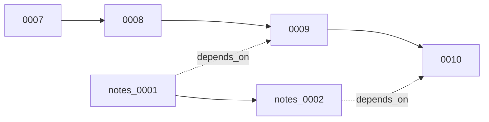

# 数据库结构与迁移

平台迁移平铺在 `versions/`，每个业务的迁移在 `businesses/<namespace>/`，各自是一条 Alembic 线性链，共用 `keystone.alembic_version`，见[平台链与业务链](#平台链与业务链)。每份迁移显式声明字段、约束和索引，不导入运行时 ORM，也不调用 `create_all`。

## 当前基线

| 文件 / Revision | 模块 | 表 |
|---|---|---|
| `0001_identity_initial.py` / `0001` | 身份与权限 | users、roles、user_roles、role_permissions、login_sessions、personal_access_tokens |
| `0002_audit_initial.py` / `0002` | 审计 | audit_logs |
| `0003_dictionary_initial.py` / `0003` | 字典 | dictionaries、dictionary_items |
| `0004_files_initial.py` / `0004` | 文件 | files、file_references |
| `0005_model_access_initial.py` / `0005` | 模型接入与费用 | model_channels、model_entries、model_invocations、model_dispatch_scopes |
| `0006_flow_initial.py` / `0006` | Flow | flow_runs |
| `0007_worker_initial.py` / `0007` | Worker | worker_registrations、worker_heartbeats |
| `0008_environments_initial.py` / `0008` | 交互环境 | environments、environment_sessions |
| `0009_messaging_initial.py` / `0009` | 消息渠道 | message_channels、message_destinations、message_external_accounts、message_deliveries、message_inbounds、message_bind_codes、message_connections |

九份迁移依序维护 27 张领域表，平台 head 为 `0009`。身份基线的角色直接包含非空、默认 false 的全部权限标记，内置 admin 角色由初始化写入该标记。Files 基线直接创建可空的 `completed_at`、回收索引，以及删除失败计数和失败上传与 S3 删除墓碑的迟到残留检查计数，两者均为非空、默认 0、约束 0～3。模型接入基线直接包含火山方舟、百炼业务空间和费用预估字段及约束。

模型接入基线包含渠道凭据密文、操作声明（含 `text.embed`）、调用归属、费用与回执、受限结果证据、发送间隔/冷却表、NewAPI 渠道类型、可修改的模型显示名称，以及 Run 关联调用表达式索引。显示名称为空时按固定 key 展示；改名不改变 key、选择或历史调用。条目 `operations` 默认仅 `text.generate`，调用 `operation` 默认 `text.generate`、`result_context` 可空，不按模型名推断媒体能力。Flow 基线只保存运行快照、状态与协调字段，调用及用量统计使用实际模型记录。Worker 基线包含固定身份登记、心跳及其约束和索引。

## 初始化与已有数据库

新库执行 `keystone init`，一次建立完整业务结构、DBOS 的 `dbos` schema、文件存储与初始管理员。相同迁移链上重复执行保留已有数据和密码。API 和 Worker 的数据库就绪检查确认连通性和各链的版本记录。

合并后的基线用于新库初始化。沿用旧库前需核对实际结构，同号 revision 只表示版本记录。

旧库先停写并备份，在途执行由原制品收尾；旧格式记录保留在原库和原制品中。新库不提供旧快照、摘要或无归属调用的兼容恢复。需要迁入的基础业务数据按当前结构转换和校验，不直接导入旧执行记录。DBOS 与业务数据的联合保留见[备份恢复](../../docs/operations/backup-restore.md)。

Alembic 连接固定 `search_path=public`，只管理 `keystone` schema。DBOS 表及数据由执行引擎管理，业务迁移与回滚不修改它们。

## 平台链与业务链

Keystone 以上游平台仓库发布，每个交付项目是一个下游仓库，在 `businesses/<namespace>` 中加入自己的业务并定期合并上游。平台和每个业务各有一条迁移链，下游只新增自己的目录，不改动平台链，合并上游时不争用序号。分链前按单链部署的下游库不在平台范围内，由下游仓库自行改造。

| 链 | 目录与文件 | Revision | 依赖 |
|---|---|---|---|
| 平台 | `versions/NNNN_<module>_<change>.py`，Worker 使用 `worker` 前缀 | `NNNN`，与文件序号相同；不加分支标签 | `down_revision` 指向平台链的前一个 revision，不依赖任何业务 |
| 业务 | `businesses/<namespace>/NNNN_<change>.py` | `<namespace>_NNNN`；首个 revision 带分支标签 `<namespace>` | 链内线性；首个 revision 的 `down_revision` 为空，`depends_on` 为生成时的平台 head。之后需要更新的平台结构时，在该迁移的 `depends_on` 中写明对应的平台 revision |

| 规则 | 内容 |
|---|---|
| 登记 | 业务链在 `keystone.model_registry.MIGRATION_CHAINS` 中显式列出命名空间，API、Worker 与 CLI 把它们作为 Alembic 的 `version_locations` 传入；不扫描目录，未登记的目录不加载，登记了但目录不存在时启动失败 |
| 命名空间 | 与业务模块相同，小写字母开头、`[a-z0-9_]`，最多 27 字符（Alembic 的 revision 列为 32 字符），不能重复 |
| 序号 | 每条链从 `0001` 连续递增，文件名序号与 revision 一致；达到 `9999` 时先调整规范 |
| 依赖方向 | 平台迁移不引用业务；业务迁移可以外键引用平台表，但必须用 `depends_on` 声明所需的平台 revision，由 Alembic 决定执行顺序。`depends_on` 只能指向平台 revision |
| 版本记录 | 共用 `keystone.alembic_version`。Alembic 只记录未被其他链依赖覆盖的 head：业务 revision 依赖平台 head 时，只记录业务那一行 |
| 初始化与就绪 | `keystone init` 先校验各链再升级到全部 head（`heads`）；API、Worker 与 CLI 按同一规则计算期望的版本记录，与数据库完全一致才视为就绪 |
| 只追加 | 进入上游 main 的平台迁移不再合并进基线、不改号、不删除，下游合并上游后平台链与上游完全相同。业务链在下游仓库内同样只追加；删除表也通过新迁移完成 |
| 回滚 | 按链回滚，例如 `<namespace>@-1` 或 `<namespace>@base`；回滚平台迁移前，依赖它的业务迁移须先回滚 |

必须成立的性质：

- `init` 前拒绝不符合上述规则的链：文件名与 revision 不一致、序号不连续、链内分叉、平台依赖业务、业务依赖其他业务或重复声明分支标签。
- 同一制品的任一数据库，`init` 后每条链都处于本制品的 head；缺链、多出的链或落后的链都让就绪检查失败。
- 合并上游不改变下游已有的任何 revision ID；平台链在所有下游中含义相同。
- 移除整个业务时，先回滚或以新迁移删除其表，再从登记中移除，不留下数据库中有记录而制品中没有的链。

`scripts/new_business.py` 在 `businesses/<namespace>/` 生成 `0001_initial.py`，含建表与逆序回滚，`depends_on` 取当前平台 head。它只读取平台迁移的静态字面量元数据（支持普通及带类型注解的赋值），在写业务文件前检查平铺路径、命名、重复序号/revision、序号连续性和线性依赖，不导入或执行历史迁移。`--migrations` 指向包含 `versions/` 与 `businesses/` 的迁移根目录，默认 `backend/migrations`；空目录仅用于独立评审或测试。业务链已有迁移时不重新生成，仅补回代码可用 `--no-migration`；之后的业务迁移按链内下一序号手工追加。生成后把命名空间加入 `MIGRATION_CHAINS`，接入步骤见[业务扩展](../../docs/development/business.md#接入实体与迁移)。

平台与业务模型由 `keystone.model_registry.load_models()` 显式加载，bootstrap 与 `env.py` 共用该入口；业务实体共享 Base/keystone schema，模型注册不导入 API、workflow 或初始化数据。

验证覆盖迁移发现、安装后定位、链校验、业务链与平台链的版本记录、脚手架、逐模块建表与回滚、完整结构和 ORM 一致、重复初始化、从最早基线到 head 的升级、调用/费用/恢复证据与 Flow 数据保留。数据库测试及回滚仅在随机隔离 PostgreSQL 库执行。

## 目标与当前实现差异

| 目标 | 当前实现 |
|---|---|
| 进入上游 main 的平台迁移只追加 | 已有基线曾合并未发布的迁移；规则从分链起生效，未在发布流程中自动检查 |
