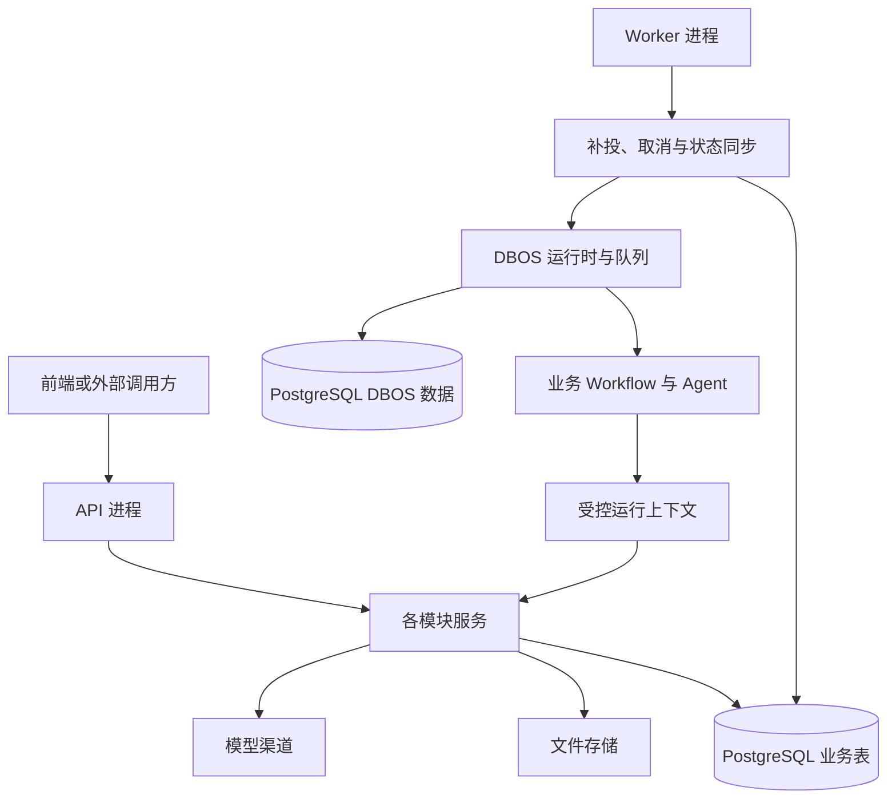

# Keystone 整体架构

采用模块化单体，字段、权限和生命周期见[领域文档](README.md#按领域阅读)。

## 1. 整体形态

采用模块化单体：一套 Python 代码、同一发布版本，启动 API 和 Worker 两种进程，共享 PostgreSQL、文件存储和必要的渠道配置。模块之间通过进程内服务调用协作，不通过内部 HTTP 转发。

API 处理认证、管理、普通业务请求和 Flow 受理；Worker 执行 DBOS 流程及必要的后台维护。首版只有一个 Worker，内部限制并发。DBOS 是 Worker 使用的执行库，不额外部署一套编排服务器。



图中的服务在两个进程中分别装配实例，共用代码而非内存对象。业务表和 DBOS 数据使用同一 PostgreSQL 数据库中的独立命名空间；DBOS 数据由其自身管理，业务模块不直接修改。

## 2. 模块边界与调用关系

| 模块 | 拥有的数据与职责 | 对外提供什么 |
|---|---|---|
| identity | 用户、角色、授权、会话和个人令牌 | 身份解析、当前权限判断、身份管理 |
| dictionary | Dictionary、DictionaryItem，平面的业务选项配置 | 字典管理、可选项查询、所属字典与可选性校验、历史名称解析 |
| files | File、FileGrant、FileReference，文件存储适配 | 上传下载、授权、引用登记与解除、内容清理 |
| model_access | Channel、ModelEntry、ModelInvocation，渠道适配 | 模型调用、调用记录、费用查询和余额刷新 |
| audit | AuditLog | 在调用方事务内追加日志，授权后的日志查询 |
| flow | Definition 目录、FlowRun，DBOS 接入 | 发起、查询、取消、执行上下文和状态同步 |
| 具体业务 | 业务实体、业务规则、Workflow、Agent 与 Skills | 业务用例、结果采用和业务查询 |

调用遵循以下规则：

- API 路由只处理请求解析、认证和响应映射，调用所属模块服务；领域规则不写在路由中。
- dictionary、files、model_access、flow 使用 identity 的当前权限判断，并自行检查对象访问范围。所有模块的关键变更通过 audit 写入日志。
- 业务通过 dictionary 服务校验选项所属字典和可选性，在自身字段保存 DictionaryItem.id；字典模块不反向依赖业务表。字典只停用、不删除，历史引用仍可读取；平台固定枚举继续由代码定义，细节见[字典领域](domains/dictionary.md)。
- dictionary:read 保护独立目录和通用字典查询。已授权业务可解析所引用选项、查询服务端限定字典的选项并校验业务写入，无需额外字典读取权；客户端不能借业务入口指定任意字典来枚举。复用已有业务服务，不建立代理层或逐字典授权表。
- flow 通过 files 和 model_access 的公开服务提供运行能力。后两者不依赖 FlowRun 表，也不反向调用 Flow 服务；模型调用关联只接收可信上下文中的标识。
- 跨模块查询在入口组合各模块授权：Run、模型调用明细/费用、文件内容分别判断，不能因 Run 可见而一并开放。步骤接口只返回白名单过程信息，不透传引擎检查点和原始消息；完整规则见 [Flow 权限](domains/flow.md#4-权限与审计)。

- 具体业务可以直接使用底座模块，不必把每个操作包装成 Flow。业务流程通过受控上下文使用文件、模型及自己的业务服务，不直接修改其他模块的表。
- audit 的写入入口只接受明确的操作事实和事务，不反向调用业务服务。审计查询在入口检查 identity 权限，避免让所有日志写入都产生反向依赖。

文件领域仅对内置管理员的 inspect/manage 免除对应 FileGrant；内容读取仍需显式授权，凭据范围与生命周期检查不变。这不是全平台的管理员绕过规则。FileReference 的增删由所属业务授权，文件管理权不能解除业务引用；详见[文件领域](domains/files.md#22-文件授权-filegrant)。

身份、字典、模型配置各自保留已确定的启停规则，文件另有不可逆删除生命周期，不统一抽象软删除或通用资源生命周期。Channel、ModelEntry 只停用不删除；模型调用、配置管理/余额与调用历史分别授权，见[模型接入](domains/model-access.md#4-权限与审计)。

模块可以共享数据库事务，但各模块仍负责自己的数据操作。跨模块获取数据走明确的服务方法，不通过到处导入 ORM 模型绕开权限和生命周期规则。业务模块保存自身实体和 run_id，Flow 不保存素材审核状态、合同状态等业务结论。

角色删除、业务采用结果、历史清理等跨模块用例由 bootstrap 装配的上层用例服务协调，依赖各模块的明确服务入口；路由只转交请求，领域内部不反向导入调用方。例如角色删除先检查 identity 的用户分配和 files 的角色授权，再同事务删除角色及自身权限配置；不能级联删除文件授权。模型记录与 PAT 清理需要 Flow 保留检查时也由上层协调，不让这些底层模块反向依赖 Flow。首版不建通用 guard 注册机制或跨领域引用表。

当前角色删除已落到 use_cases.RoleDeletion，由 Runtime 显式装配 identity/files 服务；身份排他锁覆盖检查、删除与审计提交。文件修改和删除只返回 ID 回执，完整元数据仍由独立的 inspect 权限控制。

## 3. API 与 Worker 的分工

| 事项 | API | Worker |
|---|---|---|
| 认证与管理 | 登录、用户角色、字典、文件和渠道管理等请求 | 不提供另一套登录或管理接口 |
| 字典查询与校验 | 提供选项查询、历史名称解析；业务保存时调用字典服务校验 | 没有专用字典任务；业务确需使用时调用同一服务 |
| Flow 目录 | 加载轻量 Definition 与输入输出契约 | 同时加载匹配的 workflow、Agent、工具和资源 |
| 发起 Flow | 校验并持久化 pending Run，返回 run_id | 扫描待提交记录，按固定 ID 入 DBOS 队列 |
| 执行 Flow | 不启动执行器，不在请求后台协程中运行流程 | 执行普通步骤与 Agent，处理检查点和恢复 |
| 查询 Flow | 检查各项访问权；步骤详情通过只读 DBOS 客户端转换为白名单视图，不启动执行器 | 核对 DBOS 状态，更新快照与 observed_at |
| 取消 Flow | 按当前请求身份校验，首次保存取消意图与实际操作者审计；权限组合见 Flow 文档 | 处理已受理取消意图，调用 DBOS 并同步确认状态 |
| 手动余额刷新 | 检查 model:manage，事务外有界查询并保存结果，同步返回；不创建后台请求 | 首版无定时刷新任务 |
| 后台维护 | 文件删除持久化为 deleting；其他已确定操作通过对应服务处理 | 扫描已有持久状态，调用清理、费用补查和结果补全服务；不依赖 API 内存队列 |

**首版统一由 Worker 提交 DBOS，不让 API 同时承担即时投递。** 这样 API 成功受理后即使退出，Run 仍能被发现并执行；Worker 不可用时保持 pending。少量扫描延迟是明确接受的取舍，不增加消息代理或投递表。

取消按当前请求身份，后续业务执行按原运行身份，已受理意图由 Worker 执行；重复与终态行为见 [Flow 取消](domains/flow.md#32-取消)。

Worker 同一进程内运行 DBOS 和有界的维护循环，扫描采用小批次、超时与失败退避。慢文件清理或渠道查询不能阻塞 Flow 状态同步。模块内部维护不必创建用户可见 FlowRun，也不新增通用 Job 领域。

API 与 Worker 使用一致的配置定义和构建版本，但连接池、SDK 客户端各自在进程启动时创建。API 无需导入重型 Agent 执行模块；流程目录用显式注册和稳定入口关联执行代码。Worker 才启动 DBOS，API 扩容不会增加执行器。

首版 Worker 使用固定 executor ID，由进程管理器保证单实例并在故障后重启。部署禁止同身份新旧 Worker 重叠运行；停止时先停止领取新任务，有限等待在途任务，再关闭客户端和连接。未完成运行保留恢复依据，不能在退出时全部标记失败。

迁移作为部署步骤执行，API 与 Worker 启动时检查数据库版本，不各自争抢迁移。代码发布前处理不兼容的未完成运行；首版不做多版本并行 Worker。默认开发中 Compose 只启动 PostgreSQL；在本机手动执行 keystone init 后，分别启动 API、Worker 和前端。初始化不创建模型配置。Worker 的 Flow 可用性通过日志及运行验证。

首版采用停写联合备份：完整数据库同时包含业务、版本和 DBOS 数据，与同一窗口的文件卷（内容、卷标识和永久锁文件）、原镜像和运行配置成套保存。恢复到新项目，先恢复原版本，再按发布流程升级；不增加备份领域或服务。ready 不扫描历史文件，不能替代恢复后字节/授权/Flow 核对；会话/PAT 也回到备份时点，真实上游副作用不会随数据库回滚。具体操作与边界见[联合备份与恢复](backup-restore.md)。

Worker 默认每 5 秒向 PostgreSQL 的 worker_heartbeats 运行观测表上报状态，core/worker_health.py 管理写入、数据库时钟下的新鲜度判断及只读探针；Flow 执行器通过进程内 Event 通知就绪。独立心跳循环持续上报启动中或未就绪状态，维护检查过期不再认为就绪；实例 ID 防止旧进程退出覆盖新进程状态。API `/api/v1/worker/status` 提供就绪与最近心跳，console 定时刷新；API ready 保持原有依赖检查含义。无需文件探针配置、Redis 或新服务，具体故障语义见[开发说明](development.md#worker-健康检查排障)。

## 4. 事务、身份与外部调用

最外层用例服务控制事务，需要原子完成的数据库操作接受同一事务；接受调用方事务的内部方法不擅自提交。例如业务保存附件时，业务记录、FileReference 和对应审计一起提交。直接传递现有数据库会话即可，不预建通用事务框架。

文件上传、模型发送和余额刷新属于含外部 I/O 的用例，分别编排自己的短事务，不接受一个包含未提交业务变更的外层事务并将其顺带提交。业务先完成必要的上传/调用，再在短事务中保存业务记录与引用；Flow 产物的上传确认、引用及审计由其完成阶段的同一短事务保存。业务保存失败不会撤销已发生的上传或收费，后续按已有文件/调用记录处理。共享事务约束与发送前必须提交调用记录并不冲突。

Flow 发起事务包含 Run、输入文件引用和发起审计；事务提交后由 Worker 入队，两者不假定原子。重复投递沿用 `flow:<run_id>`，由 DBOS 按固定身份处理。结果同步时，Run 的结果、输出文件引用在同一业务事务保存；具体业务采用结果另按 run_id 与稳定操作键去重。

Flow 受理幂等保证窗口从 Run.created_at 起算，使用平台公开约定（当前 7 天），不新增过期字段或永久幂等表。窗口内必须保留原 Run；窗口外原记录仍在时继续去重，清理后不再保证识别旧请求。调用方只在窗口内自动重试，主动重新执行使用新键。清理须同时满足窗口已过、历史保留期已满、Run 已终态及无未完成恢复/协调事项；确定并告知窗口和保留策略前不启用自动 Run 清理。请求摘要中的凭据标识使用 PAT ID 或会话请求的空值，不包含 Cookie 或会话 ID。

输入、中间产物与输出都通过 FileReference 保留到 Run 清理，产物上传成功与使用引用登记同事务确认。业务采用时，将业务记录与业务自己的引用原子保存，新增引用而不转移 Flow 引用；清理 Run 只释放该 Run 的引用，不删除文件内容。采用与清理由上层用例协调事务，避免业务记录已提交却没有文件引用；仍有业务引用的文件继续受保护，详见[文件引用生命周期](domains/files.md#32-flow-文件引用与业务采用)。

外部文件存储、模型 HTTP 请求和数据库事务分开处理，不持有数据库事务等待长时间网络请求。文件删除记录请求与确认完成两个阶段；模型调用在发送前登记本地尝试，登记不证明实际发送或上游接受，未知结果不等于未计费。响应后的记录补全失败不能触发重新调用。取消流程也不能撤回已发生的外部副作用，细节沿用各领域文档。

文件在 deleting 或内容清理失败时保留已有授权；确认存储清理成功后，同一事务设置 deleted、deleted_at，清除全部 FileGrant 并保存完成审计。删除过程与完成后都禁止新增授权。完成审计可合并记录授权清理范围，无需逐授权复制事件；不增加失效授权状态或表。

Flow 受理时将固定的非秘密模型选择写入已有 input，执行时不跟随当前 key 映射；发送前仍检查当前授权、原配置状态与地址一致性。文件恢复上传通过 File 的 upload_key、upload_digest 去重；模型恢复使用每次持久请求的稳定 ModelInvocation.id 原子登记防重发。已有调用记录但缺少可恢复结果时停止执行，不额外建立发送意图表，具体边界见[模型接入](domains/model-access.md#35-flow-模型请求的恢复与防重发)。

API 从会话或个人令牌构造可信身份。Worker 从 Run 恢复原始发起人和可空的个人令牌关联，在新的受保护操作前检查当前用户权限及原令牌限制，不保存用户权限快照。首版每个请求/受保护操作加载当前授权，不跨请求、步骤缓存权限，不引入策略广播或另一份可编辑 Casbin 策略库；凭据生命周期与管理员保护见[身份领域](domains/identity.md#4-权限与审计)。进程拥有的存储或渠道凭据不代表用户获得所有权限。内部清理使用受限 system 身份，审计保留真实执行主体。

审计记录实际执行身份：会话和 PAT 请求记录当前用户，管理他人凭据记录实际管理者，所属用户只作为目标信息；代表用户执行的 Worker 业务操作仍记录用户，平台维护、后台删除确认和结果同步记录 system。原发起人通过 run_id、目标和关联日志追溯，不增加 operator_id/initiator_id，也不把所有 Worker 操作统一标为系统行为。

异步阶段依靠 file_id、run_id 等稳定目标及操作代码关联；correlation_id 可选，不要求从 API 请求跨重启永久传递。文件创建即建立默认授权，未完成内容由状态限制读取；引用新增与解除分别遵循文件使用资格和所属业务授权，不通过文件管理员例外绕过业务保留。

撤权阻断新模型请求、文件访问或上传以及业务写入；已发送请求的结果与费用、DBOS 已完成运行的终态与结果仍继续保存。Worker 使用受限 system 能力同步既有事实，仅对该 Run 可信结果、原输出契约及已登记使用关系的文件补齐引用；仍检查文件存在与可保留状态，不新增授权或开放任意跳过权限入口。业务采用、发布和用户查询下载继续检查当前权限，首版不增加自动业务投影机制。详细边界见[Flow 结果同步](domains/flow.md#35-结果同步与文件保留)。

个人令牌失效与记录清理分开：仍被保留的 Run 引用时不能物理删除，也不能清空关联来改变运行身份。历史清理暂不纳入首版，不设定保留天数或维护入口，出现实际容量或运维需求后再评估。未来清理须协调凭据、运行、DBOS 历史与模型防重发记录，由上层用例通过模块服务处理，不要求底层模块反向调用 Flow。

Flow 上下文只提供需要的 files、models 和业务服务能力。Agent 提示词、工具参数和 Skill 文本不能决定身份。运行时客户端及密钥不进入输入输出或检查点；Agent 内部恢复边界沿用 [Flow 设计](domains/flow.md#34-在业务步骤中执行-agent)。

## 5. 仓库结构与扩展边界

keystone/ 是独立仓库根目录。一个 Python 后端工程，多个按需建立的独立前端工程；API 与 Worker 是同一后端工程的不同运行入口。以下为已确定的结构；具体目录按已实现功能建立：

```text
keystone/
├── backend/
│   ├── Dockerfile             # API、Worker、CLI 共用镜像
│   ├── .dockerignore
│   ├── pyproject.toml
│   ├── uv.lock
│   ├── src/keystone/
│   │   ├── entrypoints/
│   │   │   ├── api.py           # HTTP 服务启动与生命周期
│   │   │   ├── worker.py        # DBOS 与维护循环启动
│   │   │   └── cli.py           # 迁移、管理员初始化等命令
│   │   ├── bootstrap.py        # Runtime 与 HTTP 生命周期
│   │   ├── composition.py      # 权限、审计与 Flow 的显式装配
│   │   ├── model_registry.py   # 应用与迁移共用的 ORM 加载入口
│   │   ├── use_cases.py        # 明确的跨模块用例：角色删除
│   │   ├── core/               # 配置、数据库、日志、错误
│   │   ├── platform/
│   │   │   ├── identity/
│   │   │   ├── audit/
│   │   │   ├── dictionary/
│   │   │   ├── files/
│   │   │   ├── model_access/
│   │   │   └── flow/
│   │   └── businesses/         # 具体业务模块
│   ├── migrations/             # 一条 Keystone 业务迁移链
│   └── tests/                  # 按模块和跨模块场景组织
├── frontend/
│   ├── console/                # 首版平台控制台
│   │   ├── Dockerfile          # 控制台构建与 Nginx 入口
│   │   ├── .dockerignore
│   │   ├── docker/nginx.conf   # 镜像内的静态资源与 API 入口配置
│   │   ├── package.json
│   │   ├── pnpm-lock.yaml
│   │   └── src/
│   └── <business-app>/         # 按需新增的独立业务前端
├── deploy/
│   └── compose.yaml            # 第三方依赖
├── docs/
├── .gitignore
└── README.md
```

backend/ 内维护唯一后端依赖与锁文件，frontend/ 下每个应用维护自己的依赖、锁文件、构建和测试。Dockerfile、.dockerignore 和镜像入口配置随各自工程维护，使用工程目录作为构建上下文。首版只创建 console，不创建占位业务前端、pnpm workspace 或共享前端包。业务前端数量与后端业务模块数量不要求一致。deploy/ 负责第三方依赖编排，不容纳领域规则；docs/ 是当前设计唯一维护位置。

当前已实现 platform/identity、audit、files、dictionary、model_access、flow 及 businesses/document_review。API 显式注册路由和轻量流程目录；Worker 才导入执行代码，运行有界文件清理和 DBOS。CLI 提供 init/migrate/migrate-flow/revision/check/init-admin/init-storage；console 提供账户、文件、字典、模型及 Flow 基本操作。初始迁移按 identity、audit、dictionary、files、model_access、flow 分为六份，保持一条链，追加渠道凭据和 Worker 心跳迁移后，当前 head 为 0008_worker_heartbeats，文件多源字段包含在 0004_files 初始结构中；keystone schema 包含十六张领域表和一张 Worker 运行观测表，DBOS 自管 dbos schema。迁移对应关系与增量维护规则见[迁移说明](../backend/migrations/README.md)。业务前端仍按需建立。具体运行方式与部署边界见[仓库说明](../README.md)。

CLI 另提供 recover-model-calls --confirm-api-stopped：操作者停止全部 API/普通调用进程后，显式将普通遗留 running 调用收尾为 unknown，保留费用与编号并记录系统审计。确认标志不代替进程检测；恢复期间保持 API 停止。Flow 调用继续由持有单 Worker 排他锁的启动恢复处理，不新增后台超时扫描器。详细边界见[模型离线收尾](domains/model-access.md#75-普通-api-调用离线收尾)。

model_access 复用 Ether 的受控 SDK 传输思路：发送边界重新认证，原子登记 ModelInvocation 并提交后才发送，关闭 SDK 重试。模型响应与费用在独立短事务补全，不保存提示词和输出；配置变更与审计同事务。手动余额刷新在 API 内完成，同渠道用数据库会话锁串行协调，外部 I/O 不占用业务事务；费用补查直接更新原调用记录。模型始终使用真实服务，当前只支持 OpenRouter 官方地址、固定推理/账务路径，关闭网络层重试、跳转和环境代理。推理与账户余额使用独立 API Key，由控制台写入数据库密文，不增加表或网关服务。API/Worker 共用数据库及协调目录中自动生成的加密密钥；测试传输仅在测试进程注入，不随应用发布。Agent 每轮请求共享发送边界，DBOS 持久步骤派生稳定调用 ID；未知响应或成功记录缺少检查点时均拒绝重发。配置与能力见[模型接入](domains/model-access.md#77-openrouter-接入)。

文件通过 OpenDAL 访问 FILE_STORAGES 中显式声明的 filesystem/S3 源，FILE_COORDINATION_ROOT 独立指定协调目录；两者不互相推导。File.storage_key 由上传服务写入并按源路由，fingerprint 固定原位置身份。每个 File 对应一份内容，业务维护两个 File 的备份关系，不增加 FileReplica 或源管理表。API 与 Worker 使用同宿主共享协调卷及独立 LocalLeases 文件锁。存储 I/O 在短数据库事务之外，上传重试保留 File 与现有授权；删除受理由 API 写 deleting，Worker 确认内容移除后同事务写 deleted、清授权和审计。失败/中断上传保留元数据供恢复；不自动删除所有无引用文件。文件行锁协调引用与删除，角色删除和授权新增继续由身份事务锁及外键保护。初始化卷由一次性 CLI `keystone init` 完成，不由 API 启动隐式完成；就绪检查包含卷标识校验。S3 支持同内容幂等重写及 deleted tombstone 定期复核清理，远端物理删除为最终清理语义；详细边界见文件领域第 7 节。仍只支持可靠本地协调锁，不支持 NFS 或多宿主部署。

字典是进程内普通服务，不依赖 Worker。业务在已有授权与保存事务内调用选项校验，字典与选项编辑统一先锁父字典行，使启停与选择按事务顺序生效。通用查询要求 dictionary:read，业务限定范围内调用不增加字典读取权限要求；不开放客户端跳过授权参数或动态代理层。

身份模块向其他领域提供当前授权加载与短事务访问入口。角色/权限只来自本库，Casbin Enforcer 不跨操作缓存；身份读取/写入通过共享/排他 PostgreSQL 事务锁协调。密码哈希在写事务外处理并在写入前复查。审计入口由调用方显式传入事务，成功日志不独立提交；API 的 Cookie/CSRF 保护留在 HTTP 边界，Worker 使用从 Run 恢复的可信运行身份，不模拟浏览器 Cookie。

### 5.1 后端模块与业务 Flow

有接口和持久化对象的模块统一使用 controllers/、services/、models/、schemas/ 四个包，按领域放在一起；六个平台领域已按此整理，一个持久化实体一个文件。HTTP 路由由 Controller 声明，API 入口统一注册；entrypoints 只处理启动与生命周期。core 只放技术设施和通用契约基类，不接收业务规则。具体职责、依赖和风格见下方模块规范。

一个业务集中保存自身模型、服务、接口和流程。例如以下为业务出现后的组织方式，不预建视频业务：

```text
businesses/media_selection/
├── catalog.py                 # 按需声明业务权限和审计动作
├── models/
├── schemas/
├── services/
├── controllers/
└── flows/
    └── select_material/
        ├── definition.py       # 轻量目录定义
        ├── contracts.py        # 输入输出契约
        ├── workflow.py         # 编排入口
        ├── steps/
        ├── agents/
        └── resources/          # 提示词、Skills 等
```

platform/flow 管运行记录、权限、补投、取消和同步；业务 flows 管步骤、Agent、工具、分支与业务结果。新增流程在 composition.py 显式注册契约和执行导入，不修改平台执行器，也不扫描任意 Python 路径或动态安装插件。简单流程仅保留定义、契约和 workflow，复杂后再拆目录。

bootstrap 按进程职责显式装配：API 加载模块路由和轻量 Definition/契约；Worker 加载匹配版本的 workflow、Agent、资源和维护任务。平台不反向导入具体业务，业务通过公开服务或受控 Flow 上下文使用平台能力，不能直接修改平台表。简单业务直接传递明确服务对象；未来确有独立交付需求时再提取业务包，不预建插件容器或独立 SDK。

### 5.2 独立前端应用

console 提供用户、角色、字典、文件、模型渠道/费用、审计和 Flow 运维页面，也可按需加入业务管理页面；business-app 提供实际用户的业务操作、流程提交和结果展示。一个业务前端可以覆盖多个业务，不要求与后端模块一一对应。

各应用独立构建与部署，共用后端身份与权限。独立代码工程不要求使用不同域名：首版可以通过同一反向代理分别提供 /console/、业务路径和 /api/，沿用同源 Cookie 认证，浏览器路由与资源 base 按挂载路径配置；如以后分离域名，再明确 Cookie、CSRF 和跨域部署规则，不因此默认引入 SSO。

console 使用 `router/index.ts` 集中定义路由、导航与会话守卫，按页面懒加载。`App.vue` 提供全局 UI 配置，`layouts/ConsoleLayout.vue` 维护可折叠侧栏、移动导航、面包屑和账户菜单；登录、个人中心为独立路由。`stores/session.ts` 负责身份/权限与会话恢复，`api/client.ts` 统一处理 Cookie、CSRF、HTTP/流内 401/403 和过期请求结果，其余 `api/` 文件按领域维护请求及类型。页面共用 `composables/` 中的分页及请求代次处理，直接读取共享身份。不引入 Pinia、共享前端包或新的后端聚合接口。

`views/<页面>/` 保存路由页面（如 `UsersView.vue`），页面私有组件放在同目录的 `components/`，页面专用配置也就近维护；没有私有组件时不建空目录。顶层 `components/` 仅保留共用的弹窗、选择、分页、状态等基础组件，以及 `components/models/` 中被模型页面和 Flow 业务表单复用的选择器、费用展示。页面之间不导入其他页面的私有组件，按实际复用提取共享组件，保持目录层级简洁及组件名明确。

`plugins/element-plus.ts` 集中注册 Element Plus 基础组件，`styles/index.css` 定义主题与布局；编辑使用 `AppDialog`，运行、调用和引用详情使用抽屉。`AppSelect` 保留原生 form 必选校验，分页保持接口支持的上一页/下一页。领域表单直接维护字段，不增加 schema 表单或通用 CRUD 框架。概览展示 API 健康/就绪和独立的 Worker 心跳状态，不通过 API 就绪推断 Worker 在线。个人中心在切换页签或身份变化时清理密码、权限选择和令牌明文。

表格使用自动布局、原生滚动条和 `fit=false`，表体通过 CSS 至少填满容器。避免组件在 ResizeObserver 回调中同步调整列宽；手机缩放和侧栏切换由浏览器布局处理。

文件授权使用文件专用组件，目录可读时选择用户/角色，不可读时输入已知 ID；授权管理与内容读取继续独立校验，引用界面仅展示 owner/slot，解除由所属业务负责。字典采用目录加选项区域和独立编辑弹窗，完整保存允许编辑的字段，区分父字典停用与选项自身停用。两者继续直接调用现有 API，不增加通用资源授权层、前端聚合接口或实体状态字段。

模型接入按配置、模型调用和历史权限分别加载；选择器支持分页，历史列表与汇总共享时间/渠道/运行筛选，费用组件与 Flow 共用，始终按渠道和单位展示。Flow 采用独立发起和详情抽屉，保留本页幂等请求，未完成运行有界轮询；步骤或费用查询失败单独展示，不更改 Run 状态。停止接收不等于取消模型执行，Flow 取消则等待 Worker 确认；页面不提供重发未知调用或绕过文件授权的入口。

导航按读取权限显示，写操作按具体权限显示；无读取权限时不挂载对应页面。强制改密先进入账户页，身份变化后清理旧表单和数据。前端控制只改善交互，API 继续执行功能权限、对象范围和并发保护。后台补齐不改变六领域边界、十六张表、API/Worker 进程组织或审计操作名。

### 5.3 代码工程与部署单元

| 部署单元 | 代码来源 | 首版组织 |
|---|---|---|
| API | backend，entrypoints/api.py | 一个常驻进程，受理 HTTP、管理与业务请求 |
| Worker | 同一 backend，entrypoints/worker.py | 一个常驻进程，执行 Flow/Agent 与有界维护循环 |
| CLI | 同一 backend，entrypoints/cli.py | 一次性迁移、初始化命令，不是第三个常驻服务 |
| 控制台与业务前端 | frontend 下各自工程 | 分别构建静态资源，由入口服务器提供；业务应用按需增加 |
| PostgreSQL 与文件存储 | 部署设施 | API/Worker 共享；文件内容支持本地/S3 多源，协调卷仍限同宿主 |

API、Worker、CLI 共用镜像与后端依赖，通过不同命令启动；不因进程分离建立内部 HTTP 调用。API 受理 Flow 后提交业务记录，Worker 通过已有记录协调执行。维护循环与 DBOS 同处 Worker，不单独部署调度器。以后扩容 API 或 Worker 分别处理统一限流、执行器恢复和版本协调，不需要因进程数变化重排领域目录。

### 5.4 模块分层与代码规范

采用 MVC 职责划分，通过 Service 承载业务用例。Vue 页面承担 View；后端 schemas/ 负责输入输出契约及响应投影。领域目录保持聚合，六个平台领域统一使用四个包，具体业务增加接口或持久化对象时遵循同样规范。

```text
platform/identity/
├── controllers/                auth.py、users.py、roles.py、tokens.py
├── services/                   auth.py、users.py、roles.py、tokens.py
│                               credentials.py、initialize.py 为内部用例
├── models/                     一个持久化实体一个文件
│   ├── user.py
│   ├── role.py
│   ├── user_role.py
│   ├── role_permission.py
│   ├── login_session.py
│   └── personal_access_token.py
├── schemas/                    按资源归组输入与响应，types.py 放共用标量约束
├── access.py                   AccessContext：身份、事务、权限与审计上下文
├── dependencies.py             HTTP 身份提取、Cookie/CSRF 与上下文装配
├── policy.py                   身份授权规则
└── security.py                 密码、摘要与登录限流
```

| 层 | 负责 | 不负责 |
|---|---|---|
| Controller | APIRouter、参数绑定、取得服务、Cookie/CSRF、状态码、SSE 和文件 HTTP 传输 | 直接查询 ORM、开启事务、实现业务授权或跨领域协调 |
| Service | 业务规则、功能和对象权限、事务、审计、查询及调用适配器 | 接收 Request/Response、依赖 FastAPI、导入 Controller |
| Model | SQLAlchemy 实体、字段、关系、约束与索引 | HTTP 处理、调用服务或供应商 |
| Schema | Pydantic 输入约束、明确字段的响应投影及序列化 | 查询数据库、开事务、调用服务、遍历 ORM 列自动扩展响应 |

依赖方向为 Controller → Service → Model/适配器；Controller 和 Service 均可使用 Schema。通用 Input 位于 core/schemas.py。每个 models/*.py 只定义一个持久化实体，关联实体也独立；models/__init__.py 显式导出全部实体，供迁移元数据注册，不执行初始化业务。schemas/__init__.py 仅导出契约，UserCreate/UserUpdate/user_view 等同一资源的契约放在一起。

统一约定：

- Controller 和 Service 按资源或用例职责拆分，不按表机械生成接口。小模块采用相同目录，目录内可以只有一个文件。无 HTTP 或 ORM 职责的业务流程仍只保留 contracts/workflow 等实际需要的文件。
- 每个 Controller 文件导出 router，用带类型标注的 `_service(request)` 获取服务；controllers/__init__.py 只聚合路由，由 bootstrap 注册。HTTP 请求体读取、Cookie/CSRF 和 SSE 编码留在边界。
- AuthService、UserService、RoleService、TokenService 组合 AccessContext；只有密码相关服务接收 Passwords。其他领域直接使用 AccessContext，不依赖身份管理服务。ExecutionIdentity 仅重写 authorize(session) 解析 Run 执行身份，共用 access 的事务、身份锁、会话限制、权限检查、失败审计及冲突转译，不吞掉不支持的参数，不继承账户管理能力。
- 权限、事务和成功审计一起提交；AccessContext 继续维护共享/排他身份锁及失败审计。上传预检和实际写入均校验授权；Flow 步骤、费用查询保留前后授权复查。
- 跨领域组合使用明确服务入口，RoleDeletion、FlowCosts 仍放 use_cases.py 并由 bootstrap 装配。同事务内部方法可以接收调用方 session，明确授权和锁前提，不自行提交或嵌套另一事务。
- Flow 模型选择由 model_access/services/entries.py 的 select_model 执行；Flow 保留输入映射和错误契约。Flow 模型调用的启动收尾由 model_access/services/recovery.py 的 recover_interrupted_calls 执行，仅在 Worker 获得独占锁后调用。文件引用写入及有效使用记录检查归 files/services/references.py，Flow 仅提取输出文件 ID 并固定 owner/slot。
- 响应投影显式列出字段，不能因新增 ORM 列扩展接口；角色权限先由服务读取，再交给 Schema 投影。费用 Decimal 字符串、Flow UTC 时间和既有最小回执保持不变。
- 存储、渠道和 DBOS 继续由 storage.py、gateway.py、engine.py 等明确适配文件负责；模型发送位于 model_access/services/runtime.py，文件清理位于 files/services/cleanup.py。不增加 BaseService、通用 CRUD、Repository 或动态模块扫描。
- 文件和函数使用 snake_case，类型使用 PascalCase，公共边界优先标注类型；遵循 Python 3.12、Ruff 100 列和导入排序，异步服务不直接执行阻塞 I/O。

共用规则只保留小函数或静态声明：审计与模型历史通过 core/time_range.py 解析带时区的闭区间，默认截止为数据库当前时间，默认起点为截止前 30 天，最多 366 天；审计事件时间也由数据库生成。模型渠道、官方地址、路径与 HTTP 方法由 gateway.SUPPORTED_TARGETS 统一声明，目录过滤和临发送校验共用，查询目录不能替代发送校验。普通 API 离线恢复与 Worker 启动恢复保留不同前提和记录范围，共用每批 100 条的状态更新及逐条系统审计，不重发调用。

Flow host 文件读取返回 bytes，由调用方指定 max_bytes；上传显式传入 content_type，可选 storage_key 指定产物源；读取仍按 File 的源路由。UTF-8 和 16 KiB 限制属于 document_review 示例。FileService.upload_referenced 只供可信业务调用，owner/slot 由服务端固定；Files 自己校验上传归属、幂等键与状态，在完成事务内保存引用，不把 ORM 实体通过回调交给 Flow。撤权或取消后的既有写入仍完成事实保存，返回结果前重新授权；文件域错误由 Flow 在输出协调边界转换为既有 flow_invalid_output。

模型 HTTP 与 Agent 入口共用 ModelRuntime 的发送核心和 classify_error 分类，沿异常因果链识别平台错误、SDK/Pydantic AI HTTP 错误与超时。明确 HTTP 4xx 拒绝记 failed，5xx、网络、取消及无法确认的结果保持 unknown；公开安全错误和持久状态来自同一次分类，不透传上游消息。Agent 使用 invoke_sdk(selection, invocation_id, sdk_request, flow_context)，无需构造公开 Invoke 的占位消息。费用补查协议归 providers.py，Service 保留授权、配置复查与事实保存。

Identity 通过 role_grants 一次联表读取当前角色权限，执行授权与管理目标检查共用读取结果；PAT 范围、强制改密和停用规则仍由各自调用方处理，不缓存授权。通用 utcnow 位于 core/time.py，各领域直接引用；历史窗口及审计事件的数据库时钟语义不变。

用户和角色列表在分页后一次读取当前页关联数据，空页跳过关联查询，保留管理员权限展开和未知权限过滤。Flow 的 engine.py 使用显式白名单投影 DBOS 安全错误码，覆盖模型执行边界；未知代码及原始消息统一投影为 flow_execution_failed。两项均留在现有服务或适配器中，不增加通用加载器、错误框架或领域字段。

当前服务划分：

| 领域 | 主要服务职责 |
|---|---|
| Identity | auth / users / roles / tokens，凭据撤销与管理员初始化独立 |
| Files | files / grants / references / cleanup |
| Dictionary | dictionaries，父字典与条目保留同一组事务规则 |
| Model Access | channels / entries / invocations / runtime，恢复入口独立 |
| Flow | runs；catalog、engine、reconcile、host 保留清晰的执行职责 |
| Audit | writer / query，写入不反向依赖身份服务 |

### 5.5 业务权限、审计与模型接入

接入声明校验在启动时完成：权限资源名每个点分段必须非空；审计字段须传集合，不能把字符串误当作字段列表。Catalog 保留不可变目录，不增加配置解析框架。

Flow 的轻量目录同样按应用隔离：bootstrap 把显式定义列表交给 build_definitions，一次检查全部定义的重复键、权限声明、非空且唯一的执行入口、模型字段存在性及输入输出文件路径，再保存到 Runtime.flow_definitions。FlowService、ExecutionIdentity 和 reconcile 显式使用该目录，不再调用全局注册表；Worker 的 workflow 导入仍由 register_workflows 单独负责。工作流装饰器引用 definition.entrypoint；生产保持同一发布制品与单 Worker。

业务拥有自己的声明、实体和用例，由应用入口显式组合。参考 Ether 的 Module 权限声明与应用权限快照，但保持一个后端工程和一条迁移链，不引入 Project/Module 框架、插件发现或独立业务迁移装载器。当前只补齐接入点，未增加具体业务或领域表。

| 内容 | 业务拥有 | 统一接入点 |
|---|---|---|
| 功能权限 | catalog.py 中的权限键与说明 | composition.BUSINESS_CATALOGS；Identity 共用合并后的目录 |
| 审计动作 | catalog.py 中的动作键、允许记录的详情字段 | 同一 Catalog 的 audit_actions；继续写 AuditLog |
| 持久化实体 | models/ 中一实体一文件，models/__init__.py 显式导出 | model_registry.load_models() 显式导入；bootstrap 与 Alembic 共用 |
| HTTP 与 Flow | controllers/、services/ 和按需增加的 flows/ | bootstrap 显式注册；API 加载轻量定义，Worker 导入执行代码 |

以下仅展示将来业务的声明方式，不创建示例业务：

```python
# businesses/notes/catalog.py
from keystone.core.catalog import Catalog

CATALOG = Catalog(
    permissions={"notes.note:read": "查看笔记", "notes.note:write": "保存笔记"},
    audit_actions={"notes.note.save": {"before", "after", "status"}},
)

# composition.py 中显式导入并组合
from keystone.businesses.notes.catalog import CATALOG as NOTES

BUSINESS_CATALOGS = (("notes", NOTES),)
```

业务命名空间为小写字母开头的字母、数字和下划线，最多 48 字符，不重复、不占用平台前缀。权限使用 `<业务>.<资源>:<动作>`，审计使用 `<业务>.<资源>.<动作>`，完整键最多 100 字符。启动时拒绝非法声明、空权限说明和命名冲突，不能覆盖平台定义；流程要求的权限也必须已声明。新增业务声明后重新发布进程，不热加载目录。

Catalog 复制输入并冻结权限映射、审计动作映射及字段集合。build_runtime 创建合并目录，交给当前 Database 的 session factory，经 session.info 传到授权和审计入口；不通过进程全局变量或 ContextVar 切换当前业务。API、Worker 和管理命令读取同一源码声明，两个应用实例的权限/审计目录不会互相覆盖。Database 必须显式传入 Catalog，独立脚本使用 `Database(settings, catalog=build_catalog())`；未绑定目录的会话不能执行授权或审计写入。平台常量只作为装配声明来源。

角色编辑、列表、管理范围、管理员展开、PAT 和 Worker 可信身份授权均使用当前目录。管理员获得新增功能权限，普通角色与已有 PAT 不自动扩大；目录移除的权限不再生效，历史审计仍保留。功能权限不替代对象授权，所属人、参与人及管理员是否可跨对象访问，由业务 Service 明确判断。Flow 的 required_permissions 也不代替输入业务对象的权限检查。

业务 Service 复用 AccessContext：在 access 的同一事务中检查对象规则、写业务数据，并通过 log 显式记录安全详情；成功审计失败则整体回滚，失败或拒绝审计在回滚后独立尝试。沿用实际用户/PAT/可信执行身份及 correlation_id，不从客户端接收审计操作者或动作声明。动作和权限不要求一一对应，一般读取不逐次记日志。保留既有递归字段白名单和 8 KiB 限制，不序列化请求、ORM 对象、正文或秘密。

业务实体继承 core.database.Base，表名使用业务前缀，共享 keystone schema；审计和删除字段按实体需要显式定义。model_registry 只导入模型，不导入路由、workflow、Agent 或初始化数据。ORM 元数据属于同一发布制品，不按请求动态增删。新增业务追加现有链上的迁移，旧迁移保持不变；DBOS schema 仍独立管理。迁移连接固定 search_path=public，避免 PostgreSQL 同名登录角色将 keystone 视为默认 schema 后，反射丢失显式表和外键命名空间。

业务状态与 Flow 执行状态分别归各自领域；业务按需保存运行关联，不复制平台记录。平台能力通过已有服务和受控上下文使用，普通业务直接使用自己的 ORM，不增加通用 Repository。接入新业务依次完成目录声明、实体加载与增量迁移、Service/Controller、路由及可选流程注册，并验证对象权限、凭据范围和事务回滚。

Flow 输出契约由 Definition.output_schema() 统一生成序列化 Schema，启动校验、目录与快照共用；输出及文件路径使用原字段名，工作流显式按 by_alias=False 序列化。输入文件 ID 的格式和数量错误由 FlowService 在创建 Run 前转换为 422，Files 保留文件存在性及授权职责，不把值错误交给通用 500 边界。

Flow 输入统一限制为 64 KiB 的紧凑 UTF-8 JSON，原始请求和默认值填充、序列化、模型选择解析后的最终输入都检查；最终检查在创建 Run 前完成。FlowRun 保存执行参数和 ID，大内容通过文件或业务实体引用，不增加逐流程大小配置。

### 5.6 示例流程装配与停用

应用级 `composition.py` 集中维护 `FLOW_DEFINITIONS` 与 Worker 的 `register_workflows()`。bootstrap 只加载该目录，不直接导入示例业务；API 不导入 workflow、Agent 或 Skills。前端 `views/flows/forms.ts` 只负责显式映射输入表单，文本审查的文件和模型选择位于 `src/businesses/document-review/FlowInput.vue`。未映射的定义继续使用 JSON 输入，不增加动态插件系统。

停用文本审查示例时，从 composition.py 删除契约导入和 FLOW_DEFINITIONS 中的对应项，并移除 register_workflows 中的 workflow 导入；无流程时保留空元组和空函数。在 views/flows/forms.ts 删除对应导入和映射即可回到通用 JSON 表单。示例目录可按需移除。

Flow 默认启用，真实模型接入默认可用，权限判断使用 Casbin。示例和业务代码变更遵守执行版本及同版本发布约束。

未处理 HTTP 异常记录 request_id、异常类型与调用文件/函数/行号；Worker、CLI 与 Flow 协调失败也保留安全位置。日志不输出异常正文、源码行或局部变量，异常链和帧数量有界；错误响应继续保持原脱敏契约。前端使用 Prettier，格式检查与后端 Ruff 一起纳入统一入口和 CI。
