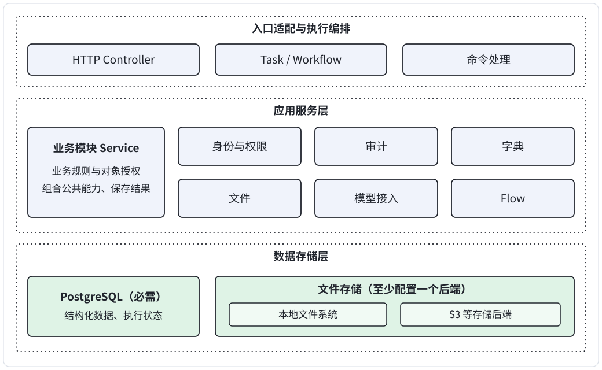
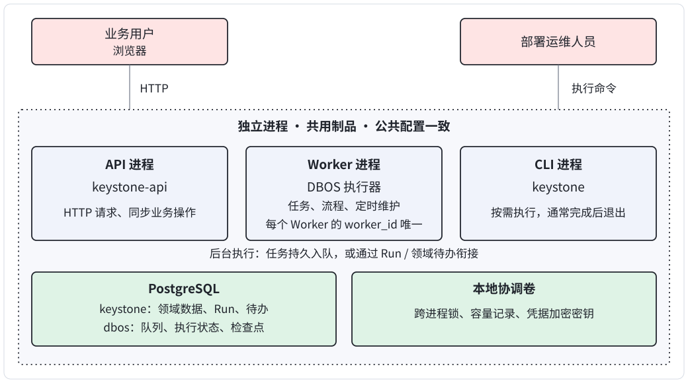
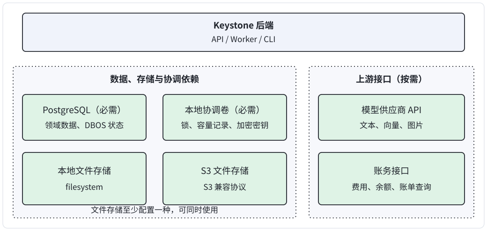

# 整体架构

Keystone 是单企业内的分层模块化单体。业务与平台共用工程、PostgreSQL 和发布制品，通过进程内 Python Service 协作。

默认一个 Worker，优先简单开发和部署；同宿主可增加同版本 Worker。多租户、跨宿主和独立业务发布按实际需求另行设计。以下是设计基线，主要接入差异见第 3 节，具体契约以各模块文档为准。

## 1. 架构视图

### 1.1 逻辑分层

入口处理请求和执行编排，Service 管理规则与数据；PostgreSQL 保存结构化数据和执行状态，文件存储适配本地文件系统、S3 等后端。

### 1.2 进程运行关系

API、Worker、CLI 独立启动，共用代码，公共配置保持一致，进程专属参数分别设置；每个 Worker 使用不同的 worker_id。Service 是各进程内的对象；DBOS 在 Worker 内运行，API 与 Worker 通过持久数据衔接执行，不通过内部 HTTP 调用。

### 1.3 外部依赖

当前部署需要 PostgreSQL、本地协调卷和至少一个文件存储后端（本地文件系统或 S3，可同时配置）；模型、账务接口按业务需要接入。

PostgreSQL 的 keystone schema 保存领域数据，dbos schema 保存执行状态和检查点；本地协调卷保存跨进程锁、容量记录和凭据加密密钥。

## 2. 模块职责与协作

| 模块 | 职责与数据归属 | 主要协作 |
|---|---|---|
| [身份](domains/identity.md) | 用户、角色、会话、PAT 和当前功能权限 | 为其他模块提供授权上下文，操作写入审计 |
| [审计](domains/audit.md) | 重要操作的追加记录与授权查询 | 各模块显式写入，查询复用身份授权 |
| [字典](domains/dictionary.md) | 字典、选项及可选性校验 | 业务保存选项 ID，字典不决定业务行为 |
| [文件](domains/files.md) | File、引用、内容完整性和清理 | 业务/Flow 维护引用，业务负责对象访问规则 |
| [模型接入](domains/model-access.md) | 渠道、模型映射、调用、用量、费用和恢复证据 | 业务/Flow 调用并按需保存文件 |
| [Flow](domains/flow.md) | Run、固定输入与模型绑定、预算、结果和取消意图 | 使用身份、模型和文件能力，DBOS 负责执行与检查点 |
| 业务模块 | 自己的对象、权限范围、业务状态和结果 | 按需组合平台 Service，保存业务记录及文件引用 |

跨模块只调用公开 Service/Schema，不访问其他模块的 ORM/Adapter。core 提供配置、连接、日志、锁和执行设施，不包含业务规则。

组合逻辑按用途放置：业务专用组合放业务 Service；公共跨域用例放上层 use_cases.py，如 Flow 诊断。composition/bootstrap 只装配声明和依赖。跨模块原子操作共享调用方事务，被调 Service 不自行提交。

## 3. 运行入口与后台执行

| 入口 | 运行方式与职责 |
|---|---|
| API：keystone-api | 常驻 HTTP 进程，处理查询、写入和有界同步操作 |
| Worker：keystone-worker | 常驻后台进程，承载 DBOS，执行 Task、Flow 和维护计划 |
| CLI：keystone | 命令行运维工具，初始化、检查、清理或恢复，通常完成后退出 |

后台执行有两种衔接方式：

| 场景 | 持久依据 |
|---|---|
| 普通 Task | 直接持久入队，DBOS 保存输入与执行，无需领域待办表或 FlowRun |
| Flow 及领域维护 | 先保存 Run/待办，由协调任务发现并投递；领域保存业务事实，DBOS 保存技术执行 |

DBOS 同时支持定时触发。提交成功不等于执行完成，业务结果、运行状态与检查点分别确认；具体入口选择和执行规则见[任务执行](execution.md)。

当前接入差异：

- 普通 Task 的 API/CLI 直接投递客户端尚待装配；现有 Flow、清理和查费采用领域状态衔接。
- 文件通用页面、接口和 FileGrant 仍存在，尚未迁移到业务授权；读锁移除及无引用回收也未落地，见[文件差异](domains/files.md#7-当前实现约定)。
- 通用模型调用、Flow 发起入口仍存在，目标由业务入口受理并组合生成与保存，见[模型](domains/model-access.md#10-不变量与实现差异)和 [Flow](domains/flow.md#1-定义与装配)。

## 4. 核心约束

- 每次独立操作检查当前身份、功能和对象范围；PAT 为当前权限与原范围交集，Flow 使用原用户/原 PAT。
- 业务变更与成功审计同事务；外部 HTTP、文件和进程 I/O 不持长业务事务，失败审计在回滚后独立尝试。
- 模型发送前唯一登记，SDK 不隐藏重试，未知结果不换 ID 重发。生成、文件保存和业务提交分别确认，已发生事实受限保存。
- 取消和撤权阻止新操作；已启动 I/O 完成收尾后释放资源，终态按事实确认。等待、并发、输出和重试有界。

## 5. 开发与部署

业务按模块接入现有工程，控制台可直接承载业务页面。代码分层、目录和显式装配见[接入规范](development/business.md#模块分层与代码规范)，完整示例见[最小业务](development/business.md#快速接入)与 [Flow 开发](development/flow.md)。

API/Worker/CLI 使用同一制品，迁移由 CLI 显式执行，服务启动只检查。默认单 Worker，多实例须同宿主、同版本并共用协调卷；失锁停止，版本变更保留原制品处理在途执行。

队列、计划与 Worker 恢复规则见[任务执行](execution.md#7-worker-与资源)，命令和发布步骤见[部署](operations/deployment.md)。数据库两个 schema、文件和协调卷按[联合备份](operations/backup-restore.md)恢复。

## 6. 验证

[自动检查](../backend/tests/README.md)覆盖代码依赖、授权、真实事务、跨进程执行与恢复。真实业务仍须验证完整页面与结果保存、第二业务的复用成本，以及目标负载下的发布和联合恢复；示例与协议桩不能替代这些验证。
