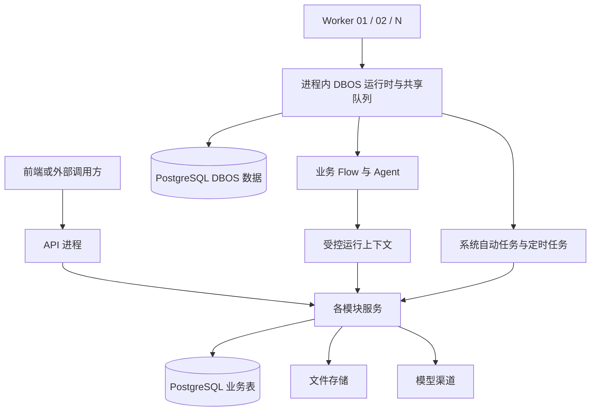
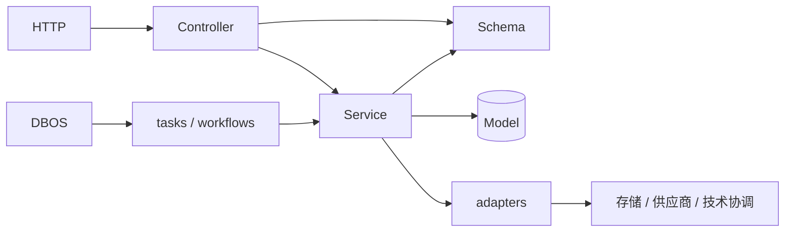
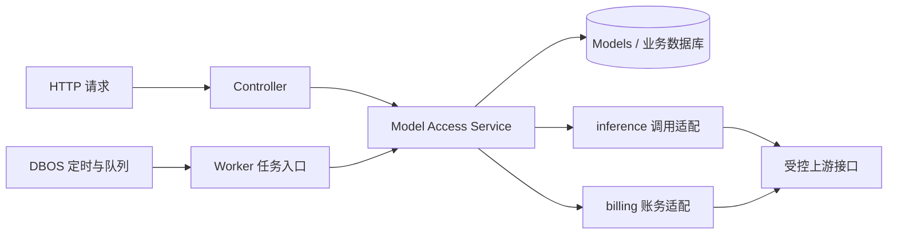

# Keystone 整体架构

采用模块化单体，字段、权限和生命周期见[领域文档](README.md#按领域阅读)。

**阅读状态：**第 1～5 节记录当前实现；第 6 节说明已落地的任务设施和后续 Flow 扩展边界。core/execution/、各模块 tasks/、三类维护的 Step 拆分和 MVC + Service 目录归位已实现；FlowPackage、多角色模型、数组文件路径及素材粗选仍为目标。完整接口与切换约束见[任务执行与模块规范设计](execution-design.md)。

Worker 通过 DBOS 承载业务 Flow、系统自动任务和定时任务。公共生命周期、文件清理、Flow 协调及自动费用核对已实现；关闭业务 Flow 后公共运行时、文件维护和查费仍启动。默认运行一个 Worker，支持同宿主、同版本的 1～4 个固定身份。共享并发、稳定去重、按旧实例恢复和实例/共享维护观测见第 3.4～3.7 节；跨宿主与自动接管不在当前范围。模型发送归属、Flow 扫描依据和 Worker 观测直接包含在模块基线迁移中，不新增业务表；升级前停机备份并执行 `keystone init`，来自旧 revision 的库须先重建或迁移，历史无归属 Flow 调用仍须专项离线收尾。操作见[部署文档](deployment.md#4-多-worker-部署与发布)。

Model Access 已按 billing/inference/Service 分层，三类系统任务的 DBOS 接入位于所属模块的 tasks/，见[Model Access 分层](#541-model-access-分层)。分层职责不随进程数量变化，费用确认和 Flow 权限规则保持一致。

固定身份动态登记、API 成员发现及显式退役已实现：新增 Worker 自动登记，API 和已有 Worker 无需重启，规则见第 3.5～3.6 节。成员资格只来自数据库登记，旧 worker_ids 清单已移除；实现位置见第 3.7 节。worker 基线迁移一次建立登记与观测表，历史身份须在迁移数据时保留恢复依据。

## 1. 整体形态

采用模块化单体：一套 Python 代码、同一发布版本，启动 API 和 Worker 两种进程，共享 PostgreSQL、文件存储和必要的渠道配置。模块之间通过进程内服务调用协作，不通过内部 HTTP 转发。

API 处理认证、管理、普通业务请求和 Flow 受理；Worker 是后台执行进程，通过 DBOS 执行业务 Flow、系统自动任务和定时任务。一个 Worker 可先运行全部任务，容量不足时增加具有独立身份的 Worker，共享队列并行处理。DBOS 是 Worker 使用的执行库，队列、调度记录和检查点保存在 PostgreSQL，不额外部署编排服务器或消息代理。



图中的多个 Worker 使用独立固定身份，默认配置只声明一个。服务在 API 和各 Worker 中分别装配实例，共用代码而非内存对象。业务表和 DBOS 数据使用同一 PostgreSQL 数据库中的独立命名空间；DBOS 数据由其自身管理，业务模块不直接修改。第一阶段多 Worker 从 2 个起步，容量验证后可增加至 4 个；仅限同宿主、同一发布版本、固定身份槽位，共享可靠本地协调卷，数量不作为无限扩容承诺。文件内容继续支持已配置的 filesystem/S3 源。不支持跨宿主自动接管、NFS 协调或多版本并行执行。

## 2. 模块边界与调用关系

| 模块 | 拥有的数据与职责 | 对外提供什么 |
|---|---|---|
| identity | 用户、角色、授权、会话和个人令牌 | 身份解析、当前权限判断、身份管理 |
| dictionary | Dictionary、DictionaryItem，平面的业务选项配置 | 字典管理、可选项查询、所属字典与可选性校验、历史名称解析 |
| files | File、FileGrant、FileReference，文件存储适配 | 上传下载、授权、引用登记与解除、内容清理 |
| model_access | Channel、ModelEntry、ModelInvocation，渠道适配及费用核对规则 | 模型调用、调用记录、费用查询、自动核对和余额刷新 |
| audit | AuditLog | 在调用方事务内追加日志，授权后的日志查询 |
| flow | Definition 目录、FlowRun、业务流程的 DBOS 接入 | 发起、查询、取消、执行上下文、补投和结果同步 |
| 具体业务 | 业务实体、业务规则、Workflow、Agent 与 Skills | 业务用例、结果采用和业务查询 |

Worker 是进程，DBOS 是执行引擎，两者都不是新增领域。公共 DBOS 初始化、启动关闭及配置已集中到 `core/execution/runtime.py` 这一薄文件；Worker 入口持有按身份的 OS 锁与 PostgreSQL 会话锁，并以共享的原全局锁排斥旧单实例制品，composition 显式装配领域服务、任务入口与稳定计划，core 不反向导入领域模块。各模块 tasks/ 承担系统任务的 DBOS 接入，费用核对、文件维护及 Flow 协调规则继续归所属模块的 Service。DBOS workflow/step 直接用于明确的执行适配代码和业务 Flow，不进入普通 Service、模型或供应商协议适配包；不建设独立 Execution 子系统、通用 JobRun 表或多引擎接口。任务入口由 composition 显式装配，当前职责及后续调整见第 3.7 节。

调用遵循以下规则：

- API 路由只处理请求解析、认证和响应映射，调用所属模块服务；领域规则不写在路由中。
- dictionary、files、model_access、flow 使用 identity 的当前权限判断，并自行检查对象访问范围。所有模块的关键变更通过 audit 写入日志。
- 业务通过 dictionary 服务校验选项所属字典和可选性，在自身字段保存 DictionaryItem.id；字典模块不反向依赖业务表。字典只停用、不删除，历史引用仍可读取；平台固定枚举继续由代码定义，细节见[字典领域](domains/dictionary.md)。
- dictionary:read 保护独立目录和通用字典查询。已授权业务可解析所引用选项、查询服务端限定字典的选项并校验业务写入，无需额外字典读取权；客户端不能借业务入口指定任意字典来枚举。复用已有业务服务，不建立代理层或逐字典授权表。
- flow 通过 files 和 model_access 的公开服务提供运行能力。后两者不依赖 FlowRun 表，也不反向调用 Flow 服务；模型调用关联只接收可信上下文中的标识。
- 跨模块查询在入口组合各模块授权：Run、模型调用明细/费用、文件内容分别判断，不能因 Run 可见而一并开放。步骤接口只返回白名单过程信息，不透传引擎检查点和原始消息；完整规则见 [Flow 权限](domains/flow.md#4-权限与审计)。

- 具体业务可以直接使用底座模块，不必把每个操作包装成 Flow。业务流程通过受控上下文使用文件、模型及自己的业务服务，不直接修改其他模块的表。
- audit 的写入入口只接受明确的操作事实和事务，不反向调用业务服务。审计查询在入口检查 identity 权限，避免让所有日志写入都产生反向依赖。

文件领域仅对内置管理员的 inspect/manage 免除对应 FileGrant；内容读取仍需显式授权，凭据范围与生命周期检查不变。这不是全平台的管理员绕过规则。FileReference 的增删由所属业务授权，文件管理权不能解除业务引用；详见[文件领域](domains/files.md#22-文件授权-filegrant)。

身份、字典、模型配置各自保留已确定的启停规则，文件另有不可逆删除生命周期，不统一抽象软删除或通用资源生命周期。Channel、ModelEntry 只停用不删除；模型调用、配置管理/余额与调用历史分别授权，见[模型接入](domains/model-access.md#4-权限与审计)。

模块可以共享数据库事务，但各模块仍负责自己的数据操作。跨模块获取数据走明确的服务方法，不通过到处导入 ORM 模型绕开权限和生命周期规则。业务模块保存自身实体和 run_id，Flow 不保存素材审核状态、合同状态等业务结论。

角色删除、业务采用结果、历史清理等跨模块用例由 bootstrap 装配的上层用例服务协调，依赖各模块的明确服务入口；路由只转交请求，领域内部不反向导入调用方。例如角色删除先检查 identity 的用户分配和 files 的角色授权，再同事务删除角色及自身权限配置；不能级联删除文件授权。模型记录与 PAT 清理需要 Flow 保留检查时也由上层协调，不让这些底层模块反向依赖 Flow。首版不建通用 guard 注册机制或跨领域引用表。

当前角色删除已落到 use_cases.RoleDeletion，由 Runtime 显式装配 identity/files 服务；身份排他锁覆盖检查、删除与审计提交。文件修改和删除只返回 ID 回执，完整元数据仍由独立的 inspect 权限控制。

## 3. API 与 Worker 的分工

公共生命周期、三类维护任务及自动费用核对已实现；系统任务入口位于所属模块的 tasks/。当前结构见第 3.7/5.4.1 节，多 Worker 边界见第 3.5 节；当前支持同宿主、同版本的固定 Worker，不提供跨宿主或自动接管。

### 3.1 职责与状态归属

| 概念 | 职责 | 示例 |
|---|---|---|
| Worker | 装配执行代码、启动 DBOS、消费队列、管理进程生命周期与健康状态 | worker-01、worker-02 |
| DBOS | 持久队列、定时触发、检查点、技术重试和执行恢复 | 将已投递任务交给可用 Worker |
| Flow | 用户可发起、查询和取消的业务流程，管理业务身份、契约及结果 | 素材分析、生成图片、保存报告 |
| 系统自动任务 | 由业务事件产生的后台工作，规则与待办归所属模块 | 调用完成后补查费用 |
| 定时任务 | 按时间计划触发的工作，处理函数归所属模块 | 每 5 秒触发文件清理、Flow 补投与状态同步、费用扫描 |

自动任务描述工作来源，定时任务描述触发方式；自动费用核对可以由定时扫描发现并执行。系统任务可由短 DBOS workflow 承载，无需注册为业务 Definition 或创建 FlowRun。

| 事项 | API | Worker |
|---|---|---|
| 认证与管理 | 登录、用户角色、字典、文件和渠道管理等请求 | 不提供另一套登录或管理接口 |
| 字典查询与校验 | 提供选项查询、历史名称解析；业务保存时调用字典服务校验 | 没有专用字典任务；业务确需使用时调用同一服务 |
| Flow 目录 | 加载轻量 Definition 与输入输出契约 | 同时加载匹配的 workflow、Agent、工具和资源 |
| 发起 Flow | 校验并持久化 pending Run，返回 run_id | 扫描待提交记录，按固定 ID 入 DBOS 队列 |
| 执行 Flow | 不启动执行器，不在请求后台协程中运行流程 | 执行普通步骤与 Agent，处理检查点和恢复 |
| 查询 Flow | 检查各项访问权；步骤详情通过只读 DBOS 客户端转换为白名单视图，不启动执行器 | 核对 DBOS 状态，更新快照与 observed_at |
| 取消 Flow | 按当前请求身份校验，首次保存取消意图与实际操作者审计；权限组合见 Flow 文档 | 处理已受理取消意图，调用 DBOS 并同步确认状态 |
| 手动余额刷新 | 检查 model:manage，事务外有界查询并保存结果，同步返回；不创建后台请求 | 首版无定时刷新任务 |
| 系统自动任务 | 在所属模块事务中保存业务事实和待办，例如 deleting 或待核对费用 | 扫描到期待办，按稳定执行标识投递，调用所属模块处理函数 |
| 定时任务 | 初期无计划管理接口；需要后台处理时只持久化待办 | 显式注册 DBOS 持久计划，到期入队，分批执行清理、扫描和状态同步 |

API 不启动 DBOS 执行器，也不在请求后台协程中运行持久任务。API 使用的引擎只读客户端仅提供授权后的 Flow 查询等能力。

| 保存位置 | 保存事实 |
|---|---|
| FlowRun | 业务受理、固定版本与身份、取消意图、业务结果和最近确认状态 |
| ModelInvocation 及所属模块的费用核对状态 | 模型调用回执、用量、费用、待核对原因和下次核对时间 |
| File 等领域记录 | 文件删除请求、内容状态及清理事实 |
| DBOS 自管数据 | 排队、执行归属、检查点、技术执行状态和定时计划 |

领域状态是持久待办与业务事实，引擎记录技术执行。各模块保留自己的结果和幂等规则，不再复制一套通用任务状态机。费用未决不改变调用的成功/失败结果，也不使已结束的 Flow 重新进入运行中。

### 3.2 Worker 生命周期与 Flow 调整

Worker 启动依次校验依赖、取得排他锁、装配匹配版本的流程和任务、完成中断调用收尾、启动 DBOS 并注册队列与持久计划，再报告就绪。进程以 Worker 身份锁和限定范围的恢复启动，先绑定当前实例再启动 DBOS，详见第 3.5 节。连接池、SDK 客户端各自在进程内创建，API 无需导入重型 Agent 模块，扩容 API 不会增加执行器。

DBOS 生命周期由 Worker 公共启动代码管理。`flow_enabled` 只控制业务 Flow 能力，不关闭公共运行时和已启用的系统任务；禁用 Flow 前先处理在途流程，不能删除 Run 或擅自改判终态。Flow 保留 Definition、受理、原身份授权、补投、取消、引擎状态投影、输出校验和文件引用；Flow 的补投与状态同步函数由有界周期任务触发。

心跳、信号和进程健康检查仍由 Worker 自己管理。清理、费用核对和状态同步使用 DBOS 调度，不为每个模块增加常驻 `while/sleep` 循环。停止时先停止领取新任务、上报排空状态、有限等待在途执行，再关闭 DBOS、客户端及连接并释放身份锁。只清理自身明确管理的协程，不能通过启动前后全部 asyncio task 的差集取消其他模块任务；未完成运行保留恢复依据，不统一标记失败。

取消按当前请求身份，后续业务执行按原运行身份，已受理意图由 Worker 执行；重复与终态行为见 [Flow 取消](domains/flow.md#32-取消)。系统维护使用范围明确的 system 身份，查费仅可核实原调用，不能新建推理请求或借用已撤销的用户权限。

### 3.3 自动任务与费用核对

初期统一由 Worker 扫描所属模块的持久待办并提交 DBOS，API 不承担即时投递。业务事务提交与引擎入队不假定原子：API 退出或提交响应丢失后，已保存的待办仍可被发现；Worker 不可用时待办保留，接受少量扫描延迟。沿用 FlowRun、文件状态和费用核对状态作为恢复入口，不增加消息代理、通用投递表或 JobRun 领域。

当前新增自动任务时，在所属模块实现业务服务、保存必要待办，再由 composition 显式装配 Worker 扫描与执行入口。当前 DBOS 装饰器、队列/计划注册、技术去重和执行健康包装放在所属模块的 tasks/，调用模块公开 Service；普通 Service 不自行注册或投递 DBOS 任务，也不接收调度器上下文。公共声明、投递、计划和安全 Step 收在 core/execution/，见第 6 节。不得从客户端接收任意导入路径、处理函数或执行身份。

自动费用核对已接入 Yunwu/Openlux 日志查询及 OpenRouter 请求直查，由 Service 管理费用待办及写回，billing/ 处理供应商账务协议，model_access/tasks/workflows.py 处理 DBOS 接入；不新增业务 Definition、FlowRun、JobRun 表或独立账务服务。查询契约、状态和落库规则见[模型接入的自动费用核对](domains/model-access.md#36-自动费用核对)，目录调整不改变这些规则。

1. 模型发送前仍登记稳定 ModelInvocation，并绑定实际站点、原查询范围和非秘密费用口径。收到可用于查费的响应编号后尽早保存；调用结束时在同一短事务保存回执和费用待办。适配器确认响应已提供实际账户费用时直接保存，缺失费用不视为零。
2. Worker 启动时投递一次费用扫描，此后通过 DBOS 每 5 秒发现到期待办。只扫描已结束、待核对且到期的记录，不把仍在执行的调用改判未知；succeeded、failed、unknown 均可能需要核对。扫描队列不执行慢 HTTP，不因关闭 Flow 而停用。
3. 请求 ID 直查型渠道按调用查询；日志型渠道按实际站点和原凭据可见范围合并扫描。Yunwu/Openlux 当前已验证的是按原 Token 拉日志，再用 other.request_id 精确匹配 x-api-request-id；不能依赖服务端 request_id 筛选，也不能把分页中变化的日志 id 当作稳定账单编号。同账户下的不同 Token 不默认共享日志可见范围。
4. 每次查询限制页数和耗时。固定窗口、下一页及本轮匹配范围由 model_access 保存到原 Channel 的查询 checkpoint，分页写回与费用确认协调提交；未扫描完不能判定整轮未找到。后续轮次重新扫描窗口以覆盖延迟写入，不靠只增不回退的日志 id 或时间水位保证完整性。
5. 调度时间和重试原因由业务待办持久化：尚未出账按逐步延后的时间核对，超时/5xx 有界退避，429 遵守有效 Retry-After 并冷却整个查询范围；鉴权或范围错误等待修复。自动窗口默认设计为 24 小时，超出后保留未知并停止自动查询，不能标为免费。SDK 不隐藏重试，不让每笔费用占据一个长期等待的 workflow。
6. 查到账单后只更新原调用，重复结果不累加；查询失败不清空已知费用，也不修改调用结果或 error_code。金额使用十进制并保留原单位、额度原值及换算口径。写回前复核原范围、配置和查询进度，旧结果丢弃；HTTP 在业务事务外执行，凭据只在受控服务内解密，不进入任务参数或检查点。
7. Flow 取消、结束、发起人撤权或渠道停用不丢弃既有回执，受限 system 核对继续保存费用事实。手动补查保留原权限校验，与自动核对共用范围互斥及保存规则；新推理仍按当前权限检查，任何查费重试都禁止重发原模型请求。

重复投递同一执行沿用稳定标识，运行中按查询范围与 execution_version 合并；下一轮查费使用新执行标识，不能重复使用已完成查询的检查点而永远读到旧结果。DBOS 恢复可能重复只读查询，业务写入仍须幂等。原 Token 不可用时进入阻塞，不用另一枚 Token 查旧调用后猜测未收费；首版对 Token 级查费渠道固定其查询范围，换 Token 新建 Channel。

### 3.4 定时任务与队列

队列同时限制每进程与全局并发，下表为默认预算，不代表吞吐承诺。业务 Flow 和查费预算由配置声明；增加进程不自动提高全局上限。

| 队列 | 内容 | 每个 Worker 上限 | 全部 Worker 合计上限 |
|---|---|---:|---:|
| keystone-flows | 业务 Workflow、Agent | 2 | 4 |
| keystone-files-maintenance | 文件清理 | 1 | 1 |
| keystone-flow-maintenance | Flow 补投、取消与状态同步 | 1 | 1 |
| keystone-model-maintenance | 费用到期扫描与合并投递，每轮最多 20 个范围 | 1 | 1 |
| keystone-system | 费用查询与分页核对 | 2 | 2 |

DBOS 队列同时设置 worker_concurrency 和 global_concurrency。相同队列由所有 Worker 按同一份配置注册，每进程上限和系统总上限分别约束；不能把进程内 Semaphore 当作系统总量。扫描器和处理任务使用不同入口/执行标识，短定时入口只投递实际任务，不持有受限队列容量等待自己的子任务。文件 I/O、Flow 协调、费用扫描和慢账务 HTTP 继续隔离。DBOS 参数语义见[队列与并发](https://docs.dbos.dev/python/tutorials/queue-tutorial)。

资源隔离与部署配置分开：各类任务使用内部默认预算，新增任务不默认新增一个公开并发参数。已有 Flow、模型发送和查费参数保留为可选调优入口；新增 Worker 只指定自身固定身份，不配置完整身份清单。查费沿用内置共享上限，无需部署者单独设置。

composition 集中声明所有启用队列及两级预算。Worker 完成身份、版本和公共配置准入以及本实例旧调用收尾后，先通过不启动执行器的 DBOS 客户端持久化全部预算，再启动 DBOS 恢复与领取任务，最后安装计划并报告就绪。不能把预算注册放到 launch 之后，否则启动恢复可能短暂使用数据库里遗留的旧限额；被拒绝准入的进程也不能修改预算。

API 手动查费不经过 DBOS，费用 Service 使用 PostgreSQL 共享容量，覆盖全部 API 和 Worker，初始查费总并发保持 2；DBOS 查询队列限制与进程内信号量仍保留以控制排队和本地资源。共享容量通过同一协调连接上的固定槽位会话锁实现，无需 Redis；容量和 scope 锁的获取顺序固定，失败立即释放已持资源，不能占一个槽等待另一个槽。拿不到容量时，自动核对保留待办等待下轮，手动入口返回安全忙碌状态，不消耗供应商错误预算。

Flow 并发不等于模型请求并发。实际发送前使用覆盖 API 和 Worker 的 PostgreSQL 共享推理预算，默认总量 4、相同推理站点/真实 Token 上限 4，可分别配置；相同 Token 的多个 Channel 不能各领完整预算。满载请求返回安全忙碌错误，不产生发送登记或上游请求；SDK 仍不重试。供应商 RPM/TPM 尚未实现，需按实际配额另行设计，不能用并发或 Flow 启动速率替代。连接池总量、CPU、临时文件与存储 I/O 同样按全部进程核算。

SDK 继续保留每进程 4 个调用槽位，在取得数据库推理许可之前限制本地资源占用。提高共享预算不会同时提高这个本地上限，也不保证达到配置的吞吐量。

当前三项维护计划为 `keystone.files.cleanup`、`keystone.flow.reconcile`、`keystone.model_access.reconcile_costs`，使用 UTC、每 5 秒触发，DBOS 每秒检查计划。关闭停机补跑，超过 10 秒的旧触发直接略过；启动时立即投递一轮，再扫描当前领域待办。计划按稳定名称更新，重启不创建副本；关闭对应能力时暂停已有计划，重新启用时恢复。费用扫描始终启用，不随 Flow 开关暂停。

各 Worker 装配相同持久计划，不选主调度 Worker，不按 Worker ID 复制计划。DBOS 按计划名与计划时间确定同一次触发；多个调度进程竞争同一执行标识，恢复仍可能重做未完成步骤。计划、时区、能力开关和公共预算必须一致，启动时校验共享声明，配置冲突不能由最后启动的进程覆盖。计划仍由代码和配置维护，确需页面创建、暂停或修改计划时再增加管理用例。调度规则见[DBOS 定时任务](https://docs.dbos.dev/python/tutorials/scheduled-workflows)。

| 去重层次 | 保留的机制 | 作用与边界 |
|---|---|---|
| 定时触发 | 计划名＋计划时间 | 同一时刻不是每个 Worker 各建一个独立任务；不是外部副作用恰好一次的承诺 |
| 维护扫描 | 计划名＋execution_version 的 deduplication_id、return-existing | 合并排队/运行中的触发；完成后下轮使用新的 workflow_id，不能永久复用已完成结果 |
| 范围查费 | scope＋execution_version 的投递去重，另有数据库范围锁 | 自动投递合并，手动查费仍通过 Service 争用同一范围；去重不能替代锁 |
| Flow 与模型发送 | 稳定 flow:<run_id>、ModelInvocation.id 及发送前原子登记 | 补投不创建第二个 Flow，已有模型调用拒绝再次发送 |
| 事实保存 | 行锁、原配置/轮次/页进度比较、同事务写回 | 查询可重做，费用不累加，终态及文件引用保持幂等 |

去重键带版本可隔离不同版本的活动键，但不能隔离全局队列容量：故障 executor 和旧版本遗留的 PENDING 仍可能占住 global_concurrency。须恢复原身份或按发布流程处理旧执行，不能认为改去重键、增加 Worker 或启动新版本就能释放容量。当前不自动清理 DBOS 历史，后续保留策略仍须遵守恢复与模型防重发约束。

文件每轮最多 20 个候选；Flow 每轮最多 25 条、单条协调最多 15 秒。Flow 按持久化的 reconcile_attempted_at 和创建时间进行公平扫描，与成功查询才更新的 observed_at 分开，避免轮换执行进程或重启后反复扫描旧记录。该进度不进入 Worker 心跳，也不新增通用 JobRun。领域服务、文件互斥、原身份及版本校验不变；失败保留待办，维护任务不创建 FlowRun 或发送额外模型请求。

### 3.5 多 Worker、恢复与发布

当前支持同宿主、同一发布版本下最多 4 个未退役固定身份，默认启动一个。新增 Worker 用自己的固定身份启动，经准入后登记，API 和已有 Worker 不重启。手动增加实例不等于自动伸缩；跨宿主、根据心跳自动抢占故障身份及多版本混跑仍不支持。故障由进程管理器以原身份重启恢复。

| 标识 | 生命周期 | 目标职责 |
|---|---|---|
| worker_id | 部署时固定，重启不变 | 对应稳定 DBOS executor_id、进程身份锁和启动恢复范围 |
| instance_id | 每次进程启动重新生成 | 区分同一槽位的前后进程，防止旧实例状态覆盖新实例 |
| execution_version | 原有发布制品内容摘要 | 限定兼容的队列领取和检查点恢复，不用随机实例 ID 替代 |

worker_registrations 保存固定身份、登记/退役状态及准入所需的部署绑定；worker_heartbeats 记录每次 instance_id 的观测，不承担永久成员清单。未退役登记是 API 的预期身份来源，离线或 stopped 身份仍占用登记名额；同身份重启不重复占名额。登记不因心跳过期、正常停机或心跳历史清理而删除。stopped_at 按匹配实例更新，心跳清理后仍能区分已正常停止与故障失联；迟到旧实例不能改变新实例的停止状态。

旧 worker_ids 清单已移除，成员资格只来自登记，API/Worker 不需要配置全部成员；worker_id 校验合法格式并用作固定 executor_id。共享摘要只比较执行兼容性，包括 Flow 开关、队列/模型预算及文件/协调配置。Model Access 在持锁事务内比较仍在运行或失联的未退役登记；成员增加不会让 API 的模型请求误判配置冲突。登记只在 Worker 准入时建立，不随进程启动或重复初始化覆盖。

准入顺序：先取得部署共享锁和本身份的 OS/PostgreSQL 排他锁，再在串行登记事务中核对宿主、execution_version、公共配置及实际协调卷标识，检查未退役身份上限并登记。并发申请最后一个名额只能成功一个；重复身份、已退役身份的普通重启及不兼容部署均拒绝，不能通过登记覆盖旧实例或更改队列预算。故障、尚未退役的身份仍参与兼容性核对，不能仅凭心跳过期忽略它。

准入后绑定本次实例，只收尾本身份旧实例的模型调用，再持久化队列预算并启动 DBOS，最后安装计划、报告就绪。旧调用收尾逐批使用持身份锁的同一连接提交，每批事务最多等待 3 秒；失锁或超时回滚当前批次，保留已提交批次与原身份恢复路径。队列准备后、DBOS 启动前再次核验身份；启动恢复完成前不让健康检查并发使用该连接。新成员不修改全局预算，不生成按身份复制的计划或去重键；API 读取登记及最新心跳即可自动显示成员变化，无需重启或同步身份清单。

第一个槽位保留现有 executor_id=keystone-worker，新增槽位使用 keystone-worker-02 等独立身份，不直接重命名旧 executor。按 worker_id 同时使用同宿主可靠协调卷上的 OS 锁和 PostgreSQL 会话锁，同一身份禁止新旧进程重叠。原 keystone-flow-worker 锁以共享方式持有，继续排斥旧单 Worker 制品；Worker 身份连接失效时停止当前执行器，不能静默重新连接继续运行。文件资源锁和数据库保护继续保留。所有 Worker 注册相同任务和队列、使用相同能力开关与公共预算，业务不指定处理进程；差异仅为身份和可用进程容量，不建设新 Execution 子系统。

身份连接还持有部署级 PostgreSQL 共享锁；专项离线收尾取得同一部署锁的排他模式，并保留原 OS 排他锁。离线收尾和新 Worker 启动双向互斥，即使误配协调目录也不能越过数据库屏障。旧单 Worker 制品没有这把数据库锁，仍须停止旧进程并使用原协调卷。运行时定期核验身份连接，单次核验最多等待 3 秒，失败或超时进入停止流程，不重新取得身份继续执行。

专项离线收尾的每批调用更新、逐条审计和旧实例停止标记都在持部署锁的同一连接上提交。连接中断时当前事务回滚，不能另开连接继续收尾；已提交批次可以在再次满足停机前提后幂等续跑。

准入还比较协调卷现有 .keystone-storage 标识，路径相同不等于共享同一个卷；容器误挂载独立卷时拒绝加入，不能靠一致的路径和 hostname 绕过。

Flow 模型调用在发送前登记实际发送进程的 worker_id、worker_instance_id 和 execution_version。归属由可信 Worker/Flow 适配在每次实际执行时提供，Model Access Service 只接收普通内部上下文，不导入 DBOS；客户端不能指定，归属也不能作为旧 Flow 输入或步骤缓存被带到新进程。已有稳定 invocation ID 的记录不能通过改写归属获得重发资格。普通 API 调用仍走独立离线收尾入口。

故障恢复顺序固定如下：

1. 由进程管理器确认旧进程已经结束，以原 worker_id 和原执行版本重启；心跳过期或运行时间长本身不构成终止证明。
2. 新实例取得该身份锁，绑定当前服务与实例上下文；只将本槽位旧实例遗留的 Flow running 模型调用收尾为 unknown/model_interrupted，保留编号、原费用、待核对状态及审计，不修改其他 Worker 的调用。
3. 收尾完成后先持久化当前全部队列预算，再启动 DBOS，触发该 executor、匹配版本的未完成任务恢复。重新入共享队列的任务可由任一匹配版本的 Worker 领取，不保证回到原进程。
4. 未完成的只读查费可以重查，已提交分页/费用继续复用；模型调用仍受稳定 ID 保护。请求已发出但结果检查点缺失时，Flow 可能以结果不可恢复结束，不能自动补发模型请求。

没有 worker_id/instance_id 的历史 running 记录，只能在首次升级确认全部旧进程停止后专项处理；不得作为每个新 Worker 启动时的全局兜底。原槽位没有重启前，其 PENDING 可能占住队列容量；其他健康进程不能仅靠新身份自动恢复它。DBOS 对检查点的所有权保护不能代替外部发送前登记或业务事实写回保护，参见[并发执行语义](https://docs.dbos.dev/explanations/concurrent-executions)。

查费已有跨进程 PostgreSQL scope 会话锁、共享 Channel checkpoint 和冷却时间，可继续沿用；同一真实 Token 的多个渠道协调同一个范围。手动/API/Worker 共用全局预算，准备和写回在持锁连接的短事务内检查连接/所有权并锁定原记录，连接失效后禁止换连接继续提交。提交比较原配置、轮次和 checkpoint revision，每次推进增加 revision，用于拒绝同轮次旧页进度写回；失去所有权或进度已改变的旧响应不推进分页、不覆盖费用。HTTP 期间不保持业务事务，金额、证据和 checkpoint 仍原子提交；重复不累加，冲突阻塞，失败不清空已知费用或改变调用结果。

增加容量只启动新固定身份，公共全局预算不随实例数自动增加。缩容只让目标 Worker 停止领取、上报排空、有限等待并退出；随后取得目标身份锁，与登记操作串行核对其 DBOS 在途/待恢复执行和 running 模型调用，全部清空后才显式标记退役。未知或截断的查询不能当作清空证明；未分配给该身份的共享排队任务仍由其他 Worker 处理，不随退役取消。

退役是持久成员操作，不能等同于 stopped 心跳或删除观测行；确认退役后才从 expected_workers 和未退役名额中排除，保留登记、执行和审计历史。只锁目标身份，API 和其他 Worker 继续运行；不调用要求全部停机的历史 Flow 收尾命令。若排空超时、存在待恢复执行或模型调用仍 running，拒绝退役，保留原身份/原制品恢复路径，先恢复并收尾；退役后重新使用身份需显式重新启用并重新准入，不能普通启动静默复活。

SIGINT/SIGTERM 触发排空，心跳持续报告 draining；worker_shutdown_seconds 配置 DBOS 有界等待，完成退出后报告 stopped。进程管理器的终止宽限期应覆盖该等待、事实收尾和必要的文件 I/O 退出；超时遗留任务仍需原身份恢复。手动停止但尚未退役的成员仍显示离线，不能因其他成员 ready 掩盖故障。

迁移由部署步骤执行一次，API 与各 Worker 只检查版本。第一阶段发布采用停写、排空/核对、全部停止、联合备份、单次迁移、同制品启动与恢复验收。未处理的旧业务执行必须保留原版本/身份恢复方案并阻止正常升级，不能改版本强行重放。对已确认无旧进程执行、可由领域待办重建的旧维护执行，可在部署核对后通过受控 DBOS 操作退役并保留历史；不得批量删除 DBOS 记录或伪造成功来释放容量，也不重置费用待办的原期限。备份包括全部身份清单、数据库、协调密钥/锁文件、所有内容源、配置及原制品。完整流程见[多 Worker 部署与发布方案](deployment.md#4-多-worker-部署与发布)。

旧版本切换须一次停机发布：先处理在途执行并联合备份，再用新制品执行 `keystone init`。worker 基线迁移只建立登记与观测结构；旧身份、心跳和运行中调用的归属须在数据迁移中按原值保留，不猜测退役。切换完成后，同版本成员增加/退役不执行迁移、不重启既有进程；代码版本、共享预算、存储等执行配置变化仍按停机发布流程处理。旧制品回退须核对登记与迁移兼容性，不能用旧静态名单忽略新增成员。

### 3.6 健康状态与运维

预期身份来自 worker_registrations 中未退役的登记，心跳按固定 worker_id 与每次启动的 instance_id 保存，包含执行版本、公共配置摘要、协调卷标识和共享维护结果。按身份取得锁并完成公共配置校验后才登记成员和新实例；准入事务与身份锁使用同一连接，失锁不能提交登记。拒绝双开或冲突的进程不能覆盖健康实例、增加预期数量或修改计划。准入成功后启动失败则保留登记并显示未就绪。观测使用登记指向的当前实例，旧进程迟到的退出不能遮蔽新进程。

| 观测范围 | 依据与处理 |
|---|---|
| 单个 Worker | 最新实例的依赖、DBOS、队列监听、版本、心跳和 starting/ready/unready/draining/stopped 状态；空闲 Worker 不必亲自执行每类维护 |
| 共享维护 | 同版本、同公共配置下聚合最近实际扫描结果，以数据库时间判断首次扫描、失败和 30 秒新鲜度；心跳不能不断刷新未执行任务的时间 |
| 部署整体 | 对照未退役登记逐项展示缺失、离线或未就绪身份，自动发现新成员并更新预期数量；未登记或不兼容的观测单列异常，一个正常实例不能掩盖另一槽位故障 |

心跳独立每 5 秒发布，排空时继续报告；过期实例离线。心跳历史可按原规则清理超过 24 小时的 stopped 观测，但不能清理永久登记、自动退役或把离线身份从预期数量中减掉。公共配置变更时确认全部进程停止，再按发布流程核对旧观测与登记，不能靠心跳过期自动接管。

尚无登记或没有就绪 Worker 时，总体不能因为 expected_workers=0 而报告就绪。普通停止与退役始终分开，退役后迟到的旧实例心跳不能恢复成员资格。

GET /api/v1/worker/status 提供总体状态、instances、maintenance、ready_workers 和 expected_workers；控制台分别展示实例与共享维护。keystone-worker --check 只检查配置的确切身份及本机进程健康，共享维护异常单独告警，避免所有正常进程一起重启。keystone-worker --inspect 额外通过只读 DBOS 客户端报告活动队列、executor、版本、状态与数量；最多扫描 1000 条并明确 truncated，不启动执行器、不返回输入输出。

动态登记仅新增固定身份登记表，复用原 worker_heartbeats 和只读引擎观测，不新增通用任务表或任务框架。心跳不是业务 checkpoint，Flow 公平扫描和账务分页进度继续归领域；详细探针与恢复操作见[开发说明](development.md#worker-健康检查排障)和[部署说明](deployment.md#4-多-worker-部署与发布)。

费用扫描持续推进已纳入就绪，调用接口显式返回核对状态/原因/时间，费用汇总返回 cost_checks 分类数量。范围冷却和 checkpoint 持久保存为内部字段；最长未决时长和独立监控面板尚未提供。供应商限流、账单延迟或单个 Token 失效保留为费用状态，不能等同于整个 Worker 无法运行；扫描停止推进才按维护健康规则撤销就绪。

当前提供逐实例/共享维护视图、按身份探针和有界队列诊断；最老待办时间、Flow 同步延迟、费用最长未决时间及完整监控面板仍待后续。Worker 心跳不是业务完成证明，API ready 也不代表 Worker 可用，不能因长期 pending 自动改判 Flow 失败。

备份仍采用停写联合备份：覆盖所有 API/Worker，完整数据库含业务、版本和 DBOS 数据，与同一窗口的文件卷（内容、卷标识和永久锁文件）、原镜像和配置成套保存。恢复时先使用原制品和原 Worker 身份，再按发布流程升级。真实上游副作用不会随数据库回滚；ready 不能代替恢复后的字节、授权和执行核对。见[联合备份与恢复](backup-restore.md)。

### 3.7 现有实现与调整点

Worker 公共启动、维护计划、Model Access 分层及固定多 Worker 已落实，默认配置仍只声明一个身份。实现职责如下：

固定身份登记、API 自动发现成员及显式退役已接入原 Worker 生命周期，Flow 和费用服务不引入新的执行框架。

| 位置 | 当前职责 |
|---|---|
| entrypoints/worker.py、core/worker_identity.py | 固定身份和本次实例、OS/数据库身份锁、公共配置/主机/版本校验、排空和原身份重启 |
| core/execution/runtime.py、各模块 tasks/ | DBOS 生命周期、每进程/全局队列预算、稳定计划与活动投递去重；只读部署诊断，不解释业务规则 |
| platform/flow | 实际发送时提供可信 Worker 归属；原受理、权限、取消、持久步骤及结果同步；持久化公平扫描依据 |
| platform/model_access | 发送前登记归属，按旧实例恢复；共享推理/查费预算，范围锁与持锁短事务写回，轮次/revision 比较；billing/inference 不引入 ORM 或 DBOS |
| platform/files | 原文件锁、生命周期与有界幂等清理；Worker 只包装调度 |
| core/worker_health.py、状态 API 与控制台 | 预期身份、最新实例、共享维护结果及总体状态；探针与部署诊断分开 |
| composition/bootstrap | 显式装配服务、客户端和 Worker 入口，传递身份和公共预算，不扫描插件或任意 Python 路径 |

模型发送归属、Flow 扫描依据及心跳观测直接包含在模块基线结构中；历史数据迁移不得推断或回填未知归属。没有通用 JobRun、独立账务服务或新的 Execution 框架。模型/费用状态、原身份权限、API 显式投影和未知请求不重发规则保持不变。

| 实现位置 | 动态登记职责 |
|---|---|
| core/config.py、core/worker_identity.py | 成员资格只来自数据库登记，旧清单已移除；保留固定身份格式及共享执行配置校验 |
| core/models、worker 基线迁移 | 建立 worker_registrations，保存固定身份及登记/退役状态；历史身份在迁移数据时保留观测和故障恢复依据 |
| Worker 公共启动 | 身份锁下串行校验、名额检查和登记，随后沿用自身恢复、预算注册、DBOS 启动顺序 |
| core/worker_health.py、状态 API、控制台 | 从未退役登记计算 expected_workers，动态发现成员，保留已登记离线/停止成员的故障展示 |
| Model Access 协调 | 公共配置比较不受成员变化影响；共享容量、范围锁、费用提交及防重发保持原行为 |
| worker/lifecycle.py、CLI | retire-worker / reactivate-worker 取得目标身份锁，调用领域只读检查并同连接提交登记与审计；正常停止继续使用原排空流程 |

回归覆盖 API/A 持续运行时 B 加入、并发申请最后一个名额、拒绝冲突进程不污染成员/计划、B 故障后登记不丢失、A 恢复不影响 B、退役与同身份启动互斥、待恢复执行阻止退役、登记/退役失锁回滚，以及原有共享并发、去重、失锁拒绝写回和未知请求不重发。跨宿主、自动接管、多版本并行、自动伸缩及供应商 RPM/TPM 仍不在本次范围；发布仍须使用原制品与原身份的恢复约束。

## 4. 事务、身份与外部调用

最外层用例服务控制事务，需要原子完成的数据库操作接受同一事务；接受调用方事务的内部方法不擅自提交。例如业务保存附件时，业务记录、FileReference 和对应审计一起提交。直接传递现有数据库会话即可，不预建通用事务框架。

文件上传、模型发送和余额刷新属于含外部 I/O 的用例，分别编排自己的短事务，不接受一个包含未提交业务变更的外层事务并将其顺带提交。业务先完成必要的上传/调用，再在短事务中保存业务记录与引用；Flow 产物的上传确认、引用及审计由其完成阶段的同一短事务保存。业务保存失败不会撤销已发生的上传或收费，后续按已有文件/调用记录处理。共享事务约束与发送前必须提交调用记录并不冲突。

Flow 发起事务包含 Run、输入文件引用和发起审计；事务提交后由 Worker 入队，两者不假定原子。重复投递沿用 `flow:<run_id>`，由 DBOS 按固定身份处理。结果同步时，Run 的结果、输出文件引用在同一业务事务保存；具体业务采用结果另按 run_id 与稳定操作键去重。

Flow 受理幂等保证窗口从 Run.created_at 起算，使用平台公开约定（当前 7 天），不新增过期字段或永久幂等表。窗口内必须保留原 Run；窗口外原记录仍在时继续去重，清理后不再保证识别旧请求。调用方只在窗口内自动重试，主动重新执行使用新键。清理须同时满足窗口已过、历史保留期已满、Run 已终态及无未完成恢复/协调事项；确定并告知窗口和保留策略前不启用自动 Run 清理。请求摘要中的凭据标识使用 PAT ID 或会话请求的空值，不包含 Cookie 或会话 ID。

输入、中间产物与输出都通过 FileReference 保留到 Run 清理，产物上传成功与使用引用登记同事务确认。业务采用时，将业务记录与业务自己的引用原子保存，新增引用而不转移 Flow 引用；清理 Run 只释放该 Run 的引用，不删除文件内容。采用与清理由上层用例协调事务，避免业务记录已提交却没有文件引用；仍有业务引用的文件继续受保护，详见[文件引用生命周期](domains/files.md#32-flow-文件引用与业务采用)。

外部文件存储、模型 HTTP 请求和数据库事务分开处理，不持有数据库事务等待长时间网络请求。文件删除记录请求与确认完成两个阶段；模型调用在发送前登记本地尝试，登记不证明实际发送或上游接受，未知结果不等于未计费。响应后的记录补全失败不能触发重新调用。取消流程也不能撤回已发生的外部副作用，细节沿用各领域文档。

文件在 deleting 或内容清理失败时保留已有授权；确认存储清理成功后，同一事务设置 deleted、deleted_at，清除全部 FileGrant 并保存完成审计。删除过程与完成后都禁止新增授权。完成审计可合并记录授权清理范围，无需逐授权复制事件；不增加失效授权状态或表。

Flow 受理时将固定的非秘密模型选择写入已有 input，执行时不跟随当前 key 映射；发送前仍检查当前授权、原配置状态与地址一致性。文件恢复上传通过 File 的 upload_key、upload_digest 去重；模型恢复使用每次持久请求的稳定 ModelInvocation.id 原子登记防重发。已有调用记录但缺少可恢复结果时停止执行，不额外建立发送意图表，具体边界见[模型接入](domains/model-access.md#35-flow-模型请求的恢复与防重发)。

API 从会话或个人令牌构造可信身份。Worker 从 Run 恢复原始发起人和可空的个人令牌关联，在新的受保护操作前检查当前用户权限及原令牌限制，不保存用户权限快照。首版每个请求/受保护操作加载当前授权，不跨请求、步骤缓存权限，不引入策略广播或另一份可编辑 Casbin 策略库；凭据生命周期与管理员保护见[身份领域](domains/identity.md#4-权限与审计)。进程拥有的存储或渠道凭据不代表用户获得所有权限。内部清理使用受限 system 身份，审计保留真实执行主体。

审计记录实际执行身份：会话和 PAT 请求记录当前用户，管理他人凭据记录实际管理者，所属用户只作为目标信息；代表用户执行的 Worker 业务操作仍记录用户，平台维护、后台删除确认和结果同步记录 system。原发起人通过 run_id、目标和关联日志追溯，不增加 operator_id/initiator_id，也不把所有 Worker 操作统一标为系统行为。

异步阶段依靠 file_id、run_id 等稳定目标及操作代码关联；correlation_id 可选，不要求从 API 请求跨重启永久传递。文件创建即建立默认授权，未完成内容由状态限制读取；引用新增与解除分别遵循文件使用资格和所属业务授权，不通过文件管理员例外绕过业务保留。

撤权阻断新模型请求、文件访问或上传以及业务写入；已发送请求的结果与费用、DBOS 已完成运行的终态与结果仍继续保存。Worker 使用受限 system 能力同步既有事实，仅对该 Run 可信结果、原输出契约及已登记使用关系的文件补齐引用；仍检查文件存在与可保留状态，不新增授权或开放任意跳过权限入口。业务采用、发布和用户查询下载继续检查当前权限，首版不增加自动业务投影机制。详细边界见[Flow 结果同步](domains/flow.md#35-结果同步与文件保留)。

个人令牌失效与记录清理分开：仍被保留的 Run 引用时不能物理删除，也不能清空关联来改变运行身份。历史清理暂不纳入首版，不设定保留天数或维护入口，出现实际容量或运维需求后再评估。未来清理须协调凭据、运行、DBOS 历史与模型防重发记录，由上层用例通过模块服务处理，不要求底层模块反向调用 Flow。

Flow 上下文只提供需要的 files、models 和业务服务能力。Agent 提示词、工具参数和 Skill 文本不能决定身份。运行时客户端及密钥不进入输入输出或检查点；Agent 内部恢复边界沿用 [Flow 设计](domains/flow.md#34-在业务步骤中执行-agent)。

## 5. 仓库结构与扩展边界

keystone/ 是独立仓库根目录。一个 Python 后端工程，多个按需建立的独立前端工程；API 与 Worker 是同一后端工程的不同运行入口。以下为已确定的结构；具体目录按已实现功能建立：

```text
keystone/
├── backend/
│   ├── Dockerfile             # API、Worker、CLI 共用镜像
│   ├── .dockerignore
│   ├── pyproject.toml
│   ├── uv.lock
│   ├── src/keystone/
│   │   ├── entrypoints/
│   │   │   ├── api.py           # HTTP 服务启动与生命周期
│   │   │   ├── worker.py        # 公共 DBOS、系统任务与可选 Flow 启动
│   │   │   └── cli.py           # 迁移、管理员初始化等命令
│   │   ├── bootstrap.py        # Runtime 与 HTTP 生命周期
│   │   ├── composition.py      # 权限、审计、模型能力与任务的显式装配
│   │   ├── model_registry.py   # 应用与迁移共用的 ORM 加载入口
│   │   ├── use_cases.py        # 明确的跨模块用例：角色删除
│   │   ├── core/               # 配置、数据库、日志、错误
│   │   ├── platform/
│   │   │   ├── identity/
│   │   │   ├── audit/
│   │   │   ├── dictionary/
│   │   │   ├── files/
│   │   │   ├── model_access/
│   │   │   └── flow/
│   │   ├── worker/             # 进程身份、排空与健康；任务归所属模块 tasks/
│   │   └── businesses/         # 具体业务模块
│   ├── migrations/             # 一条 Keystone 业务迁移链
│   └── tests/                  # unit、integration 与 support 分层
├── frontend/
│   ├── console/                # 首版平台控制台
│   │   ├── Dockerfile          # 控制台构建与 Nginx 入口
│   │   ├── .dockerignore
│   │   ├── docker/nginx.conf   # 镜像内的静态资源与 API 入口配置
│   │   ├── package.json
│   │   ├── pnpm-lock.yaml
│   │   └── src/
│   └── <business-app>/         # 按需新增的独立业务前端
├── deploy/
│   └── compose.yaml            # 第三方依赖
├── docs/
├── .gitignore
└── README.md
```

backend/ 内维护唯一后端依赖与锁文件，frontend/ 下每个应用维护自己的依赖、锁文件、构建和测试。Dockerfile、.dockerignore 和镜像入口配置随各自工程维护，使用工程目录作为构建上下文。首版只创建 console，不创建占位业务前端、pnpm workspace 或共享前端包。业务前端数量与后端业务模块数量不要求一致。deploy/ 负责第三方依赖编排，不容纳领域规则；docs/ 是当前设计唯一维护位置。

当前已实现 platform/identity、audit、files、dictionary、model_access、flow；默认不装配业务流程。API 显式注册路由和轻量流程目录；Worker 才导入执行代码，运行有界文件清理和 DBOS。CLI 以 init 统一初始化业务结构、Flow、存储和管理员，另提供 revision/check/init-admin/init-storage 及 retire-worker/reactivate-worker；console 提供账户、文件、字典、模型及 Flow 基本操作。

迁移文件直接平铺在 `versions/`，不建立分类或模块子目录。文件使用全局连续的 `NNNN_<module>_<change>.py`，模块前缀体现归属，Worker 相关使用 worker，由 Alembic 原生加载。文件序号对应线性依赖顺序，模块间仍保持一条链和单一 head（`0007`）。当前七个模块基线迁移的 revision 与文件序号一致（`0001`～`0007`），后续新迁移从 `0008` 起继续编号；旧 revision 的数据库须重建或迁移，不能靠 stamp 跳过结构差异。文件多源和渠道凭据密文直接包含在各自领域的初始结构中；keystone schema 包含十六张领域表和两张 Worker 运行观测/登记表，DBOS 自管 dbos schema。迁移对应关系与增量维护规则见[迁移说明](../backend/migrations/README.md)。业务前端仍按需建立。具体运行方式与部署边界见[仓库说明](../README.md)。

CLI 另提供 recover-model-calls --confirm-api-stopped：操作者停止全部 API/普通调用进程后，显式将普通遗留 running 调用收尾为 unknown，保留费用与编号并记录系统审计。确认标志不代替进程检测；恢复期间保持 API 停止。Flow 调用由持有身份锁的 Worker 在启动 DBOS 前仅收尾自身旧实例，不使用后台超时扫描器。历史无归属 Flow 调用通过独立停机入口处理，不能在每次启动时全局兜底。详细边界见[模型离线收尾](domains/model-access.md#75-普通-api-调用离线收尾)。

model_access 复用 Ether 的受控 SDK 传输思路：发送边界重新认证，原子登记 ModelInvocation 并提交后才发送，关闭 SDK 重试。模型响应与费用在独立短事务补全，不保存提示词和输出；配置变更与审计同事务。手动余额刷新在 API 内完成，同渠道用数据库会话锁串行协调，外部 I/O 不占用业务事务；费用补查直接更新原调用记录。模型始终使用真实服务，当前支持 OpenRouter、Openlux、Yunwu 的固定推理/账务路径，关闭网络层重试、跳转和环境代理。推理与账户余额使用独立 API Key，由控制台写入数据库密文，不增加表或网关服务。API/Worker 共用数据库及协调目录中自动生成的加密密钥；测试传输仅在测试进程注入，不随应用发布。Agent 每轮请求共享发送边界，DBOS 持久步骤派生稳定调用 ID；未知响应或成功记录缺少检查点时均拒绝重发。配置与能力见[模型接入](domains/model-access.md#77-openrouter-接入)。

文件通过 OpenDAL 访问 `keystone.toml` 的 `file_storages` 中显式声明的 filesystem/S3 源，`file_coordination_root` 独立指定协调目录；两者不互相推导。File.storage_key 由上传服务写入并按源路由，fingerprint 固定原位置身份。每个 File 对应一份内容，业务维护两个 File 的备份关系，不增加 FileReplica 或源管理表。API 与 Worker 使用同宿主共享协调卷及独立 LocalLeases 文件锁。存储 I/O 在短数据库事务之外，上传重试保留 File 与现有授权；删除受理由 API 写 deleting，Worker 确认内容移除后同事务写 deleted、清授权和审计。失败/中断上传保留元数据供恢复；不自动删除所有无引用文件。文件行锁协调引用与删除，角色删除和授权新增继续由身份事务锁及外键保护。初始化卷由一次性 CLI `keystone init` 完成，不由 API 启动隐式完成；就绪检查包含卷标识校验。S3 支持同内容幂等重写及 deleted tombstone 定期复核清理，远端物理删除为最终清理语义；详细边界见文件领域第 7 节。仍只支持可靠本地协调锁，不支持 NFS 或多宿主部署。

字典是进程内普通服务，不依赖 Worker。业务在已有授权与保存事务内调用选项校验，字典与选项编辑统一先锁父字典行，使启停与选择按事务顺序生效。通用查询要求 dictionary:read，业务限定范围内调用不增加字典读取权限要求；不开放客户端跳过授权参数或动态代理层。

身份模块向其他领域提供当前授权加载与短事务访问入口。角色/权限只来自本库，Casbin Enforcer 不跨操作缓存；身份读取/写入通过共享/排他 PostgreSQL 事务锁协调。密码哈希在写事务外处理并在写入前复查。审计入口由调用方显式传入事务，成功日志不独立提交；API 的 Cookie/CSRF 保护留在 HTTP 边界，Worker 使用从 Run 恢复的可信运行身份，不模拟浏览器 Cookie。

### 5.1 后端模块与业务 Flow

有接口和持久化对象的模块统一以 controllers/、services/、models/、schemas/ 四个包为基本骨架，按领域放在一起；六个平台领域已按此整理，一个持久化实体一个文件。模块按实际职责在 adapters/ 下组织 billing/、inference/、storage.py 等技术实现，按需增加 tasks/ 和 workflows/，不在根目录散放实现或预建空目录。HTTP 路由由 Controller 声明，API 入口统一注册；entrypoints 只处理启动与生命周期。core 只放技术设施和通用契约基类，不接收业务规则。具体职责、依赖和风格见下方模块规范。

一个业务集中保存自身模型、服务、接口和流程。以下为按需扩展的目录示意，当前脚手架只生成模型、服务、接口和契约；目标目录统一使用 workflows/，不预建视频业务：

```text
businesses/media_selection/
├── catalog.py                 # 按需声明业务权限和审计动作
├── models/
├── schemas/
├── services/
├── controllers/
└── workflows/
    └── select_material/
        ├── definition.py       # 轻量目录定义
        ├── contracts.py        # 输入输出契约
        ├── workflow.py         # 编排入口
        ├── steps/
        ├── agents/
        └── resources/          # 提示词、Skills 等
```

platform/flow 管运行记录、权限、补投、取消和同步；业务 workflows 管步骤、Agent、工具、分支与业务结果。新增流程在 composition.py 显式注册契约和执行导入，不修改平台执行器，也不扫描任意 Python 路径或动态安装插件。简单流程仅保留定义、契约和 workflow，复杂后再拆目录。

系统任务由所属模块 tasks/ 提供执行适配入口，调用所属模块 Service；清理、费用核对和 Flow 协调的业务规则与持久待办仍归原模块。composition 显式装配 Worker 包装，按[自动任务](#33-自动任务与费用核对)和[定时任务](#34-定时任务与队列)保留调度语义。`core/execution/runtime.py` 管理 DBOS 公共生命周期，schedules.py 管理稳定计划，不新增领域、通用 JobRun 或可替换引擎框架。

bootstrap 按进程职责显式装配：API 加载模块路由和轻量 Definition/契约；Worker 加载匹配版本的 workflow、Agent、资源和维护任务。平台不反向导入具体业务，业务通过公开服务或受控 Flow 上下文使用平台能力，不能直接修改平台表。简单业务直接传递明确服务对象；未来确有独立交付需求时再提取业务包，不预建插件容器或独立 SDK。

### 5.2 独立前端应用

console 提供用户、角色、字典、文件、模型渠道/费用、审计和 Flow 运维页面，也可按需加入业务管理页面；business-app 提供实际用户的业务操作、流程提交和结果展示。一个业务前端可以覆盖多个业务，不要求与后端模块一一对应。

各应用独立构建与部署，共用后端身份与权限。独立代码工程不要求使用不同域名：首版可以通过同一反向代理分别提供 /console/、业务路径和 /api/，沿用同源 Cookie 认证，浏览器路由与资源 base 按挂载路径配置；如以后分离域名，再明确 Cookie、CSRF 和跨域部署规则，不因此默认引入 SSO。

console 使用 `router/index.ts` 集中定义路由、导航与会话守卫，按页面懒加载。`App.vue` 提供全局 UI 配置，`layouts/ConsoleLayout.vue` 维护可折叠侧栏、移动导航、面包屑和账户菜单；登录、个人中心为独立路由。`stores/session.ts` 负责身份/权限与会话恢复，`api/client.ts` 统一处理 Cookie、CSRF、HTTP/流内 401/403 和过期请求结果，其余 `api/` 文件按领域维护请求及类型。页面共用 `composables/` 中的分页及请求代次处理，直接读取共享身份。不引入 Pinia、共享前端包或新的后端聚合接口。

`views/<页面>/` 保存路由页面（如 `UsersView.vue`），页面私有组件放在同目录的 `components/`，页面专用配置也就近维护；没有私有组件时不建空目录。顶层 `components/` 仅保留共用的弹窗、选择、分页、状态等基础组件，以及 `components/models/` 中被模型页面和 Flow 业务表单复用的选择器、费用展示。页面之间不导入其他页面的私有组件，按实际复用提取共享组件，保持目录层级简洁及组件名明确。

`plugins/element-plus.ts` 集中注册 Element Plus 基础组件，`styles/index.css` 定义主题与布局；编辑使用 `AppDialog`，运行、调用和引用详情使用抽屉。`AppSelect` 保留原生 form 必选校验，分页保持接口支持的上一页/下一页。领域表单直接维护字段，不增加 schema 表单或通用 CRUD 框架。概览展示 API 健康/就绪和独立的 Worker 心跳状态，不通过 API 就绪推断 Worker 在线。个人中心在切换页签或身份变化时清理密码、权限选择和令牌明文。

表格使用自动布局、原生滚动条和 `fit=false`，表体通过 CSS 至少填满容器。避免组件在 ResizeObserver 回调中同步调整列宽；手机缩放和侧栏切换由浏览器布局处理。

文件授权使用文件专用组件，目录可读时选择用户/角色，不可读时输入已知 ID；授权管理与内容读取继续独立校验，引用界面仅展示 owner/slot，解除由所属业务负责。字典采用目录加选项区域和独立编辑弹窗，完整保存允许编辑的字段，区分父字典停用与选项自身停用。两者继续直接调用现有 API，不增加通用资源授权层、前端聚合接口或实体状态字段。

模型接入按配置、模型调用和历史权限分别加载；选择器支持分页，历史列表与汇总共享时间/渠道/运行筛选，费用组件与 Flow 共用，始终按渠道和单位展示。Flow 采用独立发起和详情抽屉，保留本页幂等请求，未完成运行有界轮询；步骤或费用查询失败单独展示，不更改 Run 状态。停止接收不等于取消模型执行，Flow 取消则等待 Worker 确认；页面不提供重发未知调用或绕过文件授权的入口。

导航按读取权限显示，写操作按具体权限显示；无读取权限时不挂载对应页面。强制改密先进入账户页，身份变化后清理旧表单和数据。前端控制只改善交互，API 继续执行功能权限、对象范围和并发保护。后台补齐不改变六领域边界、十六张表、API/Worker 进程组织或审计操作名。

### 5.3 代码工程与部署单元

| 部署单元 | 代码来源 | 当前组织与目标边界 |
|---|---|---|
| API | backend，entrypoints/api.py | 一个常驻进程，受理 HTTP、管理与业务请求 |
| Worker | 同一 backend，entrypoints/worker.py | 默认单进程，可配置同宿主、同版本的固定多个进程，通过 DBOS 执行 Flow、自动任务与定时任务 |
| CLI | 同一 backend，entrypoints/cli.py | 一次性迁移、初始化命令，不是第三个常驻服务 |
| 控制台与业务前端 | frontend 下各自工程 | 分别构建静态资源，由入口服务器提供；业务应用按需增加 |
| PostgreSQL 与文件存储 | 部署设施 | API/Worker 共享；文件内容支持本地/S3 多源，协调卷仍限同宿主 |

API、Worker、CLI 共用镜像与后端依赖，通过不同命令启动；不因进程分离建立内部 HTTP 调用。API 受理后提交业务记录，Worker 通过持久待办协调执行。定时任务与 DBOS 同处 Worker，不单独部署调度器。多 Worker 的身份、排空、恢复、容量与发布按第 3.5 节处理；新增固定身份进程即可扩容，无需同步完整清单或重启已有进程，共享预算保持不变。不支持直接复制同身份进程或跨宿主接管，也不因进程数变化重排领域目录。

### 5.4 模块分层与代码规范

采用 MVC 职责划分，通过 Service 承载业务用例。Vue 页面承担 View；后端 schemas/ 负责输入输出契约及响应投影，不另建后端 views/。平台与业务模块遵循同一套目录规则，按需增加 adapters/、tasks/、workflows/；没有对应职责就不创建空目录。模块根目录只保留包说明和权限/审计声明，执行、授权与技术实现全部进入明确分层。

```text
platform/identity/
├── __init__.py                 # 仅包说明
├── catalog.py                  # 本模块权限与审计字段白名单
├── controllers/                # auth/users/roles/tokens
│   └── dependencies.py         # HTTP 身份提取、Cookie/CSRF 与上下文装配
├── services/                   # auth/users/roles/tokens、凭据撤销与初始化
│   ├── access.py               # AccessContext：事务、身份锁、权限与审计
│   ├── authorization.py        # 当前授权、管理范围、角色权限读取
│   └── login_limits.py         # 登录失败与冷却策略
├── models/                     # 六个持久化实体各自一个文件，__init__ 显式导出
├── schemas/                    # 输入、响应与 Credential；types.py 放共用标量约束
└── adapters/
    ├── security.py             # 密码、随机凭据与摘要
    └── rbac.py                 # Casbin 模型和内存 Enforcer 适配
```

| 层 | 负责 | 不负责 |
|---|---|---|
| Controller | APIRouter、参数绑定、取得服务、Cookie/CSRF、状态码、SSE 和文件 HTTP 传输 | 直接查询 ORM、开启事务、实现业务授权或跨领域协调 |
| Service | 业务规则、功能和对象权限、事务、审计、查询及调用适配器 | 接收 FastAPI Request/Response、导入 Controller、SDK 协议处理、注册 DBOS 任务 |
| Model | SQLAlchemy 实体、字段、关系、约束与索引 | HTTP 处理、调用服务或供应商 |
| Schema | 输入约束、明确字段的响应投影及序列化、轻量契约 | 查询数据库、开事务、调用服务、遍历 ORM 列自动扩展响应 |
| Adapter | SDK、协议、存储、加密及技术锁；inference/billing 均位于 adapters/ | 业务授权、领域持久化、调用 Service 或注册执行器 |
| tasks / workflows | 调用 Service、DBOS 编排、检查点、投递及执行健康 | 直接查询或修改领域表、把业务策略藏入执行包装 |
| catalog.py | 本模块权限键、说明及审计动作字段白名单 | 导入 Service、ORM、SDK 或注册 Flow/任务 |

依赖方向为 Controller/执行适配 → Service → Model/Adapter；Controller 和 Service 均可使用 Schema。适配器不反向调用 Service、Controller 或领域 ORM；技术协调可使用 core 的 Worker 登记与锁，不承担领域事实。具体依赖由 composition/bootstrap 显式装配。通用 Input 位于 core/schemas.py。



统一约定：

- 根目录只允许 __init__.py 和按需提供的 catalog.py，不新增 helper.py、policy.py、host.py 等零散实现。纯判断就近放在 services/，复杂后可分 services/policies/。模块一级目录限 controllers、schemas、models、services、adapters、tasks、workflows。
- Controller 和 Service 按资源或用例拆分，不按表机械生成接口。每个 Controller 导出 router，controllers/__init__.py 只聚合路由，由 bootstrap 注册；HTTP 身份提取与传输留在 controllers/。业务 Flow 的 contracts/workflow 放在 workflows/<flow>/ 下；独立分发的流程包另见第 6 节。
- 每个 models/*.py 只定义一个持久化实体，关联实体也独立；models/__init__.py 显式导出实体，供迁移元数据注册。Schema 按资源归组，显式列出响应字段，不因增加 ORM 列扩大接口；费用 Decimal 字符串、UTC 时间和最小回执保持不变。
- AuthService/UserService/RoleService/TokenService 组合 services/access.py 的 AccessContext；只有密码相关服务接收 Passwords。其他领域复用上下文，不依赖身份管理服务。ExecutionIdentity 只重写执行授权，共用事务、身份锁、会话限制、失败审计及冲突转译，不继承账户管理能力。
- 权限、事务和成功审计一起提交；上传预检与实际写入均校验授权，费用查询保留前后授权复查。role_grants 共用一次联表读取，PAT、停用、强制改密及最后管理员保护保持不变，不缓存授权。
- 跨模块禁止导入其他模块的 models/ 或 adapters/，平台不得依赖具体 businesses/，core 不反向依赖领域与应用组装。架构检查覆盖相对导入、包别名及嵌套文件；DBOSClient 的导入例外仅限 platform/flow/adapters/dbos.py，不能按 adapters/ 整层放行。
- 跨模块协调使用明确 Service。RoleDeletion、FlowCosts 仍由 use_cases.py 和 bootstrap 装配；事务内方法显式接收 session 和 auth，说明授权及锁前提，不自行提交。Flow 不直接读写 Files 或 Model Access 表。
- Flow 模型选择由 model_access/services/entries.py 执行；原实例中断收尾仍由 services/recovery.py 在 Worker 身份锁内执行。文件引用及有效使用检查归 files/services/references.py，Flow 只提取输出 ID 并固定 owner/slot。
- 服务保留调用授权、发送前登记、结果未知不重发和费用事实写回；SDK/账务协议进入 adapters/inference 和 adapters/billing。错误安全分类、固定目标、无隐藏重试及原单位不变。历史时间窗口继续共用 core/time_range.py，应用 UTC 时间来自 core/time.py。
- 文件和函数使用 snake_case，类型使用 PascalCase；遵循 Python 3.12、Ruff 100 列和导入排序。异步服务不直接执行阻塞 I/O，不增加 BaseService、通用 CRUD、Repository 或动态模块扫描。

当前服务划分：

| 领域 | 主要服务职责及边界 |
|---|---|
| Identity | auth/users/roles/tokens；access/authorization/login_limits；加密与 Casbin 归 adapters |
| Files | files/grants/references/cleanup/access；存储、锁、磁盘容量与传输归 adapters |
| Dictionary | dictionaries，父字典与条目保留同一组事务规则 |
| Model Access | channels/entries/invocations/runtime/costs；恢复入口独立；协议归 adapters |
| Flow | runs/reconciliation/identity/resources/outputs/artifacts；定义归 schemas，宿主与 Agent 执行接入归 workflows |
| Audit | writer/query，写入不反向依赖身份服务；审计动作在各所属模块声明 |

Identity 在当前授权上下文提供不可变 role_ids，复用原 role_grants 联表查询并包含空权限角色；Files 据此匹配自身 FileGrant，不查询 Identity 表。services/subjects.py 的 require_subjects 在调用方身份锁及事务内检查用户/角色存在性，不返回 ORM、不提交，也不排除停用用户。PAT 范围、功能权限及对象权限仍分别检查，角色信息不跨授权事务缓存。

共用协调卷身份与永久文件锁位于 core/local_leases.py，Files 和 Model Access 凭据适配共同使用；Files 的内容目录初始化仍归 adapters/storage.py。标记、锁键、错误码和单宿主前提不变。

Flow 的 workflows/context.py 保留执行作用域与取消监测，services/resources.py 承担输入、产物键与公开 Files 服务组合，adapters/dbos.py 负责引擎客户端及安全错误投影。FileService.transfer() 取得槽位并提供作用域内的 FileTransferService，由 Files 封装落盘、校验、容量及本地文件上传；Flow 不访问其 Adapter 或原始槽位。传输槽位 → 活动执行作用域 → 文件锁/句柄/临时文件的获取和释放顺序保持不变。稳定产物请求键、文件引用原子保存、撤权后事实收尾及返回前重新授权仍有效。

### 5.4.1 Model Access 分层

本节描述当前已实现的代码结构。保留 controllers/、services/、models/、schemas/ 基本骨架，在 adapters/ 下分别组织 inference/ 和 billing/；它们是模块内部能力包，不另建领域、进程、账本或一套 Controller/Service/Model。完整文件职责和当前代码映射见[模型接入代码结构](domains/model-access.md#8-代码结构与职责映射)。

| 边界 | 职责 |
|---|---|
| Service | 管理渠道、模型选择、调用用例、费用核对及授权；拥有事务、审计、费用待办、重试/截止规则和分页进度。手动与自动核对共用同一服务 |
| adapters/inference/ | 复用 OpenAI 兼容等调用协议；封装 SDK、受控 transport 和流式观测，返回必要回执；实际发送通过 Service 的受控登记边界 |
| adapters/billing/ | 依据原账务站点和口径处理响应费用、请求直查、日志分页、可选余额及错误分类，返回规范化结果；不同中转站分别适配 |
| adapters/credentials.py、adapters/coordination.py | 提供凭据加解密、非秘密范围标识及查询协调等技术能力；Service 决定使用范围和持久状态，不将数据库锁藏进 HTTP 网关 |
| 各模块 tasks/ | 为费用扫描/核对、文件清理、Flow 协调提供薄执行入口；负责 DBOS 调度接入和执行健康，调用所属模块 Service |

多个中转站可共用调用协议，各自选择 billing 适配器。例如 Openlux 渠道映射到 OpenAI 兼容调用客户端与 Openlux 账务适配器；相同请求格式不代表账务路径、Token 可见范围或金额单位一致。映射由代码显式声明，保留 Channel.provider 等现有字段，不因目录整理新增协议配置列；注册表不保存秘密、不执行数据库查询或启动任务。

billing 适配器声明能力、凭据用途、查询范围种类和单位口径，返回已找到、未报费、可重试失败、需修复配置或不支持等安全结果。日志页还需返回是否完整及后续游标；某页为空或未匹配不能等同于整轮未找到。Service 结合原快照决定精确匹配、分页推进、下一次查询和金额写入，公共核对算法不再按供应商名称分支。Openlux/Yunwu 可共享经验证的 token_logs 协议处理，各自保留站点及口径声明。



Service、models/、schemas/、billing/、inference/ 不直接导入 DBOS；DBOS 生命周期位于 core/execution/runtime.py，系统任务的装饰器位于各模块 tasks/，投递共用 core/execution/dispatch.py。Flow 的 adapters/dbos.py（仅 DBOSClient）、workflows/agent_model.py 持久执行适配及业务 workflow/step 继续按既有 Flow 约定使用 DBOS，不为隐藏其持久语义另建一套流程抽象。技术重试/执行恢复与费用业务重试分开，后者仍由持久费用状态驱动。

结构整理不改现有三张表、API 权限、费用/调用状态及恢复前提，也不新增配置开关、通用任务表、Repository 或任务引擎接口。Model Access、文件清理和 Flow 协调采用同一 Worker 接入边界；多 Worker 仍按第 3.5 节单独设计和验证。

### 5.5 业务权限、审计与模型接入

各平台模块在自己的 catalog.py 声明权限与审计字段白名单，Worker 生命周期声明位于 worker/catalog.py；composition 使用 combine_catalogs 显式合并，任何重复权限或动作均拒绝启动，再合并业务声明。原权限键、说明和审计字段不变。Flow 定义另见 schemas/definitions.py，模块 catalog.py 不承担流程注册。接入声明校验在启动时完成：权限资源名每个点分段必须非空；审计字段须传集合，不能把字符串误当作字段列表。Catalog 保留不可变目录，不增加配置解析框架。

Flow 的轻量目录同样按应用隔离：bootstrap 把显式定义列表交给 build_definitions，一次检查全部定义的重复键、权限声明、非空且唯一的执行入口、模型字段存在性及输入输出文件路径，再保存到 Runtime.flow_definitions。FlowService、ExecutionIdentity 和 reconcile 显式使用该目录，不再调用全局注册表；Worker 的 workflow 导入仍由 register_workflows 单独负责。工作流装饰器引用 definition.entrypoint；所有 API 与固定 Worker 保持同一发布制品，执行版本校验不因多进程而放宽。

业务拥有自己的声明、实体和用例，由应用入口显式组合。参考 Ether 的 Module 权限声明与应用权限快照，但保持一个后端工程和一条迁移链，不引入 Project/Module 框架、插件发现或独立业务迁移装载器。当前只补齐接入点，未增加具体业务或领域表。

| 内容 | 业务拥有 | 统一接入点 |
|---|---|---|
| 功能权限 | catalog.py 中的权限键与说明 | composition.BUSINESS_CATALOGS；Identity 共用合并后的目录 |
| 审计动作 | catalog.py 中的动作键、允许记录的详情字段 | 同一 Catalog 的 audit_actions；继续写 AuditLog |
| 持久化实体 | models/ 中一实体一文件，models/__init__.py 显式导出 | model_registry.load_models() 显式导入；bootstrap 与 Alembic 共用 |
| HTTP 与 Flow | controllers/、services/ 和按需增加的 workflows/ | bootstrap 显式注册；API 加载轻量定义，Worker 导入执行代码 |

以下仅展示将来业务的声明方式，不创建示例业务：

```python
# businesses/notes/catalog.py
from keystone.core.catalog import Catalog

CATALOG = Catalog(
    permissions={"notes.note:read": "查看笔记", "notes.note:write": "保存笔记"},
    audit_actions={"notes.note.save": {"before", "after", "status"}},
)

# composition.py 中显式导入并组合
from keystone.businesses.notes.catalog import CATALOG as NOTES

BUSINESS_CATALOGS = (("notes", NOTES),)
```

业务命名空间为小写字母开头的字母、数字和下划线，最多 48 字符，不重复、不占用平台前缀。权限使用 `<业务>.<资源>:<动作>`，审计使用 `<业务>.<资源>.<动作>`，完整键最多 100 字符。启动时拒绝非法声明、空权限说明和命名冲突，不能覆盖平台定义；流程要求的权限也必须已声明。新增业务声明后重新发布进程，不热加载目录。

Catalog 复制输入并冻结权限映射、审计动作映射及字段集合。build_runtime 创建合并目录，交给当前 Database 的 session factory，经 session.info 传到授权和审计入口；不通过进程全局变量或 ContextVar 切换当前业务。API、Worker 和管理命令读取同一源码声明，两个应用实例的权限/审计目录不会互相覆盖。Database 必须显式传入 Catalog，独立脚本使用 `Database(settings, catalog=build_catalog())`；未绑定目录的会话不能执行授权或审计写入。平台常量只作为装配声明来源。

角色编辑、列表、管理范围、管理员展开、PAT 和 Worker 可信身份授权均使用当前目录。管理员获得新增功能权限，普通角色与已有 PAT 不自动扩大；目录移除的权限不再生效，历史审计仍保留。功能权限不替代对象授权，所属人、参与人及管理员是否可跨对象访问，由业务 Service 明确判断。Flow 的 required_permissions 也不代替输入业务对象的权限检查。

业务 Service 复用 AccessContext：在 access 的同一事务中检查对象规则、写业务数据，并通过 log 显式记录安全详情；成功审计失败则整体回滚，失败或拒绝审计在回滚后独立尝试。沿用实际用户/PAT/可信执行身份及 correlation_id，不从客户端接收审计操作者或动作声明。动作和权限不要求一一对应，一般读取不逐次记日志。保留既有递归字段白名单和 8 KiB 限制，不序列化请求、ORM 对象、正文或秘密。

业务实体继承 core.database.Base，表名使用业务前缀，共享 keystone schema；审计和删除字段按实体需要显式定义。model_registry 只导入模型，不导入路由、workflow、Agent 或初始化数据。ORM 元数据属于同一发布制品，不按请求动态增删。新增业务追加现有链上的迁移，旧迁移保持不变；DBOS schema 仍独立管理。迁移连接固定 search_path=public，避免 PostgreSQL 同名登录角色将 keystone 视为默认 schema 后，反射丢失显式表和外键命名空间。

业务状态与 Flow 执行状态分别归各自领域；业务按需保存运行关联，不复制平台记录。平台能力通过已有服务和受控上下文使用，普通业务直接使用自己的 ORM，不增加通用 Repository。接入新业务依次完成目录声明、实体加载与增量迁移、Service/Controller、路由及可选流程注册，并验证对象权限、凭据范围和事务回滚。

Flow 输出契约由 Definition.output_schema() 统一生成序列化 Schema，启动校验、目录与快照共用；输出及文件路径使用原字段名，工作流显式按 by_alias=False 序列化。输入文件 ID 的格式和数量错误由 FlowService 在创建 Run 前转换为 422，Files 保留文件存在性及授权职责，不把值错误交给通用 500 边界。

Flow 输入统一限制为 64 KiB 的紧凑 UTF-8 JSON，原始请求和默认值填充、序列化、模型选择解析后的最终输入都检查；最终检查在创建 Run 前完成。FlowRun 保存执行参数和 ID，大内容通过文件或业务实体引用，不增加逐流程大小配置。

### 5.6 示例流程装配与停用

应用级 `composition.py` 集中维护 `FLOW_DEFINITIONS` 与 Worker 的 `register_workflows()`。bootstrap 只加载该目录，不直接导入示例业务；API 不导入 workflow、Agent 或 Skills。前端 `views/flows/forms.ts` 只负责显式映射输入表单，默认映射为空；文本审查表单仅保留在测试夹具中。未映射的定义继续使用 JSON 输入，不增加动态插件系统。

停用文本审查示例时，从 composition.py 删除契约导入和 FLOW_DEFINITIONS 中的对应项，并移除 register_workflows 中的 workflow 导入；无流程时保留空元组和空函数。在 views/flows/forms.ts 删除对应导入和映射即可回到通用 JSON 表单。示例目录可按需移除。

Flow 默认启用，真实模型接入默认可用，权限判断使用 Casbin。示例和业务代码变更遵守执行版本及同版本发布约束。

未处理 HTTP 异常记录 request_id、异常类型与调用文件/函数/行号；Worker、CLI 与 Flow 协调失败也保留安全位置。日志不输出异常正文、源码行或局部变量，异常链和帧数量有界；错误响应继续保持原脱敏契约。前端使用 Prettier，格式检查与后端 Ruff 一起纳入统一入口和 CI。

## 6. 任务设施与模块目录规范

本节的公共任务设施、三类维护迁移和模块目录归位已实现；FlowPackage、多角色模型、数组文件路径与素材粗选仍待后续。完整接口及四个场景见[任务执行与模块规范设计](execution-design.md)，FlowPackage 与业务阶段衔接见 [Flow 第 8 节](domains/flow.md#8-目标设计尚未实现)，业务接入步骤见[扩展说明第 9 节](extending.md#9-任务与模块规范)。

### 6.1 概念与执行范围

| 概念 | 平台含义 | 归属 |
|---|---|---|
| Task | 独立投递的后台作业，如查费、清理、协调 | 所属模块 tasks/ |
| Flow | 独立受理、授权及管理的业务流程，如素材粗选 | platform/flow 管 Run；业务包管算法与编排 |
| Workflow / Step | DBOS 编排与检查点，不是另两种业务领域 | 执行适配与业务 workflows/ |
| Schedule | 何时触发，不拥有处理规则 | 轻量声明与公共计划接入 |
| 人工操作 | 业务资源上的审核、继续或驳回 | 所属业务 Service 保存决定，按需受理独立后续 Flow |

持久后台作业与业务 Flow 共用 DBOS；普通请求直接调用 Service，心跳/连接维护仍属进程内循环。Task 可以多步，Flow 可以单步，是否包含 AI 不决定分类。维护任务不创建 FlowRun，每个 Flow 工具或 Agent 也不注册成 Task。

### 6.2 目录与依赖

```text
core/execution/                    # 公共声明、投递、计划、Step 保护、生命周期和制品版本
platform/<module>/ 或 businesses/<module>/
  __init__.py                      # 包说明
  catalog.py                       # 按需：权限与审计静态声明
  controllers/ schemas/ models/ services/
  adapters/                        # 按需：SDK/协议/存储/技术协调
  tasks/definitions.py             # 轻量任务声明
  tasks/workflows.py               # 原生 DBOS 执行适配
  workflows/                       # 按需：业务流程及执行接入
platform/flow/
  schemas/definitions.py           # Definition 与定义集合校验
  services/identity.py             # 原 Run 身份及当前授权
  services/resources.py            # 输入与受权文件操作
  services/outputs.py              # 输出文件引用保留
  adapters/dbos.py                 # DBOSClient 查询/提交/取消适配
  workflows/context.py             # 宿主句柄、活动授权/取消作用域
  workflows/agent_model.py         # Agent 与 DBOS 模型执行接入
  workflows/bootstrap.py           # 绑定宿主、原实例恢复准备及就绪
worker/                            # 进程启动、身份、排空与健康
composition.py                     # 显式装配，不扫描或在线安装代码
```

Controller/执行适配 → Service → Model/Adapter。普通 Service、Model、Schema 不导入 DBOS；tasks/、workflows/ 使用原生执行接口，adapters/dbos.py 只包装 DBOSClient，不注册执行器。Model Access inference/billing 已收在 adapters/ 下；Flow 宿主的领域 SQL 和文件操作归 Service，活动作用域与资源释放顺序归 workflows/context.py。无需增加 Module 基类、通用 Repository、TaskContext 或任务业务表。

架构检查递归覆盖平台与业务模块，拒绝根目录实现、未知分层、缺少包入口、Controller 访问 ORM、Schema/Adapter 反向依赖 Service 或领域模型，以及普通 Service 经 core/execution/ 实现包绕过 DBOS 边界。脚手架输出也执行同一检查；新增层必须先明确职责并更新规范与检查。

公共执行设施不反向导入业务或 composition；由 composition 传入完整声明和执行清单。执行制品哈希位于 core/execution/version.py，由 composition.execution_version() 显式传入包清单并缓存；费用任务及文件维护不依赖 Flow 定义取版本。Runtime 保存装配层注入的版本查询函数，通过 runtime.flow_service(identity) 创建 FlowService；执行身份及协调服务使用同一查询来源。普通模块不能反向导入 composition、bootstrap、entrypoints、model_registry 或上层 use_cases。受理、执行授权与补投仍在原边界重新查询并校验制品版本，查询函数不会进入 Run 或 DBOS 参数。

### 6.3 声明、调度与事实边界

TaskDefinition 声明逻辑键、DBOS 入口、输入模型、队列和可选期限；TaskBinding 显式绑定已注册 workflow、启用状态与观测标识；ScheduleDefinition 声明稳定计划、目标任务、时间规则、迟到/补跑/重叠策略。planning.py 交叉校验入口/计划/队列唯一性、绑定函数名称、计划目标及输入和全部任务预算；禁用队列不被消费。执行过程继续使用原生 DBOS，而不是另一套 handler 引擎。

execution_key 标识一次执行；coalesce_key 只合并排队/运行中的工作，结束后允许下一轮。费用扫描与范围核对分开投递；文件清理先保留有界批次；Flow 协调将查询、投递/取消和结果投影拆开，不能整体套 Step。异常在每个检查点持久化前脱敏，模型结果未知继续防重发。独立投递仅使用固定执行键，活动合并才附加队列去重策略；投递授权失败先重新观察引擎，避免覆盖并发完成的事实。队列和 API/Worker 共享容量沿用现有隔离。

数据库业务事实仍归原模块，技术执行记录归 DBOS。业务先提交可扫描待办，Worker 后发现；不假定业务事务与任意引擎调用原子。人工批准与后续 pending FlowRun、业务关联及审计在同一数据库事务提交，再由既有协调扫描投递，不依赖提交后通知。

### 6.4 Flow 与业务人工操作

目标 FlowPackage 显式列出轻量定义、执行模块、资源和依赖。受理时固定契约与全部角色模型，输出数组文件引用走受限路径校验；独立素材包需适配宿主 API 和受控媒体能力，目录迁移不表示已兼容。

人工操作归业务模块：Flow A 生成/分析后结束，业务保存结果版本和文件引用；人工审核该版本，通过后受理独立 Flow B，驳回则保存驳回或返工状态。业务整体状态由资源串联，A/B 分别拥有自己的 Run、身份、执行版本与预算。人工期间不悬挂 workflow，不增加人工等待队列、唤醒接口或平台待办实体。

生成成功、审核决定、后续执行状态分别保存：驳回不修改 A 的成功，B 失败或取消不撤销批准。新业务版本需要重新审核，B 实际操作前核对批准版本和当前执行关联。批准即继续时使用现有 start_in_transaction()，同事务保存决定、pending Run、业务唯一关联与审计；业务唯一约束负责跨操作者幂等，不能只依赖按发起人去重的 Flow 请求键。明确重复提交与失败后显式重试的差异，详见 [Flow 衔接设计](domains/flow.md#83-业务人工操作与独立-flow-衔接目标设计)。这些业务规则、字段与页面尚未实现。

### 6.5 切换约束

三类维护的任务、tick 和范围查询只保留无版本后缀的最新入口，输入统一为 JSON 对象；原稳定计划名、队列名和执行键前缀保留。目录移动会改变执行制品哈希；新增 Step 或改变参数格式也改变恢复协议。切换前清空在途执行或使用原制品/原身份恢复收尾，不能仅保留同名函数就宣称兼容。保留原计划/队列名与逻辑标识，不自动删除旧 DBOS 执行，不创建新 Run 重发未知模型请求。架构测试已检查模块任务/领域服务/公共执行设施的依赖边界。
