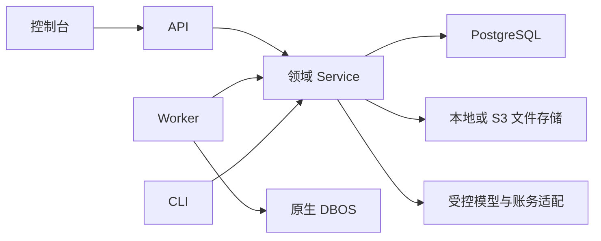

# Keystone 整体架构

Keystone 面向单企业内部多个业务模块，采用模块化单体。业务直接模块化接入，API、Worker 和 CLI 使用同一后端工程及镜像；控制台为 Vue + Element Plus。进程按执行职责分工，领域之间使用 Python Service 调用，共用 PostgreSQL，不建立内部 HTTP 服务。

当前平台目标是减少企业内部业务开发与维护的重复工作，优先简单开发、统一发布和简单部署。业务独立发布、通过远程平台协议运行专属 Worker，以及多企业共享的租户隔离均不作为当前目标；成熟度按这个单企业使用范围和本页的真实业务验证目标评估。

## 1. 整体形态

PostgreSQL 的 keystone schema 保存领域、授权和 Worker 登记，dbos schema 由 DBOS 管理。文件内容在受控存储，引用/摘要在数据库。模型密钥加密保存，实际调用、费用和文件分别保留事实。

## 2. 模块边界与调用关系

| 位置 | 负责 |
|---|---|
| core/ | 配置、数据库、日志、进程/文件锁、共享容量及公共执行设施；不依赖领域 |
| platform/ | identity、audit、dictionary、files、model_access、flow；各自拥有模型和业务规则 |
| businesses/<namespace>/ | 业务资源、Service、契约、接口及可选任务/Flow |
| examples/ | 可选的完整接入示例，平台不反向导入 |
| composition.py / bootstrap.py | 显式组合轻量声明、依赖、控制器及执行入口 |
| entrypoints/ | API、Worker、CLI 的进程入口 |

跨领域调用公开 Service/Schema，不导入其他模块 ORM/Adapter。需要跨域原子提交时，由上层明确用例持同一身份事务调用事务内 Service；被调方不提交、不另开事务。Controller 不查询 ORM、不拥有业务授权或事务。

模型接入的[多渠道设计](domains/model-access.md#8-多渠道模型接入设计)通过 CHANNELS 显式组合现有渠道的调用与账务协议。协议实现不依赖 ORM、用户权限或执行器，宿主客户端提供受控传输及错误转换；现有 Service 保留授权、发送登记、共享容量、数据库事实和恢复。协议与宿主代码均保留在当前工程并同制品发布，不新增通用协议配置、独立服务或媒体执行引擎。

已实现的操作与接口见[模型接入](domains/model-access.md#6-模型操作与产物)。NewAPI/Yunwu 的兼容聊天接口可使用配置的 HTTPS 站点和路径前缀；图片生成与原生任务仍按已接入的站点协议开放。视频和适配器独立发包尚未提供。

## 3. API 与 Worker 的分工

### 3.1 职责与状态归属

| 概念 | 事实归属 |
|---|---|
| Service | 同步或后台复用的业务规则、授权、事务、审计 |
| Task | 可独立投递的后台作业；维护任务不创建 FlowRun |
| FlowRun | 独立流程的受理、原身份、取消意图、业务结果和终态 |
| DBOS Workflow/Step | 持久编排、检查点、技术执行及恢复 |
| Schedule | 时间触发规则，不是业务运行 |
| Worker | 承载执行器的进程，不决定费用金额或业务结论 |

API 执行普通查询、配置、手动有界操作并保存持久待办。Worker 发现待办、运行 Flow 和维护 Task。业务提交与引擎投递不是天然原子；领域状态提交后由可恢复扫描补投，不能依赖提交后的临时协程。

### 3.2 Worker 生命周期与 Flow

Worker 顺序为：取得宿主/部署与固定身份锁 → 校验登记、制品和公共配置 → 收尾本身份旧实例调用 → 持久化队列预算 → 启动 DBOS 恢复/领取 → 安装稳定计划 → 报告就绪。预算必须先于执行器恢复；未获准的进程不能改预算。

DBOS 公共生命周期在 core/execution/；各模块 tasks/ 注册维护入口，业务 workflows/ 注册原生流程。具体接口见[任务执行](execution-design.md)，Flow 契约见[Flow 领域](domains/flow.md)。

### 3.3 自动任务与费用核对

文件清理、Flow 补投/取消/同步、费用扫描分别调用所属 Service。费用待办、分页进度、原凭据范围、冷却和截止由 ModelInvocation/Channel 保存；DBOS 只编排有界扫描与范围任务，不为每笔费用创建长期等待执行。

维护触发只投递实际任务，不占受限队列等待自己的子任务。API 手动查费调用相同 Service，并与 Worker 共用数据库范围锁和容量；真实 Token 范围的核对进度不会因重复 Channel 或进程重启丢失。

### 3.4 定时任务与队列

| 队列 | 每 Worker 默认 | 全局默认 |
|---|---:|---:|
| keystone-flows | 2 | 4 |
| keystone-files-maintenance | 1 | 1 |
| keystone-flow-maintenance | 1 | 1 |
| keystone-model-maintenance | 1 | 1 |
| keystone-system | 2 | 2 |

新增 Worker 不自动增加全局预算。DBOS 同时设置 worker/global_concurrency；API 和 Worker 的实际模型发送、账务 HTTP 还受 PostgreSQL 共享容量约束。SDK 保留每进程本地槽位。Flow 并发、Run 操作并发和模型物理发送并发是不同限制，详见[配置](configuration.md)。

三项维护计划 keystone.files.cleanup、keystone.flow.reconcile、keystone.model_access.reconcile_costs 使用 UTC、每 5 秒触发，启动立即运行，不补停机历史，跳过迟到超过 10 秒的触发。多个 Worker 注册同名计划；活动任务按范围和版本合并，完成后新一轮读取当前待办。所有实例的计划、队列和公共预算必须一致。

可显式启用独立的历史清理计划与队列，默认关闭，不改变上述三项的触发和健康口径。凭据、审计及已完成维护历史的边界、批次与保留期限统一见[历史清理](history-retention.md)。

计划名/时间防止重复触发；execution_key 指同一次执行，coalesce_key 合并活动工作；领域唯一约束和行锁保证事实幂等。这些机制各有边界，不能替代模型发送前登记或业务幂等。

### 3.5 多 Worker、恢复与发布

支持同宿主、同版本的固定身份登记。每个 Worker 仅配置自身 worker_id；相同身份不能重叠运行，成员增加不要求 API 或其他 Worker 重启。跨宿主共享卷和自动接管不在当前部署模型内。

默认使用一个 Worker；增加同宿主实例是已有的容量选择，不要求每个业务部署自己的 Worker。跨宿主、版本混跑和滚动发布仅在实际容量、可用性或发布需求出现时另行设计和验证，不作为当前平台成熟度的必备条件。

登记保存 executor_id、宿主/协调卷、制品和公共配置摘要、实例及退役事实。身份同时持 OS 和 PostgreSQL 会话锁，失锁停止执行，不能悄悄换连接继续。失联但未退役的身份仍参与兼容检查；心跳超时不是安全退役证明。

启动恢复只处理本身份旧实例的 running 模型调用，分批在持锁连接上提交；失锁/超时回滚当前批，保留已提交批次及原身份恢复路径。共享排队任务可由匹配版本 Worker 领取，不保证回原进程。

缩容先排空退出，再持原身份锁核实 DBOS 在途/待恢复执行和 running 调用已清空，最后显式退役。查询失败或截断不能当作清空；未分配给该身份的共享排队任务不随退役取消。

新旧制品不混跑。目录、声明、资源或检查点结构变化也会改变执行版本，须保留原制品和身份完成在途执行。具体发布、退役、离线收尾及恢复命令集中在[部署说明](deployment.md)和[备份恢复](backup-restore.md)。

### 3.6 健康状态与运维

API readiness 检查数据库、迁移和存储，不自动建表。Worker 状态分别报告进程/依赖健康及共享任务进度；没有领到任务不等于不健康，空扫描成功也不能掩盖长期积压。公开状态不含凭据、原始异常或私有运行句柄。

## 4. 事务、身份与外部调用

身份与功能权限使用当前数据库授权和 Casbin；PAT 权限为用户当前权限与令牌范围的交集。对象范围、文件内容、模型记录/费用分别检查，前端隐藏按钮不构成授权。Flow 使用原用户/原 PAT，不改用当前会话扩大权限。

业务变更与成功审计同事务，失败/拒绝在回滚后单独记录。外部 HTTP、文件或进程 I/O 不持长业务事务；发送前固定目标并原子登记，响应后按原已发生事实收尾。

模型 SDK 不隐藏重试，未知结果不换 ID 重发。已发送调用的回执/用量/费用和新操作权限分别处理：撤权、取消阻止新发送/文件发布，已发生事实仍可受限补全。费用金额是 Decimal 字符串和明确单位，未知不能当作零。

取消包含等待已启动 I/O、关闭原生进程、清理路径及释放许可；反复取消也不能提前释放。共享锁的连接所有权持续到事实提交，丢失后不换连接写回。资源、等待、输出、重试和批次均有界。

## 5. 仓库结构与扩展边界

### 5.1 后端模块与业务 Flow

平台和业务模块统一使用 controllers/、schemas/、models/、services/、adapters/、tasks/、workflows/，按需建立。根目录只保留包说明和轻量 catalog.py；不创建空任务/Flow 目录或 BaseService/通用 CRUD/Repository。

FlowDefinition/ModelRole 在轻量 Schema 中，FlowPackage 显式声明执行模块及资源。业务可组合多个 Service、Agent、工具和原生 Step；不引入在线插件、流程 DSL、TaskRun/JobRun 或第二套检查点。

### 5.2 业务页面与前端

控制台是 API 的 View，也可以直接承载业务页面；优先在现有前端按模块增加页面、路由及权限入口，复用登录和组件。业务确有界面或交付需求时可以使用独立前端；独立构建和部署是可选方式，不能成为模块接入前提。

两种方式均共用身份、CSRF、对象授权和 API 契约；持久选择和业务幂等不依赖组件生命周期。迟到响应不能覆盖新身份或新请求代次，权限失效清空受保护数据。

### 5.3 代码工程与部署单元

API、Worker、CLI 同制品发布，控制台匹配同一契约。迁移由 CLI 显式执行，服务启动只检查版本；keystone 与 dbos schema 联合备份。迁移文件平铺、全局四位序号、单一线性链，历史 revision 不重写；当前 head 和下一份新迁移示例以[迁移说明](../backend/migrations/README.md)为准。

业务模块随平台装配、构建和发布，不要求独立仓库、安装包、服务、版本调度或 Worker。保留公开 Service/Schema、依赖方向、资源归属和显式装配，便于新增模块或在明确需求下调整边界；不提前建设远程执行协议、服务拆分适配层或通用插件机制。模块边界有助于后续演进，但不承诺跨宿主或独立服务仅靠修改配置即可实现，届时仍需重新验证身份、事务、锁、迁移和恢复契约。

### 5.4 模块分层与代码规范

| 层 | 负责 | 禁止 |
|---|---|---|
| Controller | HTTP 绑定、身份提取、传输和响应 | ORM 查询、业务事务/授权 |
| Service | 用例、规则、授权、事务、审计、领域查询 | Request/Response、DBOS/Worker/FlowContext、SDK 协议实现 |
| Model | 单个实体、约束、索引和关系 | 执行调度与业务用例 |
| Schema | 轻量输入契约与显式白名单投影 | 查库、Service、ORM/SDK/执行器依赖 |
| Adapter | SDK/协议/存储和技术协调 | 业务授权、领域事务、反向调用 Service/ORM |
| Task / Workflow | 原生编排、检查点、投递与进度 | 直接读写领域表或持久化运行时对象 |

依赖为 Controller/执行适配 → Service → 本模块 Model/Adapter，各层可使用轻量 Schema。模型每文件一个实体，__init__.py 显式导出；不遍历 ORM 列自动生成响应。Model Access 的 billing/inference 分别处理账务/调用协议，普通 Service 通过明确客户端契约交接，不直接导入 OpenAI/httpx2。

Adapter 仅在 core 许可内做技术锁协调；flow/adapters/dbos.py 可适配 DBOSClient，但不注册业务执行器。这不是其他 Adapter 导入执行器或领域表的通用例外。

### 5.5 业务权限、审计与模型接入

catalog.py 只声明权限/审计字段；composition 显式合并并拒绝冲突，不动态扫描业务。Model 元数据、Controller 路由、Task 工厂和 FlowPackage 也分别显式装配。脚手架、API 和 Worker 使用同一份声明。

新业务的资源、操作、对象范围、唯一约束、审计和文件引用先由业务定义，再选择同步 Service、Task 或独立 Flow。具体步骤和示例集中在[模块扩展](extending.md)。

### 5.6 示例流程装配与停用

examples/document_review 提供受控文件读取、Agent、工具预算和报告的完整示例，默认不作为业务安装。启用时显式装配 Package，停用只影响新受理；历史 Run 仍按原契约和原制品处理。代码、接口与资源的可运行用法见[Flow 开发](flow-development.md)。

人工决定属于业务资源和 Service，前后自动阶段采用独立 Flow。当前事务内受理和文件采用能力可供组合，不提供通用审批实体、持久人工等待或唤醒 API。

## 6. 验证与文档

架构检查覆盖正反导入、相对导入、嵌套执行文件和例外绕过；集成检查真实事务、跨进程锁、取消和恢复。统一检查入口见[测试说明](../backend/tests/README.md)。迁移与 API/Worker 指纹、私有证据和错误白名单是行为契约，整理目录不能改变这些保证。

### 6.1 真实业务适用性验证目标

以下是待通过实际业务验证的目标，现有示例、自动化检查和测试替身不代表已经完成：

- 首个真实业务按需使用身份、文件、模型或 Flow，完成领域操作、页面、权限和结果保存闭环；普通业务不必为了接入平台增加 Flow。
- 第二个业务复用公共能力，主要增加自己的模型、Service、页面、迁移及显式装配，不反复改写公共领域内部实现。记录首个和第二个业务的接入耗时、重复样板、公共领域改动及文档缺口，检查复用是否实际减少开发工作。
- 开发者或 Agent 能依据接入文档完成模块接入、定位错误及必要验证；不依赖维护者口头说明内部装配规则。
- 在目标单企业环境和真实负载下验证权限变化、重复请求、人工决定后的业务采用、失败恢复、费用与外部副作用、发布及联合备份还原，记录延迟、资源占用、停机时间和人工操作量。自动化模拟通过不替代部署环境及业务效果验证。

新增接入能力以这些验证中暴露的重复需求为依据。单企业和简单部署的定位不降低授权、事务、幂等、数据保留与恢复要求，也不把跨宿主、多租户或独立发布作为先完成业务验证的前置条件。

文档按架构边界、领域契约、接入示例和操作命令分工，不保存实施计划、重构前后映射、逐轮验收日志或未实现业务的完整方案。
