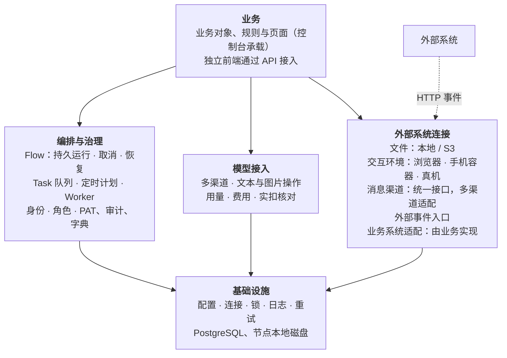
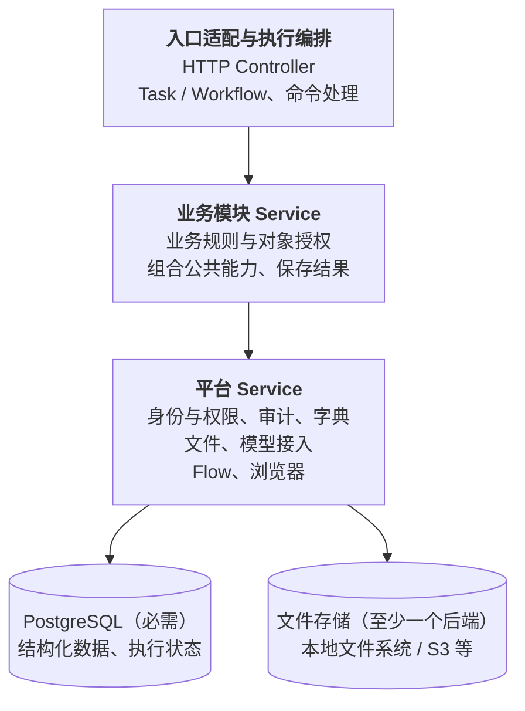
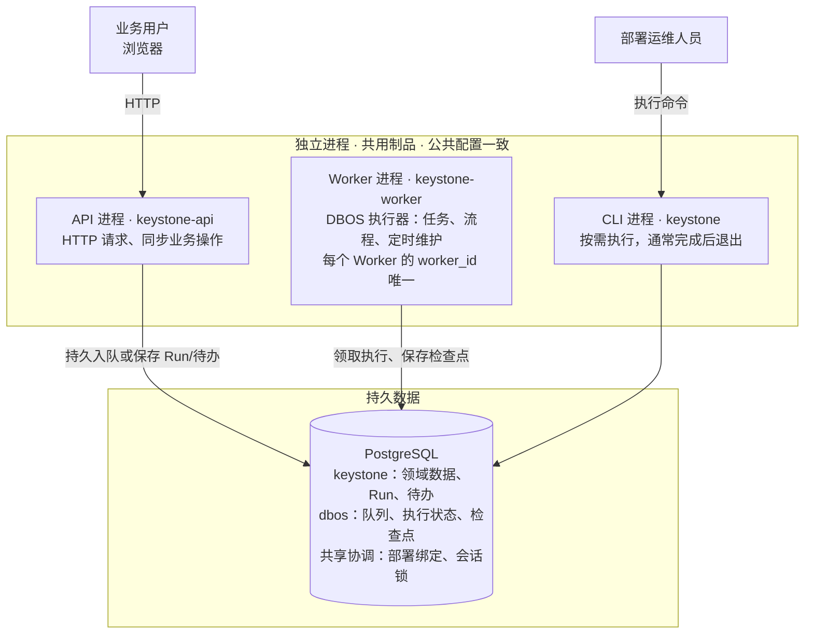
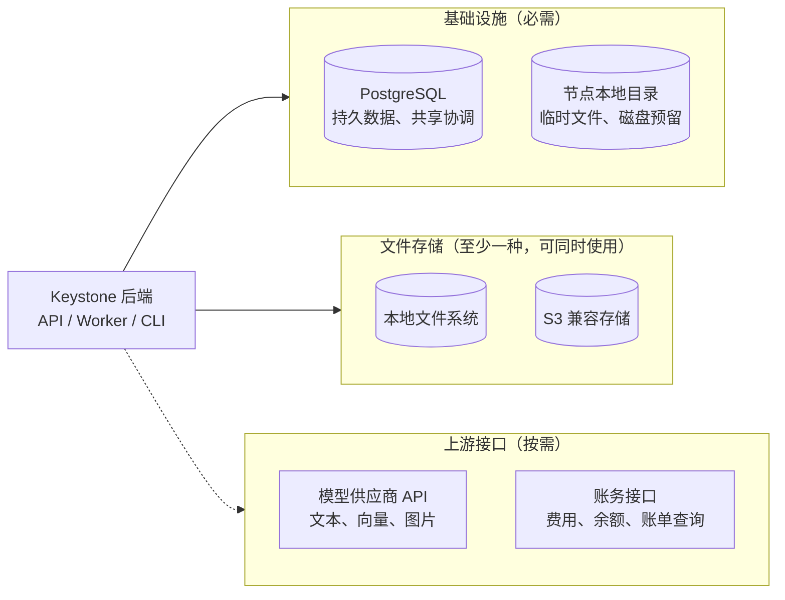

# 整体架构

Keystone 是单企业内的分层模块化单体。业务与平台共用工程、PostgreSQL 和发布制品，通过进程内 Python Service 协作。

默认一个 Worker，优先简单开发和部署；可按[存储拓扑](#14-外部依赖)增加同版本 Worker。多租户和独立业务发布按实际需求另行设计。以下是设计基线，入口与协作见第 3 节，具体契约以各模块文档为准。

## 1. 架构视图

### 1.1 能力视图

能力视图按职责划分，与目录不一一对应，例如文件、浏览器和模型接入都属于 platform/；代码分层见 1.2 和[接入规范](development/business.md#模块分层与代码规范)。业务按需直接组合各项平台能力。

目标与当前实现差异：

| 能力 | 当前实现 | 目标 |
|---|---|---|
| 部署编排 | [单宿主 Compose](operations/deployment.md#23-单宿主-compose) 启动完整应用栈，迁移显式执行；健康状态只在宿主内可见 | 外部监控进程存活并告警 |
| 消息渠道 | 飞书群机器人与自建应用：发送、账号绑定、卡片动作和固定命令已实现；企业微信待实现，见[设计](domains/messaging.md) | 平台模块，按模型接入方式声明多渠道适配，统一消息、交互卡片和回调 |
| 交互环境 | 仅浏览器：人工画面与控制台画面页、首次使用创建、备份恢复、闲置结束与业务保留检查；Worker 自动操作与人工共用控制权，续段按交还点核对 | 托管与接入两类提供方，Worker 自动操作与人工共用控制权，见[设计](domains/environments/README.md) |
| 外部事件入口 | 未实现 | 鉴权、幂等、有界地接收外部事件并受理为业务 Flow |
| 业务系统适配 | 凭据加密已作为 core 公共部件；有界 HTTP 仍在模型接入内部 | 不建统一接口，由业务模块按对象模型实现，平台按需开放公共部件 |
| 费用汇总 | 单次调用的用量、预估费用和实扣，按用户查询 | 按业务或 Flow 汇总并超阈值告警 |

各项设计时在对应领域文档确定契约。

### 1.2 逻辑分层

入口处理请求和执行编排，Service 管理规则与数据；PostgreSQL 保存结构化数据和执行状态，文件存储适配本地文件系统、S3 等后端。

### 1.3 进程运行关系

API、Worker、CLI 独立启动，共用代码，公共配置保持一致，进程专属参数分别设置；每个 Worker 使用不同的 worker_id。Service 是各进程内的对象；DBOS 在 Worker 内运行，API 与 Worker 通过持久数据衔接执行，不通过内部 HTTP 调用。

### 1.4 外部依赖

PostgreSQL 是唯一的共享协调服务；节点本地目录只负责临时文件、磁盘预留及本地 I/O 保护。含 `filesystem` 源的部署限单宿主，仅 S3 可跨宿主，见[存储拓扑](operations/configuration.md#4-文件存储与部署拓扑)。

## 2. 模块职责与协作

| 模块 | 职责与数据归属 | 主要协作 |
|---|---|---|
| [身份](domains/identity.md) | 用户、角色、会话、PAT 和当前功能权限 | 为其他模块提供授权上下文，操作写入审计 |
| [审计](domains/audit.md) | 重要操作的追加记录与授权查询 | 各模块显式写入，查询复用身份授权 |
| [字典](domains/dictionary.md) | 字典、选项及可选性校验 | 业务保存选项 ID，字典不决定业务行为 |
| [文件](domains/files.md) | File、引用、内容完整性和清理 | 业务/Flow 维护引用，业务负责对象访问规则 |
| [模型接入](domains/model-access.md) | 渠道、模型映射、调用、用量、费用和恢复证据 | 业务/Flow 调用并按需保存文件 |
| [Flow](domains/flow.md) | Run、固定输入与模型绑定、结果和取消意图 | 使用身份、模型和文件能力，DBOS 负责执行与检查点 |
| [Worker](execution.md#7-worker-与资源) | 固定身份登记、心跳和退役 | API 与 CLI 查询状态，模型接入通过只读接口核对公共配置 |
| 业务模块 | 自己的对象、权限范围、业务状态和结果 | 按需组合平台 Service，保存业务记录及文件引用 |

跨模块只调用公开 Service/Schema，不访问其他模块的 ORM/Adapter。core 提供配置、连接、日志、锁和执行设施，不包含业务规则。

组合逻辑按用途放置：业务专用组合放业务 Service；公共跨域用例放上层 use_cases.py，如 Flow 诊断。composition/bootstrap 只装配声明和依赖。

## 3. 运行入口与后台执行

| 入口 | 运行方式与职责 |
|---|---|
| API：keystone-api | 常驻 HTTP 进程，处理查询、写入和有界同步操作 |
| Worker：keystone-worker | 常驻后台进程，承载 DBOS，执行 Task、Flow 和维护计划 |
| CLI：keystone | 命令行运维工具，初始化、检查、清理或恢复，通常完成后退出 |

后台执行有两种衔接方式：

| 场景 | 持久依据 |
|---|---|
| 普通 Task | 直接持久入队，DBOS 保存输入与执行，无需领域待办表或 FlowRun |
| Flow 及领域维护 | 先保存 Run/待办，由协调任务发现并投递；领域保存业务事实，DBOS 保存技术执行 |

DBOS 同时支持定时触发。提交成功不等于执行完成，业务结果、运行状态与检查点分别确认；具体入口选择和执行规则见[任务执行](execution.md)。

业务入口负责对象授权、Flow 受理和结果登记。Files 仅提供内部能力；控制台保留配置、用量与运行监控。无引用文件回收默认关闭，启用条件见[文件设计](domains/files.md#7-当前实现约定)。

## 4. 核心约束

- 每次独立操作检查当前身份、功能和对象范围；PAT 为当前权限与原范围交集，Flow 使用原用户/原 PAT。
- 业务变更与成功审计同事务，失败/拒绝审计在回滚后独立尝试；跨模块原子操作由上层协调同一身份事务，被调 Service 不另开事务、不自行提交；外部 HTTP、文件和进程 I/O 不持长业务事务。
- 模型发送前唯一登记，SDK 不隐藏重试，未知结果不换 ID 重发。生成、文件保存和业务提交分别确认，已发生事实受限保存。
- 外部凭据由 `CredentialVault` 加密，密文绑定对象 ID 与用途（新模块按 `模块.用途` 命名）；缺少[配置密钥](operations/configuration.md#41-凭据加密密钥)则拒绝加解密，不回退。结果、审计、日志和检查点不含明文。
- 有副作用的外部写入不隐藏重试；结果未知时，仅在对方支持幂等键或可按原请求查询时用原标识重试或确认，否则交由业务决定。
- 取消和撤权阻止新操作；反复取消也须等待已启动 I/O、进程及文件清理完成后再释放句柄/许可，终态按事实确认。等待、并发、批次、输出和重试有界。

## 5. 开发与部署

业务按模块接入现有工程，控制台可直接承载业务页面。代码分层、目录和显式装配见[接入规范](development/business.md#模块分层与代码规范)，完整示例见[最小业务](development/business.md#快速接入)与 [Flow 开发](development/flow.md)。

队列、计划与 Worker 恢复见[任务执行](execution.md#7-worker-与资源)；初始化与发布见[部署](operations/deployment.md)，持久数据保护见[联合备份](operations/backup-restore.md)。

## 6. 验证

[自动检查](../backend/tests/README.md)覆盖代码依赖、授权、真实事务、跨进程执行与恢复。真实业务仍须验证完整页面与结果保存、第二业务的复用成本，以及目标负载下的发布和联合恢复；示例与协议桩不能替代这些验证。
