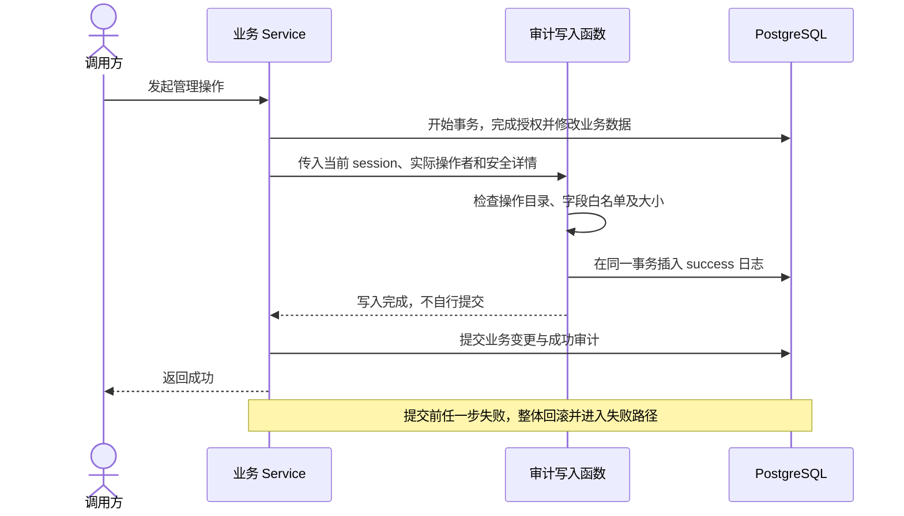
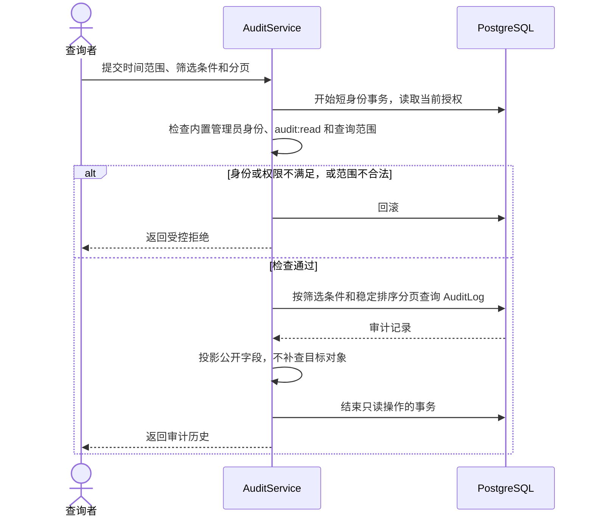

# 审计日志

审计记录谁在何时对哪个对象做了什么、结果如何。各领域显式声明重要操作并写入，审计模块统一保存与查询。

## 1. 范围与边界

| 记录 | 用途 |
|---|---|
| AuditLog | 登录、授权、配置、删除等重要操作历史 |
| ModelInvocation | 每次模型尝试的状态、用量和费用 |
| 应用日志 | 堆栈、网络错误、调试及维护任务结果 |

不逐次审计普通读取、SQL 或自动步骤。全局审计仅供具备 audit:read 的内置管理员；未来业务历史使用独立的业务权限和对象范围，可复用审计存储。

实现差异：当前后端和控制台只检查 audit:read，尚未增加内置管理员身份限制。

## 2. 领域模型

仅一张追加表 AuditLog。

| 字段 | 含义 |
|---|---|
| id、occurred_at | 服务端 ID、数据库 UTC 时间 |
| actor_type、actor_id | user/system/anonymous；只有已认证 user 填用户 ID |
| action | 模块声明的稳定操作代码 |
| target_type、target_id | 可空的目标类型及字符串 ID |
| outcome | success、failure、denied；表示本次尝试结果 |
| correlation_id | 可空，关联一次请求/执行尝试 |
| details | 可空、脱敏的小型 JSON，最多 8 KiB |

历史标识不设置随业务删除的级联关系，目标删除后日志仍可读取。应用不修改日志，不增加重复的创建、更新或软删除字段。

Actor 来自可信上下文：用户及 PAT 操作记实际用户，PAT 附非秘密 credential_id；管理员管理他人凭据时记管理员，所属用户作为目标。Worker 代表用户执行业务仍记用户，系统维护及事实同步记 system；未认证登录失败记 anonymous，不把输入用户名当身份。

details 按操作字段白名单构造必要快照或前后值，递归校验。禁止密码、哈希、Token、Cookie、渠道秘密、提示词、模型输出、文件正文、完整报文及异常堆栈；不能自动序列化 ORM 整行。

## 3. 主要流程

### 3.1 数据库内的管理操作

业务变更与成功审计同事务，writer 不自行提交。失败或拒绝先回滚，再用独立短事务尽力写 failure/denied；记录失败时保留原错误并写脱敏运行日志，不递归审计。

删除对象前取得必要标识和快照；批量操作可用一条日志表达实际范围与数量。

### 3.2 文件删除等外部操作

| 已确认事实 | 审计 | 操作者 |
|---|---|---|
| 删除请求提交，进入 deleting | file.delete.request / success | 请求用户 |
| 内容删除完成，确认 deleted | file.delete.complete / success | system |
| 本轮清理失败，仍为 deleting | file.cleanup.failure / failure | system |

每阶段的状态和审计同事务，外部 I/O 在事务外。数据库回滚不能撤销外部删除；状态确认失败由文件领域核实后重试，审计不另建补偿引擎。当前文件删除完成还同事务清除 FileGrant，可合并记录清理范围与数量。

### 3.3 查询与历史保留

全局查询同时要求当前内置管理员身份和 audit:read，PAT 还须包含该权限；普通角色即使有 audit:read 也不放行。时间、操作者和目标等筛选只缩小查询范围，不构成权限隔离，也不授予目标或文件访问权。

查询直接投影历史 ID 与安全快照，不补查当前业务对象。未来业务历史由业务服务限定已授权对象、操作范围和返回字段，不能靠客户端任意填写 target/action 隔离。

审计查询不审计自身。保留期清理使用[历史维护](../operations/deployment.md#历史保留与清理)，结果写运行日志，无业务逐条删除入口。

## 4. 权限与审计

writer 仅供服务端调用，不开放任意客户端写入。各模块 catalog.py 声明操作和字段，composition 合并并拒绝冲突，将不可变目录绑定 Database；writer 从当前 session 读取目录，未绑定或操作未声明时拒绝。

查询按 occurred_at、id 倒序分页；索引覆盖时间、操作者＋时间、目标＋时间，JSON 字段按实际查询需要建索引。应用追加限制不等于数据库防篡改或合规认证。

## 5. 设计取舍

使用一张表、显式动作目录和事务内 writer。保留业务行的必要创建/修改字段，完整历史由 AuditLog 表达；不引入 ORM 自动钩子、事件溯源、消息总线或独立审计服务。

## 6. 状态与设计验证

### 6.1 记录的事实与写入状态

outcome 不是状态机；重试成功追加新记录，不把原 failure 改成 success。

| 当前事实 | 事件 | 结果 |
|---|---|---|
| 事务内成功日志 | 业务提交 / 回滚 | 一起保存 / 一起消失 |
| 失败或拒绝 | 原事务已回滚 | 独立尝试保存，不保证数据库不可用时仍能写入 |
| 已提交日志 | 后续操作或目标删除 | 原记录不变；仅受保留期维护清理 |
| 外部请求已受理 | 完成或失败被确认 | 追加对应阶段事实 |

### 6.2 关键不变量

1. 已提交的业务管理变更与成功审计原子保存，回滚不留下虚假 success。
2. 记录实际操作者，只保存声明字段和安全值。
3. 失败审计不覆盖原错误，缺少日志不证明外部操作未发生。
4. 历史不依赖目标继续存在，审计读取不扩大目标访问权。

### 6.3 失败窗口与验证场景

真实 PostgreSQL 验证业务/审计共同提交、共同回滚及失败后的独立记录；单元验证 Actor、递归字段和 8 KiB 限制。外部操作确认、响应丢失和重试遵循所属领域幂等规则。

## 7. 当前实现

代码位于 backend/src/keystone/platform/audit/。writer.py 管 Actor、白名单与写入，query.py 通过 AccessContext 查询，控制器和响应 Schema 分离。平台/业务动作以各自 catalog.py 为准，不在文档复制完整动作清单。

| 所属领域 | 审计范围 |
|---|---|
| Identity | 登录/退出、用户和密码、角色、PAT、凭据撤销及管理员初始化 |
| Dictionary | 字典/选项创建、名称说明、排序和启停 |
| Files | 上传阶段、资料、授权、引用增删、删除阶段及残留清理 |
| Model Access | 渠道/模型配置、密钥变更状态、余额刷新、显式费用重查/范围绑定 |
| Flow | 受理、首次取消、完成同步；步骤留在 DBOS，调用留在 ModelInvocation |
| 维护 | model.invocation.recover 记录系统收尾来源，批次变更和逐条审计同事务 |

普通调用完成和自动费用补全不重复写管理审计。已认证 PAT 的失败/拒绝路径沿用 credential_id；未认证凭据不推测编号。日志保留清理默认不自动启用。

### 7.1 控制台查询

GET /api/v1/audit-logs 与 /console/audit 当前要求 audit:read。支持时间、Actor、action、目标和 outcome 筛选，每页默认 50 条，只读详情，无编辑、删除或导出。

since/until 含端点且须带时区；缺 until 使用数据库当前时间，缺 since 使用 until 前 30 天，范围最多 366 天。提交查询固定时间窗口，翻页与刷新沿用，重新查询/重置才更新范围。actor_id 为 UUID，target_id 为字符串；JSON 作为文本展示，不补查对象。

### 代码组织

AuditLog 位于 models/audit_log.py。writer 不依赖 AccessContext；query、controllers/logs.py 和 schemas/logs.py 按[统一分层](../development/business.md#模块分层与代码规范)组织。
