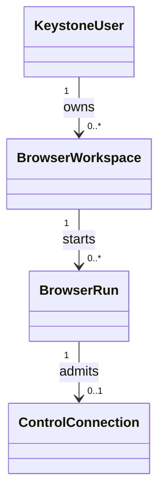
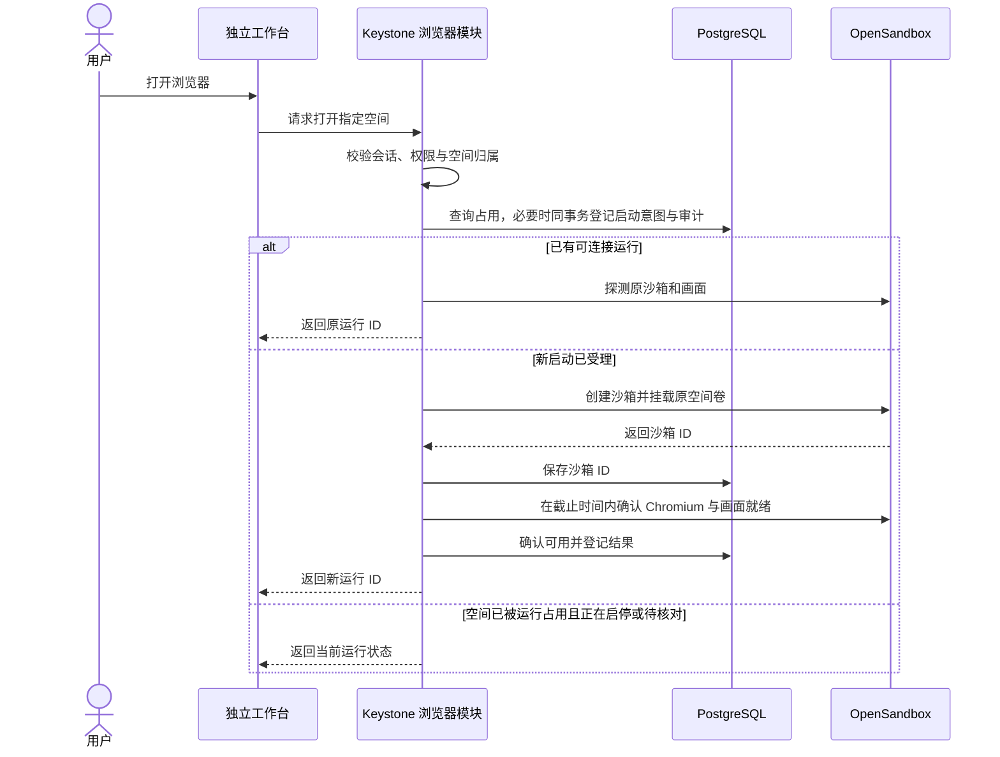
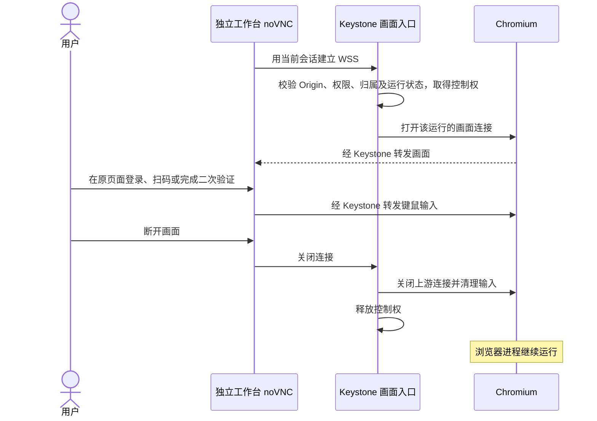
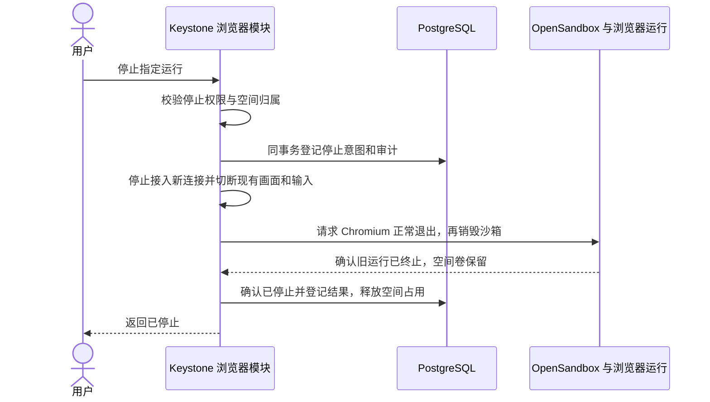
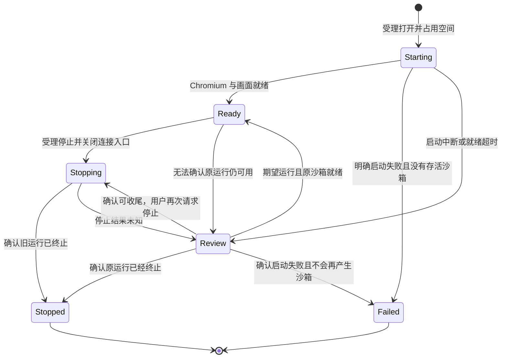
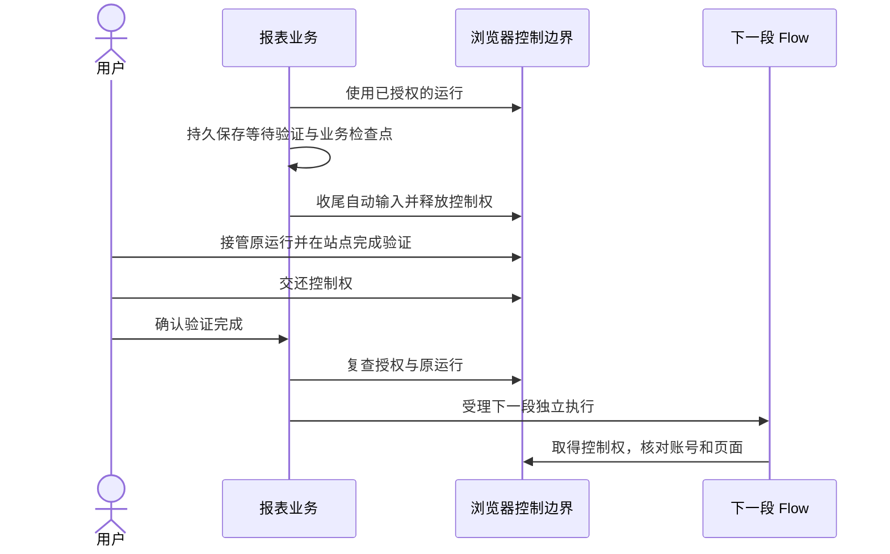
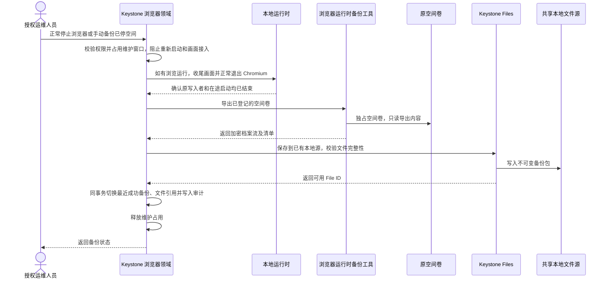
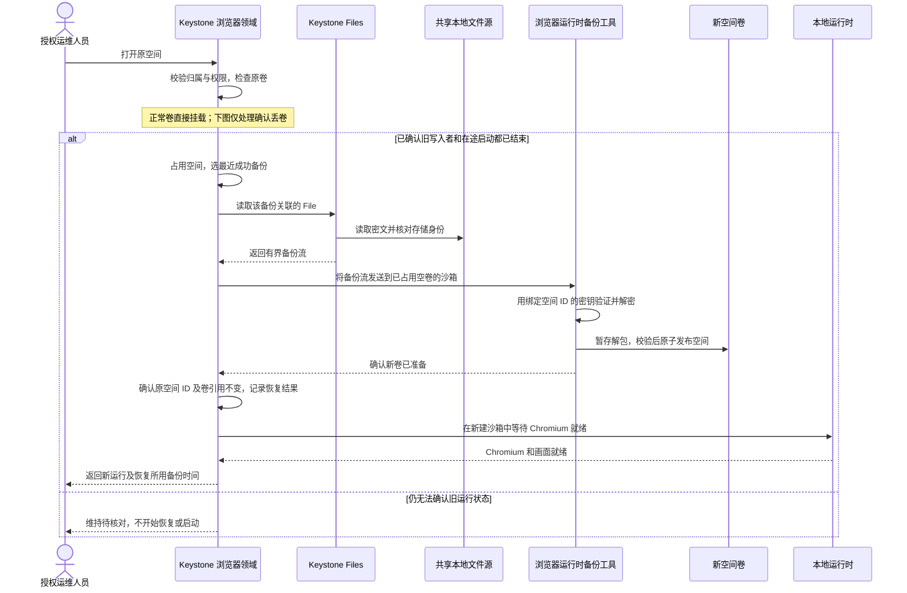

# 浏览器

## 1. 能力范围

浏览器领域模块提供有归属的持久浏览器空间、按需启停的运行和受控的交互画面。首版选用标准、有界面的 Chromium，由 OpenSandbox 在本地 Docker 环境运行。独立工作台是首个调用方，用户在 Chromium 原窗口登录、扫码和处理验证，断开画面后可以回到仍在运行的原页面。

| 能力 | 首版范围 |
| --- | --- |
| 浏览器空间 | 部署时登记一个属于指定用户的浏览器空间，绑定预先创建的持久卷。工作台显示本人空间 |
| 运行 | 打开时复用可连接的运行，或启动新运行。支持查询、停止和重新检查待核对结果 |
| 画面 | 通过同源 WSS 嵌入 noVNC。支持连接、断开、重连和独占键鼠控制 |
| 权限与审计 | 复用 Identity 和 Audit。后端校验当前用户、功能权限和空间归属 |
| 自动化衔接 | 第二个真实业务验证同一空间的人工接管与恢复后，再确定自动操作接口 |

仓库在 [`examples/browser-workbench`](../../examples/browser-workbench/README.md) 提供独立的参考前端和本机运行示例。Keystone Console 是现有管理入口，参考前端通过同一 HTTPS 入口复用 Identity 的会话 Cookie。见[身份会话协议](identity.md#7-最小实现约定)。

## 2. 领域模型与事实归属

| 对象 | 内容与归属 |
| --- | --- |
| `BrowserWorkspace` | Keystone 保存稳定 ID、所有者、显示名和唯一的存储引用。OpenSandbox 挂载空间卷，Chromium 保存 Cookie、标签页和站点设置 |
| `BrowserRun` | Keystone 保存本次运行的 ID、所属空间、用途（`browse` 或 `backup`）、生命周期状态、待核对的操作和已知的 OpenSandbox 沙箱 ID。同一空间允许历史运行，当前占用最多一个 |
| `ControlConnection` | API 进程中的临时连接，绑定具体运行和 Keystone 登录会话。断开释放控制权 |
| 第三方站点登录 | 由站点判断，由原页面显示。空间持久化让运行能够尝试复用登录 |

运行 ID 随创建请求传入 OpenSandbox 的受控元数据，用于核对外部沙箱。OpenSandbox 是容器存在与否的事实来源，Chromium 和远程画面的探测决定能否使用。Keystone 的运行状态表达操作意图、最近确认的结果和对空间的占用。备份使用独立用途的 `BrowserRun`，不再借用浏览器的停止状态。[OpenSandbox 生命周期规范](https://github.com/opensandbox-group/OpenSandbox/blob/release-1.2.0/specs/sandbox-lifecycle.yml)

## 3. 职责与授权

| 层 | 职责 |
| --- | --- |
| 工作台前端 | 展示空间、运行状态和连接状态，渲染 noVNC，提供「打开浏览器」「断开画面」「停止浏览器」「重新检查」 |
| Keystone 浏览器模块 | Controller 处理 HTTP 和 WSS，Service 负责对象授权、运行状态、审计与控制准入。Adapter 调用固定的 OpenSandbox 环境和浏览器镜像 |
| OpenSandbox 与浏览器镜像 | 单宿主 Docker 后端负责创建沙箱与挂载持久卷。镜像启动 Chromium 和虚拟显示，提供画面、就绪检查与正常退出入口 |
| 调用业务 | 选择业务目标、判断何时需要人工验证、记录任务状态和人工决定 |

浏览器模块在现有 Keystone API 进程中显式装配。首版的启动和停止在有截止时间的请求内执行。先提交业务状态和受理审计，再调用外部服务。超出截止时间后由有权用户显式重新检查。此模式适用于单宿主、一个 API 进程和一个预先拉取的镜像。见[整体架构](../architecture.md)和[模块分层](../development/business.md#模块分层与代码规范)。

查看、打开、连接和重新检查均要求空间使用权限及本人归属。停止还要求停止权限。重新检查只查询运行侧事实并记录核对结果，清理无法识别的沙箱由部署者通过受控运维入口执行。客户端只传空间或运行 ID，镜像、卷、运行参数和转发目标由服务端决定。审计登记受理、拒绝和确认结果，只保留已知操作者、空间与运行 ID、结果和时间。参见[身份](identity.md)与[审计](audit.md)。

## 4. 主要时序

### 4.1 打开浏览器

### 4.2 连接画面与人工验证

### 4.3 停止浏览器

## 5. 运行状态图

| 状态 | 工作台显示 | 允许的操作 |
| --- | --- | --- |
| `Starting` | 启动中 | 查询，重复打开返回同一运行。处理进程中断后可重新检查 |
| `Ready` | 可连接 | 打开或重连画面，断开，停止 |
| `Stopping` | 停止中 | 查询，重复停止返回同一运行的状态。处理进程中断后可重新检查 |
| `Review` | 待核对 | 重新检查原运行。确认可收尾后，可以再次请求停止 |
| `Stopped` / `Failed` | 已停止 / 启动失败 | 查看结果。再次打开产生新运行 ID |

画面连接和网站登录分别显示。画面断开属于临时传输状态。网站要求重新登录时，用户在 Chromium 原页面处理，运行仍可处于 `Ready`。`BrowserRun.purpose=backup` 只表示备份维护，不能接入画面，也不会暴露为可停止的浏览器。

### 5.1 并发与恢复

- 同一空间在 `Starting`、`Ready`、`Stopping`、`Review` 中最多有一条运行记录，由数据库唯一约束保护。所有启停和核对结果绑定原运行 ID 和当前状态，过时响应不能覆盖后续状态。启动和停止的审计分别区分「已受理」和「已确认」。
- 创建请求超时或 API 在提交后退出时，保留空间占用。核对优先按已知沙箱 ID，否则按创建时的关联元数据查找，并验证来源与空间绑定。单次查空不能证明创建请求已经结束。确认旧请求已结束且不存在仍能写入空间卷的运行后，才能释放占用。无法证实时保持「待核对」，由部署者收尾。
- 停止的受理和画面准入在同一 API 进程内串行化。受理后立即冻结输入并拒绝新连接，现有连接收尾后才停止浏览器。停止超时后复查同一个运行。只有确认它仍存活且上一轮停止已结束，才允许用户请求继续原停止意图。空间卷缺失或不可读时停止创建并报告异常。
- 复用原运行前做有界探测。OpenSandbox 已创建容器与浏览器画面已就绪分别确认。进程崩溃后控制连接随之关闭，下一次打开或重新检查先核对持久状态。[OpenSandbox 就绪检查](https://github.com/opensandbox-group/OpenSandbox/blob/release-1.2.0/docs/sdks/python.md)

### 5.2 画面与存储边界

- WSS 校验精确 Origin、浏览器会话、功能权限、空间归属和具体运行。每个运行在单 API 进程中只接入一个可写连接。断开后清理双方传输与输入，再交给下一个连接。
- 长连接按有界间隔复查权限和会话，复查失败或授权窗口到期即停止双向转发。建议首版以 5 秒作为撤权延迟验收上限。已经送达浏览器的输入按已发生事实处理。
- OpenSandbox Key 和 Docker socket 分别留在 Keystone 后端与 OpenSandbox Server。画面端点只通过授权代理提供。浏览器以受限用户运行并保留浏览器沙箱，运行网络与 Keystone 数据库及宿主机管理面隔离。空间卷及备份按登录凭据保护。画面、键鼠和站点凭据只用于交互传输，应用日志保存事件元数据。[noVNC 客户端 API](https://novnc.com/noVNC/docs/API.html) · [OpenSandbox 桌面接入示例](https://github.com/opensandbox-group/OpenSandbox/blob/main/docs/examples/desktop.md)

### 5.3 运行复用与环境变更

浏览器运行按常驻模式创建，显式使用 `timeout=None`。刷新工作台、断线或重启 Keystone API 时，客户端重新授权并连接仍在运行的原运行。noVNC 在前端本地缩放画面，工作台尺寸变化时保持远端窗口布局。只有显式停止、运行终止或受控升级才需要重建浏览器环境。[OpenSandbox Python SDK](https://github.com/opensandbox-group/OpenSandbox/blob/release-1.2.0/docs/sdks/python.md) · [noVNC 客户端 API](https://novnc.com/noVNC/docs/API.html)

重建时复用原空间卷、Chromium 档案路径和运行用户。如果 Chromium 使用系统密钥环，部署需同时保留空间解密所需的环境。部署固定镜像版本，浏览器安全更新按正常发布流程进行。即使空间可读，浏览器版本、操作系统或网络环境变化也可能触发站点复验，原标签页恢复与登录复用须分别验证。[Chromium Linux 密钥存储](https://chromium.googlesource.com/chromium/src/+/8462c68e/components/os_crypt/sync/key_storage_linux.h) · [浏览器指纹](https://developer.mozilla.org/en-US/docs/Glossary/Fingerprinting)

## 6. 第二个调用方与人工接管

以报表下载验证复用。自动阶段遇到验证页后，由报表业务持久化目标空间、业务检查点和「等待验证」，并结束本段执行。平台先确认自动输入已停止，再给人工连接控制权。用户完成验证并显式交还后，业务复查权限并受理下一段独立执行。下一段取得控制权后先核对账号和页面。提交结果未知时先核对外部结果。

任务的等待、确认、取消和超时属于业务持久状态。人工与自动化共享输入边界，确保同一时刻只有一方可以操作。第二个真实调用方验证了同一套归属、授权和控制权后，再确认平台公开的自动操作接口。见[Flow 人工决策边界](flow.md#8-api授权与诊断)。

## 7. 接入和部署

本机试用见[示例部署说明](../../examples/browser-workbench/README.md)。现有 Keystone 部署可以在单一 API 进程设置 `KEYSTONE_BROWSER_RUNTIME_URL`、`KEYSTONE_BROWSER_RUNTIME_KEY` 和 `KEYSTONE_BROWSER_RUNTIME_IMAGE`，让 OpenSandbox 通过专用网络访问沙箱，使用 `[proxy] resolve_internal = true`，并通过同一 HTTPS 入口提供应用和 API。三项在启用模块时必须同时设置；运行镜像从 [`deploy/browser/runtime`](../../deploy/browser/README.md) 构建并预分发到 OpenSandbox 宿主。生产部署应限制浏览器的出站访问。

### 7.1 恢复目标与数据边界

目标是：**Keystone 正常运行时，删掉 Chromium 容器和原 Docker 空间卷，仍能用 Files 中最近成功的备份恢复同一个浏览器空间。** Keystone 数据库整体丢失属于平台故障，不在空间恢复范围内。正常启动优先使用现有卷；只有确认卷缺失才从备份重建。恢复只包含最近一次成功备份时已写入空间的数据。

| 要恢复的事实 | 保存位置及边界 |
| --- | --- |
| 空间 ID、所有者、权限 | Keystone 数据库，恢复只针对已有空间，沿用当前归属和权限 |
| 浏览器空间内容 | Docker 卷是运行时的工作副本。停写时导出加密备份包，经 Keystone Files 保存到部署已有的本地 `filesystem` 源 |
| 备份记录 | 每个空间首版只保留一个「最近成功备份」，记录时间和兼容信息，通过 `FileReference` 保留对应的不可变 File |
| 运行环境与解密材料 | 保存浏览器镜像摘要、Chromium 档案路径、运行 UID 和必要配置。备份解密使用部署配置中独立保存的 `browser_backup_key`。要求离线完整恢复时，预存相应的 Keystone、浏览器、OpenSandbox Server/execd 和所需基础服务镜像制品 |
| 第三方网站状态 | Cookie、标签页、设置和 Chromium 已保存凭据随空间回到备份点；站点服务器端的会话有效期和二次验证不随备份回滚 |

浏览器领域负责空间授权、维护占用、备份保留和审计；[Files](files.md#12-业务授权与文件操作契约)负责文件完整性、引用保护及回收。备份文件只由浏览器领域按已授权空间定位，不开通用下载入口。同宿主的受控工具只对已登记卷导出，或恢复到为该空间预留的新卷；应用 API 容器不增加 Docker socket。

备份与其他文件共用 Files 的默认源。浏览器领域通过备份记录区分用途、授权和保留期，并用 `FileReference` 保留文件；实际目录和对象键由 Files 管理。启用备份时默认源必须是本地 `filesystem`；如果默认源是远程存储，应调整部署的默认源，而不是为备份另加一组浏览器专用存储配置。只有部署确实需要另一块盘、不同的访问边界或独立的存储生命周期时，才另配 Files 存储源。

备份文件和恢复密钥都必须位于浏览器空间卷之外。若仅防止误删该卷，独立的 Files 卷已经满足隔离；若还要防止 Docker 数据目录整体丢失，部署时把**共享的本地 Files 源**放在 Docker 数据目录之外，以宿主机目录绑定挂载给 Keystone。首版复用 Files 的有界流式读写和容量检查，按实际空间大小配置[文件上限与磁盘保底](../operations/configuration.md#2-应用参数)；超过限制时备份明确失败，不覆盖上一份可用备份。S3 等远程源不作为本机恢复的必要依赖。

### 7.2 生成备份

启用浏览器模块后，工作台在正常退出 Chromium 后自动备份，也允许对已停止空间手动备份。浏览器还在运行时，手动备份需先停机；不为定时备份打断常驻运行。备份结果与停止结果分别显示，自动备份失败时浏览器仍可正常停止，最近成功的备份仍然可用。

浏览器用部署配置的 `browser_backup_key` 按空间 ID 派生每个空间的密钥。该密钥由部署方生成并保存在配置系统或独立密钥库中，不写入数据库、Files 或浏览器空间卷；轮换前必须保留仍被旧备份引用的密钥版本。Files 记录备份时点和密文校验信息，只用兼容 Chromium 版本恢复。新文件写入并校验成功后，才切换最近成功备份；失败时保留旧备份及其引用。切换后释放旧引用，Files 按现有规则回收，不原地覆盖备份文件。备份包含持久的 Chromium 档案，排除进程锁、套接字和常见缓存。工作台刷新后显示最近成功备份时间。

### 7.3 原卷已删时恢复

OpenSandbox 按已登记的卷名创建替代卷。Keystone 先占用空间，沙箱只在卷没有空间标记且为空时接受恢复；校验通过才发布恢复后的空间内容并启动 Chromium。卷非空且不可识别时报告异常，不覆盖原数据。卷缺失但没有可用备份时报告无法恢复，不初始化空空间。数据库里的旧运行记录只用于核对，不能当成可连接运行。

配置本地 Files 且预存运行镜像时，备份和恢复不依赖网站、云存储或公共镜像仓库。首版自动路径仍需要本机 Docker 和 OpenSandbox 可用；旧写入者未确认时维持占用。打开后的站点访问和重新验证由站点决定。

## 8. 验收与当前实现

- 用一个真实站点手动验证。分别测试刷新工作台、同版本重建浏览器和升级镜像。刷新后应接回原页，后两项分别记录页面恢复和登录复用结果。站点会话失效时可在同一入口重新验证。
- 并发打开只有一个启动，双连接只有一个获得输入权。验证跨账号访问、错误 Origin、会话撤权及停止与连接竞争。
- 模拟 OpenSandbox 接受创建后响应丢失、Keystone 重启和停止响应丢失。确认只核对原运行，未确认无写入者前禁止再次占用空间。
- 恢复验收使用临时空间和本地假登录页：保存测试账号和 Cookie，备份后删除容器和原卷，断开外网，从备份恢复到新卷；检查同一空间 ID、保存的账号能填充、测试站点能读到 Cookie。再验证错误备份、缺少密钥和旧写入者状态不明时不会切换绑定。
- 当前实现包括 Keystone 浏览器模块、空间登记命令、独立示例、自动及手动备份和启动时丢卷恢复。报表任务人工接管仍是第二个调用方的设计。
