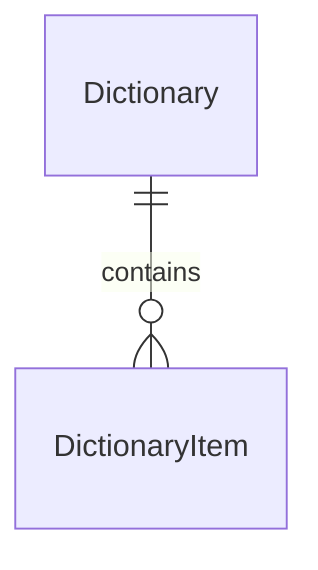
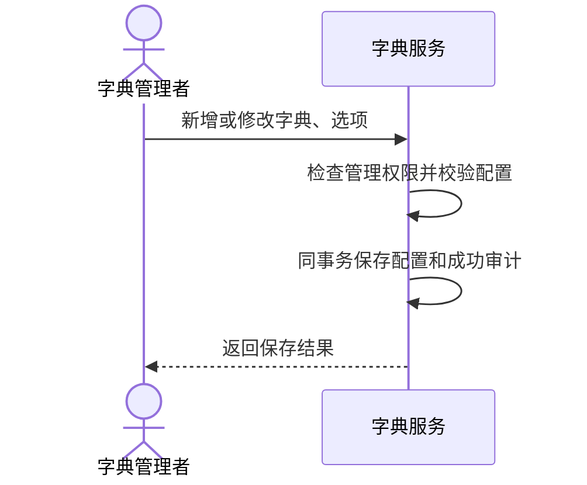
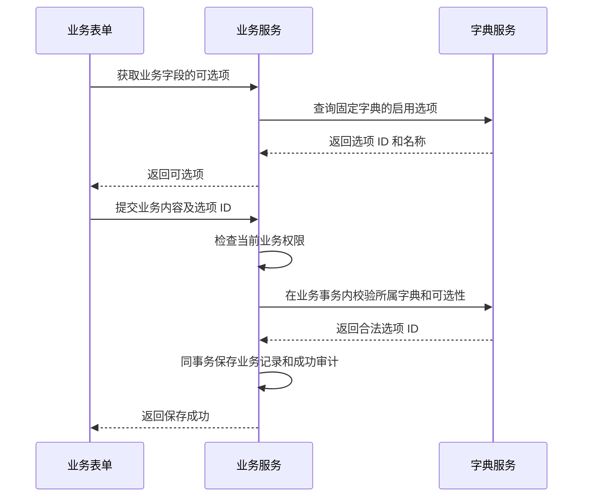
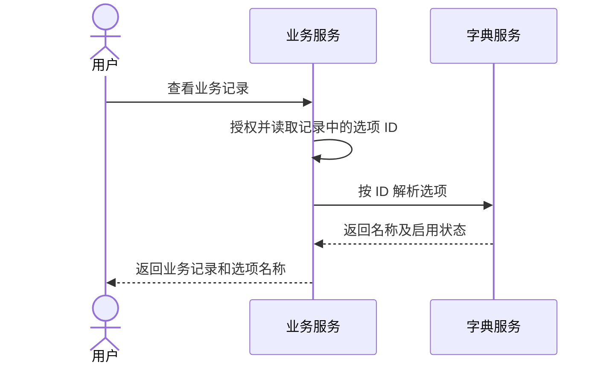
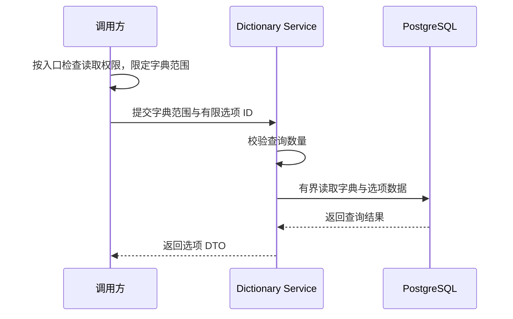

# 字典

字典为业务提供由管理者维护的分类选项、名称和顺序。字段用途、必填规则及业务对象权限由业务决定；Flow 状态、权限 key、渠道类型等固定程序枚举仍由代码维护。

## 1. 范围与边界

平台共享字典，复用 Identity 和 Audit。当前只支持平面选项，不增加逐字典授权、树形、多语言、版本或通用配置引擎。

业务选择既有字典项；可由普通用户自由创建的标签属于业务数据，在业务层单独建模与管理。字典的读取、解析和选择校验不创建或恢复选项，业务普通写权限不隐含字典维护权限。

## 2. 领域模型

### 2.1 字典 Dictionary

id、全局唯一且固定的 key、可修改 name/description、is_active，以及 created_at/by、updated_at/by。

### 2.2 字典项 DictionaryItem

id、固定 dictionary_id、字典内唯一且固定的 value、可修改 label、sort_order、is_active，以及四个创建/修改字段。业务引用 Item.id；同序号按 id 稳定排序。

### 2.3 唯一性、引用与停用

- 业务契约固定字典 key，服务端校验选项所属；不能只判断 ID 存在。
- 新增或更换选择要求字典和选项均启用，未改变的旧选择可保留停用项。
- 停用父字典不改子项状态，重新启用后仅原启用项恢复可选。
- 只停用、不删除，key/value 不复用为其他含义；不扫描业务表或维护通用引用表。
- 已有引用按 ID 展示当前 label 及状态，改名会影响已有记录的展示；需要原文快照的业务自行保存。

## 3. 主要流程

### 3.1 字典与选项维护

### 3.2 业务填写与保存

### 3.3 业务记录展示

| 当前配置 | 操作 | 结果 |
|---|---|---|
| 字典、选项均启用 | 新增/更换选择 | 可保存选项 ID |
| 任一停用 | 新增/更换选择 | 拒绝，原引用及展示保留 |
| 旧选项未改变 | 编辑其他业务字段 | 可保留，只校验所属字典 |
| 选项重新启用 | 获取新选择 | 父字典也启用时恢复可选 |

不变量：业务引用稳定 ID；所属字典由服务端限定；新增/更换在业务事务内校验；改名、排序和停用不改写引用。

### 3.4 批量读取

调用方直接通过 describe_items_in_transaction(session, keys, identifiers) 向字典公开 Service 提交有限的字典范围和选项 ID，批量返回 ID、名称、值、所属字典及父字典/选项的当前启用状态，不返回 ORM。调用方不必先查询业务表；展示业务记录时先取得引用 ID，只是该业务自己的取数步骤。

批量读取只减少逐项查询，不扩大可见范围、不增加字典行锁或变更审计。已有引用的停用项仍可解析；读取结果不代表允许新采用，保存继续使用写事务内的单项 validate_selection 及其原有内部锁。

## 4. 权限与审计

| 入口 | 权限 |
|---|---|
| 独立目录及允许指定字典的通用查询 | dictionary:read |
| 创建、修改、启停 | dictionary:manage |
| 业务选项、保存校验、单项/批量解析 | 业务自己的功能及对象权限，不另要求 dictionary:read |

业务内部查询须限定代码固定的字典范围和本次请求的有限选项 ID，不能借业务入口枚举任意字典。PAT 遵循当前权限与令牌范围交集。

配置变更与成功审计同事务，普通读取和校验不逐次记录；审计使用实际变更字段，批量排序可合并记录。时间和操作者由服务端确定，失败记录遵循[审计规则](audit.md)。

## 5. 设计取舍

两张表、进程内 Service 和普通事务即可完成，不增加缓存、专用 Worker 或 Flow。

## 7. 当前实现约定

代码位于 backend/src/keystone/platform/dictionary/。

| 字段/查询 | 限制 |
|---|---|
| key/value | 小写字母开头，后接小写字母、数字、下划线，1～64 字符，不自动转小写 |
| name/label | trim 后 1～128 字符 |
| description | 可空，最多 1000 字符 |
| sort_order | 32 位整数，默认 0 |
| 分页 | 默认 50、最高 100，offset 最高 100000 |

| API（/api/v1） | 用途 |
|---|---|
| GET/POST /dictionaries | 管理目录 / 创建 |
| PATCH /dictionaries/{id} | 修改名称、说明、启用状态 |
| GET/POST /dictionaries/{id}/items | 全状态选项 / 创建 |
| PATCH /dictionaries/{id}/items/{item_id} | 修改 label、排序、启用状态 |
| GET /dictionaries/by-key/{key}/options | 仅返回可选项，停用字典返回 [] |
| GET /dictionaries/by-key/{key}/items/{item_id} | 按 ID 解析，含父字典状态 |

字典不存在返回 404，按 ID 解析的选项不存在或跨字典返回 422。没有 DELETE、默认业务字典或预置数据。编辑使用完整表单：省略 description 写 null，省略 sort_order 写 0；其他必填字段仍需提交，审计覆盖实际写入字段。

可信业务使用 options、resolve、validate_selection。校验和编辑均先锁父字典行，保存与停用按事务顺序生效；previous_id 取自锁定的原业务记录，不能由客户端提供。

### 7.1 控制台

/console/dictionary 要求 read，manage 控制编辑。目录、选项各按 50 条分页，切换父字典清空旧编辑并丢弃迟到响应。key/value 创建后只读，编辑表单始终提交 description/sort_order。

父字典停用与子项停用分别展示，更新后同步父状态；只读用户可浏览所有状态，无删除、导入导出或拖动排序。

### 代码组织

两实体各自一个 models 文件；controllers/dictionaries.py、services/dictionaries.py 聚合父子用例，Schema 分 dictionaries/items。无需为每个实体增加独立 Service，分层见[架构规范](../development/business.md#模块分层与代码规范)。
