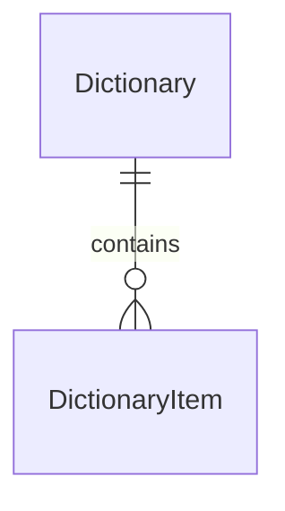

# Keystone 字典领域

[范围与边界](#1-范围与边界) · [领域模型](#2-领域模型) · [主要流程](#3-主要流程) · [权限与审计](#4-权限与审计) · [设计取舍](#5-设计取舍)

## 1. 范围与边界

为后续业务提供可配置的分类、选项、展示名称和顺序，例如客户来源、文件分类、业务标签类型。字典负责选项的定义与可选性；某个值对应的业务行为、业务记录的访问权限和字段是否必填，由使用它的业务模块负责。

FlowRun.status、文件处理状态、权限 key、渠道 provider 等参与平台代码逻辑的固定值继续由代码定义，不通过字典维护。字典不负责动态改变状态机、权限或执行逻辑，也不是通用配置中心。

字典是平台级共享配置，复用 identity 与 audit；业务通过模块服务查询、校验和引用选项。首版不引入租户隔离、逐字典授权、目录树、多语言、任意扩展 JSON 或选项版本管理。

## 2. 领域模型

仅两张表：Dictionary 定义一类选项，DictionaryItem 保存其中的具体选项。

### 2.1 字典 Dictionary

| 字段 | 含义 |
|---|---|
| `id` | 稳定字典 ID，服务端生成 |
| `key` | 全局唯一、非空的业务标识，例如 customer_source；创建后不可修改 |
| `name` | 非空展示名称，例如“客户来源”；允许修改 |
| `description` | 可空的用途说明 |
| `is_active` | 是否允许新选择该字典中的选项，默认启用 |
| `created_at` | 创建时间，服务端生成，UTC，必填 |
| `created_by` | 创建操作的用户 ID，系统初始化可为空 |
| `updated_at` | 最近修改时间，UTC，创建时与 created_at 相同 |
| `updated_by` | 最近修改操作的用户 ID，系统初始化可为空，创建时与 created_by 相同 |

### 2.2 字典项 DictionaryItem

| 字段 | 含义 |
|---|---|
| `id` | 稳定选项 ID，服务端生成，供业务字段引用 |
| `dictionary_id` | 所属 Dictionary；创建后不可更换 |
| `value` | 字典内唯一、非空的稳定值，例如 referral；创建后不可修改 |
| `label` | 非空展示名称，例如“客户推荐”；允许修改 |
| `sort_order` | 整数排序值，默认 0，升序展示；相同值按 id 稳定排序 |
| `is_active` | 选项是否启用，默认启用；实际可选性还取决于所属字典 |
| `created_at` | 创建时间，服务端生成，UTC，必填 |
| `created_by` | 创建操作的用户 ID，系统初始化可为空 |
| `updated_at` | 最近修改时间，UTC，创建时与 created_at 相同 |
| `updated_by` | 最近修改操作的用户 ID，系统初始化可为空，创建时与 created_by 相同 |

### 2.3 唯一性、引用与停用

- Dictionary.key 全局唯一，DictionaryItem 的 dictionary_id＋value 唯一。停用后仍占用原标识，不复用为不同含义。
- 业务保存 DictionaryItem.id，不用可修改的 label 作为关联键。业务契约明确期望的字典 key，保存时通过字典服务检查选项属于该字典，不能只检查 ID 存在。
- 新建选择或更换选项时，字典与选项都必须启用。只修改业务记录的其他字段时，可以保留原来已经停用的选项，不强迫重选；不能把停用选项赋给新的业务记录。
- 停用字典只修改 Dictionary.is_active，不批量修改字典项状态。重新启用字典后，仅原本启用的选项恢复可选；独立停用的选项保持停用。
- 只停用、不删除，不增加 deleted_at、deleted_by 或通用引用登记表。停用不清空业务引用，不要求扫描所有业务表。

历史记录可按 ID 读取停用选项并展示其当前 label 与停用状态。改名会影响已有记录的展示，不承诺还原当时名称；个别业务若确实需要历史原文，应由该业务保存必要快照，不为所有字典项引入版本表。

## 3. 主要流程

1. 管理员创建字典与选项，确定稳定 key、value，设置名称、顺序和启用状态；数据变更与成功审计同事务保存。
2. 业务表单通过已授权的业务入口查询服务端限定字典的可选项，或通过具备 dictionary:read 权限的通用接口查询。只返回字典与选项都启用的记录；不存在的字典明确报错，停用或没有可用选项时返回无可选项，不以任意文本替代。
3. 业务新增或更换选项时，在业务保存事务内调用字典服务校验所属字典与可选性，再保存选项 ID。后端必须重新校验，不能仅依赖前端下拉列表。
4. 历史展示按已保存的 ID 解析选项，允许读取停用记录；可选项查询和历史解析分别处理，不能因下拉列表过滤掉停用项而丢失历史名称。
5. 管理员改名、调整顺序或启停，后续查询使用新配置。业务字段原有引用不变，字典模块不反向改写业务数据。

业务保存与停用并发时，应按事务顺序确定选择是否有效：选择先完成则保留为已有引用，停用先完成则拒绝新的选择。具体数据库协调方式留到实现设计，不增加领域字段。

## 4. 权限与审计

沿用 identity 与 Casbin，声明 `dictionary:read` 和 `dictionary:manage`。read 保护独立字典目录及允许调用方指定字典的通用查询接口；manage 用于创建、修改与启停。角色按需要授予，管理界面通常同时需要两项；首版不开放匿名字典接口，不做逐字典授权表。

| 场景 | 授权规则 |
|---|---|
| 独立查询字典目录、通用选项或按 ID 解析名称 | dictionary:read |
| 创建、修改、启停字典或选项 | dictionary:manage |
| 已授权的业务详情展示选项名称 | 检查业务查看与对象访问权，只解析该记录实际引用的选项，不额外要求 dictionary:read |
| 业务新增或编辑表单查询可选项 | 检查对应业务权限，由服务端业务代码限定字典范围，不额外要求 dictionary:read |
| 业务保存时校验选项 | 跟随业务写入权限，在同一事务内检查所属字典与可选性，不额外要求 dictionary:read |

业务入口仍检查自身操作与对象访问权限；有权读取字典不代表有权读取引用它的客户、文件等业务记录。业务限定范围由可信服务端代码确定，不能接受客户端任意 dictionary key 或选项 ID 借业务接口枚举其他字典。内部名称解析和校验使用已授权的业务上下文，不通过客户端可控的跳过授权开关实现。个人令牌在各入口都受用户当前权限与令牌范围的交集限制。

这些能力放在已有业务查询、表单或写入服务内即可，不额外建立通用字典代理层。字典服务继续负责所属字典与可选性校验：历史名称允许解析停用项，新增或更换选项必须启用；业务模块决定选项的用途。

Dictionary、DictionaryItem 都是管理配置，各自保留四个审计字段，完整列在字段表中。时间由服务端生成并统一使用 UTC；操作者来自可信身份，不能由客户端指定。系统初始化的操作者可为空，并在审计日志中说明来源。

创建、改名、用途说明修改、排序调整和启停写入 [AuditLog](audit.md)，记录对象 ID、必要的 key/value、变更及真实操作者。成功变更与日志同事务提交；失败或权限拒绝沿用审计模块的独立记录规则。普通选项读取和校验不逐次写审计。批量排序可记录一条包含必要变化的日志，不为每个未变化的选项复制事件。

不提供物理删除、软删除或回收站操作。停用通过 is_active 表达，发生时间、操作者及原因通过 AuditLog 追溯，不再增加停用时间或停用人字段。

## 5. 设计取舍

- 两张表即可表达分类和选项，不增加选项关系表、引用登记表或动态规则表。
- 稳定 key/value 与可修改展示名称分开；业务引用选项 ID，由服务端校验所属字典。
- 停用阻止新的选择，历史引用继续可读；首版不删除，避免引入跨业务删除协调。
- 固定程序枚举继续由代码维护；树形、多语言、扩展属性和通用配置管理暂不加入。
- 管理和查询通过 API 调用进程内服务，不需要独立服务、专用 Worker 任务或 Flow 编排，也不预建缓存同步机制。

## 7. 当前实现约定

代码位于 backend/src/keystone/platform/dictionary/，dictionary 领域初始迁移创建 dictionaries 和 dictionary_items。key/value 使用小写英文字母开头、后接小写字母/数字/下划线，1–64 字符，不静默转换大小写；name/label 去除首尾空白后 1–128 字符，description 可空、最多 1000 字符。sort_order 为 32 位整数。创建默认启用，更新请求不接受 key/value/dictionary_id 或审计字段。

| 入口 | 权限与行为 |
|---|---|
| GET /api/v1/dictionaries | read，含停用字典的管理目录 |
| POST /api/v1/dictionaries | manage，创建字典 |
| PATCH /api/v1/dictionaries/{id} | manage，保存名称、说明和启用状态 |
| GET/POST /api/v1/dictionaries/{id}/items | read/manage，查询全部状态选项或创建选项 |
| PATCH /api/v1/dictionaries/{id}/items/{item_id} | manage，修改 label、sort_order、is_active |
| GET /api/v1/dictionaries/by-key/{key}/options | read，仅返回父字典与选项都启用的可选项 |
| GET /api/v1/dictionaries/by-key/{key}/items/{item_id} | read，按预期字典解析历史选项，包含父字典启用状态 |

查询默认 50、最多 100 条，offset 最多 100000；选项按 sort_order、id 稳定排序。options 与 items 入口的字典不存在返回 404，通用历史解析中选项不存在或跨字典返回 422；停用字典的可选项为 []。无 DELETE 接口，无默认业务字典或示例预置。

编辑接口按完整编辑表单保存：省略 description 时写入 null，省略 sort_order 时写入 0；其他必填编辑字段仍须提交。审计 before/after 覆盖实际写入的同一组字段，包括这些默认值，不能只记录请求显式传入字段的旧值。

已授权业务通过 options、resolve、validate_selection 调用进程内服务，限定 key 和实际业务记录中的 ID。validate_selection 在业务保存事务内锁定父字典行；字典和选项编辑也先锁同一父行，因此停用和新选择按提交顺序生效。previous_id 必须取自已锁定的原业务记录，不能由客户端声明；未改变的已停用选项只校验所属，新增/更换则必须可选。锁保留到业务提交，不新建字典引用表或缓存。

变更与成功审计同事务，失败后独立记录；definition/item 的 create/update action 使用明确字段白名单。控制台提供分页目录、新建/修改字典与选项、逐项排序和启停。

### 7.1 控制台

/console/dictionary 要求 dictionary:read；dictionary:manage 控制新建与编辑入口。目录与选项各按 50 条分页，提供刷新、加载状态、错误和空列表提示。选择字典后在独立区域浏览选项，切换字典清空旧编辑状态并丢弃旧请求结果；刷新目录或翻页收起原选项，避免继续使用过时的父字典状态。

字典和选项分别通过 Element Plus 弹窗编辑。key/value 创建后只读，更新只提交允许修改的字段；字典每次保留并提交 description，选项保留并提交 sort_order，不因表单遗漏而意外清空说明或重置排序。排序校验为 32 位整数，不引入拖动排序或批量更新。服务端拒绝时保留表单与原因，成功后刷新列表；取消后重新创建使用空表单。

父字典停用时，选项明确显示“已启用，字典停用中”或“已停用”，不把两种状态混为一谈。编辑父字典后同步当前选项区域的父状态，重新启用父字典不会启用原先停用的选项。目录显示名称、说明、业务标识和状态；选项显示名称、稳定值、排序和状态。只读用户可以浏览全部状态但不能编辑；无删除、树形分类、缓存、导入导出或新预置数据。

页面复用 Element Plus 弹窗、分页与请求代次处理。

### 代码组织

Dictionary 与 DictionaryItem 分别位于 models/dictionary.py、models/dictionary_item.py。controllers/dictionaries.py 与 services/dictionaries.py 保持父字典/条目用例聚合，Schema 分为 dictionaries/items，显式区分两类响应字段；不为了实体拆文件而增加服务抽象。 统一规范见[整体架构](../architecture.md#54-模块分层与代码规范)。
