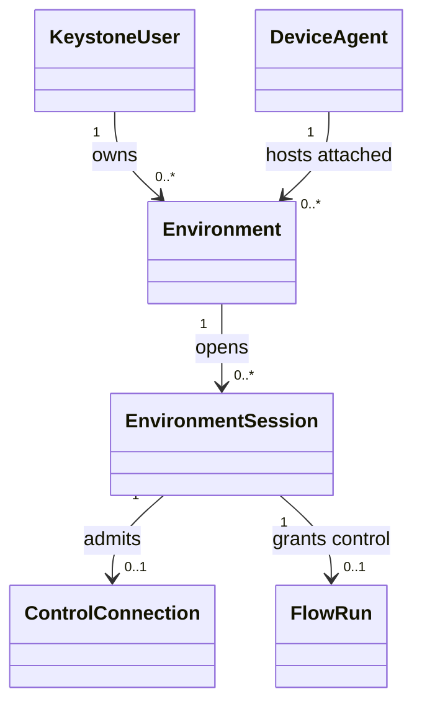
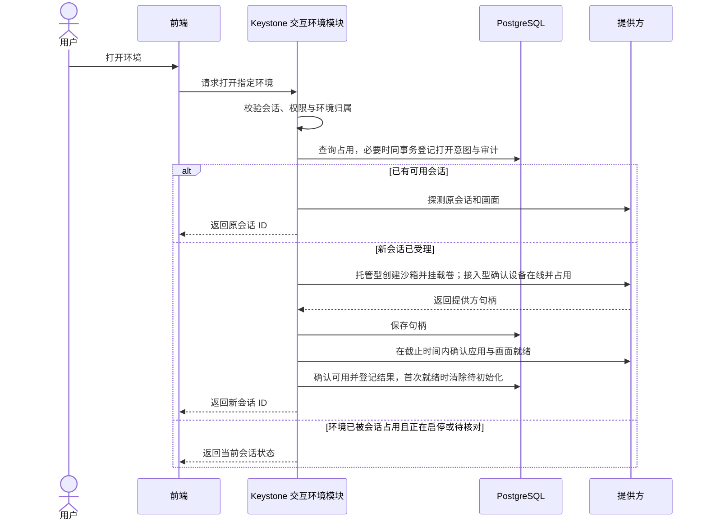
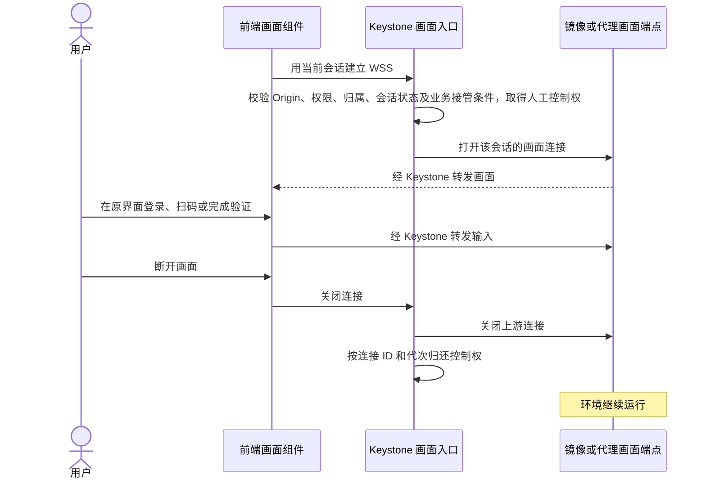
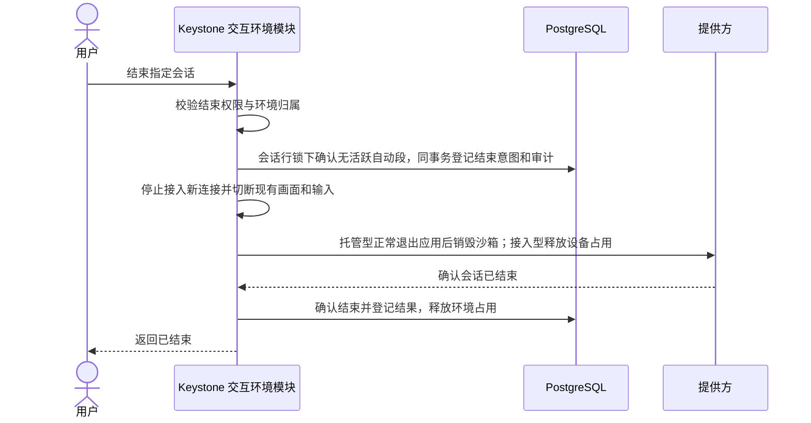
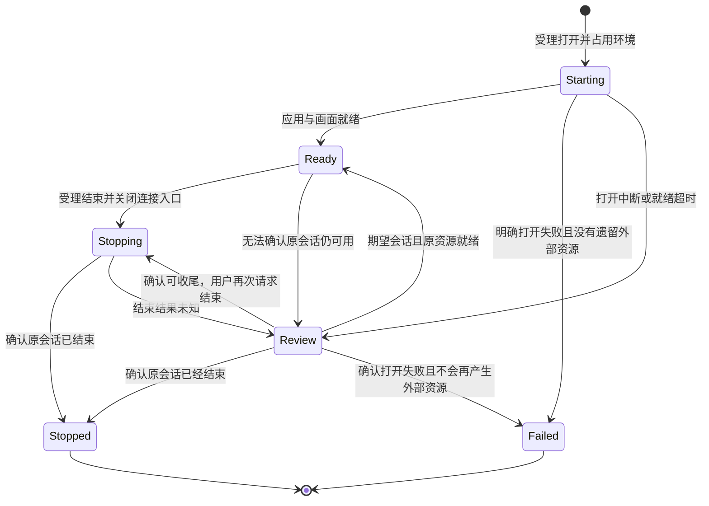
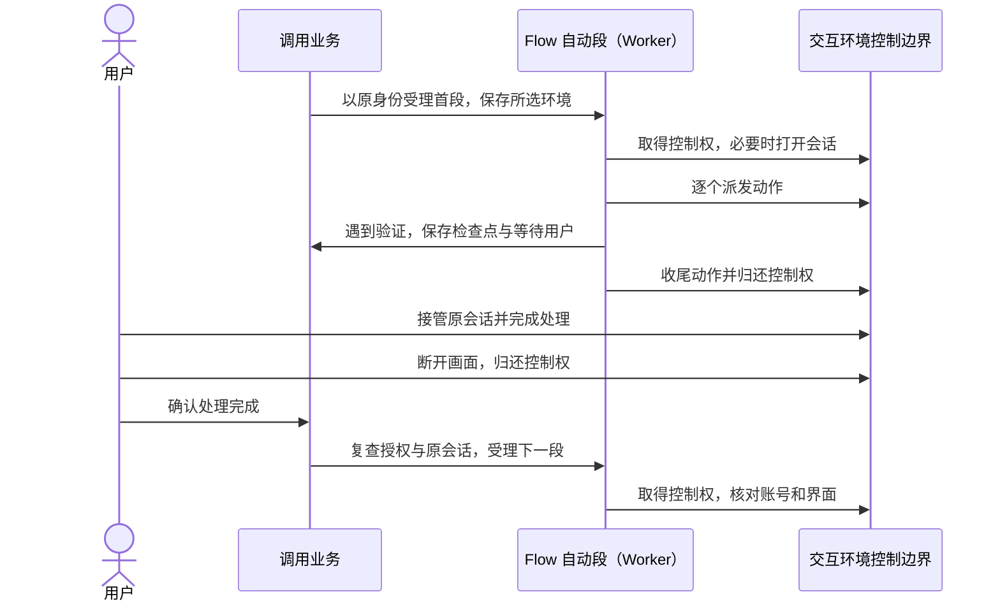

# 交互环境

## 1. 能力范围

交互环境模块让 Keystone 与没有开放接口的系统交互：用户通过远程画面在原界面登录、扫码和处理验证，业务 Flow 在同一环境自动执行，二者共用一套归属、授权和控制权。环境可以是平台托管的容器，也可以是接入的真实设备。

| 类型 | 提供方 | 画面协议 | 状态 |
| --- | --- | --- | --- |
| 浏览器（`chromium`） | 托管：OpenSandbox 容器 | `vnc` | 人工画面、空间与备份已实现，见[浏览器](browser.md) |
| 安卓容器（`android`） | 托管：OpenSandbox 容器 | `scrcpy` | 目标，待验证 |
| 安卓真机（`android`） | 接入：设备接入代理 | `scrcpy` | 目标，待验证 |

| 能力 | 范围 |
| --- | --- |
| 环境 | 托管型由用户自助新建，部署者可导入已有卷；接入型由管理员登记并分配给指定用户 |
| 会话 | 打开时复用可用会话或建立新会话。托管型启动和停止运行，接入型占用和释放在线设备。支持查询、重新检查和闲置结束 |
| 画面 | 同源 WSS 鉴权转发，协议由类型声明，前端按协议选择画面组件 |
| 自动操作 | 公共动作加类型专属动作，业务 Flow 在 Worker 中按原身份调用 |
| 权限与审计 | 复用 Identity 和 Audit。后端校验当前用户或 Flow 原身份、功能权限和环境归属 |

交互环境是可选模块：没有配置任何提供方时，API 与 Worker 都不装配 Adapter、不运行闲置检查，依赖交互环境的业务在受理时明确拒绝，控制台隐藏入口；迁移照常建表。只配置部分提供方时，只开放对应类型。

## 2. 领域模型与事实归属

| 对象 | 内容与归属 |
| --- | --- |
| 环境类型 | 代码声明：画面协议、公共与专属动作、范围含义（浏览器为域名，安卓为应用包名）、支持的提供方、是否支持备份及旁路通道策略。不在线配置 |
| `Environment` | 稳定 ID、所有者、类型、提供方、显示名。托管型保存唯一卷名和 `state_initialization_pending`；接入型保存所属代理和代理内设备标识 |
| `DeviceAgent` | 管理员登记的接入代理：稳定 ID、显示名、地址和凭据引用。凭据加密保存，不出现在结果、审计和日志中 |
| `EnvironmentSession` | 一次使用：ID、所属环境、用途（`interactive` 或托管型的 `backup`）、生命周期状态、待核对的操作、提供方句柄（沙箱 ID 或代理会话 ID）、最近活动时间和控制权（见[第 6 节](#6-控制权)）。同一环境允许历史会话，当前占用最多一个 |
| `ControlConnection` | API 进程中的临时画面连接，绑定具体会话和 Keystone 登录会话。持有记录在会话上，传输只在 API 内存 |
| 环境内的站点与应用状态 | 登录、Cookie、应用数据由站点或应用决定。托管型保存在卷中，接入型保存在设备上 |

提供方是环境存在与否的事实来源：OpenSandbox 报告容器，接入代理报告设备在线状态；画面与就绪探测决定能否使用。Keystone 的会话状态表达操作意图、最近确认的结果和对环境的占用。会话 ID 随创建或占用请求传入提供方的受控元数据，用于核对外部状态。

### 2.1 提供方契约

| | 托管型 | 接入型 |
| --- | --- | --- |
| 来源 | 用户新建或部署者导入卷 | 管理员在代理下登记设备并分配给用户；重新分配前结束当前会话 |
| 打开会话 | 创建沙箱并挂载卷，确认就绪 | 向代理确认设备在线并占用，确认画面就绪；设备不开关机 |
| 结束会话 | 正常退出应用后销毁沙箱，卷保留 | 释放占用并关闭画面与动作通道，设备保持原状 |
| 状态与备份 | 卷是工作副本，支持备份的类型按其文档备份恢复 | 状态在设备上，平台不备份；设备丢失或重置由管理员处理 |
| 独占 | 平台保证远程输入独占 | 平台只保证远程侧独占；持有设备的人可直接操作，业务须按结果核对处理 |

托管型新建与导入：

| 来源 | 规则 |
| --- | --- |
| 用户新建 | 需要登录会话和 `environment:use`。只提交类型、显示名和请求标识，后端绑定当前用户；同一用户重发同一请求标识返回原环境。在用户行锁下检查每人数量上限 `environment_limit`，超限返回 `environment_limit_reached`。只写记录和审计，`state_initialization_pending=true`，第一次启动时提供方按卷名建卷 |
| 部署者导入 | CLI 把已有卷登记给指定用户并写系统审计，同一卷只能登记一次；导入环境视为已初始化 |

`state_initialization_pending` 区分「新环境」和「丢卷的环境」，只有前者允许初始化空状态：

| 环境状态 | 启动时卷为空或缺失 |
| --- | --- |
| 待初始化 | 运行镜像持有卷写入锁，在卷为空或只有本环境未完成的初始化标记时初始化。首次就绪与清除待初始化在同一事务提交 |
| 已初始化（就绪过或导入） | 不初始化空状态。支持备份的类型从最近成功备份恢复，没有备份或不支持备份时报告无法恢复 |

客户端不能指定卷名、镜像、代理地址、设备标识或初始化行为。删除环境尚未设计，首版由部署者处理。

## 3. 职责与授权

| 层 | 职责 |
| --- | --- |
| 前端 | 展示和新建环境、会话与连接状态，按画面协议渲染组件，提供「打开」「断开画面」「结束」「重新检查」 |
| Keystone 交互环境模块 | Controller 处理 HTTP 和 WSS，Service 负责对象授权、会话状态、控制权、审计与动作派发。每个提供方一个 Adapter，只调用固定的 OpenSandbox 环境或已登记代理 |
| 运行镜像 / 接入代理 | 提供画面、就绪检查、正常结束和动作入口；按类型声明关闭剪贴板、文件传输等旁路通道。镜像与代理只接受 Keystone 鉴权后的请求 |
| 调用业务 | 选择环境和目标，声明动作与范围、步数和时长上限，判断结果和何时需要人工，记录任务状态和人工决定 |

模块在 API 和 Worker 中显式装配。API 承载画面、会话请求和环境管理；Worker 承载 Flow 中的自动准备与动作，以及闲置检查计划。两类进程都由 Keystone 主动连接提供方（OpenSandbox 或代理），通过会话行锁协调；行锁只覆盖短事务，提供方、画面和动作 I/O 在事务外。打开和结束在有截止时间的调用内执行，先提交状态和受理审计，再调用提供方；超出截止时间后由有权用户显式重新检查。接入代理必须可被 Keystone 访问，不由代理反连。

查看、新建、打开、连接和重新检查均要求 `environment:use` 及本人归属；结束会话还要求 `environment:stop`；登记代理和设备、分配设备要求 `environment:manage`。自动操作按 Flow 原身份复查同样的权限与归属，执行权限是原用户当前权限与原 PAT 范围的交集。重新检查只查询原会话的提供方事实并记录核对结果，可清理提供方已明确报告终态的容器；清理无法识别的外部资源由部署者通过受控运维入口执行。客户端只传环境或会话 ID。审计登记受理、拒绝和确认结果，只保留已知操作者、环境与会话 ID、结果和时间。参见[身份](../identity.md)与[审计](../audit.md)。

## 4. 主要时序

### 4.1 打开环境

Flow 自动段需要会话时由 Worker 走同一受理与核对路径，见[第 6 节](#6-控制权)。

### 4.2 连接画面与人工处理

### 4.3 结束会话

### 4.4 闲置结束

Worker 每分钟运行一次闲置检查计划。打开或复用会话、画面连接及断开、自动动作和归还控制权都刷新最近活动时间。会话闲置满 30 分钟时，在会话行锁下复核并受理结束；有画面连接、启停或核对中、自动控制权有效、动作仍在收尾时跳过。持有控制权的业务可通过装配的活动检查说明其任务仍需保留会话（例如 Flow 未结束，或在有限时间内等待用户处理），平台只调用检查，不解释业务状态。闲置结束沿用 4.3 并写系统审计，不触发备份。

## 5. 会话状态与画面

| 状态 | 显示 | 允许的操作 |
| --- | --- | --- |
| `Starting` | 启动中 / 连接中 | 查询，重复打开返回同一会话。处理进程中断后可重新检查 |
| `Ready` | 可连接 | 打开或重连画面，断开，结束，自动段取得控制权 |
| `Stopping` | 结束中 | 查询，重复结束返回同一会话状态。处理进程中断后可重新检查 |
| `Review` | 待核对 | 重新检查原会话。确认可收尾后，可以再次请求结束 |
| `Stopped` / `Failed` | 已结束 / 打开失败 | 查看结果。再次打开产生新会话 ID |

画面连接、自动控制和站点或应用登录分别显示。接入型设备离线时，就绪会话转入 `Review`，代理确认设备已释放后结束。托管型的 `backup` 会话只表示备份维护，不能接入画面或自动段。

### 5.1 并发与恢复

- 同一环境在 `Starting`、`Ready`、`Stopping`、`Review` 中最多有一条会话，由数据库唯一约束保护。所有打开、结束和核对结果绑定原会话 ID 和当前状态，过时响应不能覆盖后续状态。审计分别区分「已受理」和「已确认」。
- 打开请求超时或进程在提交后退出时，保留环境占用。核对优先按已知句柄，否则按关联元数据查找，并验证来源与环境绑定。单次查空不能证明打开请求已经结束。确认旧请求已结束且不存在仍能写入环境状态的资源后，才能释放占用。无法证实时保持「待核对」，由部署者收尾。
- 结束、画面准入和自动控制使用同一会话行锁。结束受理后冻结输入，现有连接收尾后才结束会话。结束超时后复查同一个会话，只有确认它仍存活且上一轮结束已完成，才允许用户继续原结束意图。
- 复用原会话前做有界探测，提供方资源存在与画面就绪分别确认。API 进程中断时画面连接随之关闭，人工持有按期限过期，下一次打开或重新检查先核对持久状态。

### 5.2 画面

画面协议由环境类型声明，Keystone 只做协议无关的 WSS 鉴权转发，前端按协议名注册画面组件。可接入的协议必须能经 WebSocket 隧道传输；依赖 UDP 或 TURN 的协议（如 WebRTC）不在此范围，需要时单独设计。

| 协议 | 画面组件 | 用于 |
| --- | --- | --- |
| `vnc` | noVNC | 浏览器 |
| `scrcpy` | 经 WebSocket 的 scrcpy 客户端 | 安卓容器与真机（待验证） |

- WSS 校验精确 Origin、登录会话、功能权限、环境归属和具体会话。每个会话全局只接入一个可写连接，首版不支持只读旁观。断开后清理双方传输，再交给下一个持有人。
- 长连接按有界间隔复查权限和会话，复查失败或授权窗口到期即停止双向转发，撤权延迟的验收上限为 5 秒。已经送达环境的输入按已发生事实处理。
- 转发不解析协议，剪贴板、文件传输、音频等旁路通道由镜像或代理按类型声明关闭或开启，默认关闭。
- 提供方 Key、代理凭据和 Docker socket 留在 Keystone 后端与提供方。画面端点和动作入口只通过授权代理提供，不直接暴露给浏览器。画面、输入和站点凭据只用于交互传输，应用日志保存事件元数据。

## 6. 控制权

控制权保存在 `EnvironmentSession`：`control_owner` 记录持有人（人工为连接 ID，自动为 FlowRun ID），`control_until` 为期限，`control_generation` 为代次，`control_sequence` 和 `control_busy_until` 为自动动作序号及在途动作截止时间。API 只在内存持有画面传输。

| 请求 | 准入与转换 |
| --- | --- |
| 自动准备与执行 | 会话行锁下复查 Flow 原身份与环境权限，要求无人持有或上一持有已过期且已收尾。首段选定或受理打开会话，续段核对原会话与受理时的代次。一次持有覆盖打开、导航和动作，Flow 段结束时归还 |
| 接管画面 | 复查登录会话、环境及业务接管条件。仅 `Ready` 且无有效自动持有的会话可接入。双方传输关闭后按连接 ID 和代次归还 |
| 手动结束、闲置结束 | 活跃自动段期间拒绝。手动结束通知本进程的画面断开，收尾后受理结束。闲置结束跳过所有有效持有和业务保护 |
| 到期、失联或撤权 | 自动每个动作前复查授权并续期。人工连接续期时复查登录会话与代次，最多转发 5 秒，再预留 3 秒关闭传输。动作结果未知时保留占用至 `control_busy_until` |

每次授予控制权或受理结束都递增代次，续期和归还保持当次代次。带预期代次的申请在会话行锁下比较并授予，其他持有人取得过控制权后旧确认即失效。Worker 中断时，同制品 Flow 可在控制权仍有效时复用原代次并核对原会话；已登记的动作按原序号处理，结果未知时禁止重复派发。

## 7. 自动操作

业务 Flow 的自动段在 Worker 中取得控制权并执行动作。遇到登录、验证或未识别界面时，业务持久化目标环境、业务检查点和「等待用户」，交还控制权并结束本段。用户接管原会话处理完成并交还后，业务复查权限并受理下一段独立执行；下一段取得控制权后先核对账号和界面。提交结果未知时先核对外部结果。

任务的等待、确认、取消和超时属于业务持久状态。外部触发（例如消息命令）时，由业务以部署配置的真实用户受理 Flow，环境归该用户所有，平台不新增服务身份。见[Flow 人工决策边界](../flow.md#8-api授权与诊断)。

固定流程和 Agent 使用同一组动作，区别只在于由代码还是模型选择动作：

| 动作 | 适用类型 |
| --- | --- |
| 界面快照、点击/触摸（引用最近一次快照中的元素）、输入、读取文本、截图、等待 | 公共 |
| 打开地址 | 浏览器 |
| 启动应用、返回、主页、滑动 | 安卓 |

| 层 | 职责 | 不承担 |
| --- | --- | --- |
| 运行镜像 / 接入代理 | 实现类型声明的动作。每个动作有超时，返回大小有上限 | 站点或应用流程、结果判断 |
| 交互环境 Service 与 Adapter | 控制权准入、动作登记与派发、范围核对、超时、审计和会话核对 | 业务动作集合、目标和结果语义 |
| 业务 Service / Flow | 取得控制权时声明允许的动作和范围，设定步数与时长上限、结果字段白名单、敏感操作的人工确认，以及固定流程或 Agent 的决策 | 直接访问提供方、CDP、adb 或动作入口 |

必须成立的性质：

- 每个动作先在会话上登记序号和截止时间，再派发；派发前复查原身份、会话、代次和取消。结果未知的动作不重放，先用快照核对界面，无法确认则交给用户。
- 动作完成后核对当前范围（浏览器为页面域名，安卓为前台应用包名），超出声明范围即结束本次持有并报告，由业务决定后续。
- 界面内容只作为数据进入模型，不改变任务的目标、范围或权限。模型调用遵循[模型接入](../model-access.md)的登记与恢复规则。
- 登录态按环境隔离。访问陌生目标的任务使用不保存其他登录的环境。快照、结果和审计不保存 Cookie、站点或应用凭据、调试会话或完整界面正文；截图只作为有界结果返回，是否经 Files 保存由业务决定。

## 8. 接入型设备

- 接入代理运行在连接设备（USB 或局域网 adb）的宿主上，由管理员登记地址和凭据。Keystone 的 API 与 Worker 主动连接代理并鉴权；代理只接受 Keystone 的请求，只操作已登记的设备。
- 设备分配给指定用户后，该用户按与托管型相同的规则使用。重新分配、停用设备或代理须先结束当前会话，写审计。
- 设备上的个人账号、SIM、短信和物理接触不受平台控制。分配前由管理员确认设备用途；平台的独占与审计只覆盖经 Keystone 的远程操作。
- 平台不备份设备状态。设备丢失、重置或离线时，相关会话转入核对，业务按结果核对规则处理在途任务。

## 9. 验收

- 新建环境：同一请求标识重发返回原环境，并发新建不超过上限；首次打开中断后可再次初始化，首次就绪后删除卷只能走备份恢复或报告无法恢复。
- 并发打开只有一个会话，画面与自动段只有一方获得输入权。验证跨账号访问、错误 Origin、登录会话撤权、结束与连接竞争、结束与活跃自动段竞争。
- 模拟提供方接受打开后响应丢失、Keystone 重启和结束响应丢失。确认只核对原会话，未确认无写入者前禁止再次占用环境。
- 自动段：Worker 中断后同制品恢复不重复派发结果未知的动作；越界结束持有；撤权后不再派发新动作；遇到验证时交还用户，再由下一段核对界面后继续。
- 闲置结束：有画面、有效自动持有或业务保护时不结束，满 30 分钟无活动时结束且状态保留。
- 接入型：设备离线、代理不可达、重新分配时会话转入核对或被拒绝，不出现两个用户同时远程持有。
- 各类型的专属验收见其类型文档。

## 10. 目标与当前实现差异

| 目标 | 当前实现 |
| --- | --- |
| 环境类型与提供方按代码声明，支持多种类型 | 模块 `platform/environments`、`Environment` / `EnvironmentSession` 与 `environment:*` 权限已就位，`kind` 只有 `chromium`，提供方固定为 OpenSandbox |
| 托管型用户自助新建，每人数量上限，待初始化环境首次打开时建卷并初始化 | 只有部署者登记命令，卷须预先创建；没有待初始化标记和数量上限 |
| API 与 Worker 共同装配，控制权保存在会话上，按会话行锁和代次协调 | 只在单个 API 进程装配，画面准入和停止在进程内串行化，控制连接只在内存 |
| 公共与类型专属动作，业务 Flow 在 Worker 中调用 | 无自动操作接口 |
| Worker 计划执行闲置结束，业务可声明活动保护 | 会话只在用户停止时结束 |
| 画面协议按类型声明，前端按协议选择组件 | 只有 noVNC |
| 安卓容器：OpenSandbox 可运行安卓镜像（binder 或 KVM）、scrcpy 画面、卷持久化 | 未验证 |
| 安卓真机：接入代理协议、设备登记与分配 | 未设计实现，代理协议待验证后确定 |
| 删除环境 | 未设计，由部署者处理 |
