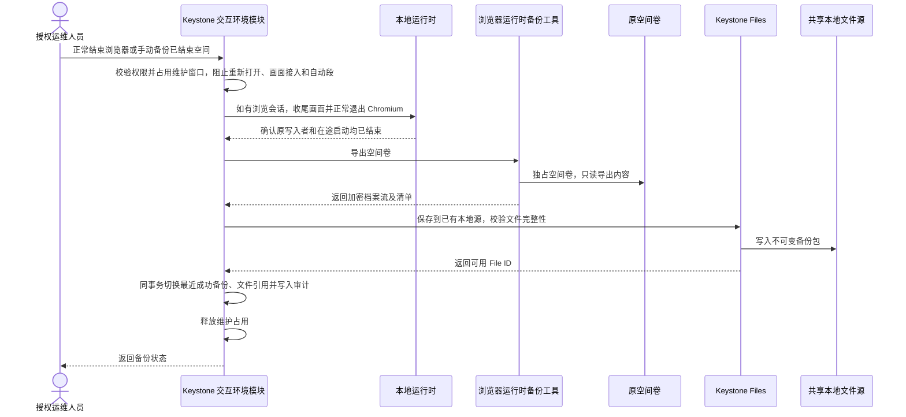
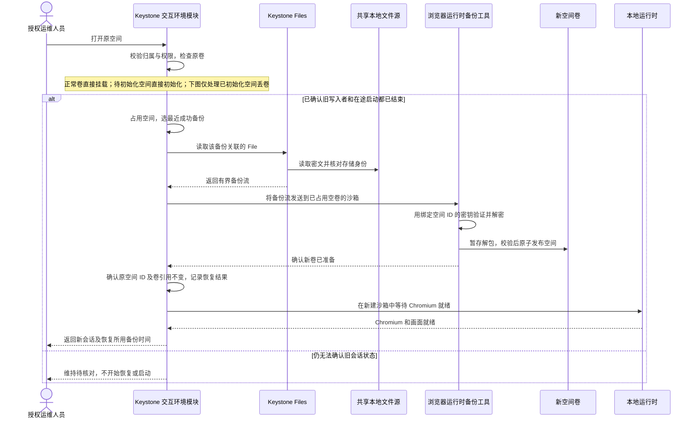

# 浏览器

## 1. 类型范围

浏览器是[交互环境](README.md)的 `chromium` 类型：标准、有界面的 Chromium，由 OpenSandbox 在本地 Docker 环境托管运行。环境、会话、画面转发、控制权和自动操作框架见交互环境；本文只记录浏览器专有的镜像、空间、动作和备份恢复。用户在 Chromium 原窗口登录、扫码和处理验证，断开画面后可以回到仍在运行的原页面。

| 类型声明 | 内容 |
| --- | --- |
| 提供方 | 托管：OpenSandbox，按空间卷名挂载 |
| 画面协议 | `vnc`，前端使用 noVNC |
| 专属动作 | 打开地址；公共动作的点击、输入经 CDP 在容器内执行 |
| 范围 | 页面域名 |
| 备份 | 支持，见[第 4 节](#4-备份与恢复) |
| 旁路通道 | noVNC 剪贴板与文件传输关闭 |

仓库在 [`examples/browser-workbench`](../../../examples/browser-workbench/README.md) 提供独立的参考前端和本机运行示例，参考前端通过同一 HTTPS 入口复用 Identity 的会话 Cookie。见[身份会话协议](../identity.md#7-最小实现约定)。

## 2. 浏览器空间

环境的卷即浏览器空间，Chromium 在其中保存 Cookie、标签页、站点设置和已保存凭据。卷名由环境 ID 确定。待初始化空间第一次启动时，运行镜像在空卷中创建 Chromium 档案并写入空间标记；初始化与丢卷恢复的判定见[交互环境提供方契约](README.md#21-提供方契约)。

第三方站点登录由站点判断，由原页面显示。空间持久化让运行能够尝试复用登录。

## 3. 镜像与运行

运行镜像从 [`deploy/browser/runtime`](../../../deploy/browser/README.md) 构建，提供：

- Chromium、虚拟显示和 VNC 画面端点；
- 就绪检查：容器已创建、Chromium 窗口已显示、档案单例套接字及画面端口可用，分别确认；
- 正常退出入口，以及备份导出和恢复入口；
- 只在容器回环接口监听、带鉴权的动作入口，CDP 只在容器内使用。

浏览器以受限用户运行并保留浏览器沙箱，运行网络与 Keystone 数据库及宿主机管理面隔离。空间卷及备份按登录凭据保护。

- 已显示过窗口的 Chromium 在正常关闭最后一个窗口后，由运行镜像在原沙箱和空间内重新打开。异常退出允许在同一沙箱内重试一次，画面服务和空间写入锁继续持有。启动失败、重试后再次异常退出或画面服务退出时，运行镜像关闭沙箱；Keystone 确认终态并清理后，用户可用原空间重新打开。
- 运行按常驻模式创建，显式使用 `timeout=None`，由闲置检查回收。刷新前端、断线或重启 Keystone API 时，客户端重新授权并连接仍在运行的原会话。noVNC 在前端本地缩放画面，前端尺寸变化时保持远端窗口布局。[OpenSandbox Python SDK](https://github.com/opensandbox-group/OpenSandbox/blob/release-1.2.0/docs/sdks/python.md) · [noVNC 客户端 API](https://novnc.com/noVNC/docs/API.html)
- 重建时复用原空间卷、Chromium 档案路径和运行用户。如果 Chromium 使用系统密钥环，部署需同时保留空间解密所需的环境。部署固定镜像版本，浏览器安全更新按正常发布流程进行。即使空间可读，浏览器版本、操作系统或网络环境变化也可能触发站点复验，原标签页恢复与登录复用须分别验证。[Chromium Linux 密钥存储](https://chromium.googlesource.com/chromium/src/+/8462c68e/components/os_crypt/sync/key_storage_linux.h) · [浏览器指纹](https://developer.mozilla.org/en-US/docs/Glossary/Fingerprinting)

启用时在 API 和 Worker 中设置相同的 `KEYSTONE_BROWSER_RUNTIME_URL`、`KEYSTONE_BROWSER_RUNTIME_KEY` 和 `KEYSTONE_BROWSER_RUNTIME_IMAGE`（三项必须同时设置，并纳入 API/Worker 一致的配置校验），让 OpenSandbox 通过专用网络访问沙箱，使用 `[proxy] resolve_internal = true`，并通过同一 HTTPS 入口提供应用和 API。OpenSandbox 需要建卷权限，运行镜像预分发到 OpenSandbox 宿主。生产部署应限制浏览器的出站访问。每人环境上限控制卷数量，宿主磁盘由部署监控，备份受 Files 容量限制。

## 4. 备份与恢复

### 4.1 恢复目标与数据边界

目标是：**Keystone 正常运行时，删掉 Chromium 容器和原 Docker 空间卷，仍能用 Files 中最近成功的备份恢复同一个浏览器空间。** Keystone 数据库整体丢失属于平台故障，不在空间恢复范围内。正常启动优先使用现有卷；只有确认已初始化空间的卷缺失才从备份重建。恢复只包含最近一次成功备份时已写入空间的数据。

| 要恢复的事实 | 保存位置及边界 |
| --- | --- |
| 空间 ID、所有者、权限 | Keystone 数据库，恢复只针对已有空间，沿用当前归属和权限 |
| 浏览器空间内容 | Docker 卷是运行时的工作副本。停写时导出加密备份包，经 Keystone Files 保存到部署已有的本地 `filesystem` 源 |
| 备份记录 | 每个空间只保留一个「最近成功备份」：空间记录 `backup_at` 与 `backup_failed`，`FileReference`（`browser:<空间 ID>` / `latest_backup`）保留对应的不可变 File |
| 运行环境与解密材料 | 镜像、Chromium 档案路径和运行 UID 由部署固定，当前不随备份记录（见[第 6 节](#6-目标与当前实现差异)）。备份解密使用部署配置中独立保存的 `browser_backup_key`。要求离线完整恢复时，预存相应的 Keystone、浏览器、OpenSandbox Server/execd 和所需基础服务镜像制品 |
| 第三方网站状态 | Cookie、标签页、设置和 Chromium 已保存凭据随空间回到备份点；站点服务器端的会话有效期和二次验证不随备份回滚 |

浏览器负责空间授权、维护占用、备份保留和审计；[Files](../files.md#12-业务授权与文件操作契约)负责文件完整性、引用保护及回收。备份文件只按已授权空间定位，不开通用下载入口。同宿主的受控工具只对空间记录的卷导出，或恢复到为该空间预留的新卷；应用 API 容器不增加 Docker socket。

备份与其他文件共用 Files 的默认源，通过备份记录区分用途、授权和保留期，并用 `FileReference` 保留文件；实际目录和对象键由 Files 管理。启用备份时默认源必须是本地 `filesystem`；如果默认源是远程存储，应调整部署的默认源，而不是为备份另加一组浏览器专用存储配置。只有部署确实需要另一块盘、不同的访问边界或独立的存储生命周期时，才另配 Files 存储源。

备份文件和恢复密钥都必须位于浏览器空间卷之外。若仅防止误删该卷，独立的 Files 卷已经满足隔离；若还要防止 Docker 数据目录整体丢失，部署时把**共享的本地 Files 源**放在 Docker 数据目录之外，以宿主机目录绑定挂载给 Keystone。备份复用 Files 的有界流式读写和容量检查，按实际空间大小配置[文件上限与磁盘保底](../../operations/configuration.md#2-应用参数)；超过限制时备份明确失败，不覆盖上一份可用备份。S3 等远程源不作为本机恢复的必要依赖。

### 4.2 生成备份

用户正常结束浏览器会话后自动备份，也允许对已结束的空间手动备份。浏览器还在运行时，手动备份需先结束；不为定时备份打断常驻运行，闲置结束也不触发备份。备份结果与结束结果分别显示，自动备份失败时浏览器仍可正常结束，最近成功的备份仍然可用。待初始化的空间没有可备份内容。备份使用 `backup` 用途的会话，不借用浏览会话的结束状态。

浏览器用部署配置的 `browser_backup_key` 按空间 ID 派生每个空间的密钥。该密钥由部署方生成并保存在配置系统或独立密钥库中，不写入数据库、Files 或浏览器空间卷；备份不记录密钥版本，更换密钥会使既有备份无法解密。Files 保存密文的大小和 SHA-256；恢复时运行时校验档案格式及按空间 ID 派生密钥的认证，不检查镜像或 Chromium 版本是否兼容。新文件写入并校验成功后，才切换最近成功备份；失败时保留旧备份及其引用。切换后释放旧引用，Files 按现有规则回收，不原地覆盖备份文件。备份包含持久的 Chromium 档案，排除进程锁、套接字和常见缓存。前端刷新后显示最近成功备份时间。

### 4.3 原卷已删时恢复

OpenSandbox 按空间记录的卷名创建替代卷。Keystone 先占用空间，沙箱只在卷没有空间标记且为空时接受恢复；校验通过才发布恢复后的空间内容并启动 Chromium。卷非空且不可识别时报告异常，不覆盖原数据。已初始化空间卷缺失但没有可用备份时报告无法恢复，不初始化空空间。数据库里的旧会话记录只用于核对，不能当成可连接会话。

配置本地 Files 且预存运行镜像时，备份和恢复不依赖网站、云存储或公共镜像仓库。自动路径仍需要本机 Docker 和 OpenSandbox 可用；旧写入者未确认时维持占用。打开后的站点访问和重新验证由站点决定。

## 5. 验收

- 用一个真实站点手动验证。分别测试刷新前端、同版本重建浏览器和升级镜像。刷新后应接回原页，后两项分别记录页面恢复和登录复用结果。站点会话失效时可在同一入口重新验证。
- Chromium 关闭最后一个窗口后在原沙箱重开；异常退出重试一次，再次失败时沙箱关闭且可用原空间重新打开。
- 自动段的域名越界、CDP 不暴露到容器外、noVNC 剪贴板与文件传输关闭。
- 恢复验收使用临时空间和本地假登录页：保存测试账号和 Cookie，备份后删除容器和原卷，断开外网，从备份恢复到新卷；检查同一空间 ID、保存的账号能填充、测试站点能读到 Cookie。再验证错误备份、缺少密钥和旧写入者状态不明时不会切换绑定。
- 通用验收见[交互环境](README.md#9-验收)。

## 6. 目标与当前实现差异

平台层面的差异见[交互环境](README.md#10-目标与当前实现差异)。

| 目标 | 当前实现 |
| --- | --- |
| 按类型声明关闭剪贴板等旁路通道 | 未核对当前镜像与 noVNC 设置 |
| 运行镜像提供带鉴权的动作入口，实现打开地址与公共动作 | 运行镜像只提供画面、停止、检查和备份 |
| Chromium 关窗重开、异常退出重试一次 | Chromium 退出后不重开，就绪检查失败，需停止后重新启动 |
| 备份记录兼容信息（镜像摘要、Chromium 版本与档案路径、运行 UID），只恢复到兼容版本 | 仅记录 `backup_at`、`backup_failed` 和文件引用；恢复只校验档案格式与密钥认证，版本兼容由部署固定镜像保证 |
| 密钥轮换时保留仍被旧备份使用的密钥版本 | 单一 `browser_backup_key`，备份不记录密钥版本；更换后需重新备份 |

已实现：浏览器模块、空间登记命令、独立示例、自动及手动备份和启动时丢卷恢复。
