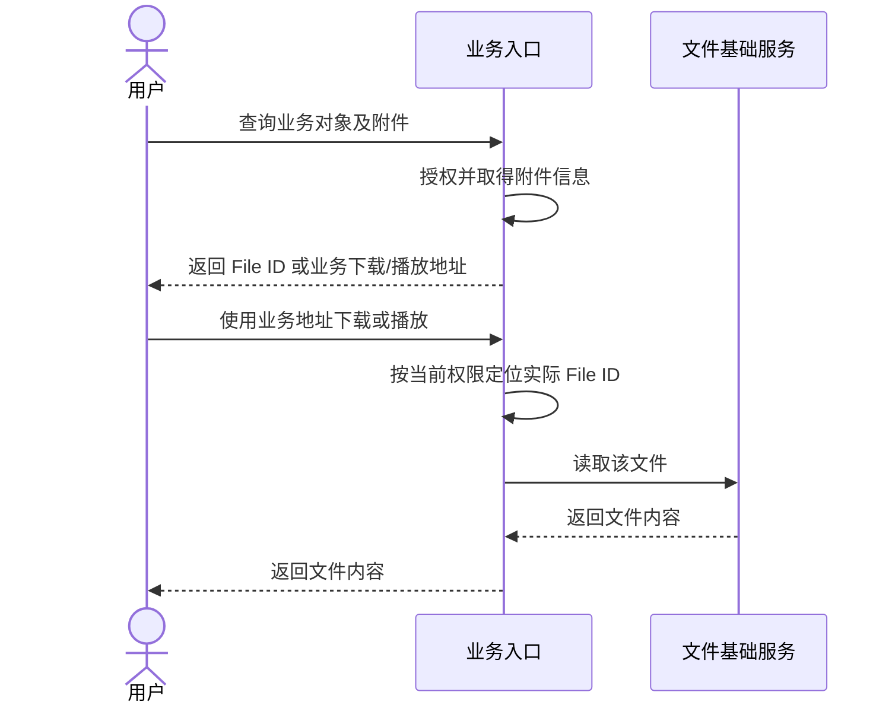
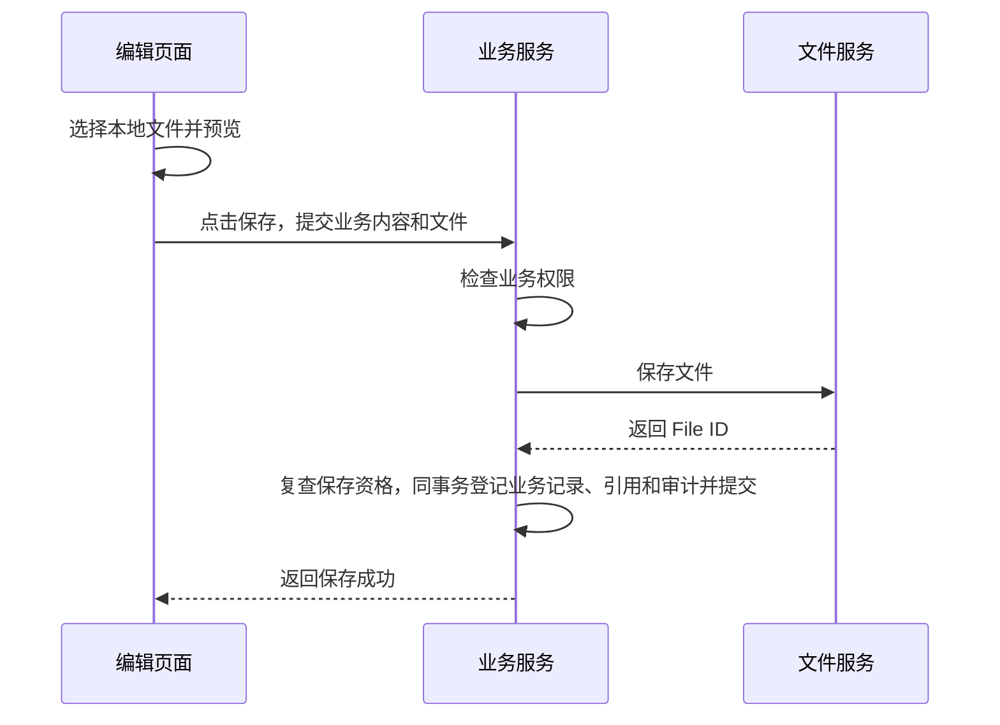
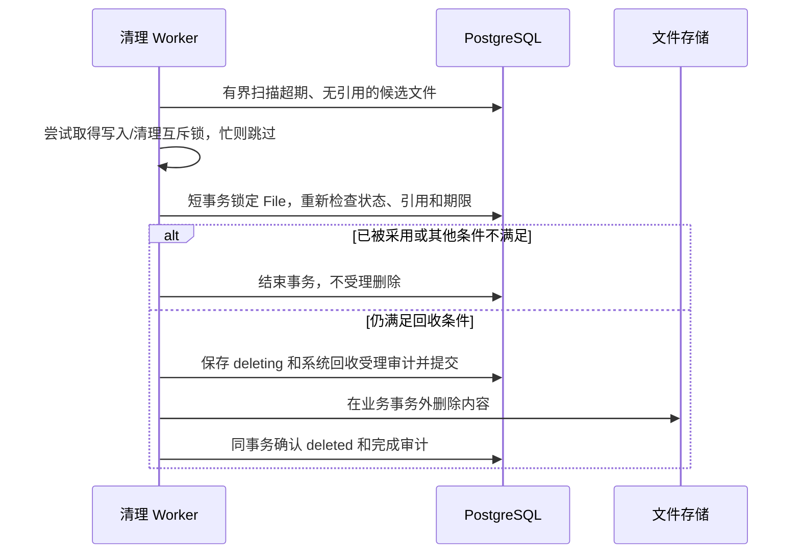
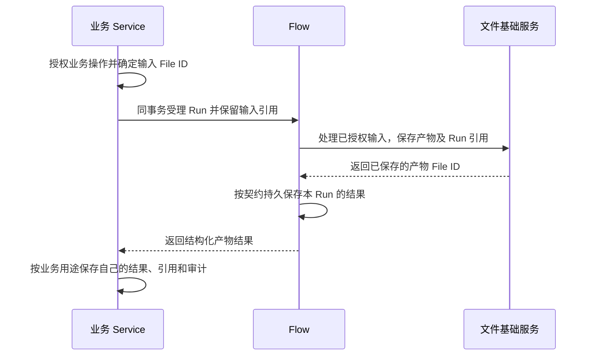
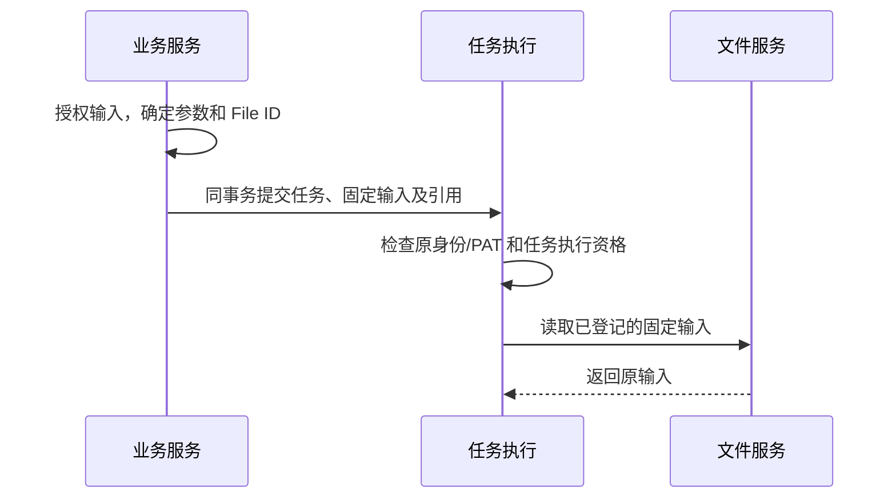
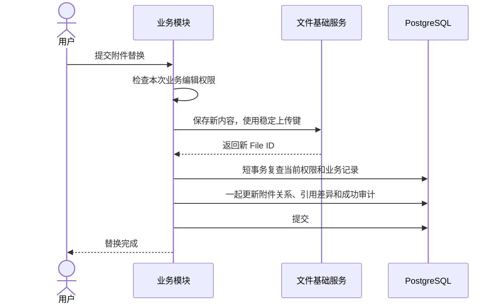
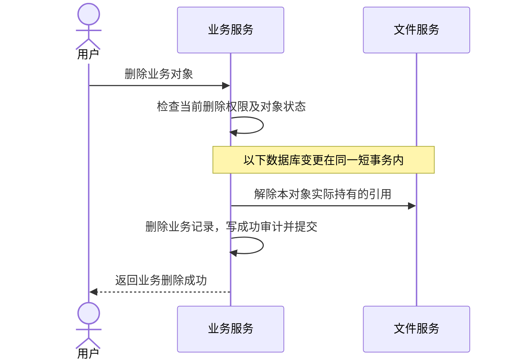
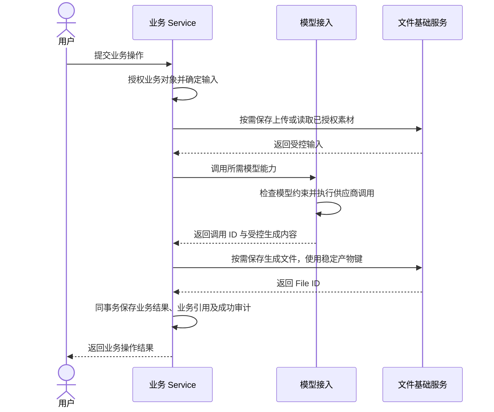

# 文件

Files 提供受管文件的存储、读取、完整性校验、引用保留和清理。博客附件、素材库等业务负责对象关系、访问规则和页面，平台不建设独立通用文件库。

本页维护文件契约与主要流程，具体接入见[实现参考](../reference/files.md)。

## 1. 范围与边界

### 核心主流程总览

| 能力 | 主线 |
|---|---|
| 接入 | 业务授权 → 保存 File → 提交业务记录与引用 |
| 使用 | 业务返回 ID/访问地址 → 内容请求重新授权 → 读取文件 |
| 生成 | 业务或 Flow 调用模型 → 保存产物 → 返回结果 → 业务登记 |
| 生命周期 | 更新或删除业务关系 → 解除自己的引用 → 无引用且超期后回收 |

### 1.1 职责划分

| Files 负责 | 业务或 Flow 负责 |
|---|---|
| 不可变内容、技术元数据、大小和完整性 | 接受什么内容、业务用途及是否采用 |
| 事务内引用与删除保护 | 哪个对象以什么用途持有引用、何时解除 |
| 安全、有界的文件 I/O | 当前身份、功能权限、对象范围和精确 File ID |

File 不排他归属某个业务，不增加 blog_id 或强制业务类型；同一 File 可被多个对象使用。来源用户、业务引用和读取权限分别表达。业务只使用 ID，普通响应不暴露磁盘路径或存储定位。

### 1.2 业务授权与文件操作契约

业务 Service 从已授权对象的记录取得实际 file_id，再调用内部 Files 能力。客户端知道 ID、是上传者或存在 FileReference，都不直接获得读取权。对象访问与共享由业务表达。

装配层通过 runtime.managed_files(identity) 注入内部 FileService；业务入口负责功能与对象授权。平台不提供通用文件 HTTP 路由或文件权限目录。

#### 普通业务附件读取

返回地址可直接使用业务内容路由，无需地址签发服务。Files 检查状态、存储身份和内容完整性，复用 Range/HEAD 与流式传输；Controller 处理 HTTP，Service 不依赖 Request/Response。

普通读取不强制第二次业务授权，不逐块查权限，也不通过 owner/slot 再证明业务归属。若排队后才实际开始读取，将最终授权放在开始边界。撤权或附件替换影响新请求，不承诺中止全部已准入读取。

### 1.3 文件上传与业务绑定

普通表单在浏览器选择文件并本地预览，点击保存才上传；提交前关闭页面没有服务端文件。不要求先建文章或草稿。

Files 完成上传登记、存储写入和可用确认，返回 File ID。业务随后复查当前保存资格，在同一事务保存业务记录、FileReference 和成功审计。上传期间不持长业务事务；文件保存成功不等于业务附件已保存。

业务使用本次上传返回的 ID，或按原上传者范围和稳定操作键核实的原文件，不能接收任意 ID 冒充本次上传。采用其他已有文件须由对应业务证明访问资格。

| 当前事实 | 事件 | 结果 |
|---|---|---|
| 仅本地选中 | 提交前放弃 | 服务端无新增文件 |
| File 已 active | 业务事务提交 | 业务记录和引用共同生效 |
| File 已 active | 业务事务回滚 | 原业务不变，新文件仍存在，后续按重试或回收规则处理 |

平台不为普通表单增加暂存实体、上传会话或票据。先上传、预处理、跨页面编辑等需求由实际业务定义。

### 1.4 无引用文件回收规则

宽限期从内容确认可用时起算，不因下载或扫描刷新。需要长期保留的业务、Run 或恢复记录必须登记自己的引用。

| 条件 | 处理 |
|---|---|
| 任一有效引用仍存在 | 保留 |
| 无引用、仍在上传完成宽限期内 | 保留，供首次采用或重试 |
| 超期、无引用、无进行中写入 | 锁定 File 行复查后进入 deleting |
| deleting | 继续原删除流程，不接受新引用 |
| uploading/failed 残留 | 使用已有失败恢复及清理规则 |

引用变更与回收受理锁定同一 File 行：引用先提交则跳过回收，deleting 先提交则拒绝新引用。上传/写入与清理继续互斥；普通读取不加读锁，接受回收导致打开或下载失败。

删除在事务外执行，失败保留 deleting；外部已删除而确认失败时，核实后继续确认。S3 迟到写入使用原精确对象与墓碑复核，不恢复文件状态。

完成时记录 completed_at；file_unreferenced_grace_seconds 显式指定宽限秒数，默认未设置、不启用回收。启用前须核对所有调用方和存量引用。旧文件完成时间无法可靠推断，导入时保留 null，不进入自动回收；FileGrant 不转换成业务引用。业务有撤销删除或回收站时，在可恢复期间保留自己的引用。

### 1.5 Flow 文件使用与产物返回契约

Flow 的受理、执行和结果查询完整时序见[Flow 主流程](flow.md#核心主流程总览)。文件交接职责如下：

生成 Flow 保存产物和 Run 引用后返回结构化结果，不反向登记业务、不等待业务回执。异步返回指完成后的结果，最初受理只返回 Run ID。业务收到结果后保存自己的记录、引用和审计；普通查询不触发业务登记。

业务登记明确失败时，用户可用新操作 ID 重新发起完整业务操作，接受新的模型成本；原 Run 保持真实成功。超时或响应丢失须沿用原键核实，不据此重新生成。不建设旧 Run 产物重新登记或通用结果消费引擎。

| 用途 | 保留责任 |
|---|---|
| 业务已有附件 | 原业务引用 |
| Run 输入 | 与受理同事务创建 input 引用 |
| Run 中间产物、输出 | 生成后即创建稳定 artifact/output 引用，覆盖执行、恢复和结果交接 |
| 业务已保存产物，含待审结果 | 业务结果同事务创建自己的引用，不转移或替换 Run 引用 |

Run 失败或取消不立即解除已有产物引用；按 Run 保留规则清理，不能提前释放检查点仍依赖的文件。任何一方引用仍存在就不得回收。历史期限及自动 Run 清理尚未完成。

#### 任务提交后的输入固定

受理事务固定参数、输入 File ID 和引用。执行、重试与恢复不重新解析来源业务的当前附件关系，不提供原地替换；新输入提交新任务。原身份/PAT、Run 取消及执行范围仍须检查，输入固定不等于永久授权。

### 1.6 附件替换与解除引用

内容不可覆盖，替换先保存新 File，再更新业务关系。

旧 ID 取自当前业务记录，只修改实际变化的引用；同一文件的其他用途及其他对象引用保持不变。移除附件省略上传步骤，同事务更新关系和审计，不直接删除内容。

#### 删除业务对象时的引用处理

业务删除、解除本对象精确引用及成功审计一起提交或回滚。物理回收另行执行，失败不撤销已提交的业务删除。

### 1.7 引用审计与统计口径

FileReference 表示当前保留关系，AuditLog 表示历史变更。引用以 `(owner, slot, file_id)` 唯一，owner/slot 由可信代码限定，不是访问策略或独占归属。

每条实际增删记录 file.reference，details 包含 owner、slot、added；目标为 File，Actor 和时间沿用审计规则。引用与审计同事务，业务变更时再与业务记录一起提交；未变化关系不重复记录。

| 指标 | 口径 |
|---|---|
| 引用关系数 | FileReference 行数 |
| 引用资源数 | owner 去重 |
| 某业务文件数/容量 | 授权范围内按 File ID 去重 |
| 实际内容容量 | 每个实际存储 File 计一次，含无引用残留 |
| 期间引用增删 | 保留期内成功引用审计，不等于当前引用量或下载次数 |

各业务容量可能重叠，不能相加冒充实际存储容量。当前提供可信事务内引用查询与 Run 诊断，未提供通用汇总报表；按需查询，不增加计数缓存或统计任务。业务查询不暴露其他对象信息，全局审计仍仅供管理员。

### 1.8 业务服务组合模型与文件

业务授权并组合子服务；模型负责协议、受控生成内容、用量、费用及恢复证据；Files 保存内容。模型生成与文件保存分开，需要持久后台执行时由 Task/Flow 组合。

小图片可有界交接字节，大图片或视频使用受控流/临时文件；大正文、句柄和签名 URL 不进入公开结果或检查点。图片、视频共用保存与引用流程，但视频模型生成尚未接入，S3 现有 64 MiB 上限不因此放大。

模型成功、文件保存和业务提交是不同事实。存储失败不能触发无证据重新生成：仍持有原结果时可用稳定产物键重试保存；崩溃后仅复用已保存文件或供应商支持的原结果取回能力。不可恢复时明确失败，不建设通用永久结果缓存。

## 2. 领域模型

### 2.1 文件 File

| 字段 | 含义 |
|---|---|
| id、name、owner_id | 稳定 ID、可改展示名、固定来源用户；来源不自动授予访问权 |
| content_type、size_bytes、checksum_sha256 | 实际内容类型、大小和完整性，完成后确定 |
| upload_key、upload_digest | 上传幂等键、原请求摘要，不随改名改变 |
| completed_at | 首次确认内容可用的时间；存量未知为 null，不自动回收 |
| storage_key | 固定存储源键，可公开 |
| storage_fingerprint、object_key | 内部存储身份和定位，不公开 |
| status、deleted_at | 处理状态、内容删除确认时间 |
| created_at/by、updated_at/by | UTC 创建/修改事实，实际操作者可与来源用户不同 |

### 2.2 业务引用 FileReference

只有 owner、slot、file_id，三元组唯一；引用增删由公开事务内服务维护，不扫描业务表推测，不开放任意 owner/slot 写接口。普通读取不依赖该表再次证明业务归属。

## 3. 状态与幂等

| 当前状态 | 事件/前提 | 下一状态及效果 |
|---|---|---|
| 无记录 | 正式上传登记 | uploading，可追踪原请求和存储定位 |
| uploading | 大小、校验通过并确认 | active，可供授权读取/采用 |
| uploading | 明确失败 | failed，不开放半文件 |
| uploading/failed | 原键、同摘要重试，旧 I/O 已协调 | 使用同一 File 重试 |
| active | 管理停用 | disabled，保留内容和引用，不接受新读取/引用 |
| disabled | 管理启用 | active，业务仍须检查当前访问资格 |
| 可删除记录 | 无引用，受理删除 | deleting，阻止新读取/引用 |
| deleting | 清理及数据库确认成功 | deleted，设置 deleted_at；不恢复 |

### 3.1 上传幂等

可信用户 ID 与稳定请求键组成 upload_key，摘要覆盖原始元数据、预期大小、SHA-256 和存储身份。使用请求键必须提供校验和；无键时不承诺跨请求去重。同键同摘要返回原 active File，不同摘要冲突；disabled/deleting/deleted 拒绝复用。

Flow 使用 run_id＋稳定产物键，循环再带稳定索引。重试复查当前资格和原存储身份，不因键相同恢复授权或覆盖内容。

### 3.2 Flow 文件引用与业务采用

Run 使用 input、artifact.<稳定键>、output 槽位。产物完成与保留引用同事务，结果只接受本 Run 已登记文件；数组路径和范围限制见[Flow 文件契约](flow.md#4-文件路径与引用)。

已完成结果的受限 system 同步仅补齐该 Run 可信、已登记的 active/disabled 文件引用，不重新上传、不恢复读取资格。业务采用是新操作，仍按当前业务授权；Run 清理与采用须由上层事务协调。

## 4. 不变量

1. File 内容不可变，业务关系、引用及成功审计原子提交。
2. 引用保护保留，不授予读取；解除一方引用不影响其他使用方。
3. 引用登记与删除受理互斥，deleting 不再接受新引用。
4. 外部存储事实不随数据库回滚消失；只确认实际完成状态。
5. 取消、撤权不开始新操作，已启动 I/O 完成收尾后才释放资源。

## 5. 设计取舍

复用共享事务、稳定上传键和已有清理 Worker。平台不增加独立文件库、授权票据、业务归属协议、文件版本、回收站或第二个清理引擎。

## 6. 边界处理补充

### 读取不加锁与回收事务互斥

普通读取接受并发回收失败；引用与回收的行锁、写入与清理的互斥继续保留，见 1.4。

### 下载中断、视频拖动与重新请求

每个新 Range/HEAD 请求重新授权。ETag/If-Range 防止拼接不同内容；中断后等待已启动 I/O 收尾，再关闭句柄和释放容量，不增加播放会话或下载任务。

### 失败、重试与残留

| 情况 | 处理 |
|---|---|
| 上传/校验失败 | 不确认 active，按原记录清理残留 |
| 文件成功、业务失败 | 业务整体回滚，文件按原键重试或超期回收 |
| 超时、断线、响应丢失 | 核实原键和实际提交状态，不自动换键重做 |
| 文件已回收 | 明确不可复用，完整重做由用户发起 |
| 外部删除成功、确认失败 | 核实原对象后继续确认，不恢复为可采用 |

### 上传完成确认失败的补充规则

明确未提交时尽力记 failed，数据库不可用则保留 uploading 待核实；已提交 active 但响应丢失不能降为 failed。S3 残留按精确对象与墓碑维护。

### 中断、取消与重试

提交后关闭页面不证明服务端失败；发现取消后不启动新业务采用，已提交记录不自动撤销。不承诺断点续传。

## 7. 当前实现约定

文件模块仅保存 File 和 FileReference。控制台不提供独立文件库，业务负责附件关系、访问入口和页面。

无引用回收默认关闭。启用前核对调用方及存量引用；完成时间未知的旧文件保持不回收。迁移不将旧授权推测为业务关系，升级条件见[迁移说明](../../backend/migrations/README.md)。

底层存储、容量和事务组合见[文件实现参考](../reference/files.md)；配置见[存储配置](../operations/configuration.md#4-同时配置本地与-s3)。
