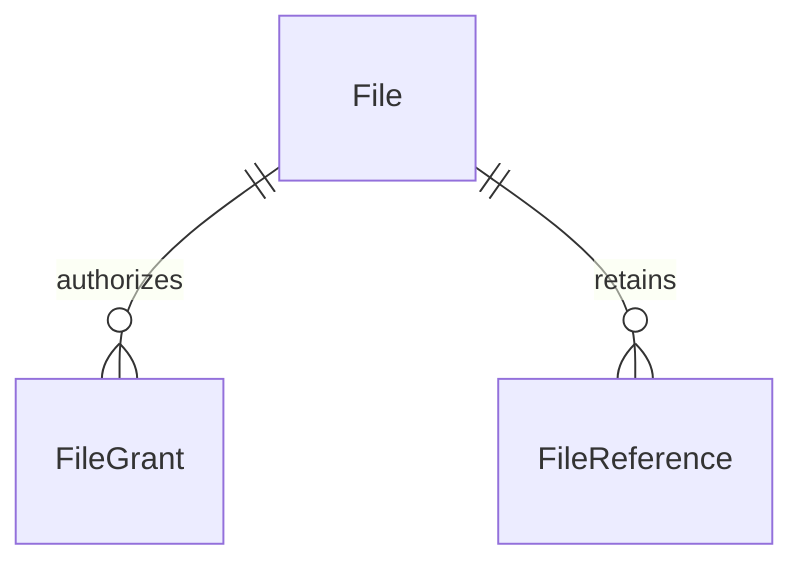

# Keystone 文件领域

[范围与边界](#1-范围与边界) · [领域模型](#2-领域模型) · [主要流程](#3-主要流程) · [权限与审计](#4-权限与审计) · [设计取舍](#5-设计取舍) · [待确定事项](#6-待确定事项)

## 1. 范围与边界

已确定的定位：文件是供后续业务复用的通用管理模块。文件库界面、业务附件和流程产物都是它的使用场景，不需要在“独立文件库”和“业务附件”之间二选一。

平台统一保存文件内容与元数据，业务通过 file_id 使用文件。文件领域负责上传、读取、授权和安全删除；合同、附件用途、审批状态等含义由业务模块负责。业务不直接依赖存储路径，也不需要各自实现上传和删除机制。

## 2. 领域模型

沿用 Ether 的三个概念：

| 模型 | 回答的问题 |
|---|---|
| File | 这是什么文件，内容存在哪里，是否可用？ |
| FileGrant | 谁可以查看、读取或管理这个文件？ |
| FileReference | 哪些业务正在使用它，是否允许删除？ |

### 2.1 文件 File

| 字段 | 含义 |
|---|---|
| `id` | 文件标识，供业务引用 |
| `name` | 展示名称，可修改 |
| `owner_id` | 所属用户，由服务端确定；用户上传及代表用户生成的流程产物归属该用户，创建后固定 |
| `content_type` | 内容类型 |
| `size_bytes` | 实际字节数 |
| `checksum_sha256` | 内容校验和，不用作跨用户自动去重依据 |
| `upload_key` | 服务端生成的上传幂等标识，隔离调用者；调用方提供稳定请求键时可跨重试复用 |
| `upload_digest` | 原始上传请求的摘要，覆盖元数据、预期大小、内容校验和及存储源身份，用于检查同键不同请求 |
| `storage_key` | 具名存储源，创建后固定；响应可返回该键，不返回源配置 |
| `storage_fingerprint`、`object_key` | 内部存储定位，沿用 Ether 的存储身份校验思路，不对外暴露 |
| `status` | 上传、可用或删除等处理状态 |
| `deleted_at` | 内容清理成功、转为 deleted 的时间；此前为空 |
| `created_at` | 创建时间，服务端生成，UTC，必填 |
| `created_by` | 创建操作的用户 ID，系统操作可为空 |
| `updated_at` | 最近修改时间，UTC，创建时与 created_at 相同 |
| `updated_by` | 最近修改操作的用户 ID，系统操作可为空，创建时与 created_by 相同 |

所属用户与实际操作人是不同含义，审计字段不能替代 owner_id。上传未完成时，大小和校验和可以为空，成功后必须确定。

首版不提供所有权转移，客户端不能任意指定所属用户。owner_id 只表达归属，不自动授予或恢复访问权；created_by、updated_by 记录实际操作来源。代表用户执行的上传沿用用户身份，平台事实同步或维护使用 system 来源，具体操作者规则见[审计日志](audit.md#2-领域模型)。

一份 File 对应一份不可变内容。同名上传也创建新文件；只有同一个幂等上传请求的重试可以返回原文件。替换附件时上传新文件，再修改业务引用，不覆盖原文件，也不预建文件版本表。

状态采用 Ether 的 `uploading / active / disabled / failed / deleting / deleted`。只有 active 可以读取内容；保留 disabled，用于不删除内容和引用的情况下暂停后续读取及新增业务引用，不增加另一套封禁标志。管理者可以在 active 与 disabled 之间切换，恢复后仍按现有授权判断。它们留在一张表内，不拆分上传任务、存储对象等新实体。

删除先进入 deleting，确认本次存储清理成功后再记为 deleted，并设置 deleted_at；S3 迟到写入另由保留记录持续复核，远端物理删除为第 7 节说明的最终清理语义；失败保留可重试状态，deleted_at 仍为空。数据库事务不能代替文件内容清理；已经进入删除流程的文件不能接受新引用。失败上传也不能当成可用文件交给业务。

进入 deleting 时保留已有 FileGrant，读取由文件状态阻断；内容清理失败时继续保留授权。确认清理成功后，在同一数据库事务内设置 deleted、deleted_at，移除该文件的全部 FileGrant，并写入删除完成及授权清理审计。deleting、deleted 都禁止新增授权，授权写入与删除协调互斥，保证删除完成后不残留授权。File 元数据与既有审计继续保留，不新增失效授权状态或表。

### 2.2 文件授权 FileGrant

沿用 Ether 的单文件授权关系：

| 字段 | 含义 |
|---|---|
| `id`、`file_id` | 授权记录及目标文件 |
| `subject_type` | `user`、`role` 或 `authenticated`（所有登录用户） |
| `user_id`、`role_id` | 根据主体类型填写其中一个，所有登录用户类型两者都为空 |
| `action` | `inspect`（元数据）、`content_read`（内容）、`manage`（管理） |
| `created_at` | 创建时间，服务端生成，UTC，必填 |
| `created_by` | 创建操作的用户 ID，系统操作可为空 |

同一文件、主体和动作不重复授权；撤销通过移除关系处理并记录审计。

角色仍被 FileGrant 使用时禁止删除，须先按文件授权管理规则显式撤销这些授权；不能删除角色时静默级联移除。角色删除与并发新增授权由事务和数据库约束协调，避免留下无效主体；不增加角色引用表。完整规则见[身份领域](identity.md#43-删除与撤销)。

文件确认删除时，按文件生命周期一并清除其授权，不需要再逐条人工撤销；这不同于删除角色时级联移除授权。处于 deleting 或清理失败的文件仍保留授权，因此仍可能阻止角色删除；真正删除完成后不再由该文件的授权阻挡角色删除。

默认私有，在创建 uploading File 的同一事务中，为所属用户建立 inspect、content_read、manage 三项普通 FileGrant，并记录上传开始及初始授权范围。上传者仍需对应功能权限才能查询状态或管理失败文件；只有 active 可以读取内容。上传完成、失败重试或重新启用都不自动补回被撤销的授权，owner 不提供隐式访问权。这沿用 Ether 的 上传时建立默认授权。共享可以面向指定用户、角色或所有登录用户；authenticated 主体只允许元数据和内容读取，不开放管理权，也不等于匿名公开。

普通用户访问同时检查对应文件功能权限与 FileGrant，PAT 还受自身范围限制。**内置管理员有明确的 inspect/manage 对象权限例外，content_read 没有例外：**

| 操作 | 普通用户 | 内置管理员 |
|---|---|---|
| 查看元数据 inspect | file:inspect 与 inspect 授权 | file:inspect，不要求该文件的 inspect 授权 |
| 管理文件及授权 manage | file:manage 与 manage 授权 | file:manage，不要求该文件的 manage 授权 |
| 读取内容 content_read | file:content_read 与 content_read 授权 | 同普通用户，仍需显式 content_read 授权 |

管理员身份来自当前用户的内置管理员角色；普通角色即使拥有 file:manage 功能权限，也不自动获得对象权限例外。所有路径继续检查用户和凭据有效性、PAT 权限范围以及文件状态；例外不绕过被引用文件禁止删除、deleting/deleted 禁止新增授权或只有 active 可读等生命周期规则。

具有有效管理权的人可以授予或撤销文件授权，包括给自己增加 content_read；每次变更写 AuditLog。manage 因此包含分发访问权的能力，不表示管理者永远不能获得内容。显式自授权不授予缺失的功能权限，实际下载仍需 file:content_read、显式文件授权和 active 状态。既有管理授权全部被撤销时，内置管理员仍可处理；首版不增加“最后一个文件管理者”保护或单独恢复机制。

这沿用 Ether 的 文件权限例外 与 授权入口。例外只属于文件领域的元数据与管理操作，不扩展成管理员绕过所有领域对象授权的通用规则。

文件上传使用 file:create；读取、元数据查看和管理仍使用上表独立权限，不相互隐含。客户端列表、详情和按 ID 查询使用相同的对象范围；列表先过滤再分页。uploading、failed 允许已授权用户查看状态；除创建时的默认授权外，授权增补、资料修改与启停仅限 active/disabled。deleting 仅允许查看处理状态和幂等删除请求，不接受修改或重新上传。deleted 的授权已清除，普通用户按不可访问处理，内置管理员可查看保留元数据；不为原 owner 恢复特殊权限。文件管理者查看引用仅返回必要 owner/slot 标识，不返回被引用业务的名称或内容，不因此取得该业务访问权。

### 2.3 业务引用 FileReference

| 字段 | 含义 |
|---|---|
| `owner` | 引用方业务对象的稳定标识，包含模块命名空间，例如 `contracts:contract:123`；不是文件所属用户 |
| `slot` | 该业务对象中的用途，例如 `attachments` |
| `file_id` | 被使用的文件 |

`owner + slot + file_id` 唯一。业务代码通过文件模块提供的登记/解除操作维护引用，用户无需手动维护。例如业务保存附件时自动登记，移除附件时自动解除；平台不扫描业务表来猜测引用。这些操作与业务保存共用数据库事务。引用登记与删除互斥检查，防止业务刚绑定的文件被并发删除。

**存在引用就不能删除；解除引用不等于立即删除；引用不自动授予读取权限。** 普通业务登记新引用前检查文件为 active 且调用者有权使用；已完成 Flow 的内部结果同步有下文限定的保留规则，不作为通用免授权入口。关系建立和解除的时间、操作者通过 AuditLog 保留，不在 FileReference 重复保存创建审计字段。

“有权使用”明确为当前 file:content_read 与该文件 content_read 授权，同时通过业务写入及对象权限检查。业务只改其他字段或保留已有引用时，不要求重新读取文件，也不强迫移除已停用或已撤权文件；新增、更换的目标逐一校验。解除引用只检查引用所属业务的修改/删除权限，不要求仍有文件读取权。owner 与 slot 由可信业务代码限定；文件 manage（包括内置管理员例外）不能直接解除其他业务的引用来绕过删除保护，不开放任意 owner/slot 的引用写接口。业务删除在同一事务中释放自己的引用。参考 Ether 的 引用读取与解除；Keystone 明确保留未变化关系，不机械地删除并重建全部引用。

保留这张统一引用表，是为了让文件模块知道文件是否被任意业务使用，而不逐个查询合同、报销、流程等业务表。FileGrant 管访问资格，FileReference 管使用关系，两者记录不同事实。

首版不根据引用自动复制或继承业务权限。某个业务需要“能看业务对象就能看附件”时，在设计该业务时明确接入规则；不为尚未确定的业务提前建立通用权限继承或同步体系。

## 3. 主要流程

1. 上传检查 file:create，同事务创建 uploading File、默认授权和上传开始审计；内容保存完成后确认大小、校验和并转为 active，完成与失败分别记录，不重复建立授权。
2. 业务保存附件时，在同一数据库事务内登记 FileReference；移除附件时解除引用，用户无需手动维护。
3. 读取时检查用户及凭据状态、角色功能权限、文件授权和文件状态，再由文件模块访问存储。
4. 删除时检查管理权限和引用情况，与新引用登记互斥；进入 deleting 后清理内容，成功后同事务确认 deleted、设置 deleted_at、清除 FileGrant 并写审计，失败保留删除状态和已有授权以便重试。

删除请求受理后，重复请求不重复记录首次请求或重置状态；已进入 deleting 的文件由受限系统清理继续处理，不因原管理者随后撤权而停止。完成后的普通查询按当前可见性处理，不能把“不可访问”单独当成删除成功证明。上传期间撤权禁止继续新写入和重试；已经写入的数据仍须由受限系统核验并确认完成或保留失败记录，不能遗失存储对象，也不能借完成阶段恢复授权或向已撤权用户返回内容。Flow 产物的系统完成仅限该次可信上传及其预定运行引用，不开放任意上传或绑定入口。

### 3.1 上传幂等

沿用 Ether 的 upload_key、upload_digest，不增加上传任务表。服务端把可信用户 ID、调用来源命名空间与上传请求键组合成唯一 upload_key；普通上传与 Flow 产物使用不同的服务端命名空间，客户端不能冒充 Flow。未提供请求键时生成独立标识，不承诺跨请求去重。两个字段都在创建 File 时确定。首版上传均归属于明确用户，不开放无所属人的 system 上传；平台维护只处理已有文件。

使用幂等上传时必须提供预期内容校验和。upload_digest 根据原始上传元数据、预期大小和校验和等影响上传结果的参数生成；checksum_sha256 则校验实际内容，两者不能互相替代。文件之后改展示名不改变原始上传摘要。

重试仍检查当前身份、file:create，以及原 File 的 manage 权限；同键查找不等于授权。普通用户不得借已知上传键接管其他上传；完成文件返回也遵循当前对象授权。存储操作校验原 storage_fingerprint，配置变化不能将同一文件静默指向另一存储。失败或进行中的本机上传与删除必须互斥，原生 I/O 未结束时不释放锁。S3 超时不能证明远端已停止，按第 7 节采用同内容重试和 deleted 记录复核清理；迟到写入不能让文件状态或授权恢复。

- 同键、同摘要且原 File 为 active：检查当前访问资格后返回原文件，不再创建或覆盖内容。
- 同键、不同摘要：返回冲突，不覆盖原文件。
- 原记录为 uploading 或 failed：不能视为成功；重试必须协调旧尝试，隔离其存储写入并核验新内容，防止迟到的旧写入覆盖已完成文件。本地协调卷使用跨进程文件锁，冲突立即返回 file_busy，释放后重试复用同一 File，不重建默认授权，见第 7 节。
- 原记录为 disabled、deleting 或 deleted：拒绝复用，不通过重试恢复或覆盖文件。

Flow 上传使用 run_id 与稳定产物键生成请求键；循环产物还要包含稳定索引，恢复时复用同一键。内容改变而键不变必须报冲突。业务采用文件后的引用仍通过 FileReference 登记，上传幂等不代替引用或授权检查。

### 3.2 Flow 文件引用与业务采用

Flow 受理时登记输入引用；产物上传成功时，在确认 File 为 active 的同一事务内登记 owner=flow:<run_id> 与稳定产物 slot，避免出现文件可删除但流程仍依赖它的窗口。流程需要输出已有文件时，也必须在当前授权下先登记该 Run 的使用关系。成功同步结果时，再按原输出契约建立 output 引用。

已完成运行的结果同步是内部事实保存：只针对该 Run 可信结果中声明、且已由受控操作登记使用关系的文件。可在发起人已撤权时，由受限 system 能力补齐输出引用；仍检查文件存在且为 active 或 disabled，不重新上传、不修改授权、不使停用文件恢复可读。关系审计记录实际 system 主体和 run_id。客户端不能提交任意文件 ID 或跳过授权开关来调用这条路径。

首版输入、中间产物、输出引用都保留到 Run 清理，失败和取消运行已有产物同样保留，不在终态提前释放中间文件。业务采用结果时，保存业务记录与业务自己的 FileReference 必须同事务完成；采用属于新的业务操作，仍检查当前业务权限与文件使用资格。

例如同一个报告文件可以同时被 owner=flow:R1、slot=output 和 owner=contracts:contract:C1、slot=review_report 引用。业务采用新增自己的引用，不转移 Flow 引用。清理 R1 时只解除 flow:R1 的引用，合同引用继续阻止文件删除；不能因流程结束或清理就直接删除文件内容。

业务采用与 Run 清理由上层用例协调事务：采用先完成则业务引用保留；清理先完成则拒绝通过已清理 Run 采用。业务记录与引用不能部分提交，文件引用登记仍与删除互斥。文件模块不反向查询 FlowRun 或各业务表，不新增引用状态、生命周期字段或通用保留任务表。

## 4. 权限与审计

操作日志采用 [AuditLog](audit.md)，文件删除的请求和清理结果按阶段关联记录。

创建时 updated_at 与 created_at 相同，updated_by 与 created_by 相同；系统初始化或系统任务允许操作者为空，具体来源在审计日志中说明。所属用户和实际操作人含义不同，不能相互替代。基础审计字段只说明创建与最近修改情况，不能代替完整操作历史。

File 保留四个审计字段，FileGrant 保留创建审计字段，均直接列在各自字段表中。FileReference 仅保存 owner、slot、file_id。授权与引用通过添加/移除维护，关系建立、移除以及文件重要变更的时间、操作者、目标、操作和结果写入审计日志。owner_id 是文件所属用户，不能由 created_by 或 updated_by 替代。

File 的字段追踪资料创建/修改，FileGrant 的字段追踪授权创建，引用建立与解除由 AuditLog 追踪；关联没有一般编辑操作，不增加 updated_at、updated_by。

File 已有删除状态并保留元数据，增加 deleted_at 方便查询清理完成时间；不增加通用 is_deleted 或回收站语义。删除发起者和后台执行者可能不同，分别记入删除请求、清理完成/失败的审计日志，首版不再增加 deleted_by，也不从 updated_by 推断删除发起者。文件不恢复、不重复开启新的删除生命周期，各阶段通过 file_id 与操作代码连接；correlation_id 可用于一次请求或执行尝试，不要求跨后台重启相同。

FileGrant、FileReference 物理移除，审计日志保留 file_id、授权主体/动作或业务引用键、操作者、时间及结果。关系建立、移除、进入 deleting、确认 deleted 等数据库状态变更与对应成功审计在同一事务内提交；外部内容清理另行执行，失败记录真实结果。日志不随目标或关系级联删除。

文件删除完成时的授权清理可以合并在该次完成审计中，保存清理范围、数量和必要授权标识，不要求逐授权复制日志。存储清理后数据库事务未成功时，不能宣称 deleted 或授权清理已提交；后续核实存储状态并重试确认。参考 Ether 的 普通删除 与 后台清理，均在确认删除时清除 FileGrant。

本领域复用身份模块的角色功能权限和个人令牌范围；普通用户同时检查 FileGrant，内置管理员仅在 inspect/manage 上使用上述对象权限例外。内容读取一律要求显式 content_read 授权；FileReference 和 owner_id 都不替代访问授权。默认私有，不允许匿名公开。管理者自授权等授权变更必须留审计，日志不保存凭据或文件内容。

能查看 Run、拥有 flow:manage 或能查看模型调用记录，都不自动获得其关联文件的下载权。内部同步保留引用也不增加任何 FileGrant；实际下载始终检查查询者当前身份、功能权限、文件授权与状态。

## 5. 设计取舍

- 保留 Ether 的不可变内容、单文件授权、显式引用和被引用文件禁止删除规则。
- 单体内沿用共享事务，不采用历史文档中的跨服务引用预留、确认状态。
- 暂不做目录树、文件版本、回收站、匿名外链或多存储管理界面。
- 文件过期和自动清理等策略后置；首版无引用文件可以手动删除，不自动删除所有未引用文件。上传失败残留仍需在实现时安排安全清理。
- 上传幂等使用 File 的 upload_key、upload_digest；本地卷重试和配置见第 7 节，不新增上传任务表。

当前实现仍只使用 File、FileGrant、FileReference。具体业务的附件权限在对应业务接入时明确；普通上传和管理接口已实现，见第 7 节。

## 6. 待确定事项

- 核心状态和授权边界已确定，保留 disabled；不再将所属人、管理员例外、初始授权时点和引用解除权限列为待定。
- 具体业务附件如何接入业务对象权限，在设计对应业务时确定。
- 普通上传交互、幂等重试、共享本地卷协调和失败残留清理已实现；多源本地与 S3 已接入；仍只支持单宿主共享可靠本地协调卷，S3 迟到写入按第 7 节复核。
- 实现时验证产物上传与引用登记的事务边界、撤权后的受限结果同步、业务采用与 Run 清理/文件删除的竞争，以及角色删除与授权新增的互斥。

## 7. 当前实现约定

代码位于 backend/src/keystone/platform/files/，迁移 0004_files 创建三表。功能权限为 file:create、file:inspect、file:content_read、file:manage。用户和角色外键限制删除，角色删除已显式检查 FileGrant；不增加通用资源注册器。

### 7.1 存储和上传

使用 OpenDAL 0.47.10，可同时配置多个 filesystem / S3 源。File.storage_key 选源，storage_fingerprint 核对身份，object_key 定位该源中的唯一对象；每个 File 仍只有一份不可变内容。不增加 FileReplica、源管理表、复制任务或平台备份策略。业务需要本地与云端两份内容时，分别上传，保存两个 file_id 并维护各自 FileReference、授权、备份状态、重试和恢复；平台不自动复制、切换读取源或同步删除。

KEYSTONE_FILE_STORAGES 为具名配置映射，KEYSTONE_FILE_DEFAULT_STORAGE 指定新上传默认源；完整例子见[存储配置](../configuration.md#4-同时配置本地与-s3)。所有内容源都在映射中显式配置，单本地源也不例外；空映射表示未配置。storage_key 是 0004_files 初始结构中的非空字段，由上传服务根据选定源写入，无隐式 local 默认值；head 为 0007_channel_credentials。切换默认源只影响新请求，已有幂等请求省略源时继续使用原 File 的源；使用中的源键及身份须保留。

filesystem 的身份来自 `.keystone-storage`，目录搬迁或恢复须连同标记保存；S3 身份来自 driver、endpoint、bucket、region、prefix，不包含凭据。配置目标改变或源被移除时，旧文件访问失败，不回退到默认源。凭据轮换不改变身份。应用不自动创建 S3 bucket；init-storage 仅显式初始化本地协调卷及已配置的本地源。对外只暴露源键，不暴露路径、对象 key、指纹、端点和凭据。源键选择使用现有 file:create 权限，首版没有按源授权；部署只应配置允许平台用户上传的源。

上传 POST /api/v1/files：查询参数为 name、content_type、expected_size，可选 storage_key、request_key、checksum_sha256；正文是原始二进制。GET /options 返回 max_file_bytes、storage_keys、default_storage；后台提供存储源选择。使用请求键必须提供 SHA-256，摘要覆盖原始元数据、源键及指纹；同键换源或改变内容返回冲突，两个独立文件须用不同请求键。默认单文件 16 MiB，最大 64 MiB；Nginx 上限需同步调整。单 API 同时接收 4 个上传，接收/处理期限 60 秒，S3 单次存储操作超时 30 秒；取消仍等待已启动的原生 I/O 结束后释放锁。保留有界内存上传，不开放直传或分片接口。

本地锁由独立 LocalLeases 管理，API/Worker 必须共用同宿主的可靠本地协调卷与标记（KEYSTONE_FILE_COORDINATION_ROOT）。配置任何内容源时都必须显式提供协调目录，协调目录与内容源互不推导，可以配置为同一路径。锁覆盖上传请求键、File 上传、完整读取及清理；冲突立即返回 409 file_busy，数据库只使用短事务。重试保留同一 File、原始请求摘要和现有授权，不补回被撤销授权。S3 重试只允许写同一已校验内容，迟到的旧 PUT 因内容完全一致不能覆盖成另一内容；不把本地锁当作远端请求已经停止的证明。不支持多宿主、NFS 协调或取消远端已受理请求。

S3 超时、断线或进程崩溃可能出现迟到 PUT。文件删除仍先阻止读取与重试，确认当前 DELETE 后转为 deleted、清除授权；远端物理删除采用最终清理语义。Worker 对已配置 S3 源的 deleted 记录每小时检查精确 object_key，存在时重新删除并记录残留清理审计，保留 tombstone、deleted_at 和删除完成审计，不恢复文件或授权；failed 记录也保留并重试残留清理。数据库必须保留这些记录和原源配置，才能继续追踪迟到写入。没有 bucket 扫描、版本清除或 multipart 清理权限；S3 版本与未完成 multipart 的保留/清理由桶策略管理。

就绪检查报告各源状态，默认源与协调卷影响整体 ready；辅助源故障作为 storage_sources 中的 unavailable 展示，不使本地源停止服务。S3 探针使用有界 list 检查（须允许相应前缀的 ListBucket），不代表所有历史文件均可读写。Worker 在数据库可用时继续逐源清理，单源失败轮转重试，不能因默认源故障阻断其他源清理。

普通上传从当前用户确定 owner。创建 uploading 与三个默认授权同事务；开始记录 user 审计。已经受理的存储写入由受限 system 确认成功/失败，不恢复授权；完成响应再次校验当前身份、file:create 和元数据对象范围。有 file:inspect 时返回元数据，仅有 file:create 时只返回新文件 ID 回执，后续查询仍需 inspect。重试要求 create 与原文件 manage，返回已有 active 的元数据还需 inspect。内容下载始终要求有效 content_read 并再次检查状态，统一按 attachment/octet-stream 输出，附 nosniff，不将 HTML 等内容内联执行。

### 7.2 管理、引用与清理

修改和删除只需要原有 manage 功能权限与对象管理权，成功统一返回文件 ID 回执，不附带名称、所属人、大小、哈希或审计字段。获取完整元数据仍须单独通过 inspect 查询；内置管理员和普通用户的响应规则相同。角色删除由 bootstrap 装配的 RoleDeletion 用例在身份排他事务内调用 files.ensure_role_unused；文件模块检查 FileGrant，身份模块不导入文件表。

| 入口 | 行为 |
|---|---|
| GET /api/v1/files、/{id} | 按当前对象范围过滤后分页、查询详情；不输出存储定位和上传摘要 |
| GET /api/v1/files/options | 返回上传上限、源键列表与默认源，要求 create |
| GET /api/v1/files/{id}/content | 校验权限、状态、大小和 SHA-256 后下载 |
| PATCH /api/v1/files/{id} | 修改 name 与 active/disabled；不替换内容，成功仅返回 `{id}` 回执 |
| DELETE /api/v1/files/{id} | 受理删除并返回 202 与 `{id}` 回执；Worker 确认完成前仍为 deleting |
| GET/POST /api/v1/files/{id}/grants | 管理者查询/新增单文件授权；重复新增返回原关系 |
| DELETE /api/v1/files/{id}/grants/{grant_id} | 撤销授权并留审计；删除处理中交给清理流程统一处理 |
| GET /api/v1/files/{id}/references | 仅返回 owner、slot，不泄露业务对象内容 |

列表默认 50、最多 100 条，offset 最多 100000。名称最多 255 字符，不允许控制字符和路径分隔符。授权主体/动作组合及去重由数据库检查约束和部分唯一索引兜底。

业务只通过 FileReferences(session, auth, namespace).replace/release 在已授权业务事务中维护引用；namespace、owner、slot 来自可信业务代码，不能从客户端透传。调用方先取得身份事务锁与当前授权，再检查业务对象。相同 owner/slot 使用事务锁，受影响文件按 ID 排序加行锁，与删除、授权写入互斥；仅增删变化项，已有停用或撤权引用保持不变。单 slot 最多 100 个目标，owner 完整长度最多 160，slot 最多 100。不提供公开引用写入 API；业务失败则引用和成功审计一起回滚。

Worker 每轮最多处理 20 个候选：deleting，以及一小时没有更新的 uploading/failed。先取得文件锁，重新检查状态和引用；仍在写入的文件跳过。过期 uploading 标记 failed 并清理残留，failed 保留元数据/授权以便原请求重试，残留维护至多每小时重试。不会自动删除所有无引用 active/disabled 文件。删除完成将 deleted、deleted_at、授权清除及完成审计同事务提交；存储删除后数据库失败则保持 deleting，后续幂等重试确认。维护使用 system，删除请求使用实际用户。

当前管理页面提供上传、分页、下载、改名、启停、删除确认、授权编辑与引用查看。可信业务调用 FileService.upload_referenced 并传入固定 owner/slot；Files 自己校验上传者、上传键和 active 状态，在上传完成事务内登记引用，不向 Flow 暴露 ORM 或完成回调。已受理写入在撤权或取消后仍保存完成事实与引用，返回前再次授权。终态同步只保留该 Run 已有引用且 active/disabled 的文件，不增加授权，也不暴露客户端跳过权限参数。报告上传后崩溃恢复使用相同请求键和原文件，不重复创建。当前没有 Run 自动清理，业务采用与清理竞争在相应用例接入时验证。

### 7.3 控制台

/console/files 复用统一会话、分页及 Element Plus 弹窗/详情抽屉。可见文件、授权和引用各按 50 条分页，异步查询按请求代次丢弃过期结果；文件编辑及删除仍只读取 ID 回执，再通过列表刷新状态。列表可展开文件 ID、所属人和时间。未取得 inspect 的管理者也可填写已知文件 ID 打开授权或引用；此入口不请求或显示完整文件资料。

授权界面参考 Ether 的 GrantPanel、SubjectPicker 和 FileReferencesDialog，裁剪为文件专用组件。用户目录有 user:read 时支持搜索分页，角色目录有 role:read 时支持分页选择；没有对应目录权限时填写已知对象 UUID，不额外读取身份资料。授权列表保留主体类型和 ID，避免将未加载的名称误认为已删除对象。新增逐条提交，重复授权由后端去重；撤销需确认，撤销后重新查询，失去对象管理权时清空列表并显示拒绝原因。

authenticated 仅能选择 inspect/content_read，不能选择 manage。可用或停用文件允许新增授权，uploading/failed 只允许撤销，deleting/deleted 不允许变更授权；按 ID 进入且状态未知时由服务端判断。页面按功能权限显示按钮，具体 FileGrant 和状态继续由 API 校验，不新增 can_manage 等领域字段。内置管理员的 inspect/manage 例外不延伸到内容读取，所属人也不自动绕过授权。

引用查看要求 file:manage 及对象管理权，仅显示 owner/slot，支持分页刷新。没有解除引用、跳转任意业务 URL 或修改业务对象的入口；删除遇到引用冲突时保留弹窗并展示原因。原业务或流程负责引用生命周期，不增加引用管理接口或新表。

### 代码组织

三个实体各自位于 models/ 下的独立文件。services/files.py 管生命周期，grants.py 管授权，references.py 管引用及受控产物保留，cleanup.py 管 Worker 清理。Flow 通过 references 内部入口写引用，调用方保留原事务与锁，不能绕过有效使用记录检查；目录与字段响应遵循整体架构规范。 统一规范见[整体架构](../architecture.md#54-模块分层与代码规范)。

内部 content 接口可指定 max_bytes，授权后在读取存储前检查文件大小，仍执行完整性和读取后授权检查。超限返回 file_too_large，引用资格错误返回 file_reference_invalid；具体业务自行转换为业务错误，Files 不声明 Flow 错误码。公开 HTTP 上传新增可选 storage_key，详情新增 storage_key；内容下载契约不变。
