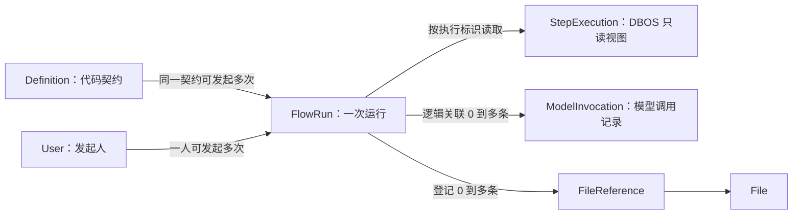
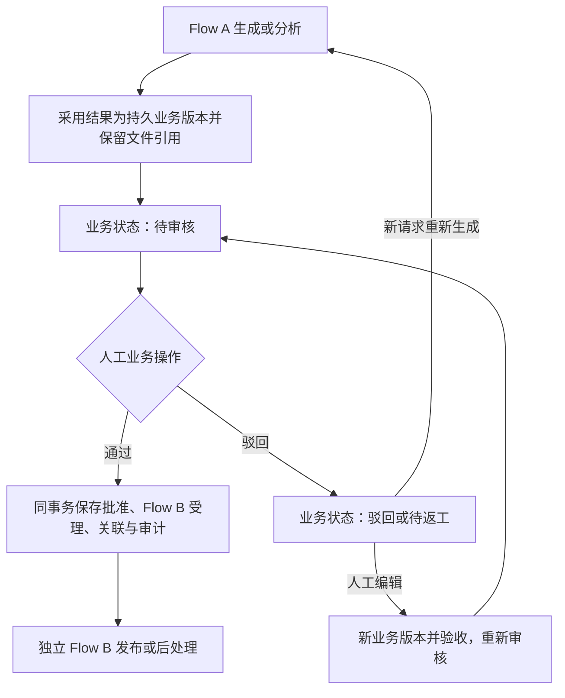

# Keystone Flow 领域

**阅读状态：**第 1～7 节描述当前契约、状态机与实现限制；第 8 节是尚未实现的 FlowPackage、多模型角色及业务阶段衔接设计。人工审核、继续和驳回由业务模块处理，前后使用独立 Flow，本次不建设通用人工节点。公共任务接口及模块目录见[任务执行与模块规范设计](../execution-design.md)。

模型接入使用真实 OpenRouter 服务，Flow/Agent 直接复用相同 ModelRuntime，不新增执行分支或 FlowRun 字段。API/Worker 从数据库读取控制台维护的模型 Key；发起表单提示真实调用可能计费，取消不撤销已发生的调用。边界见[OpenRouter 接入](model-access.md#77-openrouter-接入)。

Worker 同时承载业务 Flow、系统自动任务和定时任务，支持同宿主、同版本的固定身份，见[整体架构第 3 节](../architecture.md#3-api-与-worker-的分工)。公共 DBOS 生命周期在 Worker，Flow 补投和状态同步由定时任务触发；关闭 Flow 后公共 DBOS、文件维护和自动查费仍运行。本领域保留业务职责，第 7 节记录身份、并发和按实例恢复规则；跨宿主及自动接管未实现。

[范围与边界](#1-范围与边界) · [领域模型](#2-领域模型) · [主要流程](#3-主要流程) · [权限与审计](#4-权限与审计) · [设计取舍](#5-设计取舍) · [待确定事项](#6-待确定事项) · [当前实现](#7-当前实现) · [目标设计](#8-目标设计尚未实现)

## 1. 范围与边界

Flow 为业务提供普通代码与 Agent 混合的流程编排，支持模型调用、工具使用、Skills、结构化输出，以及长任务的查询、取消和恢复。一个业务步骤可以是普通函数、一次模型请求或包含多轮模型/工具调用的 Agent。首版采用可信 Python 代码定义流程，不做可视化编排器、BPMN、脚本在线上传或通用审批规则。

| 层次 | 负责什么 |
|---|---|
| 业务流程代码 | 输入输出、步骤顺序、分支、业务规则、结果采用 |
| Keystone Flow | 流程目录、发起人和访问权限、运行记录与平台能力接入 |
| Worker 公共启动代码 | DBOS 生命周期、Worker 身份、队列、定时计划与进程健康；不拥有 FlowRun |
| Agent 运行库与 Harness | 多轮模型/工具循环、Skills、上下文、结构化输出与执行限制 |
| DBOS | 排队、持久执行、检查点、等待、恢复和执行状态 |

执行成功不等于业务批准；审批通过/驳回等结论属于业务输出。文件清理等内部维护可以使用执行机制，但不必都注册成用户可见流程。普通业务可以直接调用 model_access 服务而不经过 Flow；实际 SDK 仍封装在模型模块，不能绕过其授权、调用记录和费用边界。

flow 保留 Definition、FlowRun、受理与原身份授权、补投、取消、引擎状态投影、结果校验和文件引用。公共 DBOS 初始化、启动关闭、固定身份配置和进程互斥位于 Worker 公共启动；Flow 的 worker.py 保留恢复准备和业务队列注册，flow/tasks/workflows.py 以 DBOS 定时任务调用原有界协调服务。费用核对归 model_access，文件维护归 files，二者通过各自的 Worker 任务入口接入，不依赖 FlowRun。多 Worker 仍沿用稳定 `flow:<run_id>` 和结果幂等规则，具体调整以整体架构第 3.7 节为准。

Agent 使用 Pydantic AI＋Harness，持久执行使用 DBOS。不自行重写 Agent 循环，也不额外引入另一套图执行框架。

素材粗选的参考结构可概括为：准备文件 → 发现 Agent → 定位 Agent → 实际裁片 → 独立审片 Agent → 通过后独立标签 Agent → 保存结果。普通处理、条件分支和多个 Agent 共同组成一个 Flow。

## 2. 领域模型

本领域回答四个问题：有哪些流程可以发起、谁发起了哪一次运行、这次运行进行到哪里、最后得到什么结果。**流程定义描述可执行的业务操作，FlowRun 记录一次实际执行。** 步骤执行用于查看过程，Agent 是步骤可以使用的一种能力。

### 2.1 概念与关系

| 概念 | 具体含义 | 归属与保存方式 |
|---|---|---|
| Definition | 一类流程的公开契约，例如“文件审查” | Flow 的代码目录，不建表 |
| FlowRun | 某个用户提交一份输入后产生的一次运行 | Flow 的核心实体，保存到 flow_runs |
| StepExecution | 一次实际的持久步骤调用，包括循环中的某一次调用 | 从 DBOS 历史读取的只读视图，不建平台步骤表 |
| Agent 调用 | 一次 agent.run，可包含多轮模型请求和工具调用 | 代码与执行上下文；恢复记录由持久化适配器和 DBOS 管理 |
| ModelInvocation | 一次本地模型调用尝试，不证明上游已收到请求 | 属于模型接入模块，与 Run 和 Agent 调用关联 |
| FileReference | 输入或产物文件与某次运行的使用关系 | 属于文件模块，不在 Run 里复制文件记录 |



图中是领域关系，不表示全部使用数据库外键。Definition 不在数据库里，StepExecution 来自引擎；模型调用通过 flow_context.flow_run_id 关联。文件引用的 owner 固定为 `flow:<run_id>`，slot 区分 input、output 或有稳定名称的中间产物。引用只表达使用关系，不授予访问权限。

当前没有平台人工待办实体，本次目标也不新增。人工决定与对象状态归所属业务，前后自动阶段使用独立 Flow，见[业务人工操作与独立 Flow 衔接](#83-业务人工操作与独立-flow-衔接目标设计)。当前也没有 Agent、Tool、Skill 管理表。

### 2.2 流程定义 Definition

| 字段 | 类型与要求 | 含义 |
|---|---|---|
| key | 非空字符串 | 稳定业务标识，例如 document.review |
| name | 非空字符串 | 展示名称，例如“文件审查” |
| description | 字符串，可为空 | 流程用途说明 |
| input_schema | JSON Schema | 发起输入的对象结构，由代码模型生成 |
| output_schema | JSON Schema | 成功结果的对象结构，由代码模型生成 |
| entrypoint | 非空字符串 | 已注册的稳定 DBOS workflow 名称，不是客户端提供的任意导入路径 |
| required_permissions | 字符串数组，可为空 | 除 flow:start 外，该流程需要的功能权限 |
| file_fields | 字段路径数组，可为空 | 输入中的文件 ID 位置 |
| output_file_fields | 字段路径数组，可为空 | 成功结果中的文件 ID 位置 |

Definition 随代码发布，不接受在线增删改，不需要数据库审计字段。首版每个 key 对外暴露当前定义，不再单独维护 revision；流程的输入输出、执行入口和资源都随同一个 execution_version 发布。该版本标识完整执行制品，包括代码、资源和锁定依赖，不因重启而变化。

### 2.3 运行实体 FlowRun

FlowRun 当前共 17 个字段，业务对象通过自身保存的 run_id 关联运行。一行对应一次受理成功的流程请求。同一运行的重启恢复不新增行；用户再次发起才产生新 Run。身份验证或输入校验未通过时不创建 Run，必要的失败留痕由 AuditLog 负责。

**发起时固定的字段**

| 字段 | 类型与要求 | 含义 |
|---|---|---|
| id | UUID，主键 | 本次运行标识；DBOS workflow ID 派生为 flow:<id>，不另存重复字段 |
| definition_key | 非空字符串 | 发起的流程 key |
| definition_snapshot | JSON 对象，必填 | 只保留输出契约和输出文件字段，结构见下文 |
| execution_version | 非空字符串 | 绑定的执行制品版本，对应 DBOS application version |
| actor_id | UUID，必填，关联 User | 原始发起人，不是 Worker 或后续管理员 |
| personal_access_token_id | UUID，可空 | 使用个人令牌发起时记录原令牌；会话发起为空，不保存令牌秘密 |
| request_key | 非空字符串 | 调用方在重试同一发起请求时复用的幂等键 |
| request_digest | 非空摘要字符串 | 服务端计算的请求摘要，用于识别同键不同请求 |
| input | JSON 对象，必填 | 校验并由服务端解析模型选择后的执行输入，不含密钥或大文件正文 |
| created_at | UTC 时间，必填 | 受理并创建记录的时间 |

**执行期间变化的字段**

| 字段 | 类型与初值 | 含义与修改规则 |
|---|---|---|
| status | 枚举，初始 pending | 生命周期状态，含义见下表；仅协调执行的服务更新 |
| result | JSON 对象，初始空 | 只在成功时保存通过契约校验的结果；没有业务结果也返回约定对象，例如 {} |
| error_code | 字符串，初始空 | 失败终态的稳定错误分类，例如 execution_not_authorized |
| cancel_requested_at | UTC 时间，初始空 | 首次取消请求受理时间，重复取消不覆盖 |
| finished_at | UTC 时间，初始空 | 平台首次确认并保存终态的时间；不作为上游请求的精确耗时依据 |
| observed_at | UTC 时间，初始空 | 最近成功查询 DBOS 的时间；不可达时不更新；它不是 Worker 心跳 |
| reconcile_attempted_at | UTC 时间，初始空 | 最近领取协调尝试的时间；公平扫描使用，失败也推进，与成功观察时间分开 |

definition_snapshot 只包含两个固定成员：

| 成员 | 保留原因 |
|---|---|
| output_schema | 旧运行完成后，协调器按原输出契约校验结果，不依赖当前安装的定义 |
| output_file_fields | 协调器按原字段位置登记产物引用，避免升级后遗漏文件引用 |

不保存 name、description、input_schema、entrypoint、required_permissions 或 file_fields。运行名称使用当前 Definition 的 name；定义已下线或不可用时显示 definition_key，不保证保留历史名称。输入在受理时已经校验且登记引用；执行入口和所需权限从匹配 execution_version 的代码目录取得。找不到该版本时停止补投和新的执行操作，不能套用当前版本；已结束运行的结果同步仍可使用小快照完成。快照不负责保存代码或恢复检查点。

当前流程目录只展示用户有 flow:start 且满足该 Definition.required_permissions 的可发起定义；新运行的首次执行及后续新的受保护操作复查同一执行版本的这些要求，再检查具体文件、模型或业务能力权限。授权拒绝作为明确执行失败，不隐式等待重新授予权限后重跑。查询和取消历史 Run 则按当前 read/cancel/manage 规则，与定义是否仍安装、是否仍有 start 权限无关，不因定义下线而隐藏已有历史。

**执行版本保留一份：execution_version。** 虽然 DBOS 入队后也记录 app_version，但 API 创建 Run 时还没有 DBOS 记录。这里必须先固定目标版本，Worker 再用 definition_key＋execution_version 找到唯一入口，提交时显式指定同一 app_version。版本信息不一致应报诊断并停止投递，不取最新版本替代。首版执行入口不另存一列，也不保留独立的契约版本。

**不保存发起人的权限快照。** 沿用 Ether 的身份引用与当前授权检查：会话发起按用户当前权限，个人令牌发起按“用户当前权限 ∩ 原令牌权限上限”，同时检查用户、令牌和运行状态。用户后续获得的权限可以在原运行中生效，这是明确采用的简化规则；工具范围仍由固定版本代码约束，文件等对象授权仍逐次检查。原令牌关联不可清空后退化成会话发起。

只要 FlowRun 仍保留，其引用的 PersonalAccessToken 就不能物理删除，包括已结束运行。令牌过期或撤销立即阻断后续受保护操作，保留记录不会使凭据继续有效。LoginSession 不进入运行关联；清理规则见[身份领域](identity.md#43-删除与撤销)。

**模型选择保存在已有 input 中。** 受理时把用户提交的 model_key 解析为 model_entry_id、channel_id、provider_model、api_base；流程契约及受理代码明确模型选择的位置，执行代码读取这个固定值。同一 Run 不跟随之后的 key 映射变化，每次发送仍检查原配置的启用状态、当前授权与渠道地址。它是非秘密选择快照，与绑定执行代码的 execution_version 用途不同，不扩展 definition_snapshot。详见[模型选择规则](model-access.md#34-flow-的固定模型选择)。

**约束与行为**

- actor_id＋request_key 唯一。摘要覆盖调用方原始提交的 definition_key、input 及发起凭据标识：PAT 请求使用原令牌记录 ID，会话请求使用空值，不包含 Cookie 或 LoginSession.id。采用稳定序列化，不混入当前时间、服务端选择的版本或解析后的模型选择。原记录仍保留时，重复请求先检查幂等，相同请求返回原 Run，不同请求冲突；不重新解析当前模型映射，仍检查当前访问权。幂等保证期限见下文。
- 发起字段受理后不可编辑。取消只表达意图；恢复沿用原 Run。首版不提供修改输入、跳过步骤、重新打开终态或指定失败步骤重跑的操作。
- succeeded、failed、cancelled 都是终态，finished_at 必填；其余状态 finished_at 为空。终态不被后续过期观察覆盖。
- 只有 succeeded 保存 result；failed 保存错误分类；面向用户的 error_message 由错误码目录生成，不单独存一列。pending/running 的暂时不可达或缺少对应版本属于运行诊断，不写成失败结果。取消原因通过取消审计追溯。
- actor_id 已表达创建来源，因此不重复 created_by。没有人工编辑，不加 updated_by 或通用 updated_at；不提供普通删除接口，不加 deleted_at、deleted_by。取消操作者记录在 AuditLog。

### 2.4 生命周期

| 状态 | 含义 | 可以发生什么 |
|---|---|---|
| pending | 已受理，尚未确认开始，可能等待投递或排队 | 开始执行、取消；执行前明确拒绝时失败 |
| running | 已开始且未结束，可能正在恢复或等待外部处理；不表达业务待审核 | 成功、失败或取消 |
| succeeded | 编排完成，结果通过本次运行契约校验 | 只读查询 |
| failed | 明确执行失败、执行前授权拒绝，或最终输出无效 | 只读查询；重新发起使用新 request_key |
| cancelled | 协调器确认取消；尚未投递时确认不会再投递 | 只读查询；不代表已撤回外部副作用 |

正常路径为 pending → running → succeeded/failed/cancelled；执行前拒绝或取消可以从 pending 直接进入终态。如果两次同步之间流程已结束，也可以从 pending 直接记录成功或失败，不伪造曾观察到 running。恢复中即使 DBOS 重新排队，平台也不把已经开始的 Run 退回 pending。

cancel_requested_at 有值但 status 尚未变为 cancelled 时，界面显示“取消处理中”，无需增加 cancelling 状态。取消与完成竞争时保留已确认的实际终态，不能因为有取消请求就把成功或其他失败覆盖掉。业务输出中的“未通过审查”“没有候选”仍可能是 succeeded，取决于是否正常完成契约。

### 2.5 步骤与 Agent 的可见性

不建步骤表不意味着看不到执行过程。StepExecution 是按需从 DBOS 历史转换的只读视图，首版展示 workflow_id、执行内 step_id、name、可取得的开始/结束时间及脱敏失败信息；以 workflow_id＋step_id 区分调用，不以步骤名称唯一。没有检查点或引擎不可达时明确返回信息未形成/不可用，不虚构进度百分比。

首版对外只返回上述白名单过程信息，不透传 DBOS 原始参数、返回值、检查点、消息历史或异常文本；子流程必须确认属于已授权 Run，客户端不能通过任意 workflow_id 查询引擎。步骤访问沿用 Run 查看权限；查询引擎后返回前重新检查当前权限。业务结果通过 FlowRun.result 的明确契约展示，过程证据确需开放时保存为受控 File，不能借步骤详情绕过文件授权。参考 Ether 的 步骤投影 与 查询后复查权限。

业务 node_key 是代码阶段标识，例如 review；一个阶段可能对应多个 DBOS 步骤或子流程，不能把两者强行视作一对一。首版不建立自己的 DAG、步骤状态机或运行事件表，也不承诺重建每个未持久化普通函数的运行过程。

Agent 在代码中声明稳定 agent_key、提示词、输出类型、工具、Skills 与执行预算。每次调用有稳定 agent_call_id，用于区分循环中的多次调用；同一调用的多轮模型请求共用此标识，各自仍有独立 ModelInvocation。这些标识由服务端产生，不能承担授权作用。SDK 实例和密钥仅在运行时取得。

### 2.6 一次文件审查的例子

以下标识为便于阅读的示意值，实际 Run、用户和文件使用各自 ID 类型。

1. 构建版本 build-A 注册 document.review；输入为 source_file_id、model_key，输出为 verdict、report_file_id。
2. 用户 U 提交文件 F1、model_key 与 request_key=review-001，生成 Run R1，固定 execution_version=build-A、小快照、身份和输入；服务端把模型选择解析并保存在 input 的约定位置，文件模块登记 owner=flow:R1、slot=input、file_id=F1。
3. Worker 执行读取、审查、保存三个业务阶段。审查阶段调用 review_agent，调用标识 A1；它向模型发送两次请求，因此产生两条 ModelInvocation，二者都关联 R1 和 A1。
4. 保存阶段用 R1 与稳定产物键 report 幂等上传报告 F2。Run 成功结果为 verdict=needs_changes、report_file_id=F2，文件模块登记输出引用；needs_changes 是审查结论，Run 仍为 succeeded。
5. 再提交同一个幂等请求返回 R1；处理另一份输入需使用新 request_key。Worker 重启恢复 R1 不创建 R2，已有模型结果检查点直接复用；若已有调用记录却缺少可恢复结果，则停止执行，不重新发送该请求。

因此首版平台只新增 flow_runs 一张表，但领域关系同时覆盖代码定义、引擎过程以及已有的用户、文件、模型调用和审计记录。

## 3. 主要流程

### 3.1 发起、提交与状态同步

1. API 校验身份与流程权限，以原始提交检查幂等；新请求再校验输入和文件使用资格、解析固定模型选择，在业务事务内创建 pending Run、必要文件引用和发起审计。重复请求按原记录返回，不因当前模型映射改变而改写原输入。
2. API 提交事务后返回 run_id，不在请求内或后台协程中执行流程。Worker 扫描待提交 Run，使用固定的 `flow:<run_id>` 向 DBOS 队列提交，再按设定并发执行。
3. 提交超时或进程中断后，Worker 按同一 ID 查询 DBOS；确认需要补交时仍使用原 ID。补交前检查取消意图、授权和代码版本，不生成新 ID 重复执行。
4. 从 DBOS 查询并同步状态，拒绝用旧观察覆盖已确认终态。DBOS 暂时不可达时保留最后确认状态和 observed_at；已经完成的执行不因发起人后来撤权而停止结果同步，边界见[结果同步与文件保留](#35-结果同步与文件保留)。

业务事务与 DBOS 入队不假定原子，即使共用 PostgreSQL 也要处理二者之间的中断窗口。首版利用 FlowRun 做轻量补交与状态核对，不另建通用消息框架。DBOS 的同 ID 去重依赖执行历史保留，未解决的提交与恢复记录不能先清理。

受理幂等采用平台公开约定的有限保证窗口（当前 7 天），从首次受理的 created_at 起算，不新增过期字段。窗口内必须保留 Run，包括成功、失败和取消的运行；同一请求重试只返回原记录，不重新执行。窗口外只要原记录仍在就继续去重，记录已清理则无法保证旧请求不会被视为新请求。调用方只能在保证窗口内自动重试；主动重新执行必须使用新 request_key。查询和重试仍受当前身份与访问权限约束。

不保留额外幂等墓碑表，也不承诺删除原记录后仍永久识别旧请求。当前不规划历史清理；未来如启用，须先明确保留策略并告知调用方，不能早于已承诺的 7 天幂等窗口。该窗口约束的是 Flow 受理去重，不替代已有 Run 内的 ModelInvocation 防重发保护。

### 3.2 取消

取消自己的 Run 需要 flow:read 与 flow:cancel；取消他人的 Run 再加 flow:manage。manage 只扩大对象范围，不替代读取或取消动作权限；取消不要求 flow:start，失去发起权限不自动失去停止已有运行的能力。

检查当前取消请求的用户、会话或 PAT 及其有效权限，不使用 Run 的原 PAT 授权取消。原 PAT 已过期或撤销时，本人仍可重新登录并按当前权限取消；Run 的原身份关联保持不变。这与执行后续业务步骤时检查原凭据是两个不同入口。

API 仅在首次接受非终态 Run 的取消请求时设置 cancel_requested_at，并同事务记录实际取消人的审计。重复取消不覆盖时间、不重复生成首次取消请求日志；对已经终态的 Run，在完成当前授权检查后直接返回现有状态，不写新的取消意图、不重新打开运行。

Worker 再调用 DBOS；通知失败可以重试，查询到 DBOS 取消状态后同步为 cancelled。尚未提交的运行由同一个定时协调任务核实未入队后取消，不再投递。若运行已经完成，保留实际完成结果。取消不能保证正在执行的步骤或已发出的外部请求立即停止，也不撤销已发生的业务写入或费用。该幂等行为参考 Ether 的 request_cancel，Keystone 额外明确独立 flow:cancel 权限。

### 3.3 恢复、业务写入与外部副作用

继续同一运行使用兼容代码、原 workflow ID 和原检查点；另起新 Run 是一次新业务请求。不能用“重跑”隐式覆盖原记录，也不能在旧版本不可用时用不兼容的新代码强行恢复。DBOS workflow 编排保持确定性，时间、随机数和外部 I/O 放入合适的 step、事务或持久化适配器。

恢复时普通数据库写入和远端请求都可能重复，必须分别处理。业务写入按 run_id 和稳定操作键去重；创建文件产物使用 run_id 与稳定产物键，循环中包含稳定索引，通过 File.upload_key、upload_digest 检查重复与冲突，详见[上传幂等](files.md#31-上传幂等)。业务采用结果同样需要幂等。大型结果保存为 File，运行只保留引用；引用登记和解除沿用文件模块，不能自行覆盖或删除共享文件。

收费模型调用不能仅依赖“SDK 关闭重试”：引擎恢复也可能重执行尚未落检查点的步骤。首版复用 ModelInvocation.id，为每次持久模型请求提供稳定身份，在发送边界原子登记，只有首次成功登记者可以发送。已有结果检查点就复用；已有调用记录但无可恢复结果则停止执行并报错，即使记录为 succeeded 也不重发，且不改写已经确认的调用结果。具体规则见[模型恢复与防重发](model-access.md#35-flow-模型请求的恢复与防重发)。

一轮 Agent 中的多个模型请求各有独立稳定 ID，不能把整个 Agent 当作一次发送。记录落库后、HTTP 发送前中断也会被保守阻断；这不承诺上游只执行一次。首版不新增发送意图表或 File 标记，仍需验证适配器的稳定身份、原子登记与内部恢复边界，才能承诺对应恢复行为。

### 3.4 在业务步骤中执行 Agent

业务步骤准备输入与证据，选定 Agent、模型和预算，执行 Agent 循环，再校验结构化结果并交给下一个步骤。必需 Skill 在首次请求前装载；文件 ID 或“工具可用”不代表模型已经收到内容，多模态证据需要实际读取、传入并记录必要的送达信息。具体选片、裁片和视觉判断规则属于业务包。

不同角色默认使用独立消息上下文，只通过明确的结构化输入传递事实。参考项目把审片取舍与标签拆成两个 Agent 调用，没有把前一阶段的消息历史传给标签 Agent。需要共享历史时必须显式声明，不能因复用 Agent 对象就默认共享判断过程。

Agent 配置 Pydantic AI 的 `DBOSDurability`，从 DBOS workflow 或其兼容的普通函数调用 `agent.run()`。不要再把整个持久化 Agent 包进一个自动重试的外层 `@DBOS.step`。普通自定义工具的 I/O 需要逐项确认恢复边界，不能假定所有 Python 工具都会自动持久化。参考项目的 review_segment 位于 step_02 文件中，但本身就是普通 async 函数。

每次新的模型请求尝试在发送前单独登记 ModelInvocation，并关联运行、业务步骤和 Agent 调用；登记不证明上游已经接受请求。工具进度和 Agent 事件可以流式展示，但不新增一张完整聊天消息表。引擎为了恢复可能持久化消息和工具结果，这与调用表默认不存正文是两件事，必须限制检查点的访问、大小和保留期。业务需要保存过程证据时显式生成受控 File，不默认复制全部对话到审计日志。

请求次数、工具次数、token 和总时长分别设上限，Agent 的输出修正、工具重试、引擎恢复与传输重试不能无限叠加。结构校验成功仅说明格式满足契约，不代表业务结果正确。

### 3.5 结果同步与文件保留

新的受保护操作与已经发生的执行事实分别处理。新模型请求、文件读取或上传、业务写入都检查当前用户与原令牌权限；失效时拒绝。已发送模型请求的响应继续补全状态、用量和费用；DBOS 已完成的 Run 继续同步真实终态和通过原契约校验的结果。不能因为同步时用户停用或令牌撤销，就把已成功完成的运行改成授权失败。

结果同步由受限 system 能力执行，不冒充原用户仍有操作权限。内部文件引用登记只接受对应 Run 的可信结果、原 output_file_fields 和已通过该 Run 受控操作登记的文件使用关系；结果里出现一个文件 ID 本身不构成授权。执行代码若要输出已有文件，必须在仍有权限时登记该 Run 的使用关系。同步仍检查文件存在且状态为 active 或 disabled，拒绝未完成上传、已进入删除等不可引用状态；保留 disabled 文件引用不恢复内容读取权。该入口不能接受客户端任意指定的文件列表或通用跳过授权参数。

Run 的结果、输出引用及相应引用审计在同一事务内保存。引用审计记录 system 执行主体和 run_id，Run.actor_id 继续表示原发起人。业务采用结果、修改合同或发布内容仍是新的业务操作，必须检查相应当前权限；首版不引入自动业务投影机制或投影状态字段。用户查询、下载也始终按查询者当前权限判断。

文件保留统一使用已有 FileReference：

| 阶段 | 引用规则 |
|---|---|
| 受理输入 | 在创建 Run 的事务内登记 owner=flow:<run_id>、slot=input |
| 生成中间产物 | 上传完成时同事务登记该 Run 的稳定产物 slot；已有文件使用也需先授权登记，保护后续执行与恢复 |
| 成功同步 | 按原输出契约登记 slot=output，与结果一起保存 |
| 业务采用 | 业务记录与业务自己的 FileReference 同事务提交；增加业务引用，不转移或移除 Flow 引用 |
| Run 清理 | 仅解除 owner=flow:<run_id> 的引用，不解除业务引用，不直接删除文件内容 |

首版输入、中间产物与输出引用都保留到 Run 清理，不在终态提前释放中间产物；失败或取消运行已生成的文件也按此规则保留。代价是中间文件保留更久，换取统一的清理边界。业务采用与 Run 清理需要事务协调：采用方确认 Run 及结果仍可用，并完成业务记录和引用的原子保存；清理先完成时明确返回不可采用，不能保存悬空业务记录。具体引用与删除互斥规则见[文件领域](files.md#32-flow-文件引用与业务采用)。

这沿用 Ether 的 结果同步 和 产物引用登记 边界；Keystone 首版统一延后到 Run 清理时释放产物引用，不搬入 Ether 的终态临时引用释放或整套业务投影字段。

## 4. 权限与审计

沿用用户、角色、个人令牌和 Casbin，声明 `flow:start`、`flow:read`、`flow:cancel`，跨用户管理使用 `flow:manage`。普通用户只能查询和取消自己的运行；人工审核权限由所属业务声明，Run 的查看或管理权不代替业务批准权或文件内容权。

| 查询或操作内容 | 必须满足的规则 |
|---|---|
| 自己的 Run 状态与结果 | flow:read，且 actor_id 为当前用户 |
| 他人的 Run 状态与结果 | flow:read 与 flow:manage |
| 取消自己的 Run | flow:read 与 flow:cancel；按当前取消请求身份判断 |
| 取消他人的 Run | flow:read、flow:cancel 与 flow:manage；不要求 flow:start |
| Run 下的模型调用明细和费用汇总 | Run 可见且有 model_invocation:read；默认仅限当前用户记录，查看他人或系统记录还需 model_invocation:read_all |
| 关联文件内容 | 当前文件功能权限、FileGrant 和可读取状态；Run 可见或 flow:manage 都不替代文件检查 |

Flow 页面和模型记录页面使用同一套模型记录授权判断。仅有 flow:manage 不获得他人模型费用或文件内容访问权；费用区域无权限时明确显示“无查看权限”，不能显示零费用。只在调用记录页面查询时按模型模块规则判断，不要求模型模块反向检查 Flow。权限组合由入口用例完成，不增加跨模块授权表。

发起人固定，执行时检查用户是否启用及当前权限，不另冻结一份用户权限。通过个人令牌发起时使用原令牌的范围限制，不能退化为只检查用户角色；令牌已撤销/到期时不再发起新的受保护操作。会话退出是否中止既有运行与令牌规则不同，首版会话只用于受理认证，退出不自动取消已受理运行。

凭据、SDK 客户端和连接秘密不进入 input、result、检查点或审计。文件访问与模型调用都经过对应模块的当前授权检查；Flow 内的模型调用使用 flow_context.flow_run_id 关联运行，node_key、agent_key、agent_call_id 补充步骤与 Agent 调用标识。业务对象自行保存 run_id，FlowRun 不反向保存业务关联字段，也不增加另一张关联表。Agent 不能绕过模型接入模块另用环境密钥直连，否则权限、费用和调用追踪都会失效。

本领域的必要审计字段已在各模型表内列出，不统一套四字段。发起、取消等重要操作写入 [AuditLog](audit.md)，日志记录真实操作人和 Run 目标。自动步骤进度留在执行引擎，调用费用留在 ModelInvocation，不逐步骤复制审计。

Worker 代表原用户执行且仍通过当前授权的业务变更，以该用户为审计操作者；平台结果同步、引用清理等维护操作以 system 记录。不能仅根据所在进程选择 actor_type；取消日志记录当前取消人，不覆盖 Run.actor_id。

首版不提供运行的普通用户删除接口，也不增加 deleted_at、deleted_by。保留期清理必须同时满足：已过受理幂等保证窗口、满足历史保留期、已经终态、没有未完成的恢复或协调事项。同事务解除该 Run 的输入、中间产物及输出引用，保留独立业务引用；不直接删除文件内容。运行与引擎历史的保留期限需要协调，不能提前清除仍需恢复或等待的记录。清理任务使用运行日志，引用解除沿用文件领域的审计规则，已有审计独立保留。

保留协调也包括用于模型防重发的 ModelInvocation，恢复义务结束前不能清除。原个人令牌须等引用它的所有 Run 都已清理后，才可能满足身份模块的凭据清理条件。

## 5. 设计取舍

### 5.1 FlowRun 与 DBOS 各保存什么

| 数据 | DBOS 能否提供 | Keystone 的选择 |
|---|---|---|
| 执行版本、workflow 名称 | 入队后可查 app_version、name | 保留 execution_version 以覆盖入队前窗口；入口由匹配版本的 Definition 取得，不重复存 |
| 契约版本、业务展示与文件字段 | 不自动生成 Keystone 的契约或引用规则 | 去掉独立 definition_revision，仅保存输出契约与输出文件字段组成的两成员 definition_snapshot |
| 用户当前权限、个人令牌状态 | 引擎身份元数据不等于平台当前授权 | 保留 actor_id 和 personal_access_token_id，实时授权，去掉 permission_snapshot |
| 业务输入 | DBOS 保存调用参数，不保证就是业务输入；Ether 向 workflow 传入的是 run_id | 保留 input，支持受理、补投和历史查询 |
| 状态、最终结果、执行错误 | 可查 status、output、error | 本地保留 status、result、error_code，供列表筛选、结果引用登记及业务历史查询；不保存原始异常 |
| 步骤、子流程、执行器、队列 | 可查执行与步骤记录 | 按需读取，不建平台表或字段 |
| 引擎时间 | 可查 created_at、dequeued_at、completed_at 等 | 不存 started_at；按原含义展示引擎时间，不把最近出队时间当首次开始时间 |
| 受理、取消请求、状态同步时间 | 不对应平台受理及同步事实 | 保留 created_at、cancel_requested_at、observed_at；finished_at 保留为平台确认终态的时间 |

状态和结果虽可查 DBOS，仍保留必要的本地投影；这是为了让平台的授权分页、入队前取消及历史查询不必依赖引擎联表。DBOS 历史清理后，步骤和执行时间等详情可以不可用，不能承诺永久保留；Run 仍保留最终业务结果。两边保留期要协调，未完成运行及尚未同步的结果不能清理。

核对依据：[DBOS WorkflowStatus](https://docs.dbos.dev/python/reference/contexts#workflow-status)、[DBOS Client](https://docs.dbos.dev/python/reference/client)。这些是当前官方接口；实现时仍需核对所固定的 SDK 版本。

Ether 的 Run 模型 同时保存 definition_revision、definition_snapshot、entrypoint、application_version，但没有冻结用户全部权限的快照；授权实现 检查当前权限与流程要求。它的 快照构造 还服务于应用归属和业务投影，Keystone 首版不需要完整搬入，也不保存用户权限快照。

### 5.2 部署与参考范围

跨模块调用与进程职责见 [整体架构](../architecture.md)。实现优先参考 Ether 已有的 Run 受理、Worker 补投、状态同步和宿主能力接入，再按本文范围裁剪；不另起一套编排机制。

当前部署为 **API 进程＋固定身份 Worker＋PostgreSQL**，默认一个 Worker，支持同宿主、同版本的 1～4 个固定身份。API 与 Worker 使用同一套业务代码和依赖，仍属于模块化单体。Worker 内允许受限并发，按原身份恢复，不提供跨 Worker 自动接管；约束见[多 Worker 部署](../architecture.md#35-多-worker恢复与发布)。

直接使用 DBOS 编排 API，平台只封装发起、查询和取消等少量入口。不做通用多引擎接口、独立编排服务或自建检查点表，当前不依赖 Conductor。现有固定身份锁和归属校验用于互斥与原身份恢复，不提供选主或跨 Worker 自动接管。目标 core/execution/ 是公共技术接入目录，不是新的执行领域。

相对 Ether，当前保留代码定义、运行归属、幂等、历史契约与 Agent 接入经验。本次不建设平台人工任务、automatic/manual 切换或通用审批；人工操作按第 8 节由业务衔接独立 Flow。Sandbox 生命周期、完整外部操作领域和多版本并行执行器仍未实现。升级前处理未完成运行，不能把使用 DBOS 理解成自动解决不兼容版本迁移。

官方依据：[DBOS workflow 与取消](https://docs.dbos.dev/python/tutorials/workflow-tutorial)、[自托管恢复](https://docs.dbos.dev/production/workflow-recovery)、[Pydantic AI 的 DBOS 集成](https://pydantic.dev/docs/ai/capabilities/durable_execution/dbos/)。参考项目的固定依赖与最新文档可能不同，实现时必须固定并验证版本。

## 6. 待确定事项

- 真实供应商逐个联调，核对模型工具调用、结构化输出与实际账务能力；模拟完成不代表模型判断质量或真实计费正确。
- 历史清理暂不纳入首版，不设定保留天数或清理入口；有实际容量或运维需求后再评估。当前保留 Run、DBOS 历史、调用记录和凭据，仍须遵守引用与恢复约束。备份恢复与升级沿用部署规程。
- 具体业务出现后实现“采用结果”的业务用例，在同一事务写业务记录及自身文件引用。当前示例止于报告生成，不增加占位业务表或通用投影机制。
- 需要人工操作的业务按第 8 节定义资源版本、决定与后续 Run 的关联、幂等和页面；不增加平台人工节点。多 Worker 自动接管、流式 Agent 过程展示和复杂表单仍按实际需求另行设计。

## 7. 当前实现

### 7.1 装配、迁移与接口

轻量定义目录由 build_definitions 根据 composition.py 的显式列表构建，拒绝重复键、空白或重复执行入口，并对每个定义检查 required_permissions、model_field 是否存在于序列化输入的顶层字段，以及输入输出文件路径是否符合契约。文件路径使用对象点路径，末端为字符串 ID 或 ID 列表；支持嵌套契约与可空值，空值不登记引用，不支持通配符或穿越对象数组。重复路径、未声明字段、数字等不匹配类型在启动时拒绝；实际 ID 仍在使用时转换为 UUID 并校验文件权限。

输出契约统一由 Definition.output_schema() 按 `mode="serialization", by_alias=False` 生成，启动校验、目录展示与 Run 快照共用。工作流输出使用 `model_dump(mode="json", by_alias=False)`，字段序列化器按实际返回类型描述；输出字段和文件路径使用原字段名，不使用别名。输入目录保留校验契约，允许按输入契约接收别名；受理后同样按原字段名序列化，供模型选择和文件路径读取。已有 Run 继续使用原快照，不重写历史结果契约。

输入文件 ID 在创建 Run 和解析模型选择之前提取；非法 UUID 或超过 100 个不同文件 ID 返回 `422 flow_invalid_input`，不保存 Run 或引用、不占用请求幂等键，并沿用失败审计。文件存在性与授权仍由 Files 服务检查；结果文件错误继续在同步边界转换为 flow_invalid_output。

不可变映射由当前 Runtime.flow_definitions 持有，目录展示、发起、ExecutionIdentity 授权及 reconcile 补投都使用同一映射；不再保留全局 _definitions 或覆盖式注册。Worker 继续由 register_workflows 单独显式导入 workflow，装饰器使用 definition.entrypoint，避免手写第二份入口名。未增加插件发现、执行版本字段或多项目调度能力。

代码位于 backend/src/keystone/platform/flow/；flow 领域初始迁移创建 keystone.flow_runs，保持上文 16 字段，不增加投递、步骤、Agent、租约或快照版本表。DBOS 自己管理同一 PostgreSQL 的 dbos schema，由同一个 `keystone init` 初始化/升级；API 和 Worker 启动均不运行迁移。

composition.py 集中声明轻量 Definition，bootstrap 加载该目录；只有 Worker 装配 workflow、Agent 和 Skills。新增业务流程时在业务目录声明契约、编排和受控能力，在 composition.py 注册，不修改平台执行器。API 使用 DBOSClient 查询历史，不启动 DBOS 执行器。`KEYSTONE_FLOW_ENABLED` 默认 true。

| 接口 | 当前行为 |
|---|---|
| GET /api/v1/flow-definitions | 返回当前有权发起的代码目录、启用状态、执行版本和 7 天幂等保证窗口 |
| POST /api/v1/flow-runs | 校验原始请求、解析固定模型选择、保存 Run/输入引用/审计，返回 202；同用户同键同请求返回原 Run |
| GET /api/v1/flow-runs、/{id} | 当前授权与归属过滤；列表默认 50、最多 100 条，支持状态与分页 |
| POST /api/v1/flow-runs/{id}/cancel | 保存首次取消意图和实际操作者；重复或终态取消不覆盖原事实 |
| GET /api/v1/flow-runs/{id}/steps | 前后复查 Run 可见性，仅返回步骤 ID、名称及引擎开始/完成时间；最多 32 个引擎关联流程、500 条步骤 |
| GET /api/v1/flow-runs/{id}/costs | 同时检查 Run 和模型记录权限，复用最近 30 天的模型汇总；更长范围从模型记录 API 查询 |

步骤接口不返回原始参数、输出、错误消息或检查点。历史服务不可用返回 503，已存 Run 详情仍可读；历史为空不代表流程失败。管理页提供发起、状态筛选与分页、运行详情、状态轮询、取消确认、步骤、费用及报告下载，复杂 JSON Schema 表单后置，其他流程输入采用 JSON 对象。文件下载仍走文件授权，Flow 管理权不替代它。

控制台流程目录按名称、标识或说明搜索，并从对应行发起，自动选中该流程。加载、失败、未启用及无可见定义分别显示；目录失败可直接刷新重试。运行记录支持重置状态筛选；等待执行时可从目录提示进入平台状态检查 Worker 就绪状态和最近心跳，Worker 离线不会阻止任务受理。

### 7.2 Worker 与执行预算

默认一个 Worker，可按共同清单配置同宿主同版本的固定身份。原身份授权、稳定 Flow ID、取消与结果同步保持不变；身份、共享预算和首次迁移见[整体架构](../architecture.md#37-现有实现与调整点)及部署文档，不能复制同身份进程。

executor_id 使用配置的固定 worker_id，第一个槽位保留 keystone-worker。业务队列 keystone-flows 默认每进程并发 2、全局 4，分别由 flow_worker_concurrency / flow_global_concurrency 控制，满载保留在队列。flow/tasks/workflows.py 注册同一个 `keystone.flow.reconcile` 计划，每 5 秒触发、启动立即扫描；实际协调在独立全局串行队列运行，活动触发合并去重，不占业务执行和文件清理容量。每轮按持久 reconcile_attempted_at/创建时间最多选 25 条，单条协调上限 15 秒，进程轮换或重启不重置公平扫描依据。停机不逐个补跑旧时间点。缺少原版本时保留运行并告警，不将输入交给新版本解释；成功查询才更新 observed_at，与扫描尝试分开。受理键至少保留 7 天，当前完全不自动清理，原 Run 仍在时持续去重。

execution_version 是实际加载的后端包、打包资源和 uv.lock 的内容摘要；源码换行统一后计算，API/Worker 必须交付同一制品。wheel 安装时核验已安装包，不使用部署目录中另一份源码副本。后端资源包括 Python、Markdown、JSON、文本。外部执行包通过 composition.EXECUTION_PACKAGES 显式声明包名及必需资源路径；核验所有包内代码和资源（包含二进制资源、媒体子进程），排除字节码缓存，缺包或必需资源时启动失败。API 只定位包文件，不导入执行模块。定义快照仍只有 output_schema 和 output_file_fields。发布前处理未完成运行，或保留原制品用于恢复；不做多版本同时调度。

输入/结果 JSON 上限 64 KiB，按紧凑 JSON 的 UTF-8 字节数计算，恰好 65536 字节允许。输入先检查原始请求，在默认值填充、字段序列化和模型选择解析完成后、创建 FlowRun 前，再检查最终保存的 inputs；超限沿用 `422 flow_value_too_large`，事务不保存 Run 或引用，并记录失败审计。原始请求的幂等摘要及重试规则不变，不增加逐流程配置。FlowRun 输入只承载参数、业务对象 ID、文件 ID 和少量文本；大段正文或文件内容由文件模块或业务实体保存，通过 ID 引用。

SDK 请求体上限 256 KiB。可复用文件审查示例只读 16 KiB 以内 UTF-8 文本，流程时限 180 秒，最多 4 次模型请求、3 次普通工具调用、16000 tokens，输出修正最多一次；每次模型输出最多 2048 tokens。FlowModel 默认输出上限为 1024，可信业务可显式配置 1～4096。业务调整执行预算须修改代码并形成新制品，具体约定见[业务 Flow 开发](../flow-development.md)。

Worker 全生命周期持有按身份的 OS 与 PostgreSQL 锁，同身份双开拒绝；原 keystone-flow-worker 以共享锁持有，排斥旧单实例制品。prepare 绑定当前服务，只收尾自身旧 instance 的 Flow running 模型调用，再启动 DBOS；每次实际发送由可信适配提供当前 worker_id、instance_id 和 execution_version，不能从旧输入恢复。无归属的历史调用阻止启动，须在停机迁移后专项收尾。普通 API 调用仍独立离线处理，不按心跳或时间推断请求已终止。公共运行时位于 core/execution/runtime.py，停止领取后上报 draining，按 worker_shutdown_seconds 有限等待再清理本进程 DBOS 协程，保留恢复依据；不取消其他组件的独立协程，剩余资源清理仍有独立线程池。

Worker 持续上报[心跳与就绪](../development.md#worker-健康检查排障)，实例依赖/执行器健康和共享维护结果分开；空闲实例不必亲自完成每种维护。共享扫描失败或超过 30 秒未更新会反映为整体未就绪，但心跳继续。关闭 Flow 时暂停共享协调计划，不注册业务 workflow、不做 Flow 收尾或协调；监听不含 keystone-flows 和 keystone-flow-maintenance，禁用前须处理在途 Flow，所有进程使用一致开关。重新启用恢复原计划，不创建副本；公共 DBOS、文件维护和查费继续运行。扫描尝试字段不改变业务终态，也不把长期 pending 自动改判失败。

### 7.3 普通步骤与 Harness Agent

可复用示例位于 backend/src/keystone/examples/document_review，默认不注册；backend/tests/support/flow_fixture 直接复用这份代码。流程为准备可信源信息 → Agent 调用摘要/分段读取工具 → 结构化审查及业务验收 → 保存报告。Harness 加载打包的 review-text Skill，Pydantic AI 执行模型/工具循环；DBOSDurability 持久化每轮模型请求，普通工具的文件 I/O 显式放在 DBOS step 内。不在 agent.run 外再套可重试的大步骤。输出验收、可信预算、工具摘要约定及显式接入方法见[业务 Flow 开发](../flow-development.md)。

该示例的 required_permissions 为 file:content_read/create/inspect/manage 与 model:invoke，另按平台规则要求 flow:start。inspect/manage 用于报告上传恢复时复用原文件，沿用文件服务已有的重试检查，在受理时明确声明；对象授权仍逐文件检查，不因这些功能权限获得他人文件。

模型适配器通过现有 ModelRuntime 内部回调使用受控 SDK，每个实际模型请求都经过当前授权、原模型选择校验、发送前登记及响应后费用补全。稳定调用 ID 由 Run、DBOS workflow ID 和 step ID 派生；它不是客户端参数。模型步骤和 SDK 不自动重试实际发送。Agent 依赖仅含运行和业务标识，运行时客户端/秘密不进入检查点。

报告上传使用稳定的 flow:<run_id>:report 请求键，完成确认与 artifact.report 引用同事务保存。结果同步验证原输出契约，原子保存终态、result、output 引用和 system 审计，只保留本 Run 已登记且仍可保留的文件。已有调用回执和文件事实不因撤权或取消而丢弃；新的受保护操作仍被阻断。

### 7.4 控制台

/console/flows 将流程目录、发起表单和运行详情分开。只有 flow:start 时加载目录和发起能力；只有 flow:read 时仅查询运行，不额外读取文件和模型目录。运行按状态过滤并以 50 条分页，列表只要存在 pending/running 就每 3 秒刷新；自动刷新可保留上一批行，失败明确提示。详情抽屉独立轮询当前未完成运行，不叠加同一弹窗的查询；关闭、切换运行或离开页面后丢弃旧结果并停止相应轮询。

发起弹窗为文本审查提供分页文件/模型选择，也允许输入已知源文件 UUID；可见不代表可读，最终由 API 判断。其他定义使用不超过 64 KiB 的 JSON 对象输入并展示输入 Schema，不建设通用表单引擎。原输入与 request_key 保留在当前页面，提交失败及关闭重开都可继续使用同一请求；修改输入或点击“准备新的运行”产生新请求键，离开页面后不持久保存草稿。重复受理遵守现有 7 天窗口，不新增恢复令牌或运行快照。

详情先确认 Run 可见，再分别读取步骤和费用；展示最近确认时间，历史/费用不可用不覆盖已经确认的 Run 状态。运行查询失去权限或返回 404 时清空详情并停止轮询。终态不再自动轮询，暂缺的步骤或账务可手动刷新。费用还需 model_invocation:read，报告下载还需文件内容功能及对象权限，不因能看 Run 自动放行。

取消按钮要求 flow:cancel，且为自己的可见运行或具有 flow:manage。操作需确认；收到请求回执只显示取消处理中，等执行端确认后才显示已取消，不声称撤销已发生的费用和文件写入。终态运行无取消按钮。Flow enabled 仅代表启用配置，界面明确不把它当作 Worker 在线状态。

参考 Ether 的 FlowStartDialog、FlowRunDialog 和 useFlowRunDetail，保留分区失败处理、请求代次和关闭清理；不引入人工任务、可视化编排或 DBOS 管理控制台。

### 代码组织

模块根目录只保留包说明与 catalog.py（Flow 权限、审计动作和字段白名单）。原先混合承担定义职责的 catalog 已拆为 schemas/definitions.py，提供 Definition/build_definitions；文件路径与小值约束分别在 schemas/files.py、schemas/values.py。它们只处理轻量契约，不导入 Service、ORM 或执行器。

```text
flow/
  catalog.py                  # 本模块权限与审计声明
  controllers/ schemas/ models/
  services/
    runs.py                   # 受理、查询、取消和幂等
    identity.py               # ExecutionIdentity、原身份授权
    reconciliation.py         # 补投/取消准备与状态投影事务
    resources.py              # 输入、受权文件读写和产物访问
    outputs.py                # 输出文件引用保留
    artifacts.py              # 产物查询和业务事务内校验
  adapters/dbos.py            # DBOSClient 包装与安全错误投影
  tasks/                     # 维护任务声明、Step 和同步编排
  workflows/
    context.py                # 宿主句柄、活动授权/取消作用域
    agent_model.py            # Agent 模型请求持久适配
    bootstrap.py              # 绑定上下文、原 Worker 实例恢复准备
```

业务代码使用 `from keystone.platform.flow.workflows import context as host`。context 不再查询领域表；受权操作由 FlowResourceService 通过原身份调用 Files/Artifact Service。长传输仍按槽位 → 活动执行作用域 → 文件读取锁/临时文件嵌套，取消后先关闭句柄、删除临时副本，结束作用域，最后释放槽位。稳定产物键、引用原子保存与返回前授权复查不变。DBOS workflow/step 名称及参数协议保持原值，目录移动仍改变执行制品哈希，旧在途运行按原制品收尾。

Flow Service 不反向导入 composition 获取版本：装配层通过 Runtime 注入只读版本查询，API 与跨模块用例统一使用 runtime.flow_service(identity)，ExecutionIdentity 与协调器使用相同来源。每次授权仍在身份锁内校验原 Run 的版本；历史版本不匹配时不提交新执行，已完成运行的事实仍按原快照投影。版本查询函数只作为进程内依赖，不进入持久参数。

Flow 同步由 `tasks/definitions.py` 声明、`tasks/workflows.py` 编排，状态事务位于 `services/reconciliation.py`。批次认领、准备和重新观察后的投影分别建立 Step；逐 Run 的内部子 workflow 记录 15 秒超时/失败，下一轮仍按领域待办扫描。引擎投递与取消位于 Step 外，继续使用独立 `flow:<run_id>`，不建立维护任务到业务 Flow 的递归取消关系。恢复时投递前重新检查原身份；投影重新检查版本/入口且不覆盖终态，完成事实仍可在发起人撤权后落库。

FlowRun 独立于 models/flow_run.py，接口和用例分别位于 controllers/runs.py、services/runs.py。ExecutionIdentity 继承 AccessContext，只提供 Run 执行授权。Flow 不直接读写文件引用、渠道配置或模型调用表：模型选择/恢复、文件引用保留通过所属领域的内部服务完成，仍保持原事务、Worker 身份锁、受控 owner/slot 和取消授权规则。响应字段在 schemas/runs.py 明确列出。 统一规范见[整体架构](../architecture.md#54-模块分层与代码规范)。

ExecutionIdentity 只覆盖身份授权，共用 AccessContext 的事务、锁、失败审计及冲突转译；session_only 仍会拒绝执行身份。host.read_file 返回 bytes，要求调用方提供 max_bytes；host.upload 显式接收 content_type。UTF-8 解码、16 KiB 限制及相应业务错误由具体流程负责，可复用示例位于 examples/document_review。Files 校验受控上传并原子保留引用，Flow 只传固定 owner/slot 和文件 ID；输出协调将 file_reference_invalid 转为 flow_invalid_output，不改公开错误契约。

FlowModel 通过 ModelRuntime.invoke_sdk 传入固定模型选择、稳定调用 ID、FlowContext 和 SDK 回调，直接取得 Agent 响应对象，不再构造 model_key=internal 或占位文本。与普通/流式调用共用发送登记、授权、费用收尾及异常分类；Pydantic AI 包装后的 HTTP 402/429 保留相同的安全错误码和 failed 状态，未知结果仍禁止重发。

DBOS 错误投影沿用 Ether 的显式安全码白名单边界。补齐模型执行可能产生的 model_not_found、model_target_changed、model_input_too_large、model_response_too_large、model_stream_incomplete、model_interrupted、model_invalid_request 和 upstream_model_not_found；其中 HTTP 400/422 对应 model_invalid_request，404 对应 upstream_model_not_found。只有完整匹配白名单的代码进入 FlowRun.error_code；未知代码或附带原始消息的字符串一律变为 flow_execution_failed，不透传供应商消息、异常正文或凭据。白名单不改变模型调用记录的 failed/unknown 判断或禁止自动重发规则，不增加错误实体或异常框架。


### 7.3 人工素材库接入入口

`FlowArtifactService(identity, storage)` 将运行产物查询与发布前的引用校验收敛到 Flow 服务，业务不再直接查询 `FileReference`。Worker 使用 `await host.artifact(run_id, key, max_bytes=...)`，或直接调用服务的 `find`；返回通过当前授权与存储完整性校验的文件 ID，只有未登记该键时返回 `None`。停用、损坏、撤权、存储失败或同键对应多个文件均明确报错，不触发缺失产物重建。普通 `AccessContext` 需要运行可见性、`flow:read`、`file:content_read` 和文件对象读取授权，可查询已结束或旧版本运行；`ExecutionIdentity` 只能查询自身仍有效的运行，并复核原 PAT 范围、版本与取消状态。存储 I/O 期间不持有数据库事务，完成后重新检查授权与精确引用。

`await service.require_in_transaction(session, auth, run_id, {key: file_id})` 在调用方当前身份与业务事务中校验运行归属、精确且唯一的产物引用、文件 active 状态与内容读取授权；文件按 ID 顺序锁定至调用方事务结束。此入口不扫描存储字节、不提交、不增加引用或授权，采用文件与成功审计仍由业务事务一起提交或回滚。业务在事务外查询/校验内容，再在发布事务内调用本入口；规格、完整产物集合、多个产物是否必须不同及可否发布都由业务决定。

产物键是 1–86 字符的逻辑标识，不允许控制字符，与现有上传统一映射为 `flow:<规范 UUID>` / `artifact.<key>`；已有稳定上传请求键不变。单次事务最多校验 100 个键；引用不匹配返回 `flow_invalid_artifact`，同键多文件返回 `flow_artifact_ambiguous`。这些均为可信内部服务入口，不开放客户端自定义 owner/slot 或任意引用查询接口。

`FlowService.start_in_transaction(session, auth, Start(...))` 接收调用方从 `AccessContext.access()` 取得的当前身份事务。业务先验证自身对象，再在同一事务中保存业务记录、授权/引用、FlowRun 和成功审计；内部沿用权限、幂等和契约校验，不提交也不做外部 I/O。调用方中途失败则全部回滚。提交后 Worker 扫描 pending，即使受理 API 已退出也能补投，无需额外 outbox。事务内入口只供可信业务代码，不能接受客户端自造的 auth 或 owner/slot。

媒体步骤可以使用 `async with host.materialize_file(run_id, file_id) as path` 取得经授权、校验的受限本地副本；退出删除副本，不能把 path/句柄作为 DBOS 检查点保存。`host.upload_file(run_id, key, path, name=..., content_type=...)` 分块校验并上传业务产生的本地文件，以运行和产物键幂等，确认时保留 artifact 引用。两者在扫描字节前取得容量槽位并检查大小，复用既有身份、存储指纹、文件锁和授权；原有有界 read_file/upload 字节入口继续可用。

新增文件上下文在持有资源期间每秒检查运行是否取消或执行身份失效；取消触发当前异步任务退出，分块校验/复制停止后续块，等待当前原生 I/O 结束后清理句柄、临时文件和槽位。资源释放不依赖引擎取消调用成功；引擎取消仍由定时协调任务统一处理，明确的 flow_cancelled 错误在存在取消请求时归为 cancelled，不掩盖其他业务失败。DBOS 自身的步骤边界取消机制继续保留。业务必须让处理保持可取消：同步重活放线程/子进程，子进程在自身 finally 中终止并等待退出，FFmpeg 参数与工作目录由业务管理。

Definition 的可信代码字段 `timeout_seconds` 默认 300，可设 1–86400 秒并形成新执行制品；客户端不能任意放大执行期限。它控制 DBOS 运行预算，队列并发控制同时执行数量，临时槽位和文件限额控制本地 I/O 资源，不引入新的媒体调度器。

### 运行授权作用域与受限工具

可信步骤使用 `async with host.execution_scope(run_id, permissions=(...)) as check` 包住长操作。入口、正常出口和每秒监测均使用原执行身份、原 PAT 范围、当前运行状态及执行版本重新授权；额外功能权限由业务代码声明，关键边界可 `await check()`。监测不持有长事务，依赖短暂故障会脱敏告警并继续检查；撤权或取消会中断当前任务，已有业务异常继续保留。同一运行嵌套会合并外层权限，禁止嵌套其他运行。`materialize_file` 和 `upload_file` 已复用这个作用域。

`await host.run_process(run_id, argv, timeout=..., stdout_limit=..., stderr_limit=..., output=path, output_limit=...)` 在作用域内执行可信参数数组；`run_id=None` 仅能继承当前作用域。底层 `keystone.core.processes.run_process` 可由其他可信宿主使用，不依赖 Flow。工具通过独立监督进程运行，不经过 shell、不自动重试，也不记录参数或原始输出。返回 `ProcessResult(returncode, stdout, stderr)`，由调用方解释工具的业务退出码。监督器保留 125 表示执行环境不可用（转为 `503 process_unavailable`），127 表示找不到可执行文件。

进程超时必须为 0–86400 秒之间的有限正数（默认 300）；stdout/stderr 分别有界，默认 256/64 KiB，均最多 16 MiB，超限返回 `413 process_output_limit`。可选的单个产物路径必须配非负容量上限，运行期间及退出后复查，超限返回 `413 process_file_limit`；超时返回 `504 process_timeout`。产物空间预留、路径选择和最终内容校验仍由调用方负责。平台错误仅投影安全码，不透传工具错误正文。

取消等待原生清理完成后才返回，重复取消也不会提前释放上层文件资源；正常完成同样清理遗留子孙进程。宿主控制管道关闭会触发清理。Windows 使用 Job Object 并在启动工具前绑定监督器，监督器被强制结束也会关闭整个作业；POSIX 使用独立进程组并终止该组。这是可信工具的资源与生命周期约束，不是任意代码沙箱，也不限制主动脱离进程组的恶意程序。

## 8. 目标设计（尚未实现）

本节不改变第 1～7 节当前 Definition、FlowRun 五态、两成员快照、单模型字段或 host API。公共任务接口及维护场景见[任务执行设计](../execution-design.md)。下面的 FlowDefinition、FlowPackage、FlowContext 是拟议契约；第 8.3 节复用当前 start_in_transaction() 和产物服务，具体业务字段、审核与衔接示例尚未实现。

### 8.1 FlowPackage、快照与素材包

目标 FlowDefinition 增加明确契约 revision，将 model_fields 扩展为角色到输入路径的映射；文件路径允许受限数组 *。FlowPackage 声明轻量定义、执行模块、制品包/资源及宿主 API 版本。API 只读轻量目录，Worker 显式导入 workflow/Agent/资源，普通 Service 仍不依赖 DBOS。

新 Run 的业务 input 与固定执行选择分开，角色模型及 revision 等进入有版本标识的 definition_snapshot；现有 input 中的单模型选择和两成员快照继续按原格式读取。先按原始提交与凭据范围核对幂等，旧请求仍返回原 Run；新请求才选择当前 revision、固定全部 ModelEntry。执行前复查当前权限和配置，不换模型，不从快照恢复秘密或旧 Worker 实例。快照不提供跨制品执行能力。

目标 FlowContext 提供当前 Run 的受控文件、固定角色模型、产物、原身份检查及有界工具。原片/候选的算法、Agent 隔离、裁片、标签与补查归独立素材包；宿主负责 ModelEntry、文件授权、Run 和结果入库。示例与差距见[素材粗选设计](../execution-design.md#6-业务-flowpackage-与素材粗选)。没有默认插入人工采用门槛。

### 8.2 Flow 协调任务与恢复

费用、文件和 Flow 协调继续是后台 Task，不创建 FlowRun。Flow 协调不整体包装成 Step：已将公平领取 Run、读取/计划、引擎投递/取消、重新观察/结果落库拆开。投递在 workflow 层，通过固定 flow:<run_id> 执行；维护任务不等待业务 Flow，不把自己的取消递归传播给业务执行。

计划与引擎观察可能在恢复时变旧，后续实际副作用仍复查原执行身份；投影锁定 Run、核对入口/版本/观察顺序、不覆盖终态。已完成运行的结果保存不因后来撤权而丢失。原制品不在时停止新的执行，不将旧输入交给当前最新代码。

### 8.3 业务人工操作与独立 Flow 衔接（目标设计）

人工审核、继续、驳回、返工归所属业务模块，前后自动阶段分别受理独立 Flow。平台不建设通用人工待办、人工节点、等待队列或消息唤醒接口。Flow A 完成即结束，人工操作期间业务对象可以处于待审核状态，原 Run 不保持 running，也不从原 workflow 的某个位置恢复。完整业务过程通过资源版本、决定及各阶段 Run 的关联追踪。

当前已有 [FlowService.start_in_transaction()](../../backend/src/keystone/platform/flow/services/runs.py) 和第 7 节的产物查询/事务内校验能力；以下业务字段、审核 Service、流程定义与页面是接入示例，尚未实现。具体业务不需要审核时继续直接采用结果，不默认给素材粗选加审核门槛。



#### 8.3.1 三类状态与关联

生成结果是否可用、是否经过人工批准、后续处理是否完成分别表达。业务可采用如下状态含义，但不要求所有业务照搬字段名或新建相同表：

| 情况 | 结果/资源状态 | 审核状态 | 后续处理状态 | FlowRun 含义 |
|---|---|---|---|---|
| A 仍在执行 | 尚未形成可审核版本 | 不可审核 | 未受理 | A pending/running |
| A 明确失败或取消 | 本次没有可审核的成功结果 | 不可审核 | 未受理 | 保留 A 的 failed/cancelled，不解释成成功零结果 |
| A 成功，业务采用尚未完成 | 结果待采用 | 不可审核 | 未受理 | A succeeded；重试采用，不重跑 A |
| A 成功且业务采用完成 | 固定版本可用 | 待审核 | 未受理 | A succeeded，人工期间不占执行位置 |
| 人工驳回 | 原结果及来源保留 | 已驳回或待返工 | 未受理 | A 仍 succeeded，不创建 B |
| 批准并受理 B | 固定版本可用 | 已批准 | 已受理/排队 | A succeeded；B pending |
| B 执行中 | 固定版本可用 | 已批准 | 处理中 | B running |
| B 成功 | 保留批准版本与交付结果 | 已批准 | 已完成 | B succeeded |
| B 失败或取消 | 保留结果与决定 | 已批准 | 失败/取消，按原因处理 | B failed/cancelled，不倒改批准 |
| 内容被编辑 | 新版本保留来源 | 新版本待审核 | 新版本尚未受理 | 旧决定/旧 Run 仅对应旧版本 |

表中的业务状态不是新增的 FlowRun 枚举。后续执行状态可以通过经授权的 Run 查询投影；若业务保存快照，须定义单向同步和新旧比较，不能用执行失败覆盖审核决定。原批准的幂等回执保留首次 B 的关联，业务当前处理状态按明确的当前 attempt 投影，历史尝试不得覆盖新尝试。后续外部副作用不确定时可增加业务“待核验”标识，不把它伪装成平台新增终态或默认可重试。

业务记录至少能关联资源 ID、业务版本、source_run_id、结果/文件引用、审核决定及其实际操作者、后续动作和执行尝试对应的 next_run_id。这里的业务版本与 FlowDefinition.revision、execution_version 是不同概念。决定可以是资源上的字段和必要历史，不强制建立通用审批资源。每次人工修正创建新业务版本，不改写 A.input、A.result 或旧决定。

#### 8.3.2 结果采用与文件保留

A 先产生受控结果；业务通过现有公开产物服务验收并采用为明确版本，保存自身 FileReference，采用完成后才允许审核。来源 Run 成功、结果契约满足及文件集合与采用规则均应检查。业务采用失败可按稳定来源键继续采用已完成的结果，不为此重新执行 A。相同来源/逻辑产物的重复采用返回原版本，同一键对应不同内容应报冲突。

B 的输入使用已批准资源版本、决定标识、必要文件引用及来源信息，由业务 Service 构造，不直接使用客户端重传的任意文件集合或 A 的临时路径/Agent 消息。B 在关键副作用前通过业务服务核对批准仍有效、版本/产物指纹匹配、当前动作尝试关联的是本 Run。业务变更与执行权的取得应按同一业务互斥规则协调；不持有跨外部 I/O 的长事务，也不承诺撤销决定能撤回已发生副作用。

业务文件引用使审核与后续处理不依赖 A 的临时工作区或引擎历史。驳回不自动删除文件；后续保留/解除引用按业务生命周期及文件权限处理。不同版本与不同尝试的迟到结果只写回精确关联，不覆盖较新的内容或执行结果。

当前产物接口仍检查 Run 可见范围及文件权限。跨用户审核若需要采用他人 Run 结果，必须核对并按需补服务端限定的业务授权入口；不能因拥有业务审核权就绕过现有范围，也不能通过业务接口枚举任意 Run 或文件。只返回业务关联回执，不自动开放 A/B 的完整运行明细或文件内容。

#### 8.3.3 批准与 B 受理的事务

本例选择“批准即受理后续处理”：由当前明确授权的业务操作者执行。一个身份事务内完成以下操作：

1. 检查业务审核权和对象范围，按固定顺序锁定目标业务版本及动作关联。
2. 查找同一逻辑动作的既有决定/关联，先处理重复提交或冲突。
3. 新操作验证源结果已可审核、版本/指纹未变化、尚无相反决定。
4. 保存批准，并用当前 auth 调用 start_in_transaction()；由平台继续检查 flow:start、目标 Flow 所需权限、文件范围和受理幂等，创建 pending B。
5. 保存决定与 B 的业务关联及成功审计，共同提交。任一检查或受理失败则全部回滚，不能提示“批准且已启动”。

代码片段中只有 FlowService.start_in_transaction() 是现有平台接口，其余 DTO、业务查询/写入和流程 key 是设计示例：

```python
async def approve_and_start(self, data):
    async with self.context.access(write=True) as (session, auth):
        auth.require("assets.review:decide")  # 示例业务权限，需显式声明
        version = await self.lock_authorized_version(session, auth, data)
        action_key = self.action_key(version, action="publish", attempt=1)

        old = await self.find_transition(session, action_key)
        if old is not None:
            self.require_same_payload(old, data)
            return self.authorized_receipt(auth, old)

        await self.require_reviewable(session, auth, version, data)
        decision = await self.save_approval(session, auth, version, data)
        accepted = await self.flows.start_in_transaction(
            session,
            auth,
            Start(
                definition_key="assets.publish_approved",
                request_key=self.flow_request_key(action_key),
                input=self.publish_input(version, decision),
            ),
        )
        transition = await self.link_run(
            session, action_key, decision, accepted["id"]
        )
        await self.record_approval_audit(session, auth, transition)
        return self.authorized_receipt(auth, transition)
```

审核权不自动授予发布、模型、文件或启动 Flow 的权限。上述事务内身份模式要求同一当前操作者具有相应权限；B.actor_id 记录该次实际发起身份，A.actor_id 不变。若业务改用自动执行身份，必须另行明确授权、受理和审计契约，不能隐式冒用 A 的身份或把 Worker 当用户。

数据库提交后即有 pending B，Worker 通过既有 Flow 协调扫描补投。API 提交后退出或响应丢失不会丢失受理；无须发送“继续”消息，不在 API 后台协程中执行 B，也不在业务事务内直接调用 DBOS。业务若只想批准、暂不受理 B，需要显式定义“已批准但未受理”的状态和后续动作，不能沿用本例接口却宣称处理已启动。

#### 8.3.4 业务幂等、相反决定与显式重试

业务唯一约束按资源 ID、固定业务版本、动作及执行尝试建立；决定另保存规范化提交摘要。请求键由服务端根据该逻辑动作生成并满足 Flow 长度约束，不依赖点击时间、随机数或审核人。授权检查仍在重复请求读取前进行，回执不泄露独立受保护详情。

Flow 自身的唯一范围是 actor_id/request_key，摘要还包含原凭据关联。它不足以阻止不同审核人、用户或凭据对同一业务动作产生两个 Run。业务必须先在锁与唯一约束下返回既有关联，不对重复批准再次调用 start_in_transaction()。

| 情况 | 衔接规则 |
|---|---|
| 同一动作、相同规范化载荷重复提交 | 返回原决定及原 B 关联，即使 B 已失败/取消也不新建 |
| 两位审核人同时批准同一版本 | 固定锁顺序及业务唯一约束保障最多一个决定/后续 Run；另一方返回已有回执或明确冲突 |
| 同一逻辑动作但载荷不同 | 幂等冲突，不改写旧决定、输入或关联 |
| 同一版本同时批准与驳回 | 最多一个有效决定，相反决定冲突；不把后提交当覆盖 |
| 人工编辑或重新生成 | 新业务版本重新审核；旧批准不自动继承 |
| A 的结果重复被采用 | 稳定来源键返回原版本；内容矛盾报冲突 |
| B 明确失败后点击原批准按钮 | 返回原 B；不会隐式把一次失败变成新尝试 |
| 显式“重试后处理” | 校验批准版本仍有效、旧尝试终态且副作用可安全处理，再原子增加 attempt、受理新 Run 和关联 |
| 旧执行仍在途或结果/外部副作用未知 | 保留待核验与来源标识，先查询/协调；不换 Run 或调用 ID 掩盖未知 |

显式重试只重做 B 的处理目标，不重新生成 A，也不重新批准未变化的内容；新尝试仍重新授权，并由当前代码校验其输入和版本兼容性。外部发布等副作用继续使用稳定业务目标键及领域幂等，不能仅凭 B.failed 就断言“未发布”。批准、撤销、编辑与正在执行的 B 必须有明确竞争规则；已发生事实保留，必要补偿由业务定义。

#### 8.3.5 独立运行、取消与发布

取消 B 仅控制 B 及其执行后代，不撤销批准、不修改已结束 A、不自动回滚已发生业务副作用。取消整个业务事项需业务 Service 明确协调对象状态与相关运行，不能依靠跨独立 Run 的自动级联。驳回后人工编辑或重新生成由业务操作决定，不能强制所有驳回都重跑 A。

人工期间没有活跃 A，因此不占 DBOS 队列名额、没有 A 的执行倒计时或原检查点的唤醒问题；业务审核期限由业务规则管理，超时不默认批准。已有完成结果按业务引用保留。B 是新受理，可以绑定当前发布制品，但必须重新验证固定资源版本和输入契约；这是正常新运行，不是用新制品恢复 A。已经在途的 B 仍遵守原制品/原身份的恢复与升级约束。

### 8.4 目标能力验收

平台 Task/FlowPackage 目标仍按公共设计验收。采用人工衔接的业务另验证：A 成功但采用失败时只重试采用；来源版本/文件引用固定；业务审核和 A/B 查询权限隔离；重复采用；同操作者与跨操作者重复批准；批准/驳回/编辑竞争；批准、B 受理、关联与审计同事务回滚；提交响应丢失；Worker 停止后恢复补投；B 失败/取消不倒改批准；未知副作用不自动重试；显式重试只新增 B 尝试；旧结果不覆盖新版本；新制品受理 B 的契约检查。现有基础服务不等于这些具体业务字段、接口、页面和端到端验证已经完成。
