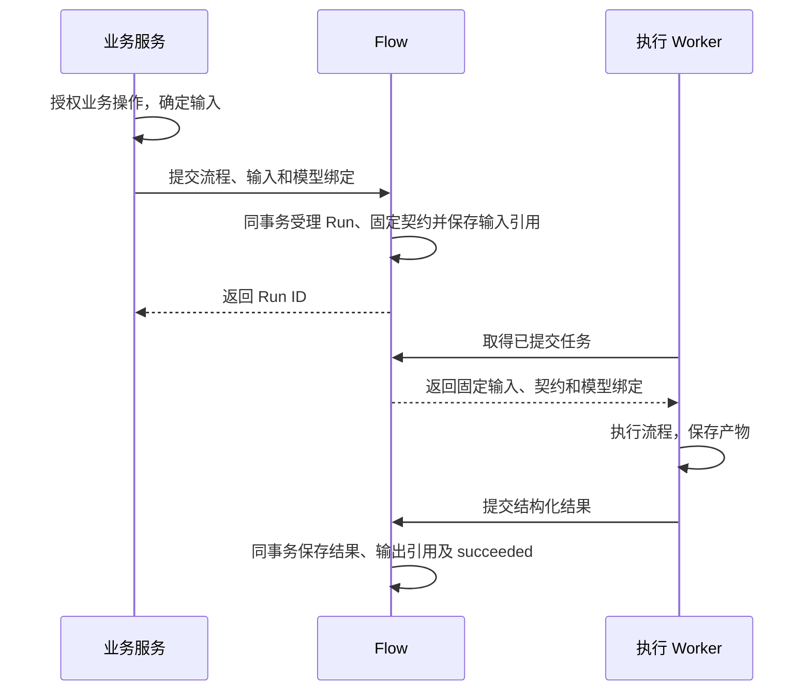
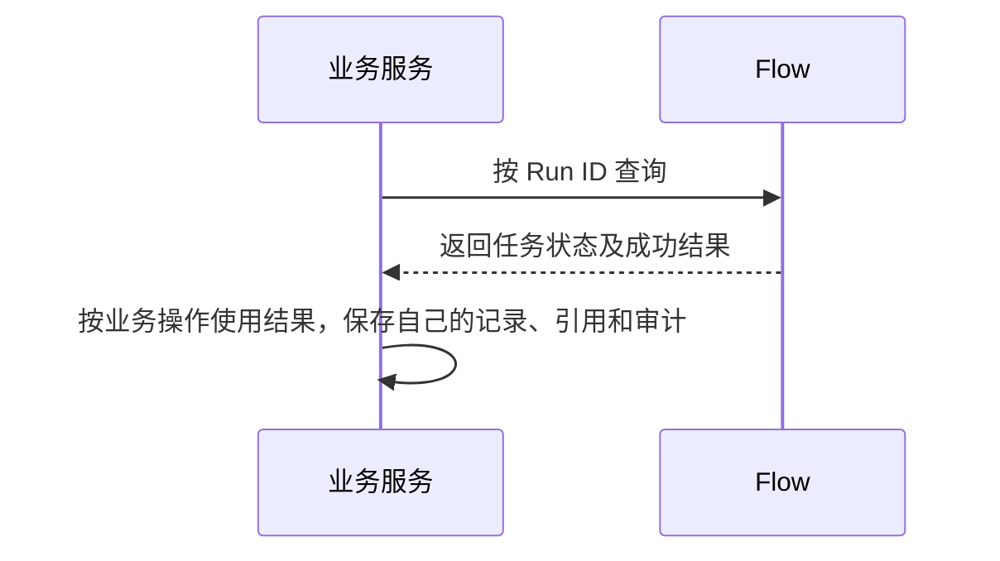
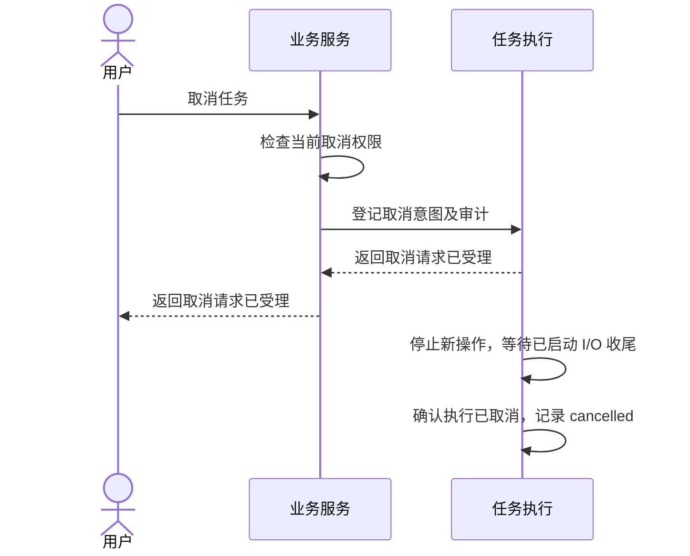
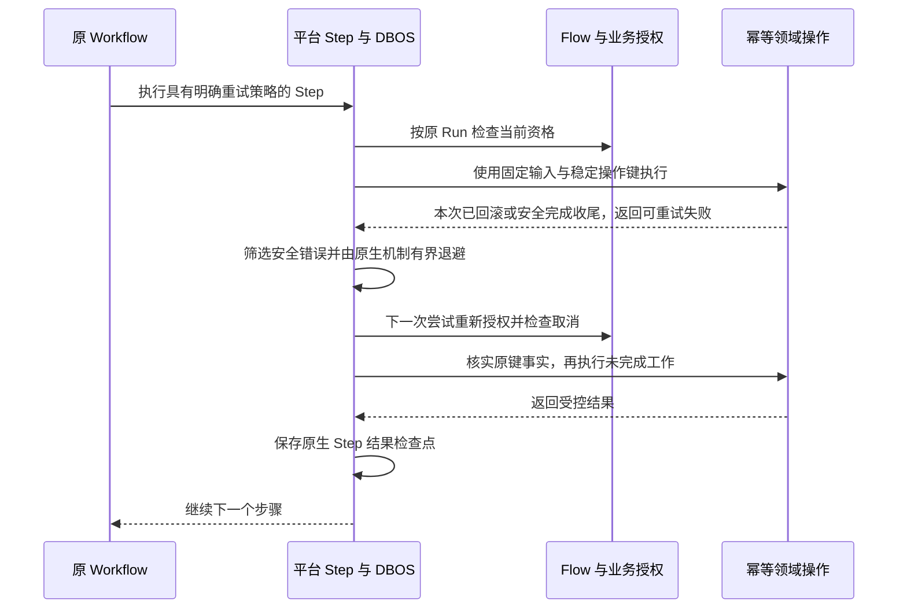

# Flow

Flow 管理需要独立受理、查询、取消及输入/结果契约的运行。业务 Service 保存业务对象和决定，FlowRun 保存原身份、受理契约与结果，DBOS 保存 Workflow/Step 和检查点。普通后台 Task 不创建 FlowRun。

## 核心主流程总览

业务预先确定流程和模型用途，从业务入口提交；运行时不要求先查询通用流程目录。

提交与执行：

结果查询与业务使用：

查询只读。生成 Flow 返回产物，调用方另行保存业务记录、引用和审计；Flow 不反向登记业务或等待回执。业务登记明确失败可由用户重新发起完整操作，通信结果未知时仍沿原键核实。

| 当前状态 | 事件/前提 | 下一状态 |
|---|---|---|
| 无记录 | 受理事务提交 | pending |
| pending | 执行开始 | running |
| pending/running | 执行成功，结果和输出引用提交 | succeeded |
| pending/running | 确认执行失败 | failed |
| pending/running | 确认停止并完成 I/O 收尾 | cancelled |

不变量：受理后输入、契约和模型绑定固定；执行使用原身份/PAT；结果和引用原子保存，终态不被旧观察覆盖；已发生的调用、费用和文件按事实保留。

## 1. 定义与装配

可信 Python 声明 FlowDefinition，通过 FlowPackage 显式装配。由业务入口发起，业务决定是否让用户选择模型；平台仅提供运行查询与管理。

### FlowDefinition

| 字段 | 契约 |
|---|---|
| key/name/description | 唯一流程标识及说明 |
| revision/entrypoint | 每 key 安装一个版本，稳定且不重复的 DBOS 入口 |
| input_model/output_model | Pydantic 对象；输入禁止额外字段，验证/序列化均为对象 |
| required_permissions | 显式功能权限；当前模型/文件权限按所用能力声明 |
| file_fields/output_file_fields | 输入/输出文件路径 |
| model_roles | 最多 16 个独立模型用途 |
| timeout_seconds | 1～86400，默认 3600；整体超时始终存在，恢复沿用现有引擎语义 |
| queue | 已配置的队列名，默认 keystone-flows |

ModelRole 含 key、label、operation、delivery；key 为 `[a-z][a-z0-9_]{0,63}`，label trim 后 1～128。所有角色必须绑定，不自动默认/回退，多个角色可用同一模型。操作与交付见[模型接入](model-access.md#6-模型操作与产物)。

队列及其并发沿用现有 QueueDefinition 和 composition 装配。受理时检查队列已配置并将名称固定到 Run 快照，之后按该名称投递；未配置的名称报错。

### FlowPackage

包含 key、host_api_version=1、definitions、execution_modules，可选 execution_packages/required_resources。PackageResource 指定顶层包和相对资源，拒绝绝对路径、越界、符号链接、缺失资源及不兼容宿主。

composition.FLOW_PACKAGES 显式装配；API 只读轻量契约，Worker 导入执行模块。制品指纹覆盖实际安装代码、uv.lock、声明及资源，目录变化也影响版本。无在线安装、动态扫描或多版本路由。

## 2. FlowRun

| 字段 | 含义 |
|---|---|
| id/definition_key | Run 与流程标识 |
| definition_snapshot/execution_version | 原契约和制品指纹 |
| actor_id/personal_access_token_id | 原用户及可选原 PAT |
| request_key/request_digest | 同用户请求去重及原摘要 |
| input/result | 规范化输入/成功结果，各最多 64 KiB JSON |
| status/cancel_requested_at | 运行状态与独立取消意图 |
| error_code/observed_at/finished_at | 安全错误、最近观察、终态时间 |
| created_at/updated_at | 受理/投影时间 |

只有 succeeded 保存 result；成功表示输出契约和引用通过，不代表业务批准。Run 快照保存包/宿主版本、权限、超时、队列、Schema、文件路径、角色与绑定。绑定固定 Entry、Channel、provider/model/base、operation/delivery，无秘密；公开只投影白名单及角色→模型 key。

## 3. 受理与幂等

平台不提供通用发起 HTTP 路由。业务入口在自身事务内调用 start_in_transaction，data 含 definition_key、request_key、input，可选 definition_revision/model_bindings。选择在 input 外，不接受内部 Selection、调用 ID 或限额。

一个事务完成当前授权、查重、规范化、模型绑定、输入引用和审计。查重先于当前定义/模型解析；同键同请求返回原 Run，不同输入、角色、显式版本或原 PAT 冲突。规范输入、完整请求和快照各检查 64 KiB，历史按原摘要先查重。

锁序：身份/Run → 全部 Entry → 全部 Channel → dispatch → 调用记录 → 按 ID 排序 File，不包含外部 I/O。Worker 从已提交 pending 发现投递。

| 事务内入口 | 行为 |
|---|---|
| start_in_transaction(session, auth, data) | 受理及幂等回执 |
| get_in_transaction(session, auth, run_id) | 当前授权下读取，刷新当前行，不使用旧缓存 |
| statuses_in_transaction(session, run_ids) | 关联 Run 的有界批量状态读取，返回 {run_id: status}，供已授权业务展示 |
| cancel_in_transaction(session, auth, run_id) | 记录取消意图和审计，重复不重记 |

由上层持 AccessContext 身份事务，入口不提交、不开新事务、不访问执行引擎。完整 Run 读取及取消仍要求 flow:read/cancel 和本人/管理范围。回执丢失以原键原请求重试；业务唯一约束仍负责跨用户幂等。

## 4. 文件路径与引用

文件职责与完整交接流程见[文件设计](files.md#15-flow-文件使用与产物返回契约)。受理时固定输入并保留引用，执行不回查来源业务当前附件，不提供原地替换；新输入需新 Run。

路径按 serialization/by_alias=False 字段名，数组用 *（documents.*.file_id）；支持可空、对象联合及 UUID/UUID 列表终点，拒绝数字下标、重叠、非法类型、递归/远程引用。

输入/输出各最多 32 路径，每条 8 段；提取最多访问 4096 位置、100 唯一 File ID，空/null 不引用、重复去重。受理和结果验收用同一解释规则。

引用槽位为 flow:<run_id>/input、artifact.<稳定键>、output。结果只接受本 Run 已登记有效文件，输入可作为输出；引用与结果原子保存。引用不授权，文件 I/O 仍检查执行身份、范围和完整性。

### 批量产物读取

FlowArtifactService.find_many(run_id, keys) 批量返回产物键到 File ID 的映射，复用现有单项查询的授权、文件完整性和引用复核。未登记的键返回 None；已登记但文件异常时明确报错。输入键集合有界，单项 find 内部复用批量实现。

## 5. FlowContext 与 Agent

flow_context(run_id) 在 Step 内重建短期能力，不进入检查点、不暴露 Runtime/Session/SDK。

| 接口 | 用途 |
|---|---|
| inputs()/check(permissions=...) | 原输入副本、当前授权检查 |
| execution_scope(permissions=...) | 操作期间的授权监控及退出清理 |
| read_file(file_id, max_bytes=...)/materialize_file(file_id) | 有界内容或临时路径 |
| upload(...)/upload_file(...) | 稳定键保存产物及引用 |
| artifact(key, max_bytes=...)/artifacts(keys, max_bytes=...) | 单项/批量核验原产物 |
| workspace(max_bytes=...) | 统一目录工作区，见[文件契约](files.md#110-统一临时工作区) |
| local_file(file_id) | 作用域内使用本 Run 的已授权本地文件 |
| run_process(argv, **bounded_options) | 受限进程，输出仅当前 Task 的活跃托管空间 |
| invoke_text/structured/vision/embedding | 匹配角色的明确 DTO |
| invoke_image/edit_image | 当前生成/编辑组合，返回 File 引用 |
| submit_image/image_result | 原异步图片任务，pending 由 Workflow 显式 sleep |

Context 不隐式创建 Workflow/Step。稳定调用 ID 由 Run、workflow_id/step_id 派生，同 Step 不能换角色取得新身份；每个 Agent 请求分别登记，同 Agent 调用共享 agent_call_id。deps 只存小型可序列化标识。

每次外部操作复查原身份/PAT、Run、取消、角色及固定目标。已发送响应可有界收尾，取消/撤权不开始新发送或产物发布。接口用法见[Flow 开发](../development/flow.md)。

execution_guard(session, auth, run_id, definition_key, input) 在原身份和权限校验通过后检查当前业务资格；业务可拒绝执行或报告临时不可用，执行权限始终取原用户当前权限与原 PAT 范围的交集。

## 6. 执行统计与单次操作限制

Flow 不维护累计模型次数、token、工具调用、循环次数或文件总量配额，也不获取每 Run 操作许可。模型调用和 token/费用统计查询 ModelInvocation，按 Run、节点、角色和 Agent 聚合；上游未报告的用量保持未知。步骤、工具执行和重试查询 DBOS 历史，业务可记录带 run_id 的结构化阶段日志，不保存正文或凭据。

每次请求仍校验协议、目标、输入大小和输出参数；Flow 整体超时和 Agent 单次 run 的 request_limit 是有界的执行上限（不是费用预算），示例默认 100 次请求。文件保留单文件限制与引用幂等，workspace(max_bytes=...) 保留明确的单次工作区上限，原生进程保留超时、stdout/stderr 和输出文件上限。模型、媒体及后台队列继续按实际资源控制并发。取消须等待 I/O、进程和文件清理完成。调用登记、未知结果保护与统计不依赖预算账本。

## 7. 取消与恢复

### 7.1 取消与已生成产物

| 当前状态 | 事件/前提 | 结果 |
|---|---|---|
| pending/running | 取消意图提交 | 记录时间，暂不改终态，停止新投递/操作 |
| 已请求取消 | 确认未启动或已停止，I/O 收尾结束 | cancelled |
| 与完成竞争 | 已确认成功/失败 | 保存真实 succeeded/failed |
| 任一终态 | 重复取消/旧观察 | 保持原终态 |

取消不撤回远端请求、真实费用或已完成写入，不自动撤销业务已提交结果。部分产物不作成功 result，已有文件和引用按保留规则处理；清理见[文件回收](files.md#14-无引用文件回收规则)。

### 7.2 恢复窗口

| 已保存事实 | 行为 |
|---|---|
| 尚无发送登记 | 原身份/目标检查后可登记 |
| 已登记，无结果检查点/证据 | model_result_unavailable，保留原调用事实，不重发 |
| Step 已保存结果 | 重放原结果，继续后续步骤 |
| 原图片任务/Manifest | 仅查询原任务、核原文件和摘要 |
| 文件已保存、结果未落库 | 复用原 File ID 和引用 |

费用记录不能替代结果正文。检查点不保证第三方 exactly-once；恢复使用原制品、身份、契约及稳定 ID，不能换 Run 绕过未知结果。

只接受当前制品支持的完整快照，固定原模型选择、输入输出 Schema 和执行身份；损坏或不支持的格式返回 flow_snapshot_unavailable。新制品不能冒充旧执行版本接管检查点。

### 7.3 平台步骤重试

#### 场景、职责与入口

本地文件处理或结果发布可能因短暂身份锁竞争、尚未取得数据库连接而失败。目前七加用业务 `retry_local` 包装多种幂等操作，退避从 0.5 秒增至 5 秒，直到所属 Flow 的执行期限。平台统一安全步骤的重试执行，业务只声明该步骤的幂等前提和允许的临时失败。文件操作无数量槽位；[Files 容量契约](files.md#51-文件容量与临时目录)在磁盘不足时立即失败，不建立工作区容量队列。

| 层次 | 拥有的事实与责任 |
|---|---|
| Files | 物理盘预留、文件状态、稳定产物键及目录/句柄清理；不提供文件数量许可或容量排队 |
| core/execution | 安全异常投影、重试筛选、原生 Step 的次数/退避/超时适配；不导入 Flow 或业务 |
| Flow 宿主 | 每次尝试前重新检查原身份/PAT、Run、取消及固定契约；将检查与操作传给执行设施 |
| 业务步骤 | 证明同一输入重复执行安全，提供稳定业务键及自身对象/版本检查 |
| DBOS | 原生执行、重放、Step 检查点及恢复；不另建步骤或重试状态表 |

`core.retries.RetryPolicy` 声明有限策略；`safe_step` 适配原生重试，要求 `idempotent=True`；`flow_step` 在每次尝试前检查原 Run 并开启原生可取消执行。局部幂等保存使用 `retry_operation`，不创建检查点。默认仍为一次执行；允许重试的声明必须同时具有幂等语义和明确错误分类，不能只设置 `retries_allowed=True` 后重试全部异常。成功标准是已完成模型阶段不因后续局部繁忙再次发送，安全的本地阶段在有限尝试内恢复，撤权、取消和不可恢复故障及时停止。

#### 正常主线：原步骤内重试

退避前必须已退出失败尝试的事务、文件和进程作用域。平台封装不能替任意业务函数证明这一点；未完成清理的操作不进入下一次尝试。步骤内的已知产物按稳定键核实复用，不能给每次尝试生成新的业务键、模型调用 ID 或 Run。

#### 故障分类与幂等前提

| 故障或操作 | 自动处理 |
|---|---|
| `file_capacity_full`（含磁盘被其他操作预留） | 立即失败并退出所有相关工作区；不进入平台自动重试白名单，释放/扩容后由业务明确重试 |
| `identity_busy`、短时容量账本锁竞争 | 仅在本次事务已回滚、操作幂等且策略允许时重试 |
| 数据库连接池取连接超时 | 仅对确认尚未开始事务的情况分类；不把全部 `OperationalError` 视为可重试 |
| 确定无副作用的读取、稳定键的文件保存、幂等业务发布 | 可由业务声明重试；发布先核对原键及版本，回执丢失不重复计数 |
| 同一文件/作用域的 `file_busy` | 先区分外部竞争与递归/并发误用；不直接照搬七加按错误字符串重试的集合 |
| 权限失效、取消、契约/版本不匹配、内容损坏、容量/输入超限、作用域误用 | 不重试，保留安全原因 |
| SQL 连接丢失、提交结果未知 | 不直接重放写入；先用稳定键核实实际提交事实，无法核实则明确失败或交领域恢复 |
| 模型已经发送或返回结果未知、整个 Agent run | 不通过通用步骤重试再次发送；沿用模型调用登记和原结果恢复规则 |
| 普通 HTTP 上传正文已经消费 | 不假定正文可重放；本次请求明确失败，由原上传键核实和重试 |

模型调用、已保存结果和业务发布分别划为步骤。仅发生在本地发布阶段的临时失败不包住前面的模型发送。业务确需多个动作放同一步骤时，必须对每个已发生副作用提供核实与幂等保证。

#### 有界策略、异常与恢复语义

显式启用安全重试时，默认最多 3 次尝试（含首次），初始间隔 3 秒、退避倍率 2，两次退避分别为 3 秒和 6 秒；业务可显式选择其他有限策略。未启用仍执行一次。每次尝试有独立超时，退避及全部尝试仍受所属 Workflow 的原生超时约束，取消检查同时覆盖操作和退避。不得把每次重新进入操作理解为获得新的完整 Flow 期限。退避间隔不是模型请求超时，两者独立设置。

仓库锁定的 DBOS 3.2.0 已提供 `max_attempts`、`interval_seconds`、`backoff_rate`、`should_retry`、`preemptible` 和逐次 `timeout_seconds`。完整步骤优先适配这些原生参数，不另建业务步骤重试调度器；原生逐次超时不包含重试之间的等待。步骤的检查点保存最终结果或错误，并不承诺每次失败尝试都独立持久化；重启后未保存结果的步骤可能再次执行，次数上限沿原生恢复语义，不宣称跨崩溃的严格累计次数上限。

`safe_step` 在进入原生重试层前完成分类，只向 DBOS 交付明确白名单的安全失败类型/代码；非白名单异常仍投影为固定通用错误，不能把 SQL、SDK 或供应商原文交给原生重试日志与持久化。重试耗尽的原生包装错误只解出已批准的安全原因，其他统一失败；不通过正则允许任意异常文本。

| 原执行事实 | 允许的后续行为 | 禁止的转换 |
|---|---|---|
| Run 活动、当前步骤无最终检查点 | 原步骤按声明重试，重新授权和核实原键 | 换 Run 或新调用 ID 绕过失败事实 |
| 当前步骤已有成功检查点 | 原生重放结果，继续后续步骤 | 因后续失败重做已完成模型阶段 |
| Run 已请求取消 | 停止新尝试，完成原生 I/O/进程及事务收尾 | 将取消作为临时故障继续重试 |
| Run 已 failed/cancelled/succeeded | 保持终态；业务明确发起后续恢复或新操作 | 协调器自动把终态改回 running |
| Worker 中断、当前步骤无结果 | 同制品、原身份与原检查点恢复，并重新核实副作用 | 保证外部 exactly-once 或跨重启累计尝试次数 |

重试不新增 FlowRun 状态，等待中的 Run 继续为活动态。诊断使用 DBOS 原生执行/步骤事实及受控结构化尝试日志；记录 Run、Step、尝试序号、安全原因和等待时长，不伪造原生历史不存在的每次尝试记录，不记录正文或凭据。

#### 七加文件繁忙与模型失败的覆盖边界

| 触发点 | 本次目标的覆盖范围 |
|---|---|
| 输入图片、工作区、模型回复文件竞争有限文件槽位 | 去槽后不再产生这类 `file_transfer_busy`；须同步七加的 Files 包装、媒体槽位换算及配置，不能只改 Keystone |
| 模型准入暂满或冷却未结束，尚无调用登记 | 可按 3/6 秒策略重试准入；由模型层确认登记事实及固定目标，不单凭错误码判断整个模型步骤安全 |
| 模型已有可用回复，本地保存遇到允许重试的临时身份/短锁错误 | 保留内存中的同一回复，只重试稳定键保存；不重新调用模型 |
| 模型回复文件已保存，但后续解析或发布失败 | 按稳定产物键读取原回复，重试合格的解析/发布阶段；解析非法不触发再次付费生成 |
| 上游请求超时、断线、已有调用登记却没有可恢复正文 | 槽位简化与延长退避不能恢复未知结果，仍按原调用证据处理；不自动换调用 ID 重发 |
| 上游返回 429/5xx，或模型回复格式/质量无效 | 不等同于本地资源繁忙；需要独立的协议失败/新尝试契约，本轮不承诺通用自动重发 |

七加的 `load_or_invoke_vision` 已先查原回复文件，并在得到模型回复后局部重试 `ctx.upload`；脚本理解步骤也在保存原回复后解析。不能机械删除这些局部保存重试，改为重试包含模型发送的整个步骤。对于“模型请求与回复保存处于同一 Step”的现有组合，局部重试只包住保存函数，复用平台的有限退避、分类和取消规则；不嵌套新的 DBOS Step，不重跑模型阶段，也不另建持久状态。进程若在回复未持久化前崩溃，这段内存仍可能丢失，必须如实返回不可恢复结果。

模型容量准入仅在登记前有限重试，每次重新授权；登记提交结果未知时，先按原稳定调用 ID 核实，无法证明尚未登记就不再发送。模型准入并发和冷却属于模型领域，本次去文件槽位不移除这些限制。SDK 与整体操作采用相同超时，开启思考至少 120 秒；延长重试间隔不能替代合理的单次响应期限。

#### 接入边界

默认不启用整步骤重试。只对已证明幂等且完成全部资源收尾的步骤传入 `RetryPolicy`；`before_attempt`/Flow 检查覆盖每次真实尝试，白名单之外的异常不自动重试。可重试错误为 `identity_busy`、`file_capacity_busy`、真实文件互斥的 `file_busy` 和在事务开始前取得连接失败的 `database_connection_busy`。`Database.transaction` 在交出 session 前取得连接，只在此边界转换连接建立/池等待超时，不将 SQL 执行或提交错误分类为安全重试。

`RetryPolicy(max_attempts=3, interval_seconds=3, backoff_rate=2, timeout_seconds=None)` 为默认策略；逐次超时可按操作显式设置，原 Workflow 总期限始终存在。Flow 的公开错误与原生重试耗尽原因只按 `schemas.errors.ERRORS` 白名单投影，不返回任意供应商或 SQL 异常正文。参数和错误分类用 unit 验证，事务、防重、取消及检查点重放用专用 PostgreSQL/DBOS 验证。

## 8. API、授权与诊断

| 当前 API（/api/v1） | 规则 |
|---|---|
| GET /flow-runs、/{id} | flow:read，本人；flow:manage 扩大范围 |
| POST /flow-runs/{id}/cancel | flow:cancel＋本人或 manage |
| GET /flow-runs/{id}/steps | Run 可见；最多 32 关联流程/500 步骤，只含名称/位置/时间 |
| GET /flow-runs/{id}/costs | Run＋模型记录权限；当前费用窗口最近 30 天 |
| GET /flow-runs/{id}/diagnostics | section=all/models/files，默认 50、最高 100，offset 分页 |

诊断在短身份事务组合公开 Service，前后复查 Run；模型调用先按独立读取范围过滤，文件仅列当前 Run 的引用，再分页。模型调用不可见时返回 available=false。未请求的板块返回 null，列表通过 truncated/next_offset 分页。

- 模型：read/read_all 独立判断，返回调用、操作、角色/节点/Agent、原 Step 位置及安全错误，不因 flow:manage 扩权。
- 文件：Run 可见后列出关联 File ID/slot，不授予内容读取权；同 Run 可见图片调用与原 Manifest 的产物键、摘要、大小、MIME 全部匹配才补 invocation_id，不按名称/时间猜测。

不返回检查点、私有 result/cost_context、供应商任务/下载地址、原文异常、秘密或本地路径。控制台各板块独立加载，失权清相应数据，迟到结果丢弃；仅活动 Run 自动轮询，终态缺步骤/费用可手动刷新。

人工决定和采用版本由业务保存，批准与后续独立 Flow 可在同事务受理，不提供通用人工等待/唤醒。平台不提供通用发起入口；业务 Service 在已授权的事务中调用 start_in_transaction，业务页面自行查询输入和模型选项。
