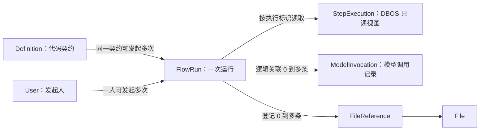

# Keystone Flow 领域

状态：最小实现 v1.1，2026-10-18；16 字段 FlowRun、DBOS Worker、Pydantic AI/Harness、文件审查示例及管理页面已接入，使用模拟渠道完成执行和恢复验证；后台已整理发起/详情弹窗、状态筛选、取消确认和轮询。领域模型保持不变，部署限于一个 API、一个 Worker 和共享本地文件卷。

模型接入已增加 OpenRouter live，Flow/Agent 直接复用相同 ModelRuntime，不新增执行分支或 FlowRun 字段；独立 Worker 已通过本机 HTTP 的两轮 Agent 调用验证，尚未发起真实模型请求。API/Worker 的运行模式和秘密配置必须一致，mock/live 分开数据库和文件卷；发起表单提示实际模式，live 流程可能计费，取消不撤销已发生的调用。边界见[OpenRouter 接入](model-access.md#78-openrouter-live-接入)。

[范围与边界](#1-范围与边界) · [领域模型](#2-领域模型) · [主要流程](#3-主要流程) · [权限与审计](#4-权限与审计) · [设计取舍](#5-设计取舍) · [待确定事项](#6-待确定事项) · [当前实现](#7-当前实现)

## 1. 范围与边界

Flow 为业务提供普通代码与 Agent 混合的流程编排，支持模型调用、工具使用、Skills、结构化输出，以及长任务的查询、取消和恢复。一个业务步骤可以是普通函数、一次模型请求或包含多轮模型/工具调用的 Agent。首版采用可信 Python 代码定义流程，不做可视化编排器、BPMN、脚本在线上传或通用审批规则。

| 层次 | 负责什么 |
|---|---|
| 业务流程代码 | 输入输出、步骤顺序、分支、业务规则、结果采用 |
| Keystone Flow | 流程目录、发起人和访问权限、运行记录与平台能力接入 |
| Agent 运行库与 Harness | 多轮模型/工具循环、Skills、上下文、结构化输出与执行限制 |
| DBOS | 排队、持久执行、检查点、等待、恢复和执行状态 |

执行成功不等于业务批准；审批通过/驳回等结论属于业务输出。文件清理等内部维护可以使用执行机制，但不必都注册成用户可见流程。普通业务可以直接调用 model_access 服务而不经过 Flow；实际 SDK 仍封装在模型模块，不能绕过其授权、调用记录和费用边界。

Agent 使用 Pydantic AI＋Harness，持久执行使用 DBOS。不自行重写 Agent 循环，也不额外引入另一套图执行框架。

素材粗选的参考结构可概括为：准备文件 → 发现 Agent → 定位 Agent → 实际裁片 → 独立审片 Agent → 通过后独立标签 Agent → 保存结果。普通处理、条件分支和多个 Agent 共同组成一个 Flow。

## 2. 领域模型

本领域回答四个问题：有哪些流程可以发起、谁发起了哪一次运行、这次运行进行到哪里、最后得到什么结果。**流程定义描述可执行的业务操作，FlowRun 记录一次实际执行。** 步骤执行用于查看过程，Agent 是步骤可以使用的一种能力。

### 2.1 概念与关系

| 概念 | 具体含义 | 归属与保存方式 |
|---|---|---|
| Definition | 一类流程的公开契约，例如“文件审查” | Flow 的代码目录，不建表 |
| FlowRun | 某个用户提交一份输入后产生的一次运行 | Flow 的核心实体，保存到 flow_runs |
| StepExecution | 一次实际的持久步骤调用，包括循环中的某一次调用 | 从 DBOS 历史读取的只读视图，不建平台步骤表 |
| Agent 调用 | 一次 agent.run，可包含多轮模型请求和工具调用 | 代码与执行上下文；恢复记录由持久化适配器和 DBOS 管理 |
| ModelInvocation | 一次本地模型调用尝试，不证明上游已收到请求 | 属于模型接入模块，与 Run 和 Agent 调用关联 |
| FileReference | 输入或产物文件与某次运行的使用关系 | 属于文件模块，不在 Run 里复制文件记录 |

图中是领域关系，不表示全部使用数据库外键。Definition 不在数据库里，StepExecution 来自引擎；模型调用通过 flow_context.flow_run_id 关联。文件引用的 owner 固定为 `flow:<run_id>`，slot 区分 input、output 或有稳定名称的中间产物。引用只表达使用关系，不授予访问权限。

首版没有 FlowTask。将来需要人工分配与提交决定时，再加入独立待办实体；它与自动步骤不是同一概念。也不建立 Agent、Tool、Skill 管理表。

### 2.2 流程定义 Definition

| 字段 | 类型与要求 | 含义 |
|---|---|---|
| key | 非空字符串 | 稳定业务标识，例如 document.review |
| name | 非空字符串 | 展示名称，例如“文件审查” |
| description | 字符串，可为空 | 流程用途说明 |
| input_schema | JSON Schema | 发起输入的对象结构，由代码模型生成 |
| output_schema | JSON Schema | 成功结果的对象结构，由代码模型生成 |
| entrypoint | 非空字符串 | 已注册的稳定 DBOS workflow 名称，不是客户端提供的任意导入路径 |
| required_permissions | 字符串数组，可为空 | 除 flow:start 外，该流程需要的功能权限 |
| file_fields | 字段路径数组，可为空 | 输入中的文件 ID 位置 |
| output_file_fields | 字段路径数组，可为空 | 成功结果中的文件 ID 位置 |

Definition 随代码发布，不接受在线增删改，不需要数据库审计字段。首版每个 key 对外暴露当前定义，不再单独维护 revision；流程的输入输出、执行入口和资源都随同一个 execution_version 发布。该版本标识完整执行制品，包括代码、资源和锁定依赖，不因重启而变化。

### 2.3 运行实体 FlowRun

FlowRun 共 16 个字段，业务对象通过自身保存的 run_id 关联运行。一行对应一次受理成功的流程请求。同一运行的重启恢复不新增行；用户再次发起才产生新 Run。身份验证或输入校验未通过时不创建 Run，必要的失败留痕由 AuditLog 负责。

**发起时固定的字段**

| 字段 | 类型与要求 | 含义 |
|---|---|---|
| id | UUID，主键 | 本次运行标识；DBOS workflow ID 派生为 flow:<id>，不另存重复字段 |
| definition_key | 非空字符串 | 发起的流程 key |
| definition_snapshot | JSON 对象，必填 | 只保留输出契约和输出文件字段，结构见下文 |
| execution_version | 非空字符串 | 绑定的执行制品版本，对应 DBOS application version |
| actor_id | UUID，必填，关联 User | 原始发起人，不是 Worker 或后续管理员 |
| personal_access_token_id | UUID，可空 | 使用个人令牌发起时记录原令牌；会话发起为空，不保存令牌秘密 |
| request_key | 非空字符串 | 调用方在重试同一发起请求时复用的幂等键 |
| request_digest | 非空摘要字符串 | 服务端计算的请求摘要，用于识别同键不同请求 |
| input | JSON 对象，必填 | 校验并由服务端解析模型选择后的执行输入，不含密钥或大文件正文 |
| created_at | UTC 时间，必填 | 受理并创建记录的时间 |

**执行期间变化的字段**

| 字段 | 类型与初值 | 含义与修改规则 |
|---|---|---|
| status | 枚举，初始 pending | 生命周期状态，含义见下表；仅协调执行的服务更新 |
| result | JSON 对象，初始空 | 只在成功时保存通过契约校验的结果；没有业务结果也返回约定对象，例如 {} |
| error_code | 字符串，初始空 | 失败终态的稳定错误分类，例如 execution_not_authorized |
| cancel_requested_at | UTC 时间，初始空 | 首次取消请求受理时间，重复取消不覆盖 |
| finished_at | UTC 时间，初始空 | 平台首次确认并保存终态的时间；不作为上游请求的精确耗时依据 |
| observed_at | UTC 时间，初始空 | 最近成功查询 DBOS 的时间；不可达时不更新；它不是 Worker 心跳 |

definition_snapshot 只包含两个固定成员：

| 成员 | 保留原因 |
|---|---|
| output_schema | 旧运行完成后，协调器按原输出契约校验结果，不依赖当前安装的定义 |
| output_file_fields | 协调器按原字段位置登记产物引用，避免升级后遗漏文件引用 |

不保存 name、description、input_schema、entrypoint、required_permissions 或 file_fields。运行名称使用当前 Definition 的 name；定义已下线或不可用时显示 definition_key，不保证保留历史名称。输入在受理时已经校验且登记引用；执行入口和所需权限从匹配 execution_version 的代码目录取得。找不到该版本时停止补投和新的执行操作，不能套用当前版本；已结束运行的结果同步仍可使用小快照完成。快照不负责保存代码或恢复检查点。

当前流程目录只展示用户有 flow:start 且满足该 Definition.required_permissions 的可发起定义；新运行的首次执行及后续新的受保护操作复查同一执行版本的这些要求，再检查具体文件、模型或业务能力权限。授权拒绝作为明确执行失败，不隐式等待重新授予权限后重跑。查询和取消历史 Run 则按当前 read/cancel/manage 规则，与定义是否仍安装、是否仍有 start 权限无关，不因定义下线而隐藏已有历史。

**执行版本保留一份：execution_version。** 虽然 DBOS 入队后也记录 app_version，但 API 创建 Run 时还没有 DBOS 记录。这里必须先固定目标版本，Worker 再用 definition_key＋execution_version 找到唯一入口，提交时显式指定同一 app_version。版本信息不一致应报诊断并停止投递，不取最新版本替代。首版执行入口不另存一列，也不保留独立的契约版本。

**不保存发起人的权限快照。** 沿用 Ether 的身份引用与当前授权检查：会话发起按用户当前权限，个人令牌发起按“用户当前权限 ∩ 原令牌权限上限”，同时检查用户、令牌和运行状态。用户后续获得的权限可以在原运行中生效，这是明确采用的简化规则；工具范围仍由固定版本代码约束，文件等对象授权仍逐次检查。原令牌关联不可清空后退化成会话发起。

只要 FlowRun 仍保留，其引用的 PersonalAccessToken 就不能物理删除，包括已结束运行。令牌过期或撤销立即阻断后续受保护操作，保留记录不会使凭据继续有效。LoginSession 不进入运行关联；清理规则见[身份领域](identity.md#43-删除与撤销)。

**模型选择保存在已有 input 中。** 受理时把用户提交的 model_key 解析为 model_entry_id、channel_id、provider_model、api_base；流程契约及受理代码明确模型选择的位置，执行代码读取这个固定值。同一 Run 不跟随之后的 key 映射变化，每次发送仍检查原配置的启用状态、当前授权与渠道地址。它是非秘密选择快照，与绑定执行代码的 execution_version 用途不同，不扩展 definition_snapshot。详见[模型选择规则](model-access.md#34-flow-的固定模型选择)。

**约束与行为**

- actor_id＋request_key 唯一。摘要覆盖调用方原始提交的 definition_key、input 及发起凭据标识：PAT 请求使用原令牌记录 ID，会话请求使用空值，不包含 Cookie 或 LoginSession.id。采用稳定序列化，不混入当前时间、服务端选择的版本或解析后的模型选择。原记录仍保留时，重复请求先检查幂等，相同请求返回原 Run，不同请求冲突；不重新解析当前模型映射，仍检查当前访问权。幂等保证期限见下文。
- 发起字段受理后不可编辑。取消只表达意图；恢复沿用原 Run。首版不提供修改输入、跳过步骤、重新打开终态或指定失败步骤重跑的操作。
- succeeded、failed、cancelled 都是终态，finished_at 必填；其余状态 finished_at 为空。终态不被后续过期观察覆盖。
- 只有 succeeded 保存 result；failed 保存错误分类；面向用户的 error_message 由错误码目录生成，不单独存一列。pending/running 的暂时不可达或缺少对应版本属于运行诊断，不写成失败结果。取消原因通过取消审计追溯。
- actor_id 已表达创建来源，因此不重复 created_by。没有人工编辑，不加 updated_by 或通用 updated_at；不提供普通删除接口，不加 deleted_at、deleted_by。取消操作者记录在 AuditLog。

### 2.4 生命周期

| 状态 | 含义 | 可以发生什么 |
|---|---|---|
| pending | 已受理，尚未确认开始，可能等待投递或排队 | 开始执行、取消；执行前明确拒绝时失败 |
| running | 已开始且未结束，可能正在恢复或持久等待 | 成功、失败或取消 |
| succeeded | 编排完成，结果通过本次运行契约校验 | 只读查询 |
| failed | 明确执行失败、执行前授权拒绝，或最终输出无效 | 只读查询；重新发起使用新 request_key |
| cancelled | 协调器确认取消；尚未投递时确认不会再投递 | 只读查询；不代表已撤回外部副作用 |

正常路径为 pending → running → succeeded/failed/cancelled；执行前拒绝或取消可以从 pending 直接进入终态。如果两次同步之间流程已结束，也可以从 pending 直接记录成功或失败，不伪造曾观察到 running。恢复中即使 DBOS 重新排队，平台也不把已经开始的 Run 退回 pending。

cancel_requested_at 有值但 status 尚未变为 cancelled 时，界面显示“取消处理中”，无需增加 cancelling 状态。取消与完成竞争时保留已确认的实际终态，不能因为有取消请求就把成功或其他失败覆盖掉。业务输出中的“未通过审查”“没有候选”仍可能是 succeeded，取决于是否正常完成契约。

### 2.5 步骤与 Agent 的可见性

不建步骤表不意味着看不到执行过程。StepExecution 是按需从 DBOS 历史转换的只读视图，首版展示 workflow_id、执行内 step_id、name、可取得的开始/结束时间及脱敏失败信息；以 workflow_id＋step_id 区分调用，不以步骤名称唯一。没有检查点或引擎不可达时明确返回信息未形成/不可用，不虚构进度百分比。

首版对外只返回上述白名单过程信息，不透传 DBOS 原始参数、返回值、检查点、消息历史或异常文本；子流程必须确认属于已授权 Run，客户端不能通过任意 workflow_id 查询引擎。步骤访问沿用 Run 查看权限；查询引擎后返回前重新检查当前权限。业务结果通过 FlowRun.result 的明确契约展示，过程证据确需开放时保存为受控 File，不能借步骤详情绕过文件授权。参考 Ether 的 [步骤投影](M:/code/ether-workspace/ether/packages/flow/src/ether_flow/engine.py) 与 [查询后复查权限](M:/code/ether-workspace/ether/packages/platform/src/ether/flow/service.py)。

业务 node_key 是代码阶段标识，例如 review；一个阶段可能对应多个 DBOS 步骤或子流程，不能把两者强行视作一对一。首版不建立自己的 DAG、步骤状态机或运行事件表，也不承诺重建每个未持久化普通函数的运行过程。

Agent 在代码中声明稳定 agent_key、提示词、输出类型、工具、Skills 与执行预算。每次调用有稳定 agent_call_id，用于区分循环中的多次调用；同一调用的多轮模型请求共用此标识，各自仍有独立 ModelInvocation。这些标识由服务端产生，不能承担授权作用。SDK 实例和密钥仅在运行时取得。

### 2.6 一次文件审查的例子

以下标识为便于阅读的示意值，实际 Run、用户和文件使用各自 ID 类型。

1. 构建版本 build-A 注册 document.review；输入为 source_file_id、model_key，输出为 verdict、report_file_id。
2. 用户 U 提交文件 F1、model_key 与 request_key=review-001，生成 Run R1，固定 execution_version=build-A、小快照、身份和输入；服务端把模型选择解析并保存在 input 的约定位置，文件模块登记 owner=flow:R1、slot=input、file_id=F1。
3. Worker 执行读取、审查、保存三个业务阶段。审查阶段调用 review_agent，调用标识 A1；它向模型发送两次请求，因此产生两条 ModelInvocation，二者都关联 R1 和 A1。
4. 保存阶段用 R1 与稳定产物键 report 幂等上传报告 F2。Run 成功结果为 verdict=needs_changes、report_file_id=F2，文件模块登记输出引用；needs_changes 是审查结论，Run 仍为 succeeded。
5. 再提交同一个幂等请求返回 R1；处理另一份输入需使用新 request_key。Worker 重启恢复 R1 不创建 R2，已有模型结果检查点直接复用；若已有调用记录却缺少可恢复结果，则停止执行，不重新发送该请求。

因此首版平台只新增 flow_runs 一张表，但领域关系同时覆盖代码定义、引擎过程以及已有的用户、文件、模型调用和审计记录。

## 3. 主要流程

### 3.1 发起、提交与状态同步

1. API 校验身份与流程权限，以原始提交检查幂等；新请求再校验输入和文件使用资格、解析固定模型选择，在业务事务内创建 pending Run、必要文件引用和发起审计。重复请求按原记录返回，不因当前模型映射改变而改写原输入。
2. API 提交事务后返回 run_id，不在请求内或后台协程中执行流程。Worker 扫描待提交 Run，使用固定的 `flow:<run_id>` 向 DBOS 队列提交，再按设定并发执行。
3. 提交超时或进程中断后，Worker 按同一 ID 查询 DBOS；确认需要补交时仍使用原 ID。补交前检查取消意图、授权和代码版本，不生成新 ID 重复执行。
4. 从 DBOS 查询并同步状态，拒绝用旧观察覆盖已确认终态。DBOS 暂时不可达时保留最后确认状态和 observed_at；已经完成的执行不因发起人后来撤权而停止结果同步，边界见[结果同步与文件保留](#35-结果同步与文件保留)。

业务事务与 DBOS 入队不假定原子，即使共用 PostgreSQL 也要处理二者之间的中断窗口。首版利用 FlowRun 做轻量补交与状态核对，不另建通用消息框架。DBOS 的同 ID 去重依赖执行历史保留，未解决的提交与恢复记录不能先清理。

受理幂等采用平台公开约定的有限保证窗口（当前 7 天），从首次受理的 created_at 起算，不新增过期字段。窗口内必须保留 Run，包括成功、失败和取消的运行；同一请求重试只返回原记录，不重新执行。窗口外只要原记录仍在就继续去重，记录已清理则无法保证旧请求不会被视为新请求。调用方只能在保证窗口内自动重试；主动重新执行必须使用新 request_key。查询和重试仍受当前身份与访问权限约束。

不保留额外幂等墓碑表，也不承诺删除原记录后仍永久识别旧请求。自动清理启用前必须确定并向调用方说明保证窗口与历史保留策略；清理不能早于已承诺的窗口。具体窗口长度留到部署配置确定。该窗口约束的是 Flow 受理去重，不替代已有 Run 内的 ModelInvocation 防重发保护。

### 3.2 取消

取消自己的 Run 需要 flow:read 与 flow:cancel；取消他人的 Run 再加 flow:manage。manage 只扩大对象范围，不替代读取或取消动作权限；取消不要求 flow:start，失去发起权限不自动失去停止已有运行的能力。

检查当前取消请求的用户、会话或 PAT 及其有效权限，不使用 Run 的原 PAT 授权取消。原 PAT 已过期或撤销时，本人仍可重新登录并按当前权限取消；Run 的原身份关联保持不变。这与执行后续业务步骤时检查原凭据是两个不同入口。

API 仅在首次接受非终态 Run 的取消请求时设置 cancel_requested_at，并同事务记录实际取消人的审计。重复取消不覆盖时间、不重复生成首次取消请求日志；对已经终态的 Run，在完成当前授权检查后直接返回现有状态，不写新的取消意图、不重新打开运行。

Worker 再调用 DBOS；通知失败可以重试，查询到 DBOS 取消状态后同步为 cancelled。尚未提交的运行由同一个协调循环核实未入队后取消，不再投递。若运行已经完成，保留实际完成结果。取消不能保证正在执行的步骤或已发出的外部请求立即停止，也不撤销已发生的业务写入或费用。该幂等行为参考 Ether 的 [request_cancel](M:/code/ether-workspace/ether/packages/platform/src/ether/flow/models.py)，Keystone 额外明确独立 flow:cancel 权限。

### 3.3 恢复、业务写入与外部副作用

继续同一运行使用兼容代码、原 workflow ID 和原检查点；另起新 Run 是一次新业务请求。不能用“重跑”隐式覆盖原记录，也不能在旧版本不可用时用不兼容的新代码强行恢复。DBOS workflow 编排保持确定性，时间、随机数和外部 I/O 放入合适的 step、事务或持久化适配器。

恢复时普通数据库写入和远端请求都可能重复，必须分别处理。业务写入按 run_id 和稳定操作键去重；创建文件产物使用 run_id 与稳定产物键，循环中包含稳定索引，通过 File.upload_key、upload_digest 检查重复与冲突，详见[上传幂等](files.md#31-上传幂等)。业务采用结果同样需要幂等。大型结果保存为 File，运行只保留引用；引用登记和解除沿用文件模块，不能自行覆盖或删除共享文件。

收费模型调用不能仅依赖“SDK 关闭重试”：引擎恢复也可能重执行尚未落检查点的步骤。首版复用 ModelInvocation.id，为每次持久模型请求提供稳定身份，在发送边界原子登记，只有首次成功登记者可以发送。已有结果检查点就复用；已有调用记录但无可恢复结果则停止执行并报错，即使记录为 succeeded 也不重发，且不改写已经确认的调用结果。具体规则见[模型恢复与防重发](model-access.md#35-flow-模型请求的恢复与防重发)。

一轮 Agent 中的多个模型请求各有独立稳定 ID，不能把整个 Agent 当作一次发送。记录落库后、HTTP 发送前中断也会被保守阻断；这不承诺上游只执行一次。首版不新增发送意图表或 File 标记，仍需验证适配器的稳定身份、原子登记与内部恢复边界，才能承诺对应恢复行为。

### 3.4 在业务步骤中执行 Agent

业务步骤准备输入与证据，选定 Agent、模型和预算，执行 Agent 循环，再校验结构化结果并交给下一个步骤。必需 Skill 在首次请求前装载；文件 ID 或“工具可用”不代表模型已经收到内容，多模态证据需要实际读取、传入并记录必要的送达信息。具体选片、裁片和视觉判断规则属于业务包。

不同角色默认使用独立消息上下文，只通过明确的结构化输入传递事实。参考项目把审片取舍与标签拆成两个 Agent 调用，没有把前一阶段的消息历史传给标签 Agent。需要共享历史时必须显式声明，不能因复用 Agent 对象就默认共享判断过程。

Agent 配置 Pydantic AI 的 `DBOSDurability`，从 DBOS workflow 或其兼容的普通函数调用 `agent.run()`。不要再把整个持久化 Agent 包进一个自动重试的外层 `@DBOS.step`。普通自定义工具的 I/O 需要逐项确认恢复边界，不能假定所有 Python 工具都会自动持久化。参考项目的 review_segment 位于 step_02 文件中，但本身就是普通 async 函数。

每次新的模型请求尝试在发送前单独登记 ModelInvocation，并关联运行、业务步骤和 Agent 调用；登记不证明上游已经接受请求。工具进度和 Agent 事件可以流式展示，但不新增一张完整聊天消息表。引擎为了恢复可能持久化消息和工具结果，这与调用表默认不存正文是两件事，必须限制检查点的访问、大小和保留期。业务需要保存过程证据时显式生成受控 File，不默认复制全部对话到审计日志。

请求次数、工具次数、token 和总时长分别设上限，Agent 的输出修正、工具重试、引擎恢复与传输重试不能无限叠加。结构校验成功仅说明格式满足契约，不能代替业务效果验收。

### 3.5 结果同步与文件保留

新的受保护操作与已经发生的执行事实分别处理。新模型请求、文件读取或上传、业务写入都检查当前用户与原令牌权限；失效时拒绝。已发送模型请求的响应继续补全状态、用量和费用；DBOS 已完成的 Run 继续同步真实终态和通过原契约校验的结果。不能因为同步时用户停用或令牌撤销，就把已成功完成的运行改成授权失败。

结果同步由受限 system 能力执行，不冒充原用户仍有操作权限。内部文件引用登记只接受对应 Run 的可信结果、原 output_file_fields 和已通过该 Run 受控操作登记的文件使用关系；结果里出现一个文件 ID 本身不构成授权。执行代码若要输出已有文件，必须在仍有权限时登记该 Run 的使用关系。同步仍检查文件存在且状态为 active 或 disabled，拒绝未完成上传、已进入删除等不可引用状态；保留 disabled 文件引用不恢复内容读取权。该入口不能接受客户端任意指定的文件列表或通用跳过授权参数。

Run 的结果、输出引用及相应引用审计在同一事务内保存。引用审计记录 system 执行主体和 run_id，Run.actor_id 继续表示原发起人。业务采用结果、修改合同或发布内容仍是新的业务操作，必须检查相应当前权限；首版不引入自动业务投影机制或投影状态字段。用户查询、下载也始终按查询者当前权限判断。

文件保留统一使用已有 FileReference：

| 阶段 | 引用规则 |
|---|---|
| 受理输入 | 在创建 Run 的事务内登记 owner=flow:<run_id>、slot=input |
| 生成中间产物 | 上传完成时同事务登记该 Run 的稳定产物 slot；已有文件使用也需先授权登记，保护后续执行与恢复 |
| 成功同步 | 按原输出契约登记 slot=output，与结果一起保存 |
| 业务采用 | 业务记录与业务自己的 FileReference 同事务提交；增加业务引用，不转移或移除 Flow 引用 |
| Run 清理 | 仅解除 owner=flow:<run_id> 的引用，不解除业务引用，不直接删除文件内容 |

首版输入、中间产物与输出引用都保留到 Run 清理，不在终态提前释放中间产物；失败或取消运行已生成的文件也按此规则保留。代价是中间文件保留更久，换取统一的清理边界。业务采用与 Run 清理需要事务协调：采用方确认 Run 及结果仍可用，并完成业务记录和引用的原子保存；清理先完成时明确返回不可采用，不能保存悬空业务记录。具体引用与删除互斥规则见[文件领域](files.md#32-flow-文件引用与业务采用)。

这沿用 Ether 的 [结果同步](M:/code/ether-workspace/ether/packages/platform/src/ether/flow/reconcile.py) 和 [产物引用登记](M:/code/ether-workspace/ether/packages/platform/src/ether/files/service.py) 边界；Keystone 首版统一延后到 Run 清理时释放产物引用，不搬入 Ether 的终态临时引用释放或整套业务投影字段。

## 4. 权限与审计

沿用用户、角色、个人令牌和 Casbin，声明 `flow:start`、`flow:read`、`flow:cancel`，跨用户管理使用 `flow:manage`。普通用户只能查询和取消自己的运行；人工待办权限等启用该能力时再定义。

| 查询或操作内容 | 必须满足的规则 |
|---|---|
| 自己的 Run 状态与结果 | flow:read，且 actor_id 为当前用户 |
| 他人的 Run 状态与结果 | flow:read 与 flow:manage |
| 取消自己的 Run | flow:read 与 flow:cancel；按当前取消请求身份判断 |
| 取消他人的 Run | flow:read、flow:cancel 与 flow:manage；不要求 flow:start |
| Run 下的模型调用明细和费用汇总 | Run 可见且有 model_invocation:read；默认仅限当前用户记录，查看他人或系统记录还需 model_invocation:read_all |
| 关联文件内容 | 当前文件功能权限、FileGrant 和可读取状态；Run 可见或 flow:manage 都不替代文件检查 |

Flow 页面和模型记录页面使用同一套模型记录授权判断。仅有 flow:manage 不获得他人模型费用或文件内容访问权；费用区域无权限时明确显示“无查看权限”，不能显示零费用。只在调用记录页面查询时按模型模块规则判断，不要求模型模块反向检查 Flow。权限组合由入口用例完成，不增加跨模块授权表。

发起人固定，执行时检查用户是否启用及当前权限，不另冻结一份用户权限。通过个人令牌发起时使用原令牌的范围限制，不能退化为只检查用户角色；令牌已撤销/到期时不再发起新的受保护操作。会话退出是否中止既有运行与令牌规则不同，首版会话只用于受理认证，退出不自动取消已受理运行。

凭据、SDK 客户端和连接秘密不进入 input、result、检查点或审计。文件访问与模型调用都经过对应模块的当前授权检查；Flow 内的模型调用使用 flow_context.flow_run_id 关联运行，node_key、agent_key、agent_call_id 补充步骤与 Agent 调用标识。业务对象自行保存 run_id，FlowRun 不反向保存业务关联字段，也不增加另一张关联表。Agent 不能绕过模型接入模块另用环境密钥直连，否则权限、费用和调用追踪都会失效。

本领域的必要审计字段已在各模型表内列出，不统一套四字段。发起、取消等重要操作写入 [AuditLog](audit.md)，日志记录真实操作人和 Run 目标。自动步骤进度留在执行引擎，调用费用留在 ModelInvocation，不逐步骤复制审计。

Worker 代表原用户执行且仍通过当前授权的业务变更，以该用户为审计操作者；平台结果同步、引用清理等维护操作以 system 记录。不能仅根据所在进程选择 actor_type；取消日志记录当前取消人，不覆盖 Run.actor_id。

首版不提供运行的普通用户删除接口，也不增加 deleted_at、deleted_by。保留期清理必须同时满足：已过受理幂等保证窗口、满足历史保留期、已经终态、没有未完成的恢复或协调事项。同事务解除该 Run 的输入、中间产物及输出引用，保留独立业务引用；不直接删除文件内容。运行与引擎历史的保留期限需要协调，不能提前清除仍需恢复或等待的记录。清理任务使用运行日志，引用解除沿用文件领域的审计规则，已有审计独立保留。

保留协调也包括用于模型防重发的 ModelInvocation，恢复义务结束前不能清除。原个人令牌须等引用它的所有 Run 都已清理后，才可能满足身份模块的凭据清理条件。

## 5. 设计取舍

### 5.1 FlowRun 与 DBOS 各保存什么

| 数据 | DBOS 能否提供 | Keystone 的选择 |
|---|---|---|
| 执行版本、workflow 名称 | 入队后可查 app_version、name | 保留 execution_version 以覆盖入队前窗口；入口由匹配版本的 Definition 取得，不重复存 |
| 契约版本、业务展示与文件字段 | 不自动生成 Keystone 的契约或引用规则 | 去掉独立 definition_revision，仅保存输出契约与输出文件字段组成的两成员 definition_snapshot |
| 用户当前权限、个人令牌状态 | 引擎身份元数据不等于平台当前授权 | 保留 actor_id 和 personal_access_token_id，实时授权，去掉 permission_snapshot |
| 业务输入 | DBOS 保存调用参数，不保证就是业务输入；Ether 向 workflow 传入的是 run_id | 保留 input，支持受理、补投和历史查询 |
| 状态、最终结果、执行错误 | 可查 status、output、error | 本地保留 status、result、error_code，供列表筛选、结果引用登记及业务历史查询；不保存原始异常 |
| 步骤、子流程、执行器、队列 | 可查执行与步骤记录 | 按需读取，不建平台表或字段 |
| 引擎时间 | 可查 created_at、dequeued_at、completed_at 等 | 不存 started_at；按原含义展示引擎时间，不把最近出队时间当首次开始时间 |
| 受理、取消请求、状态同步时间 | 不对应平台受理及同步事实 | 保留 created_at、cancel_requested_at、observed_at；finished_at 保留为平台确认终态的时间 |

状态和结果虽可查 DBOS，仍保留必要的本地投影；这是为了让平台的授权分页、入队前取消及历史查询不必依赖引擎联表。DBOS 历史清理后，步骤和执行时间等详情可以不可用，不能承诺永久保留；Run 仍保留最终业务结果。两边保留期要协调，未完成运行及尚未同步的结果不能清理。

核对依据：[DBOS WorkflowStatus](https://docs.dbos.dev/python/reference/contexts#workflow-status)、[DBOS Client](https://docs.dbos.dev/python/reference/client)。这些是当前官方接口；实现时仍需核对所固定的 SDK 版本。

Ether 的 [Run 模型](M:/code/ether-workspace/ether/packages/platform/src/ether/flow/models.py) 同时保存 definition_revision、definition_snapshot、entrypoint、application_version，但没有冻结用户全部权限的快照；[授权实现](M:/code/ether-workspace/ether/packages/platform/src/ether/flow/authorization.py) 检查当前权限与流程要求。它的 [快照构造](M:/code/ether-workspace/ether/packages/platform/src/ether/flow/schemas.py) 还服务于应用归属和业务投影，Keystone 首版不需要完整搬入，也不保存用户权限快照。

### 5.2 部署与参考范围

跨模块调用与进程职责见 [整体架构](../architecture.md)。实现优先参考 Ether 已有的 Run 受理、Worker 补投、状态同步和宿主能力接入，再按本文范围裁剪；不另起一套编排机制。

首版部署为 **API 进程＋一个 Flow Worker 进程＋PostgreSQL**。API 与 Worker 使用同一套业务代码和依赖，仍属于模块化单体。Worker 内允许受限并发，使用稳定 executor ID，由进程管理器在故障后重启并恢复；首版不承诺跨 Worker 自动接管。

直接使用 DBOS 编排 API，平台只封装发起、查询和取消等少量入口。不做通用多引擎接口、独立编排服务、自建检查点表、Worker 租约或选主，首版不依赖 Conductor。需要多 Worker 高可用时，再单独明确执行器恢复与版本部署方案。

相对 Ether，保留代码定义、运行归属、幂等、历史契约与 Agent 接入经验；暂缓人工任务、automatic/manual 切换、通用审批、Sandbox 生命周期、完整外部操作领域和多版本并行执行器。升级前处理未完成运行，不能把使用 DBOS 理解成自动解决不兼容版本迁移。

官方依据：[DBOS workflow 与取消](https://docs.dbos.dev/python/tutorials/workflow-tutorial)、[自托管恢复](https://docs.dbos.dev/production/workflow-recovery)、[Pydantic AI 的 DBOS 集成](https://pydantic.dev/docs/ai/capabilities/durable_execution/dbos/)。参考项目的固定依赖与最新文档可能不同，实现时必须固定并验证版本。

## 6. 待确定事项

- 真实供应商逐个联调，核对模型工具调用、结构化输出与实际账务能力；模拟完成不代表模型判断质量或真实计费正确。
- 历史保留期、备份恢复和升级操作规程随部署验收落实。当前没有 Run、DBOS 历史、调用记录或凭据的自动清理；不得单独删除仍承担恢复义务的记录。
- 具体业务出现后实现“采用结果”的业务用例，在同一事务写业务记录及自身文件引用。当前示例止于报告生成，不为验收增加业务采用表或通用投影机制。
- 人工待办、多 Worker 接管、流式 Agent 过程展示和复杂表单按实际业务另行扩展。

源码参考：[Ether Flow](M:/code/ether-workspace/ether/docs/flows.md)、[素材粗选编排](M:/code/ether-workspace/ether-flows-media-selection/src/ether_flows_media_selection/workflows/select_material_v17/workflow.py)、[审片阶段](M:/code/ether-workspace/ether-flows-media-selection/src/ether_flows_media_selection/workflows/review_segment_v10/steps/step_02_review_segment.py)、[Agent 能力声明](M:/code/ether-workspace/ether-flows-media-selection/src/ether_flows_media_selection/workflows/review_segment_v10/agent.py)、[模型发送保护](M:/code/ether-workspace/ether-flows-media-selection/src/ether_flows_media_selection/adapters/first_image_model.py)。参考其代码组织与边界，不直接照搬完整实现。

## 7. 当前实现

### 7.1 装配、迁移与接口

轻量定义目录由 build_definitions 根据 bootstrap 的显式列表构建，拒绝重复键、空白或重复执行入口，并对每个定义检查 required_permissions、model_field 是否存在于序列化输入的顶层字段，以及输入输出文件路径是否符合契约。文件路径使用对象点路径，末端为字符串 ID 或 ID 列表；支持嵌套契约与可空值，空值不登记引用，不支持通配符或穿越对象数组。重复路径、未声明字段、数字等不匹配类型在启动时拒绝；实际 ID 仍在使用时转换为 UUID 并校验文件权限。

输出契约统一由 Definition.output_schema() 按 `mode="serialization", by_alias=False` 生成，启动校验、目录展示与 Run 快照共用。工作流输出使用 `model_dump(mode="json", by_alias=False)`，字段序列化器按实际返回类型描述；输出字段和文件路径使用原字段名，不使用别名。输入目录保留校验契约，允许按输入契约接收别名；受理后同样按原字段名序列化，供模型选择和文件路径读取。已有 Run 继续使用原快照，不重写历史结果契约。

输入文件 ID 在创建 Run 和解析模型选择之前提取；非法 UUID 或超过 100 个不同文件 ID 返回 `422 flow_invalid_input`，不保存 Run 或引用、不占用请求幂等键，并沿用失败审计。文件存在性与授权仍由 Files 服务检查；结果文件错误继续在同步边界转换为 flow_invalid_output。

不可变映射由当前 Runtime.flow_definitions 持有，目录展示、发起、ExecutionIdentity 授权及 reconcile 补投都使用同一映射；不再保留全局 _definitions 或覆盖式注册。Worker 继续由 register_workflows 单独显式导入 workflow，装饰器使用 definition.entrypoint，避免手写第二份入口名。`pytest tests/test_flow_catalog.py` 在干净子进程中观察真实 DBOS 装饰器注册，检查显式目录的所有入口都已注册，同时确认 API 装配未导入 workflow；不连接数据库、不启动 DBOS、不使用私有注册表。未增加插件发现、执行版本字段或多项目调度能力。

代码位于 backend/src/keystone/platform/flow/；迁移 0006_flow 只增加 keystone.flow_runs，保持上文 16 字段，不增加投递、步骤、Agent、租约或快照版本表。DBOS 自己管理同一 PostgreSQL 的 dbos schema，通过一次性 `keystone migrate-flow` 初始化/升级；API 和 Worker 启动均不运行迁移。

bootstrap 显式注册轻量 Definition；只有 Worker 装配 workflow、Agent 和 Skills。新增业务流程时在业务目录声明契约、编排和受控能力，在 bootstrap 注册，不修改平台执行器。API 使用 DBOSClient 查询历史，不启动 DBOS 执行器。`KEYSTONE_FLOW_ENABLED` 默认 false；本轮验证同时设置 `KEYSTONE_MODEL_MODE=mock`，凭据仅用环境中的假秘密引用。

| 接口 | 当前行为 |
|---|---|
| GET /api/v1/flow-definitions | 返回当前有权发起的代码目录、启用状态、执行版本和 7 天幂等保证窗口 |
| POST /api/v1/flow-runs | 校验原始请求、解析固定模型选择、保存 Run/输入引用/审计，返回 202；同用户同键同请求返回原 Run |
| GET /api/v1/flow-runs、/{id} | 当前授权与归属过滤；列表默认 50、最多 100 条，支持状态与分页 |
| POST /api/v1/flow-runs/{id}/cancel | 保存首次取消意图和实际操作者；重复或终态取消不覆盖原事实 |
| GET /api/v1/flow-runs/{id}/steps | 前后复查 Run 可见性，仅返回步骤 ID、名称及引擎开始/完成时间；最多 32 个引擎关联流程、500 条步骤 |
| GET /api/v1/flow-runs/{id}/costs | 同时检查 Run 和模型记录权限，复用最近 30 天的模型汇总；更长范围从模型记录 API 查询 |

步骤接口不返回原始参数、输出、错误消息或检查点。历史服务不可用返回 503，已存 Run 详情仍可读；历史为空不代表流程失败。管理页提供发起、状态筛选与分页、运行详情、状态轮询、取消确认、步骤、费用及报告下载，复杂 JSON Schema 表单后置，其他流程输入采用 JSON 对象。文件下载仍走文件授权，Flow 管理权不替代它。

### 7.2 Worker 与执行预算

固定 executor 为 keystone-worker，队列为 keystone-flows，并发 2。每轮按 ID 游标扫描最多 25 条非终态 Run，单条协调上限 15 秒；缺少原版本时不重新解释原输入、不分发给新版本，保留运行并记录脱敏告警。成功查询引擎才更新 observed_at。受理键承诺至少保留 7 天，当前完全不自动清理，因此原 Run 仍在时持续去重。

execution_version 是后端源码、打包资源和 uv.lock 的内容摘要；源码换行统一后计算，API/Worker 必须交付同一制品。当前资源包括 Python、Markdown、JSON、文本；以后引入其他执行资源时同步纳入摘要。定义快照仍只有 output_schema 和 output_file_fields。发布前处理未完成运行，或保留原制品用于恢复；不做多版本同时调度。

输入/结果 JSON 上限 64 KiB，按紧凑 JSON 的 UTF-8 字节数计算，恰好 65536 字节允许。输入先检查原始请求，在默认值填充、字段序列化和模型选择解析完成后、创建 FlowRun 前，再检查最终保存的 inputs；超限沿用 `422 flow_value_too_large`，事务不保存 Run 或引用，并记录失败审计。原始请求的幂等摘要及重试规则不变，不增加逐流程配置。FlowRun 输入只承载参数、业务对象 ID、文件 ID 和少量文本；大段正文或文件内容由文件模块或业务实体保存，通过 ID 引用。

SDK 请求体上限 256 KiB。当前文件审查示例只读 16 KiB 以内 UTF-8 文本，单流程超时 300 秒，Agent 超时 180 秒、最多 4 次模型请求、2 次普通工具调用、16000 tokens；每次模型输出最多 1024 tokens。业务调整执行预算须显式修改代码并形成新制品。

Worker 全生命周期持有共享本地卷上的 OS 文件锁，第二个同卷 Worker 拒绝启动。此锁用于支持范围内的单实例约束，不是分布式选主。只在持锁后的启动阶段，将旧执行器遗留的 Flow 模型 running 记录转为 unknown；不处理仍可能由 API 执行的普通调用，也不按时间猜测请求已终止。停止先关闭领取、有限等待 5 秒，再取消剩余协程并释放客户端/数据库/文件锁；未完成运行保留恢复依据。DBOS 关闭其采用的线程池后，为剩余资源清理提供独立线程池。

Worker 入口维护[本地健康文件](../deployment.md#12-worker-最小健康检查)。Flow 在 DBOS 队列注册完成后置位进程内就绪事件，退出时清除；未初始化或任务退出时不能刷新健康文件。该机制不修改 FlowRun 字段和业务状态，也不把单个 Run 长期 pending 自动改判为失败。

### 7.3 普通步骤与 Harness Agent

业务示例为 businesses/document_review：准备文件 → Agent 调用 inspect_document 工具 → 结构化审查结果 → 保存报告。Harness 加载打包的 review-text Skill，Pydantic AI 执行模型/工具循环；DBOSDurability 持久化每轮模型请求，普通工具的文件 I/O 显式放在 DBOS step 内。不在 agent.run 外再套可重试的大步骤。

该示例的 required_permissions 为 file:content_read/create/inspect/manage 与 model:invoke，另按平台规则要求 flow:start。inspect/manage 用于报告上传恢复时复用原文件，沿用文件服务已有的重试检查，在受理时明确声明；对象授权仍逐文件检查，不因这些功能权限获得他人文件。

模型适配器通过现有 ModelRuntime 内部回调使用受控 SDK，每个实际模型请求都经过当前授权、原模型选择校验、发送前登记及响应后费用补全。稳定调用 ID 由 Run、DBOS workflow ID 和 step ID 派生；它不是客户端参数。模型步骤和 SDK 不自动重试实际发送。Agent 依赖仅含运行和业务标识，运行时客户端/秘密不进入检查点。

报告上传使用稳定的 flow:<run_id>:report 请求键，完成确认与 artifact.report 引用同事务保存。结果同步验证原输出契约，原子保存终态、result、output 引用和 system 审计，只保留本 Run 已登记且仍可保留的文件。已有调用回执和文件事实不因撤权或取消而丢弃；新的受保护操作仍被阻断。

### 7.4 验证范围

PostgreSQL 集成测试启动真实独立 DBOS Worker，使用内存模拟渠道，覆盖正常两轮模型/工具调用、重复受理和并发幂等、审计失败回滚、固定选择重放、PAT 撤销、取消范围、在途取消仍保存费用、受限文件引用、缺失版本和步骤白名单。

恢复测试强制结束进程后启动同制品 Worker：发送前已登记和响应后未落检查点均以 model_result_unavailable 停止，不再发送；前者记录 unknown，后者保留已确认成功。报告上传后未落检查点则复用模型检查点和原文件继续成功，不重复模型调用或上传文件。另验证同卷单 Worker 互斥及有序停止。浏览器验证受理 pending、独立执行、完成结果、步骤与费用展示。具体测试结果见[实施记录](../implementation-plan.md#46-阶段-5flow-模拟验证)。

### 7.5 管理后台

/admin/flows 将流程目录、发起表单和运行详情分开。只有 flow:start 时加载目录和发起能力；只有 flow:read 时仅查询运行，不额外读取文件和模型目录。运行按状态过滤并以 50 条分页，列表只要存在 pending/running 就每 3 秒刷新；自动刷新可保留上一批行，失败明确提示。详情弹窗独立轮询当前未完成运行，不叠加同一弹窗的查询；关闭、切换运行或离开页面后丢弃旧结果并停止相应轮询。

发起弹窗为文本审查提供分页文件/模型选择，也允许输入已知源文件 UUID；可见不代表可读，最终由 API 判断。其他定义使用不超过 64 KiB 的 JSON 对象输入并展示输入 Schema，不建设通用表单引擎。原输入与 request_key 保留在当前页面，提交失败及关闭重开都可继续使用同一请求；修改输入或点击“准备新的运行”产生新请求键，离开页面后不持久保存草稿。重复受理遵守现有 7 天窗口，不新增恢复令牌或运行快照。

详情先确认 Run 可见，再分别读取步骤和费用；展示最近确认时间，历史/费用不可用不覆盖已经确认的 Run 状态。运行查询失去权限或返回 404 时清空详情并停止轮询。终态不再自动轮询，暂缺的步骤或账务可手动刷新。费用还需 model_invocation:read，报告下载还需文件内容功能及对象权限，不因能看 Run 自动放行。

取消按钮要求 flow:cancel，且为自己的可见运行或具有 flow:manage。操作需确认；收到请求回执只显示取消处理中，等执行端确认后才显示已取消，不声称撤销已发生的费用和文件写入。终态运行无取消按钮。Flow enabled 仅代表启用配置，界面明确不把它当作 Worker 在线状态。

参考 Ether 的 FlowStartDialog、FlowRunDialog 和 useFlowRunDetail，保留分区失败处理、请求代次和关闭清理；不引入人工任务、可视化编排或 DBOS 管理控制台。浏览器测试启动独立真实 DBOS Worker，验证模拟 Agent 执行、步骤/费用、报告下载及重复提交，见[第三批实施记录](../implementation-plan.md#411-管理后台第三批)。

### 代码组织（2026-10-19）

FlowRun 独立于 models/flow_run.py，接口和用例分别位于 controllers/runs.py、services/runs.py。ExecutionIdentity 继承 AccessContext，只提供 Run 执行授权。Flow 不直接读写文件引用、渠道配置或模型调用表：模型选择/恢复、文件引用保留通过所属领域的内部服务完成，仍保持原事务、Worker 独占锁、受控 owner/slot 和取消授权规则。响应字段在 schemas/runs.py 明确列出。 统一规范见[整体架构](../architecture.md#54-模块分层与代码规范)。领域字段、权限和生命周期不变。

ExecutionIdentity 只覆盖身份授权，共用 AccessContext 的事务、锁、失败审计及冲突转译；session_only 仍会拒绝执行身份。host.read_file 返回 bytes，要求调用方提供 max_bytes；host.upload 显式接收 content_type。UTF-8 解码、16 KiB 限制及相应业务错误留在 document_review。Files 校验受控上传并原子保留引用，Flow 只传固定 owner/slot 和文件 ID；输出协调将 file_reference_invalid 转为 flow_invalid_output，不改公开错误契约。

FlowModel 通过 ModelRuntime.invoke_sdk 传入固定模型选择、稳定调用 ID、FlowContext 和 SDK 回调，直接取得 Agent 响应对象，不再构造 model_key=internal 或占位文本。与普通/流式调用共用发送登记、授权、费用收尾及异常分类；Pydantic AI 包装后的 HTTP 402/429 保留相同的安全错误码和 failed 状态，未知结果仍禁止重发。

DBOS 错误投影沿用 Ether 的显式安全码白名单边界。补齐模型执行可能产生的 model_not_found、model_target_changed、model_input_too_large、model_response_too_large、model_stream_incomplete、model_interrupted、model_invalid_request 和 upstream_model_not_found；其中 HTTP 400/422 对应 model_invalid_request，404 对应 upstream_model_not_found。只有完整匹配白名单的代码进入 FlowRun.error_code；未知代码或附带原始消息的字符串一律变为 flow_execution_failed，不透传供应商消息、异常正文或凭据。白名单不改变模型调用记录的 failed/unknown 判断或禁止自动重发规则，不增加错误实体或异常框架。
