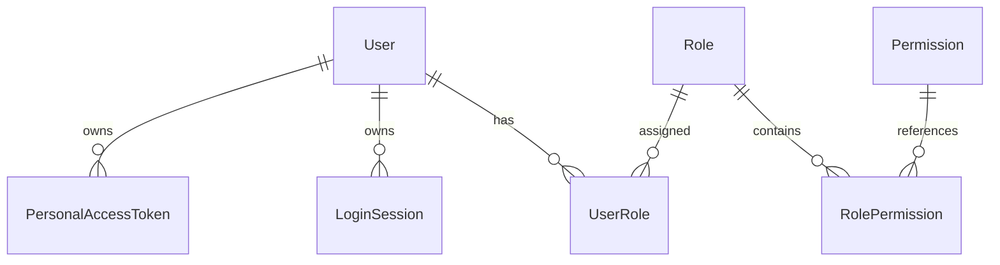
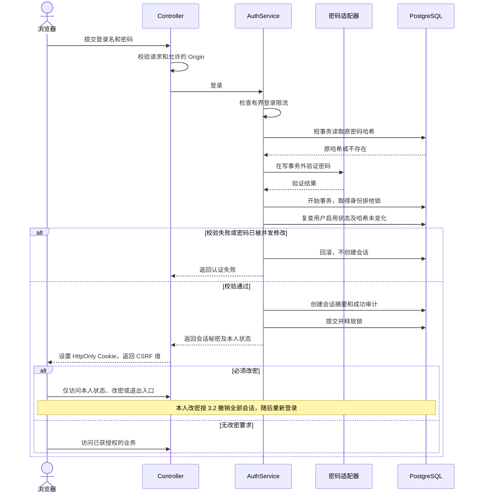
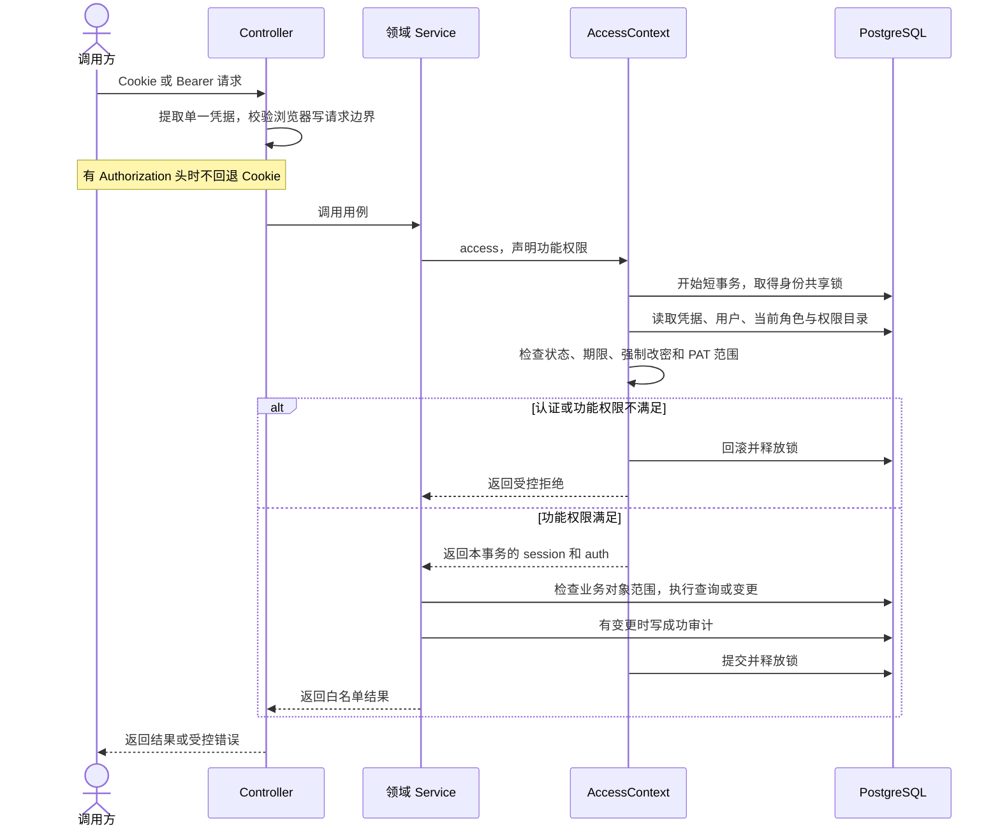
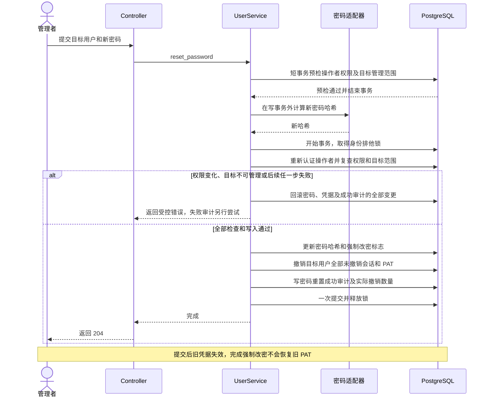
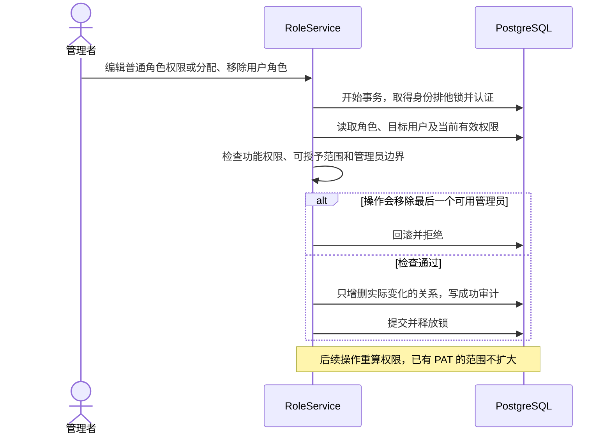
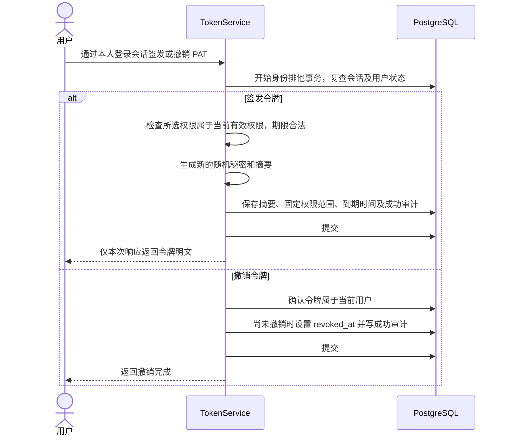

# 身份与权限

身份模块统一管理单企业内的用户、角色、登录会话和个人令牌（PAT）。管理员创建用户，登录名创建后固定，用户只停用、不删除；初始管理员通过命令创建，无默认密码。当前使用本地密码认证，不建设部门、SSO、租户或角色继承体系。

## 1. 范围与边界

功能权限由 Identity 计算，业务对象的可见、编辑和共享范围由所属业务检查。

- 会话权限 = 当前角色权限并集 ∩ 当前代码权限目录。
- PAT 权限 = 会话权限 ∩ 签发时选定的令牌范围。
- 用户停用、凭据过期或撤销时拒绝认证；必须改密时只开放本人状态、改密和退出等必要会话入口。
- 内置管理员拥有全部已声明功能权限，仍受凭据和 PAT 范围限制。对象权限例外由各领域明确，普通角色拥有全部权限不等于内置管理员身份。

权限键精确匹配，不支持通配符。每次独立操作读取当前授权，同一短事务内复用，不跨请求或 Step 缓存。

## 2. 领域模型

Permission 是代码目录，其余六个对象持久化。

| 对象 | 主要字段与约束 |
|---|---|
| User | id、唯一且固定的 username、display_name、password_hash、is_active、password_change_required |
| Role | id、唯一且固定的 key、name、description；内置 admin 不可编辑或删除 |
| UserRole | user_id、role_id，二元组唯一 |
| RolePermission | role_id、permission_key，二元组唯一；未知权限不生效 |
| Permission | key、name、description；各模块 catalog.py 声明，composition 显式合并并拒绝冲突 |
| LoginSession | id、user_id、token_digest、created_at、expires_at、revoked_at |
| PersonalAccessToken | 会话同类字段，另有 name、固定 permissions；期限必填，秘密只在签发时返回一次 |

User、Role 保留 created_at/by、updated_at/by；关联表只保留 created_at/by。会话和 PAT 用所属用户、签发、到期与撤销时间表达生命周期，撤销者及原因写入[审计](audit.md)，不叠加一般编辑或软删除字段。

权限目录绑定当前 Runtime/Database，未绑定时拒绝授权，显式空目录不继承平台权限。新增权限自动进入内置管理员权限，普通角色和已有 PAT 不自动扩权；移除的权限不再放行，历史审计保留。

## 3. 主要流程

### 3.1 认证与访问

浏览器使用服务端会话 Cookie，API 使用 Bearer PAT；密码保存 Argon2 哈希，随机凭据保存摘要。存在 Authorization 头时只验证 Bearer，失败不回退 Cookie。PAT 不能用于改密、退出或管理 PAT。

### 3.2 凭据生命周期

| 操作 | 原子变更 |
|---|---|
| 退出 | 撤销当前会话 |
| 本人主动或强制改密 | 校验旧密码，更新密码并解除改密要求，撤销全部会话；保留有效 PAT |
| 管理员重置密码 | 更新密码、要求下次改密、撤销目标全部会话及 PAT |
| 撤销全部凭据 | 撤销目标全部会话及 PAT，不改密码和改密要求 |
| 停用用户 | 停用并撤销全部会话及 PAT |
| 重新启用 | 保留原改密要求，旧凭据不恢复 |
| 调整角色权限 | 凭据保留，下一次操作重算权限 |

撤销只填写尚未撤销记录，不覆盖原撤销时间，也不物理删除。管理员重置要求 user:reset_password 和目标管理范围，已包含全部凭据撤销，无需另有 user:credentials；独立撤销操作仍要求该权限。本人改密成功后清除 Cookie 并重新登录，泄露的 PAT 需另外撤销。

管理员创建或重置用户时提供初始密码并线下安全交付，用户首次登录须改密。初始化命令由首位管理员自行设置密码，无需再改一次。

### 3.3 登录与首次改密时序

密码在写事务外验证，提交前复查用户状态和原哈希，防止与密码重置竞争时错误签发会话。

登录不增加去重键；响应丢失可能留下未过期会话，再次登录创建新会话。

### 3.4 每次受保护操作的授权时序

业务对象检查失败或成功审计写入失败，整个事务回滚。外部 I/O 结束后开始新操作须重新授权；撤权不能收回已发送请求或已交付内容，已发生事实由所属领域受限收尾。

### 3.5 管理员重置密码时序

密码计算前预检是资源优化，最终事务内授权和原子提交是必要保证。响应丢失时不自动连续重置；再次重置会撤销期间新签发的凭据，应由管理员明确决定。

### 3.6 角色变更与删除时序

修改普通角色检查变更前后权限并集，分配或移除角色检查该角色权限及目标用户范围，均不得超过操作者有效权限。控制管理员账户或成员关系还要求内置管理员身份，并保护最后一个启用管理员。

只增删变化关系；重复分配、解除或保存不重写创建信息，也不生成重复变更审计。

#### 角色与文件授权的迁移边界

角色删除由 Identity 自己完成，不依赖 Files。业务自己的角色引用按实际外键约束处理。

### 3.7 PAT 签发与撤销时序

PAT 只能由本人有效会话签发、列出或撤销，权限不得超过当前范围；原范围和期限不原地修改，需要时重签。重复撤销保留首次时间，不影响其他凭据。签发与重置、停用使用同一身份锁串行化。

签发响应丢失后无法找回明文；用户可查看元数据、撤销未使用令牌再签发。签发重试会创建新记录。

## 4. 权限与审计

### 4.1 权限判断

Authorization.require() 直接检查有效权限集合，角色关系是唯一授权来源。普通角色不能通过角色管理或账号控制给自己扩权，不另建策略库、权限版本或广播缓存。

业务明确自己的对象访问规则，不统一增加管理员绕过。

### 4.2 审计规则

登录、用户管理、密码、角色和凭据变更显式记录审计，成功与变更同事务，失败或拒绝回滚后尽力记录。实际操作者来自可信身份；PAT 操作另保存非秘密 credential_id。认证未完成时不推测用户或令牌身份。

密码、哈希、凭据秘密不进入审计、通用响应或检查点。审计写入、Actor 与字段限制统一见[审计设计](audit.md)。

### 4.3 删除与撤销

| 对象或关系 | 清理规则 |
|---|---|
| User | 只停用，不删除 |
| 内置 admin | 不编辑、不删除 |
| 普通 Role | 仍有任何用户分配时拒绝删除，包括停用用户；自身 RolePermission 同事务删除 |
| 会话、PAT | 到期或撤销后按保留期清理；任何保留 Run 引用的 PAT 均不得删除 |
| 历史审计 | 独立保留，不随对象删除 |

不得清空 Run 的原 PAT 关联，使其退化成会话身份。LoginSession 不被 Run 引用。具体保留期与批量维护见[历史清理](../operations/deployment.md#历史保留与清理)。

## 5. 设计取舍

使用本地认证、固定到期会话和 PAT。保留多角色权限并集与内置管理员；当前不引入 JWT、刷新令牌、滑动续期、设备管理、用户直接授权或拒绝规则。

## 6. 状态与设计验证

### 6.1 状态与转换

有效、过期、已撤销由现有字段判断，不新增通用凭据状态机。

| 当前状态 | 事件/前提 | 结果 |
|---|---|---|
| 用户启用、必须改密 | 有效会话成功改密 | 解除改密要求，全部会话撤销 |
| 用户启用 | 重置密码 / 停用 | 必须改密 / 停用；按 3.2 撤销凭据 |
| 用户停用 | 管理者启用 | 可重新登录，原撤销不恢复 |
| 会话或 PAT 有效 | 到期或撤销 | 失效，不可续活 |
| 普通角色存在 | 无外部使用且授权通过 | 删除角色及自身权限关系 |

### 6.2 关键不变量

1. 认证、当前权限和对象范围在每次短操作内生效，PAT 范围不扩大。
2. 密码、用户状态、对应凭据撤销及成功审计一起提交或回滚。
3. 至少保留一个启用的内置管理员，普通角色不能冒充该身份。
4. 已撤销凭据不恢复，角色删除不破坏有效引用或历史。
5. 撤权阻止新操作；事实收尾不扩大查询、文件读取或业务采用权限。

### 6.3 访问决策与拒绝边界

| 条件 | 结果 |
|---|---|
| 用户或凭据失效 | 401 |
| 有效身份但功能/对象范围不足 | 403，或领域约定的不可见响应 |
| 必须改密、PAT 访问仅会话入口 | 拒绝普通业务或该入口 |
| 身份锁等待超过 3 秒 | 503 / identity_busy，不能当作永久撤权 |

### 6.4 失败、并发与重试场景

验证登录与重置、签发与停用、权限变更与业务操作、最后管理员及角色引用的竞争；检查事务整体回滚、重复撤销与取消收尾。锁和事务使用真实 PostgreSQL 验证，集合与字段规则可单元验证。

## 7. 最小实现约定

代码位于 backend/src/keystone/platform/identity/。

| 项目 | 当前限制 |
|---|---|
| ID、时间 | UUID、带时区 UTC |
| username | trim 后转小写；3～64 个 ASCII 字母、数字、点、下划线或连字符，首位字母/数字 |
| 密码 | 8～128 字符，不 trim、不强制字符组合；本人改密不能复用当前密码；Argon2 并发 4 |
| 展示名、角色名、PAT 名 | 1～128 字符；角色说明最多 1000 |
| 角色 key | 小写字母开头，最多 64，允许数字、点、下划线、连字符；admin 保留 |
| 会话 | 32 随机字节，SHA-256 摘要；默认 8 小时，可配置 1～168 小时 |
| PAT | 到期必填，默认最大 90 天，界面默认 30 天 |
| 列表 | 默认 50、最高 100，offset 最高 100000，不查询总数 |

Cookie 使用 HttpOnly、SameSite=Lax、Path=/；生产使用 Secure 和 __Host-keystone_session，开发名为 keystone_session。生产须配置精确 HTTPS KEYSTONE_BROWSER_ORIGINS。登录检查 Origin 和 X-Keystone-Request: 1，Cookie 写请求另检查绑定会话的 X-CSRF-Token；CSRF 通过登录及 /auth/me 返回，仅在前端内存保存。

单 API 进程登录限流：60 秒内每用户名 5 次、全局 60 次，最多 4096 个摘要键，重启清空。Nginx 另按来源 IP 每分钟 10 次、burst 5；API 不信任任意 X-Forwarded-For。多 API/代理部署须另确认共享限流与可信代理。

AccessContext.access() 默认使用 PostgreSQL 事务级共享身份锁；身份、角色、授权或凭据变更传 identity_write=True，取同键排他锁。获取连接及身份锁总等待最多 3 秒；取消后先完成连接清理再返回，不覆盖后续对象查询超时。密码计算和外部 I/O 不持该写事务。

### 7.1 当前 API

路径统一带 /api/v1；请求 Schema 见本地 /docs。

| 接口 | 权限/用途 |
|---|---|
| POST /auth/login；GET /auth/me | 登录、本人状态 |
| POST /auth/logout；POST /auth/password | 仅会话，退出、本人改密 |
| GET/POST /auth/tokens；DELETE /auth/tokens/{id} | 仅会话，本人 PAT 管理 |
| GET/POST /users | user:read / user:create |
| PATCH /users/{id}；PUT /users/{id}/active | user:update 及目标范围 |
| POST /users/{id}/password | user:reset_password 及目标范围 |
| POST /users/{id}/credentials/revoke | user:credentials 及目标范围 |
| GET /permissions；GET /roles | role:read |
| POST /roles；PUT /roles/{id}；DELETE /roles/{id} | role:create/update/delete 及可授予范围 |
| PUT /users/{user_id}/roles/{role_id} | role:assign 及目标范围，逐项 assigned=true/false |

初始化使用 keystone init-admin --username <name> [--display-name <name>]，隐藏输入并确认密码，已有任何用户时拒绝。

### 7.2 控制台

/console/users、/console/roles 按读取权限加载，按钮使用各自操作权限。角色编辑支持筛选及仅看已选，选择操作只影响当前可授予范围；用户角色逐项保存。admin 只读，不提供用户删除、部门或导入。

进入受保护页面通过 /auth/me 复查；401 清除身份，403 复查权限，强制改密进入账户页。身份变化清空旧数据并丢弃迟到响应；密码不存浏览器存储，提交或关闭表单后清空。

### 代码组织

Auth/User/Role/Token Service 共用 AccessContext；密码与凭据适配在 adapters/security.py。authorization.py 统一读取角色和权限，其他领域通过 Identity Service 协作。

Authorization.role_ids 来自同次角色联表查询，包含空权限角色，不跨事务缓存。用户/角色列表先分页，再按当前页 ID 批量读取关联，避免逐行查询。通用分层见[架构规范](../development/business.md#模块分层与代码规范)。
