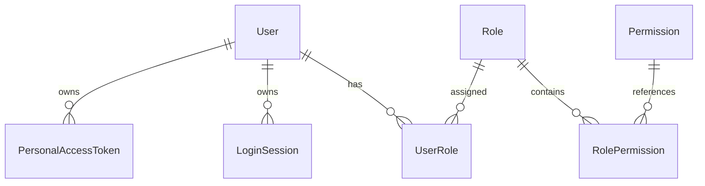

# Keystone 身份与权限领域

状态：最小实现 v1.1，2026-10-18；六张身份表、Cookie 会话、PAT、Casbin、管理边界、管理员初始化、账户及用户/角色管理页面已实现。FileGrant 角色删除检查及 FlowRun 对 PAT 的引用保护已接入，凭据自动清理尚未启用。

[范围与边界](#1-范围与边界) · [领域模型](#2-领域模型) · [主要流程](#3-主要流程) · [权限与审计](#4-权限与审计) · [设计取舍](#5-设计取舍) · [待确定事项](#6-待确定事项)

## 1. 范围与边界

Keystone 是模块化单体平台。各业务模块共用一套用户、登录和权限管理，一次登录即可使用获得授权的模块。

已确定：首版不做租户、Department 和 SSO；使用本地认证，权限判断采用 Casbin。

用户管理、认证和授权可以放在一个身份模块中，共用数据库。不需要分别建设服务、通用身份框架或应用账号体系。

已确定的用户管理规则：由管理员创建用户，不开放公开注册；登录名唯一且创建后不可修改；用户只停用、不删除。初始管理员通过初始化命令创建，不设置默认密码。

## 2. 领域模型

**用户、角色、权限目录、登录会话、个人令牌**，加上用户角色和角色权限两种关联关系。

Permission 是代码声明的目录，不需要单独建表。持久化共六张表：四张主体表、两张关联表；不包含公共审计存储。

### 2.1 用户 User

| 字段 | 含义 |
|---|---|
| `id` | 稳定用户 ID |
| `username` | 唯一登录名，创建后不可修改 |
| `display_name` | 展示名 |
| `password_hash` | 密码哈希 |
| `is_active` | 是否启用 |
| `password_change_required` | 是否必须修改密码，沿用 Ether 的能力 |
| `created_at` | 创建时间，服务端生成，UTC，必填 |
| `created_by` | 创建操作的用户 ID，系统操作可为空 |
| `updated_at` | 最近修改时间，UTC，创建时与 created_at 相同 |
| `updated_by` | 最近修改操作的用户 ID，系统操作可为空，创建时与 created_by 相同 |

支持管理员创建用户、修改资料、启用、停用、修改和重置密码。不开放公开注册，首版不提供删除、归档和恢复。初始管理员通过初始化命令创建，不设置默认密码。

停用用户不能通过任何凭据访问；必须改密时只允许改密、退出等必要操作。业务记录关联用户 ID，不用用户名作为身份键。

### 2.2 角色 Role

| 字段 | 含义 |
|---|---|
| `id` | 稳定角色 ID |
| `key` | 唯一且稳定的角色标识 |
| `name` | 展示名称 |
| `description` | 角色说明 |
| `created_at` | 创建时间，服务端生成，UTC，必填 |
| `created_by` | 创建操作的用户 ID，系统操作可为空 |
| `updated_at` | 最近修改时间，UTC，创建时与 created_at 相同 |
| `updated_by` | 最近修改操作的用户 ID，系统操作可为空，创建时与 created_by 相同 |

### 2.3 用户角色 UserRole

| 字段 | 含义 |
|---|---|
| `user_id` | 用户 ID |
| `role_id` | 角色 ID |
| `created_at` | 创建时间，服务端生成，UTC，必填 |
| `created_by` | 创建操作的用户 ID，系统操作可为空 |

### 2.4 角色权限 RolePermission

| 字段 | 含义 |
|---|---|
| `role_id` | 角色 ID |
| `permission_key` | 代码声明的权限 key |
| `created_at` | 创建时间，服务端生成，UTC，必填 |
| `created_by` | 创建操作的用户 ID，系统操作可为空 |

### 2.5 权限目录 Permission

权限目录由代码声明，不新增数据库表。平台 PERMISSIONS 与业务 catalog.py 的权限在 composition.py 显式合并，生成当前 Runtime 的不可变目录；Database 必须绑定该目录，角色目录、管理员权限展开、可授予范围、PAT 和 Worker 授权从当前会话读取。未绑定目录时拒绝授权，显式空目录也不会继承平台权限。业务使用命名空间防止冲突，具体接入见[业务接入规范](../architecture.md#55-业务权限审计与模型接入)。

新增权限不自动授予普通角色或扩大已有 PAT；从当前目录移除的权限不再生效，但不删除历史审计。管理员拥有全部已声明功能权限，对象范围和管理员例外仍由所属业务明确检查。

| 字段 | 含义 |
|---|---|
| `key` | 唯一权限标识 |
| `name` | 展示名称 |
| `description` | 权限说明 |

Permission 是代码目录，不持久化，不增加行级审计字段。

角色 key 唯一且稳定，两种关联关系分别按二元组唯一。权限 key 由模块声明，例如 `user:read`，未知权限不能用于放行。角色权限编辑只增删发生变化的关系，未变化授权保留原始 created_at/created_by；重复分配现有角色也不重写原授权创建信息。

用户可以拥有多个角色，权限取并集。首版不做角色继承、拒绝规则和直接用户权限。角色管理仍需检查操作者的管理权限与可授予范围，不能通过管理接口给自己越权。

内置管理员角色拥有全部已声明权限，新增权限自动纳入，不通过普通角色编辑修改。不能停用最后一个可用管理员或移除其管理员角色；不能直接删除仍被使用的角色。管理员使用个人令牌时仍受令牌权限上限约束。

Casbin 负责判断这些授权关系，不负责登录、会话或用户状态。功能权限与具体业务对象的访问规则分别检查。

### 2.6 登录会话 LoginSession

| 字段 | 含义 |
|---|---|
| `id` | 会话记录 ID |
| `user_id` | 所属用户 |
| `token_digest` | 随机秘密凭据的摘要 |
| `expires_at` | 固定到期时间 |
| `revoked_at` | 撤销时间，未撤销为空 |
| `created_at` | 创建时间，服务端生成，UTC，必填 |

登录创建会话，退出撤销会话。用户启用、会话未到期且未撤销时才可认证成功；强制改密限制仍需检查。

浏览器通过 Cookie 携带秘密凭据，记录 ID 本身不能用来登录。一个用户可以有多个会话。过期或撤销后重新登录，不续活原会话。

会话由所属用户登录建立，创建身份已由 user_id 表达，不重复保存 created_by。会话不提供一般编辑，使用 created_at、expires_at、revoked_at 表达生命周期，不需要 updated_at、updated_by。退出、管理员操作或系统规则导致的撤销，其操作者和原因记录在审计日志中。

首版不需要 RefreshToken、会话状态枚举、空闲计时或每次访问更新活跃时间。

### 2.7 个人令牌 PersonalAccessToken

| 字段 | 含义 |
|---|---|
| `id` | 令牌记录 ID |
| `user_id` | 所属用户 |
| `name` | 用途说明 |
| `token_digest` | 秘密摘要 |
| `permissions` | 允许使用的权限上限 |
| `expires_at` | 到期时间 |
| `revoked_at` | 撤销时间，未撤销为空 |
| `created_at` | 创建时间，服务端生成，UTC，必填 |

用户通过登录会话创建和撤销自己的令牌，用 Bearer Token 调用 API。令牌不能继续签发令牌；明文只在创建时展示一次。

PAT.permissions 保存签发时明确选定的权限 key 集合，不使用会自动扩展的通配符；新增代码权限不会自动进入旧 PAT。未知权限不允许签发，使用时不放行。到期时间必填且晚于签发时间，首版不发永久令牌。

有效权限为“用户当前权限 ∩ 令牌权限上限”，并受用户状态、强制改密限制、到期和撤销检查约束。角色权限恢复后，仍有效的令牌可以再次使用其范围内的权限；撤销的令牌不能恢复。

首版只允许用户为自己签发令牌，不修改令牌权限或延长期限，需要时重新签发。因此创建身份使用 user_id，保留 created_at、expires_at、revoked_at，不重复增加 created_by、updated_at、updated_by；签发和撤销的操作者、原因写入审计日志。令牌代表用户，不另建机器身份。

## 3. 主要流程

### 3.1 认证与访问

**浏览器登录：**验证用户名、密码与用户状态，创建会话，将随机凭据写入 Cookie。后续请求检查会话是否到期或撤销，以及用户是否仍可用。退出时撤销当前会话并清除 Cookie。

**个人令牌访问：**验证令牌和用户状态，取得所属用户。令牌权限上限不能超过签发时用户拥有的权限，使用时还要与用户当前权限取交集。

**业务授权：**用户通过角色获得权限，多角色取并集，默认拒绝。业务模块声明权限并调用统一检查入口。具体业务对象的归属、共享等规则由业务模块处理。

密码和随机凭据只保存适当的哈希或摘要；个人令牌明文只展示一次。Cookie 配置 HttpOnly、生产环境 Secure 和合适的 SameSite，并保护写请求免受 CSRF；登录需要限流。这些是实现要求，不增加领域对象。

### 3.2 凭据生命周期

| 操作 | 首版规则 |
|---|---|
| 退出 | 撤销当前会话 |
| 修改或重置密码 | 撤销全部会话；个人令牌独立管理 |
| 管理员重置密码 | 另要求用户下次登录修改密码 |
| 停用用户 | 拒绝访问，并撤销全部会话和个人令牌 |
| 重新启用用户 | 重新登录、重新签发令牌，已撤销的凭据不恢复 |
| 调整角色权限 | 保留会话和令牌，按当前权限重新判断 |

采用上述规则。其中改密/重置撤销全部会话参考 Ether 的 [认证服务](M:/code/ether-workspace/ether/packages/platform/src/ether/user/auth/service.py) 与 [用户管理](M:/code/ether-workspace/ether/packages/platform/src/ether/user/service.py)；停用时同时撤销 PAT 是 Keystone 的明确收敛，重新启用不恢复旧凭据，不增加状态或模型。改密和重置密码不是撤销所有访问凭据的同义操作：未撤销的个人令牌在用户完成强制改密后仍可使用；如果属于凭据泄露处置，需要另外撤销个人令牌。

本人改密仅允许有效会话并验证当前密码，成功后撤销包括当前会话在内的全部会话，清除 Cookie，重新登录；强制改密期间只开放本人状态、改密和退出等必要会话入口，PAT 不能用于改密或绕过限制。创建用户或管理员重置密码时，由管理员提供初始密码并通过线下安全方式交付，服务端只保存哈希且要求首次改密，不建邀请、邮件、重置链接或一次性密码表。初始化命令交互输入首位管理员密码，不内置默认密码。

用户状态、密码与对应凭据撤销在同一事务变更，并与凭据签发/认证复查协调，防止停用后并发签发仍有效的凭据。当前授权检查阻断变更提交后才开始的新操作，不承诺撤回已通过检查且发出的外部请求；其结果仍按文件、模型和 Flow 的事实保存规则处理。

## 4. 权限与审计

### 4.1 权限判断

权限由代码声明，例如 `user:read`，管理员将已有权限分配给角色，再把角色分配给用户。

Keystone 的用户角色、角色权限关系是唯一授权数据来源，Casbin 使用这些数据进行判断，不另建一套可独立编辑的策略存储。首版 API 在请求授权时、Worker 在每次新的受保护操作前从数据库加载当前用户、角色与原 PAT 状态/范围，不跨请求或跨步骤复用授权结果；同一次短操作内可以复用已加载上下文，不在外部调用期间保持长事务。内置管理员身份与 FileGrant 也使用当前关系。以此满足多进程撤权语义，不引入策略广播、权限版本字段或缓存基础设施。参考 Ether 的 [AuthorizationService.load](M:/code/ether-workspace/ether/packages/platform/src/ether/user/rbac/engine.py)。

已确定：保留内置管理员角色，拥有全部已声明权限，模块新增权限自动纳入；保护最后一个可用管理员。普通角色可配置权限，但授予和修改不能超出操作者的权限范围。仍被使用的角色不能直接删除。

普通角色 key 创建后固定；内置管理员 key 保留，不能通过创建或重命名普通角色取得。角色修改检查变更前后权限并集，分配/移除角色检查其有效权限集合，均不得超出操作者当前有效权限（含 PAT 范围）。重置他人密码、启停用户和撤销他人凭据也检查目标用户权限范围，不能通过账号控制绕过角色授予限制。内置管理员具有文件对象例外，因此普通角色即使拥有全部功能权限，也不能管理管理员角色成员或重置/控制内置管理员账户；这些操作还要求操作者本人是当前内置管理员，并满足相应功能权限与最后管理员保护。参考 Ether 的 [角色管理](M:/code/ether-workspace/ether/packages/platform/src/ether/user/rbac/service.py) 与 [密码控制边界](M:/code/ether-workspace/ether/packages/platform/src/ether/user/service.py)，对管理员特殊能力补充明确限制，不增加角色层级。

内置管理员的全部权限来自固定规则，不通过普通角色编辑修改。管理员仍受用户状态、会话和令牌有效性检查约束；使用个人令牌时也不能绕过令牌权限上限。拥有全部功能权限不自动跳过业务对象的访问规则。

文件领域明确一条例外：当前内置管理员在具备对应有效功能权限时，inspect/manage 不要求该文件的对应 FileGrant；content_read 仍要求显式授权和可读状态。普通角色拥有 file:manage 不等于具备此例外，PAT 也不能绕过功能权限范围。管理员可按文件管理规则显式授予自己读取权并留下审计；这不是身份模块对所有对象的通用授权绕过，详见[文件授权](files.md#22-文件授权-filegrant)。

### 4.2 审计规则

AccessContext 在认证完成后保存当前 PAT 编号供异常路径使用；后续权限拒绝或业务失败的 details 保留 credential_id，与成功日志一致。认证未完成时不推断令牌身份，沿用 anonymous 和空 actor_id；原始秘密不进入日志。普通用户、会话、系统操作不因这项补齐增加凭据字段。

操作日志采用 [AuditLog](audit.md)，本领域的行级字段和删除规则仍完整列在下文。

按对象用途选择字段，不要求所有表继承相同的审计基类：

| 对象 | 保留信息 | 理由 |
|---|---|---|
| User、Role | created_at、created_by、updated_at、updated_by | 需要追踪谁创建、谁修改了管理对象 |
| UserRole、RolePermission | created_at、created_by | 需要知道谁授予关系；关系只添加或移除 |
| LoginSession、PersonalAccessToken | created_at、expires_at、revoked_at，以及 user_id | 记录签发、到期、撤销；没有一般编辑操作 |
| Permission | 无行级审计字段 | 由代码声明，不是数据库表 |

时间由服务端生成，统一使用 UTC；操作人来自已验证身份，不能由客户端任意指定。有更新审计字段的对象，创建时 updated_at 与 created_at 相同，updated_by 与 created_by 相同。系统操作允许操作者为空，并在日志中说明来源。会话和令牌的创建者因首版仅支持本人登录/签发而与 user_id 一致；撤销者不一定是本人，必须单独记录在操作日志中。行上字段不能代替完整操作历史。

用户停用、密码重置、角色分配及权限修改、令牌签发与撤销需要记录时间、操作者、操作、目标和结果，不记录密码或凭据明文。保留 revoked_at 表达撤销时间，不用 updated_at 猜测撤销事实。并发登录、撤销及最后管理员保护需要在实现时验证。

使用 PAT 执行业务时，操作者是其所属用户；管理或撤销凭据时，操作者是实际执行的用户或系统，不能用凭据所属人代替。被管理凭据及其所属用户作为目标与必要 details 保存。Worker 中的用户业务操作沿用可信用户身份，系统维护和事实同步使用 system；不因运行进程而改变身份归属，不新增操作者字段。

### 4.3 删除与撤销

User 只停用、不删除，不增加 deleted_at、deleted_by。会话和令牌通过 revoked_at 失效，撤销不等于删除，不再叠加软删除标记。

普通角色的删除区分外部使用关系和自身配置：

| 关联或约束 | 删除规则 |
|---|---|
| 内置管理员角色 | 禁止删除 |
| UserRole | 存在任何用户分配就禁止删除，包括停用用户；先显式解除分配，继续保护最后一个可用管理员 |
| FileGrant | 存在角色文件授权就禁止删除；通过文件模块显式撤销，或在文件确认删除时一并清理，不能随角色静默级联删除 |
| RolePermission | 属于角色自身配置，不阻止删除；删除角色时在同一事务内一并移除 |
| AuditLog 中的历史角色 ID | 不阻止删除；审计独立保留，不随角色清理 |

角色删除仍检查操作者的管理权限与可管理范围。首版明确检查 UserRole 和 FileGrant，并用事务与数据库约束防止删除检查后并发新增关系，不引入通用 guard 注册机制或角色引用表；将来新增引用角色的领域，再补充检查。该边界参考 Ether 的 [角色删除](M:/code/ether-workspace/ether/packages/platform/src/ether/user/rbac/service.py)、[文件授权检查](M:/code/ether-workspace/ether/packages/platform/src/ether/files/integration.py) 和 [角色关系](M:/code/ether-workspace/ether/packages/platform/src/ether/user/rbac/models.py)。

FileGrant 只在文件内容确认删除、转为 deleted 的事务中随文件生命周期清除；deleting 或清理失败时仍保留授权，因此仍会阻止角色删除。不在角色删除检查里跳过这些授权，也不增加授权失效状态，见[文件删除规则](files.md#21-文件-file)。

UserRole 和 RolePermission 可以按授权管理规则物理移除。删除角色或解除关系前记录目标 ID、角色 key、必要权限或关联键等快照，以及操作者、时间和结果；成功变更与审计同事务提交，回滚不能留下“删除成功”记录。角色与其 RolePermission 的删除可以记录为一次包含必要配置快照的角色删除操作。

过期或撤销立即使凭据失效，但不立即删除记录。只要仍有保留的 FlowRun 引用 PersonalAccessToken，该令牌就不能物理删除，即使运行已经结束；不能清空运行上的令牌关联，使其退化为会话发起身份。令牌只有在已过期或撤销、满足保留期且没有 FlowRun 引用时才能清理，不另存凭据快照。

LoginSession 不被 FlowRun 引用，过期或撤销后按自己的保留策略清理。凭据清理记录任务、范围、数量和结果即可；不为每条已删除记录增加 deleted_by，也不把删除审计存放在即将删除的那一行上。审计日志独立保留，不能随目标级联删除。

撤权、用户停用或原令牌失效阻断后续新的受保护操作，不撤销已发生的事实。Worker 仍可用受限 system 能力同步已经完成的 Run、补全已发送调用的结果和费用，并按 [Flow 规则](flow.md#35-结果同步与文件保留) 保留必要引用；这不代表原身份继续有效。业务采用结果、发布内容及用户查询下载仍检查当前权限，不将它们归为免授权的事实同步。

## 5. 设计取舍

| 内容 | 首版选择 |
|---|---|
| 用户、角色、权限目录及关联关系 | 保留 Ether 的基本结构 |
| Department、岗位、归档与恢复状态 | 首版不加入，只提供用户启用和停用 |
| 登录认证 | 用户名和密码 |
| 浏览器访问 | 服务端会话，通过 Cookie 携带随机凭据 |
| JWT 与 Refresh Token | 不引入，省去刷新与轮换流程 |
| 个人 API 凭据 | 保留，仍代表所属用户 |
| 权限计算 | 使用 Casbin，数据由 Keystone 自己管理 |

首版会话只有固定到期时间和退出撤销，不增加空闲超时、滑动续期或设备管理。基础审计字段和重要操作的审计日志保留，请求上下文属于实现配套，不在这里扩展成新的核心领域。

操作历史使用共享的 AuditLog 追加记录，不引入事件溯源、通用 Credential 或复杂的恢复状态体系。

## 6. 待确定事项

核心生命周期与初始密码交付方式已实现，参数见下节。尚未启用会话/PAT 自动物理清理；保留期限在对应维护功能接入时确定，届时必须遵守 FlowRun 引用保留规则。FileGrant 已随文件模块落地，当前角色删除显式检查 UserRole 与 FileGrant，并由限制性外键兜底；身份事务锁协调并发新增授权，不引入 guard 注册系统。

已通过真实 PostgreSQL 验证停用与登录/PAT 签发竞争、改密撤销会话、强制改密不能由 PAT 绕过、后续请求按当前权限判断，以及管理员特殊身份与最后管理员并发保护。Worker 的 Flow 场景仍在 Flow 阶段验证，不把 API 测试当作 DBOS 恢复验收。

## 7. 最小实现约定

代码位于 backend/src/keystone/platform/identity/，六张身份表由 0001_identity 迁移创建；AuditLog 由独立审计迁移负责。复用 Ether 的 Argon2 校验、随机凭据摘要、当前授权加载、管理范围和显式审计模式；会话和 PAT 按本文重新实现，不引入 JWT。权限库锁定 PyCasbin 2.8.0，使用其内存 Enforcer 和 RBAC 规则，参考[官方 Python 实现](https://github.com/pycasbin/casbin)；每次短操作从 Keystone 关系表装载，不使用数据库 Adapter、casbin_rule 或全局授权缓存。

| 项目 | 当前规则 |
|---|---|
| ID 与时间 | UUID；带时区 UTC 时间；用户和角色保留完整创建/修改字段 |
| 登录名 | 去除首尾空白、转为小写，3–64 个 ASCII 字母/数字/点/下划线/连字符，首字符为字母或数字；创建后固定 |
| 密码 | 新密码 8–128 字符，不要求大小写、数字或特殊字符组合，不做 trim；本人改密不能复用当前密码；Argon2 哈希线程并发上限 4 |
| 展示字段 | display_name、角色 name、PAT name 为 1–128 字符；角色说明最多 1000 字符 |
| 角色 key | 小写字母开头，最多 64 字符，允许数字/点/下划线/连字符；admin 保留且不可编辑/删除 |
| 会话 | 32 随机字节生成秘密，库中只存 SHA-256 摘要；固定 8 小时，可用 KEYSTONE_SESSION_HOURS 配置 1–168 小时 |
| PAT | 独立随机秘密；到期必填，默认最大 90 天，可用 KEYSTONE_PAT_MAX_DAYS 配置；UI 默认选 30 天，服务端不隐式发永久令牌 |
| 管理员初始化 | keystone init-admin --username <name> [--display-name <name>]；交互隐藏输入并确认密码，无默认密码；已有任何用户则拒绝重复初始化；首位管理员的自选密码不要求再改一次 |
| 查询 | 默认 50 条、最多 100 条；offset 最多 100000；用户/角色页面每页 50 条，不额外查询总数 |

Cookie 使用 HttpOnly、SameSite=Lax、Path=/，生产环境使用 Secure 和 __Host-keystone_session 名称；开发环境使用 keystone_session。生产环境必须配置精确的 HTTPS KEYSTONE_BROWSER_ORIGINS 列表，不开启任意来源 CORS。登录要求允许的 Origin 和 X-Keystone-Request: 1；后续 Cookie 写请求还要求会话绑定的 X-CSRF-Token。CSRF 值通过登录和 /auth/me 返回，只在前端内存中保留；它不是会话秘密。退出和本人改密清除 Cookie。存在 Authorization 头时只尝试 Bearer PAT，失败不会回退 Cookie；PAT 不能进入仅会话允许的管理令牌、改密和退出入口。

应用登录限流为单 API 进程内的固定 60 秒窗口：每个规范化登录名最多 5 次，全局最多 60 次，键空间上限 4096；重启清空，不声称跨进程共享。用户名只以摘要作为限流键。Nginx 入口另配置每个连接来源 IP 每分钟 10 次、burst 5；API 不信任任意 X-Forwarded-For。这样代理后的用户不会全被应用层当作同一 IP 计数。多 API 或额外上游代理部署前仍需明确统一限流和可信代理配置。

身份读取用共享 PostgreSQL 事务级 advisory lock，身份写入用同一个键的排他锁；认证、当前授权复查与短操作保持同事务，跨进程协调最后管理员和凭据生命周期。Argon2 在写事务外运行；登录/改密写入时重新核对原密码哈希与当前凭据/用户状态。该锁不覆盖外部 I/O，也不承诺撤回已发出的外部请求；后续领域使用可信身份在各短操作中重新检查。

### 7.1 当前 API

角色删除由 bootstrap 装配 use_cases.RoleDeletion：持有身份排他事务，先通过 identity 检查内置角色、可授予范围和用户分配，再通过 files.ensure_role_unused 检查文件授权，最后调用 identity 删除角色并写审计。所有检查、角色及权限行删除、成功审计共享同一事务；与新增文件授权互斥，失败整体回滚。身份服务只管理自己的表，不反向依赖 files，也不引入通用 guard 注册器。

以下路径统一带 /api/v1 前缀；秘密字段和行审计字段不接受客户端写入。接口的具体请求 Schema 可在本地 /docs 查看。

| 接口 | 用途与要求 |
|---|---|
| POST /auth/login；GET /auth/me | 登录和本人状态；强制改密会话可读取自身状态 |
| POST /auth/logout；POST /auth/password | 当前会话退出、验证旧密码后本人改密；仅会话可用 |
| GET/POST /auth/tokens；DELETE /auth/tokens/{id} | 本人 PAT 列表、签发、撤销；仅会话可用，明文仅签发响应返回 |
| GET/POST /users | 用户列表/创建，分别要求 user:read、user:create |
| PATCH /users/{id}；PUT /users/{id}/active | 修改展示名、启停，要求 user:update 及目标可管理范围 |
| POST /users/{id}/password | 重置密码，要求 user:reset_password 及目标可管理范围 |
| POST /users/{id}/credentials/revoke | 批量撤销该用户会话与 PAT，要求 user:credentials 及目标可管理范围 |
| GET /permissions；GET /roles | 代码权限目录与角色列表，要求 role:read |
| POST /roles；PUT /roles/{id}；DELETE /roles/{id} | 角色创建、修改、删除，分别要求 role:create/update/delete 及可授予范围 |
| PUT /users/{user_id}/roles/{role_id} | assigned=true/false，要求 role:assign，核对角色和目标用户管理范围 |

新增模块只声明实际已实现的权限。当前共 25 项：user:read/create/update/reset_password/credentials、role:read/create/update/delete/assign、audit:read、file:create/inspect/content_read/manage、dictionary:read/manage、model:invoke/manage、model_invocation:read/read_all、flow:start/read/cancel/manage。普通角色全功能权限仍不等于内置管理员身份；未实现模块不预发空权限。前端提供登录、强制/主动改密、退出、本人 PAT 签发/列表/撤销、健康状态及下述管理页面。

### 7.2 管理后台

后台在 /admin/ 下使用独立路由。用户页 /users 要求 user:read，提供搜索、创建、修改展示名、启停、重置密码、撤销全部凭据和逐角色分配；操作按钮按各自权限显示。分配界面还需 role:read 与 role:assign，逐项提交 assigned，避免整组覆盖。用户不提供删除、部门或导入功能。密码不写入浏览器存储，提交尝试结束和关闭表单时清空。

角色页 /roles 要求 role:read，提供普通角色创建、修改、删除和可筛选的权限目录。内置 admin 不可编辑/删除；普通操作者只能选择自己可授予的权限，超出范围的角色不可修改或分配。目标用户管理范围、最后管理员保护和角色引用保护仍由 API 在事务中判断；前端展示服务端拒绝原因，不另建一套领域判断或新增管理员状态字段。

页面刷新和受保护路由进入时通过 /auth/me 恢复或复查身份；未登录跳转登录页，必须改密时进入账户页。会话与 CSRF 仅在内存中共享。401 清除身份，403 复查权限；身份或权限变化后清空旧页面，丢弃上一身份尚未完成的请求结果。无读取权限的页面不加载列表，前端入口控制不替代后端授权。

沿用 Ether 的原生 dialog、分页和请求代次处理方式，按 Keystone API 裁剪；不引入部门、角色继承配置或通用授权框架。验证范围见[后台第一批实施记录](../implementation-plan.md#49-管理后台第一批)。

### 代码组织（2026-10-19）

实现分为 controllers/、services/、models/、schemas/ 四层目录，六个持久化实体各自一个文件。AuthService/UserService/RoleService/TokenService 组合 access.py 的 AccessContext；其他领域仅复用上下文，不依赖账户管理服务。Password 哈希服务仅传给认证、用户管理及初始化。角色响应由 schemas/roles.py 显式投影。 统一规范见[整体架构](../architecture.md#54-模块分层与代码规范)。领域字段、权限和生命周期不变。

AccessContext.access 统一处理事务、共享/排他身份锁、权限、会话限制、失败审计和 IntegrityError → conflict。ExecutionIdentity 只覆盖 authorize(session)，按 Run 检查当前身份和执行资格；不另写事务上下文，也不接收后忽略调用参数。

参考 Ether user/rbac/engine.py 的 user_grants，role_grants 用一次联表读取角色及已声明权限，保留空角色、内置管理员展开和未知权限过滤。load_authorization 与管理目标检查共用该读取；前者仍检查用户/PAT 状态、凭据范围和强制改密，后者仍保留停用或待改密目标的原角色范围用于防越权管理。权限不跨请求缓存。utcnow 移到 core/time.py，各领域直接引用，不再通过 identity.policy 获取通用时间工具。

用户、角色列表先完成搜索、排序和分页，再用当前页 ID 一次读取 UserRole 或 RolePermission；空页不查询关联表，查询次数不随页内记录数增长。未分配角色的用户返回空 role_ids，空角色返回空 permissions，内置 admin 展开当前权限目录，未知权限仍被过滤。读取和响应投影分离，不增加缓存、Repository 或总数查询。
