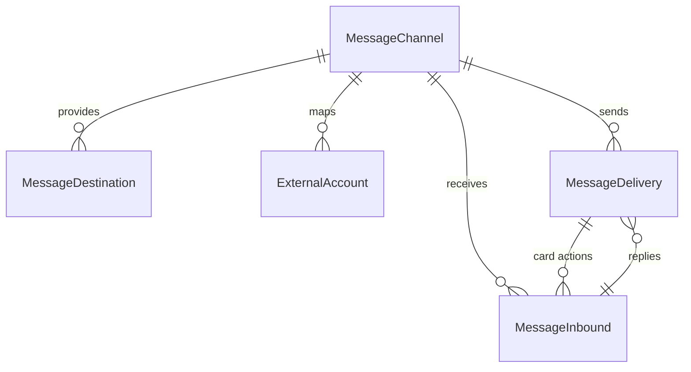
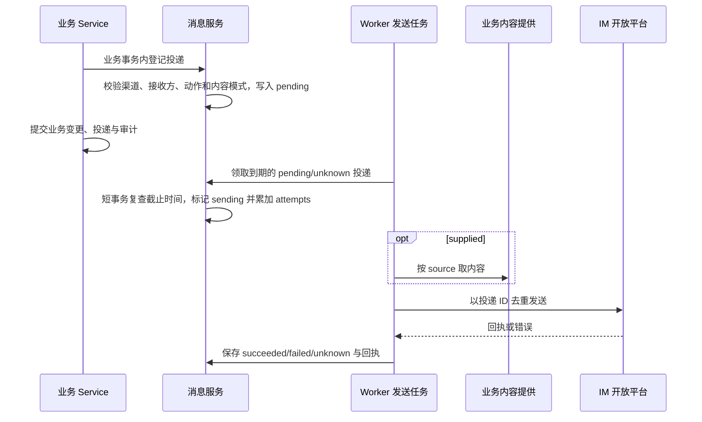
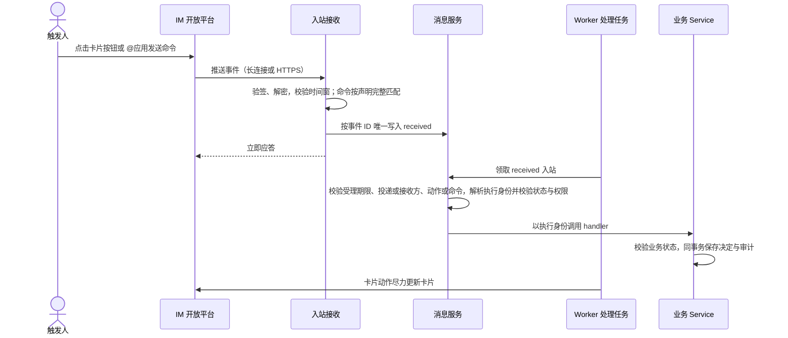

# 消息渠道

消息渠道把通知和交互卡片送到企业 IM，并把卡片上的操作和固定文本命令按声明的执行身份交回业务决定。业务 Service 决定发什么、发给谁、收到操作后做什么；平台负责渠道配置、发送登记与防重、入站验签与去重、执行身份解析和送达事实。

本页是设计契约，飞书群机器人推送和飞书自建应用向群发送已实现，其余见[目标与当前实现差异](#目标与当前实现差异)。首版接入飞书和企业微信的自建应用（可发送与交互）和群机器人（只发送到所在群）；固定文本命令首版只支持飞书。

## 1. 范围与边界

| 能力 | 负责 |
|---|---|
| 配置 | 渠道凭据、具名接收方及其执行用户、外部账号绑定、启停 |
| 发送 | 与业务同事务登记、Worker 发送、按渠道去重能力有界重试、截止时间、发送时取内容、保存送达事实 |
| 入站 | 卡片动作与固定命令的验签、去重、受理期限、执行身份解析与授权、调用业务注册的 handler、尽力更新卡片 |

不建设通用消息中心、用户订阅偏好、模板引擎、群管理、聊天机器人对话或在线插件。固定命令按完整文本匹配业务声明，不做自然语言理解，不属于对话。告警等运行通知由事实所属模块判断，作为普通投递发送。消息只是通知与操作入口，业务事实以业务 Service 为准；卡片不承载业务状态。

**成功标准**：业务提交与消息登记同时成立或同时回滚；同一投递在渠道去重窗口内至多送达一次，过了截止时间不再发送；只有按声明的身份模式解析出、在职且具备所需权限的执行身份能改变业务状态；渠道故障不阻塞业务事务；消息正文中的敏感内容可以不落库。

## 2. 领域模型

| 对象 | 主要字段与约束 |
|---|---|
| MessageChannel | id、name、provider（feishu_app/wecom_app/feishu_webhook/wecom_webhook）、非秘密连接参数（飞书自建应用为 app_id，随渠道固定）、凭据密文、is_active、配置审计字段 |
| MessageDestination | id、唯一且固定的 key、channel_id、外部会话标识、name、可选 executing_user_id、is_active；业务按 key 引用，不传原始外部 ID。群机器人渠道恰有一个接收方，随渠道创建，key 在渠道表单中填写，名称跟随渠道；不填外部会话标识，也不能设置执行用户。控制台只在有多接收方的渠道上单独展示接收方，称为发送目标；自建应用的群从应用机器人所在的群中选择，同一渠道的同一个群只配置一次 |
| ExternalAccount | channel_id、external_user_id、user_id；(channel_id, external_user_id) 与 (channel_id, user_id) 各自唯一。飞书 open_id 按应用不同，所以绑定属于渠道；只保存 open_id，查询用的邮箱或手机号不保存、不审计 |
| MessageDelivery | 见下表 |
| MessageInbound | 见下表；(channel_id, provider_event_id) 唯一 |

| MessageDelivery 字段组 | 含义 |
|---|---|
| id、channel_id、target | 投递 ID（同时作为渠道去重键）、渠道、接收方快照：绑定用户、destination key 或被回复的入站 ID，及解析出的外部 ID |
| source_module、source_type、source_id | 发起业务及其对象引用；卡片动作和发送时取内容只凭此定位业务对象 |
| kind、content_mode、content | text 或 card；content_mode 为 stored 时 content 为受控结构，最大 16 KiB，不含秘密；为 supplied 时不保存 content，见 [4.2](#42-发送时取内容) |
| actions | 卡片动作 key 列表，须为发起业务已注册的动作 |
| expires_at | 可选截止时间；之后不再发送 |
| status、attempts、error_code、first_attempted_at | 见 [5.2](#52-发送)；attempts 计领取发送的次数，first_attempted_at 是首次领取时间，重试窗口由此起算 |
| provider_message_id、card_update_ref | 渠道回执；卡片后续更新所需的受控凭据及期限 |
| created_at/by、sent_at、updated_at | 登记、首次发送与最近变更 |

| MessageInbound 字段组 | 含义 |
|---|---|
| id、channel_id、provider_event_id、kind | 入站 ID、渠道、渠道事件 ID、card_action 或 command |
| delivery_id、action_key | 卡片动作：所属投递与动作 key |
| destination_id、command_key、provider_message_id | 命令：所在接收方（私聊为空）、匹配到的命令、原消息 ID（供回复） |
| external_user_id、actor_id | 触发人的渠道用户 ID；解析出的执行身份 |
| occurred_at、status、error_code、received_at、processed_at | 渠道记录的事件发生时间；状态见 [5.3](#53-入站动作与命令) |

渠道固定 provider 与所属企业；换企业、应用或群机器人须新建渠道。群机器人的 webhook 地址和签名密钥按凭据加密保存。凭据按[核心约束](../architecture.md#4-核心约束)加密，绑定渠道 ID 与 `messaging.*` 用途；access token 只缓存在进程内存，不落库。命令消息的原文不保存，只保存匹配到的 command_key。

## 3. 渠道适配

适配器在代码中声明，随制品发布，形式同[模型渠道](model-access.md#8-多渠道模型接入设计)：负责鉴权、报文、去重参数、回执、入站验签解密、命令文本提取和卡片渲染；不依赖 ORM、权限或 Service。中立卡片结构为标题、正文、字段（标签/值）和动作按钮（key、文案、样式）。stored 投递的渲染必须确定性，同一投递每次生成相同报文，不加入时间戳或随机值。渠道不支持的内容在发送前报错，不静默降级。

渠道分两类：

| 类型 | provider | 发送范围 | 入站 |
|---|---|---|---|
| 自建应用 | feishu_app、wecom_app | 绑定成员、回复入站消息；飞书另可发到应用机器人所在的群 | 卡片动作；飞书另支持固定命令 |
| 群机器人 | feishu_webhook、wecom_webhook | 只发到添加该机器人的群 | 不支持；登记带动作或回复的投递时拒绝 |

| 能力 | 飞书自建应用 | 企业微信自建应用 | 群机器人（飞书/企业微信） |
|---|---|---|---|
| 去重 | 发送与回复请求带 uuid（≤50 字符），相同 uuid 1 小时内至多成功一次；uuid 取投递 ID。重复请求的返回形式未说明，重试成功不区分首次或去重 | enable_duplicate_check，相同请求体在间隔内（最长 4 小时）不重复送达；依赖确定性渲染 | 无 |
| 去重窗口取值 | 50 分钟 | 间隔设为 4 小时，重试截止 3 小时 50 分钟 | 不重试 |
| supplied 内容 | 支持，按 uuid 去重与内容无关 | 不支持，按内容去重 | 支持，不重试 |
| 卡片 | 交互卡片 | 模板卡片（按钮交互型等） | 只读卡片（飞书消息卡片、企业微信文本通知/图文展示模板卡片），按钮只能是链接 |
| 入站接入 | 长连接，由 Worker 主动连出，不需要公网入口，仅企业自建应用可用；集群模式，同一应用的事件随机投给一个在线连接，每应用最多 50 个连接。命令使用接收消息事件，需开通接收群聊 @ 消息的权限；卡片回调经长连接投递待联调确认 | HTTPS 回调 URL，Token 签名与 EncodingAESKey 解密，需要公网可达；首版只接卡片动作 | 无 |
| 回调时限 | 3 秒内处理完成且不抛异常，否则超时重推；重推次数和是否沿用事件 ID 未说明 | 按官方文档核验 | — |
| 卡片更新 | 回调 token 延时更新（30 分钟内、最多 2 次） | response_code 调用一次更新 | — |
| 限频与部署 | 接口 1000 次/分钟、50 次/秒；同一用户 5 QPS，同一群内机器人共享 5 QPS。出站访问开放平台；开发、测试、生产使用不同应用 | 出站 IP 加入企业可信 IP；回调域名为企业可信域名；群聊只能发到应用创建的群，首版不使用 | 飞书单机器人 100 次/分钟、5 次/秒，请求体 ≤20 KB；签名为以 `timestamp + "
" + 密钥` 作 HMAC-SHA256 密钥签空串后 Base64，时间戳须在 1 小时内；关键词与 IP 白名单不符分别返回 19024、19022。企业微信单机器人约 20 条/分钟 |

飞书各项已按官方文档核验（[发送消息](https://open.feishu.cn/document/server-docs/im-v1/message/create)、[回复消息](https://open.feishu.cn/document/server-docs/im-v1/message/reply)、[长连接](https://open.feishu.cn/document/server-docs/event-subscription-guide/event-subscription-configure-/request-url-configuration-case)、[自定义机器人](https://open.feishu.cn/document/client-docs/bot-v3/add-custom-bot)），官方未说明重推是否沿用事件 ID 以及卡片回调能否经长连接投递，实现时以真实应用联调确认；企业微信回调时限、response_code 期限与群机器人限频实现前仍须核验；核验结论写入实现参考，与本表不一致时先改本页。企业微信按内容去重意味着同一接收方在间隔内收到完全相同的消息只送达一次，业务需要重复提醒时须使内容可区分。

## 4. 业务接入

业务模块在 catalog 中显式声明卡片动作、命令和内容提供函数，由 composition 汇总并拒绝冲突：

| 声明 | 字段 |
|---|---|
| 卡片动作 | source_type、action_key、identity、permission、handler(身份上下文, source_id, action_key, inbound_id) |
| 命令 | command_key、text（去掉 @ 后完整匹配）、where（p2p、group 或两者）、identity、permission、accept_within、handler(身份上下文, inbound_id, command_key) |
| 内容提供 | source_type、provider(source_id) → 内容或「不再可用」 |

不同命令的 text 不能相同。identity 取值：

| 身份模式 | 触发人 | 执行身份 | 访问控制 |
|---|---|---|---|
| bound | 须有 ExternalAccount 绑定 | 触发人绑定的用户 | Keystone 权限 |
| destination_user | 不需要绑定 | 入站所在接收方的执行用户 | 渠道应用可用范围与群成员资格，加执行用户的 Keystone 权限 |

destination_user 只在群内、且接收方配置了执行用户时可用；卡片动作取投递目标接收方（回复投递取被回复入站所在的接收方），命令取消息所在接收方。私聊只能使用 bound。在未配置为接收方的群里收到的命令不处理。

### 4.1 登记投递

业务在自己的事务内调用 MessagingService.enqueue 登记投递，传入接收方（Keystone 用户、destination key 或要回复的 inbound_id）、内容或 supplied、可选动作和截止时间；平台校验渠道启用、接收方可解析、动作已注册、渠道支持所选内容模式，与业务变更同事务写入 pending 投递。发给 Keystone 用户时，平台取该用户在已启用自建应用渠道上最早的绑定，登记时要求绑定存在且用户在职；投递只记录用户和渠道，发送时再按该渠道读取当前绑定。回复只能针对本模块命令产生的入站，发到原入站所在的会话和渠道。投递取消只在 pending 时生效。业务不直接调用渠道接口。

命令 handler 只受理：在执行身份下校验业务规则，登记业务任务或 Flow，并保存 inbound_id。需要等待结果的回复由业务在结果确定时另行登记，不由平台等待。

### 4.2 发送时取内容

content_mode=supplied 用于正文含有不应落库的内容（如带凭据的链接）。Worker 每次发送前调用该 source_type 的内容提供函数取内容并立即渲染发送，内容不进入投递记录、日志、检查点或错误信息。提供函数以登记投递时的身份（created_by）及其当前权限执行，须有界、不改变业务状态，返回「不再可用」时投递转为 expired。同一投递的多次尝试可能取得不同内容，因此只在按键去重的渠道上重试。

## 5. 主要流程

### 5.1 配置

渠道、接收方和外部账号绑定是独立管理操作，各自与成功审计同事务；保存配置不发送消息。凭据只记设置/变更状态。首版由管理者维护外部账号绑定：选择 Keystone 用户并填写对方的飞书邮箱或手机号，平台在配置事务外向飞书查询 open_id 后保存。控制台输入完整的邮箱或手机号后先预览对方姓名和是否已绑定（预览不保存、不审计，邮箱和手机号经请求体传递，不进 URL），绑定时后端重新查询，不信任预览结果；读姓名需另开“获取用户基本信息”权限，缺少时只显示 open_id。企业邮箱查不到，对方须在应用的通讯录数据权限范围内。解除绑定后，已登记未发出的投递在发送时失败。设置或更换接收方的执行用户另需 messaging:delegate，且执行用户的有效权限不得超过操作者的有效权限，与[角色分配](identity.md#36-角色变更与删除时序)的上限规则一致；这把该用户的权限交给群成员使用，只在设置时检查，之后执行用户权限变化按其当前权限生效。停用渠道阻止新发送和新入站处理，已登记投递保持原状态。删除渠道连同其接收方、外部账号绑定和投递记录一起删除，待发送的投递不再发送，审计记录被删的接收方 key 与投递数；有投递正处于 sending 时拒绝删除，不部分删除。

### 5.2 发送

| 当前状态 | 事件 | 下一状态 |
|---|---|---|
| pending | 业务取消 | cancelled |
| pending | 已过 expires_at | expired |
| pending | 领取并登记本次尝试 | sending |
| sending | 内容提供返回「不再可用」 | expired |
| sending | 发送前被拒（取不到 token、限频），确定没有发出 | 首次尝试回到 pending，否则 unknown；error_code 保留原因 |
| sending | 渠道明确成功 | succeeded，保存 provider_message_id |
| sending | 渠道明确拒绝（权限、接收方无效、内容不支持） | failed |
| sending | 超时、断流或无法确认 | unknown |
| unknown | 渠道支持去重，距 first_attempted_at 仍在去重窗口内、未过截止时间、attempts 未达 3，且距上次尝试已过 30 秒 | sending（同一投递 ID；stored 投递使用同一报文） |
| unknown | 群机器人，或超出窗口、次数或截止时间 | 保持 unknown，不再自动发送；可能已送达，所以不改为 expired |
| sending（进程中断遗留） | 发送任务恢复 | 视为 unknown，按上两行处理 |

发送任务由维护计划定期扫描，使用独立队列与全局并发上限，按渠道限频节奏发送；未配置渠道时没有投递，扫描只是一次走状态索引的空查询。外部请求不持业务事务；标记 sending 与发送分开提交，接受“已标记未发出”的窗口，由同一去重键重试覆盖。超出窗口的 unknown 不重发，由业务或操作者核对后决定是否以新投递再次通知。接收方绑定失效或用户停用时直接 failed，不改发他人。

### 5.3 入站动作与命令

| 当前状态 | 事件 | 下一状态 |
|---|---|---|
| — | 验签失败或时间窗外 | 不入库，记安全日志 |
| — | 消息未匹配任何命令，或所在群不是接收方 | 不入库，不回复 |
| — | 首次收到事件 | received |
| received | 重复事件 ID | 不变，原样应答 |
| received | 命令自 occurred_at 起超过 accept_within | expired |
| received | 投递/动作/接收方不匹配、未绑定、执行用户未配置或停用、无权限 | rejected，记 denied 审计 |
| received | handler 成功（含业务已处于目标状态的幂等返回） | processed |
| received | handler 业务拒绝 | rejected，保存业务错误码 |
| received | 处理中断或基础设施失败 | 保持 received，任务有界重试 |

卡片动作只携带投递 ID 和 action_key，业务对象由投递的 source 引用定位，不信任回调中的其他值。执行身份的权限是其当前角色权限，不叠加 PAT 范围，也不继承发送人身份；bound 模式下群卡片中任何成员点击都按各自身份判断。业务 handler 必须对重复决定幂等，以业务状态而非入站次数判定。卡片更新失败不影响已提交的业务决定。业务拒绝或过期时是否回复由业务决定。

飞书长连接由每个 Worker 各自建立；同一应用的事件只投给其中一个连接，重推由事件 ID 去重，不需要协调锁。一个飞书应用只能服务一套部署，否则事件会被其他部署的连接收走。企业微信回调由 API 的公开路径接收，只验签和入库，不在请求内执行业务。

## 6. 权限与审计

| 权限 | 范围 |
|---|---|
| messaging:manage | 渠道、接收方、外部账号绑定的配置与启停 |
| messaging:delegate | 设置或更换接收方的执行用户；不默认分配给普通角色 |
| message_delivery:read | 投递与入站的状态、接收方、错误和业务引用，不含消息内容 |

业务登记投递不另设发送权限：接收方只能是 Keystone 用户、已配置的 destination 或本渠道的入站会话，内容和时机由业务入口授权负责。消息内容由业务按自身对象权限展示。

配置变更与成功审计同事务。业务决定的审计由业务 handler 写入，操作者为执行身份，details 记录 via=messaging、入站 ID 和触发人的 external_user_id；入站拒绝记 denied。发送结果保存在 MessageDelivery，不逐次写审计。凭据、access token、回调密钥、原始报文、命令原文和 supplied 内容不进入审计、日志或检查点。

投递与入站记录纳入[历史清理](../operations/deployment.md#历史保留与清理)，保留期与规则在该处维护；仍为 pending、sending 或 received 的记录不清理。

## 7. 不变量

1. 投递与业务变更同事务登记；没有提交的业务不会发出消息。
2. 自动重发只在渠道去重窗口和截止时间内、使用同一投递 ID；stored 投递使用同一报文，supplied 投递只在按键去重的渠道上重发。窗口外或截止后不发。
3. 入站先验签再入库，按事件 ID 去重；业务状态只由按声明模式解析出、在职且具备权限的执行身份通过业务 handler 改变。
4. 入站不携带业务参数：卡片动作的业务对象只从投递记录解析，命令只有声明的 command_key。
5. destination_user 模式只在管理员显式为接收方配置执行用户后生效，审计同时记录执行身份和触发人。
6. 渠道停用、绑定解除、执行用户撤销和用户停用阻止新操作，已发生事实保留。

## 待确认事项

| 事项 | 当前倾向 |
|---|---|
| 飞书回调方式 | 只支持长连接；需要 HTTPS 回调时再加 |
| 外部账号绑定 | 管理者按邮箱或手机号查询绑定；用户自助绑定（如私聊应用发送绑定码）另行设计 |
| 企业微信群内交互与命令 | 首版群内只用群机器人推送；需要群内点击或命令时评估企业微信智能机器人（长连接、无需公网入口），另行设计 |

## 目标与当前实现差异

| 范围 | 当前实现 |
|---|---|
| 飞书群机器人 | 已实现：渠道与其唯一接收方同表单配置、凭据加密、业务事务内登记、Worker 每 5 秒发送、截止时间、控制台配置与测试消息、投递记录 |
| 飞书自建应用发送 | 已实现：App ID/Secret 配置（token 只在进程内缓存）、从机器人所在的群选择发送目标、按投递 ID 去重发送并在窗口内重试未知结果、保存消息 ID、单独删除发送目标；卡片使用只读卡片结构，与群机器人相同。选群失败和投递错误按错误码附处理提示（缺权限、未启用机器人、机器人不在群等），对照表只在适配器维护 |
| 飞书账号绑定 | 已实现：按邮箱或手机号查询 open_id 绑定、解除绑定、给绑定用户发测试消息、业务按 user_id 登记；发送时复查绑定与在职，解绑或停用的投递记 failed（recipient_unbound/recipient_disabled），不改发他人 |
| 入站 | 未实现：长连接入站、命令、卡片动作、执行用户、回复原消息、发送时取内容；企业微信自建应用与群机器人 |
| 历史清理 | 已实现：已结束的投递记录按保留期清理；入站记录待入站实现后纳入 |
| 渠道事实核验 | 飞书已按官方文档核验：token 使用推荐的 `accounts.feishu.cn/oauth/v3/token`（旧 `auth/v3/tenant_access_token/internal` 已标为历史版本），机器人不在群 230002、群已解散 232009、限频 230020、卡片请求体 ≤30 KB；自建应用已真实联调通过 token 获取、群列表和文本消息发送；token 失效码 99991661/99991663/99991665 与卡片结构在自建应用上待真实联调，重推事件 ID 与卡片回调经长连接待联调；企业微信待核验 |
