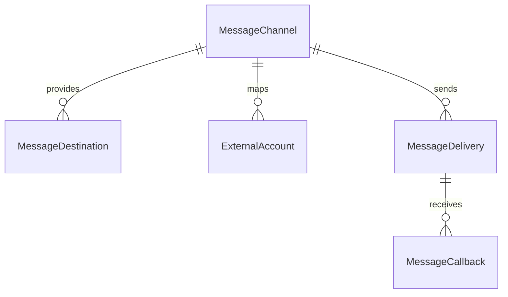
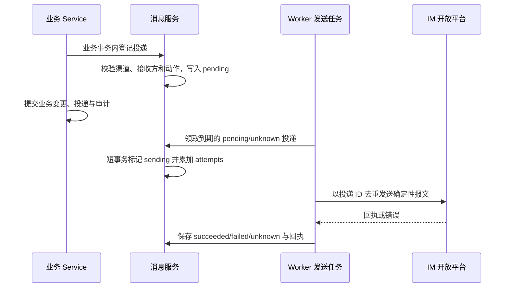
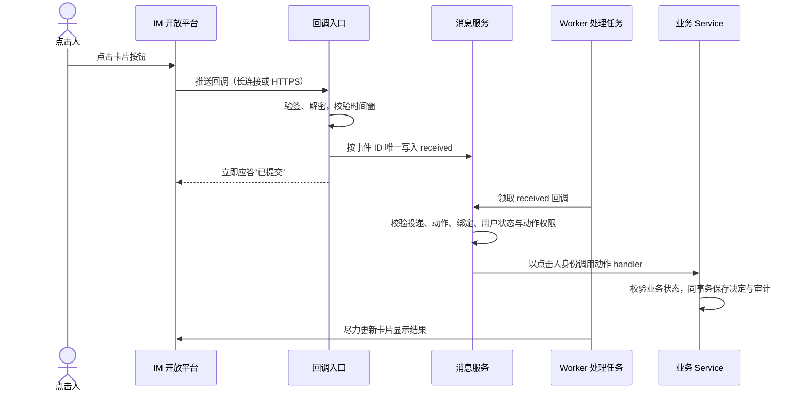

# 消息渠道

消息渠道把通知和交互卡片送到企业 IM，并把卡片上的操作按点击人的当前权限交回业务决定。业务 Service 决定发什么、发给谁、点击后做什么；平台负责渠道配置、发送登记与防重、回调验签、外部账号映射和送达事实。

本页是设计契约，尚未实现，见[目标与当前实现差异](#目标与当前实现差异)。首版接入飞书和企业微信的自建应用（可发送与交互）和群机器人（只发送到所在群）。

## 1. 范围与边界

| 能力 | 负责 |
|---|---|
| 配置 | 渠道凭据、具名接收方、外部账号绑定、启停 |
| 发送 | 与业务同事务登记、Worker 发送、按渠道去重能力有界重试、保存送达事实 |
| 交互 | 回调验签与去重、点击人映射与授权、调用业务注册的动作、尽力更新卡片 |

不建设通用消息中心、用户订阅偏好、模板引擎、群管理、聊天机器人对话或在线插件。告警等运行通知由事实所属模块判断，作为普通投递发送。消息只是通知与操作入口，业务事实以业务 Service 为准；卡片不承载业务状态。

**成功标准**：业务提交与消息登记同时成立或同时回滚；同一投递在渠道去重窗口内至多送达一次；只有已绑定、在职且具备动作所需权限的点击人能改变业务状态；渠道故障不阻塞业务事务。

## 2. 领域模型

| 对象 | 主要字段与约束 |
|---|---|
| MessageChannel | id、name、provider（feishu_app/wecom_app/feishu_webhook/wecom_webhook）、非秘密连接参数、凭据密文、is_active、配置审计字段 |
| MessageDestination | id、唯一且固定的 key、channel_id、外部会话标识、name、is_active；业务按 key 引用，不传原始外部 ID。群机器人渠道恰有一个接收方，不填外部会话标识 |
| ExternalAccount | channel_id、external_user_id、user_id；(channel_id, external_user_id) 与 (channel_id, user_id) 各自唯一 |
| MessageDelivery | 见下表 |
| MessageCallback | id、channel_id、provider_event_id、delivery_id、action_key、external_user_id、status、error_code、received_at、processed_at；(channel_id, provider_event_id) 唯一 |

| MessageDelivery 字段组 | 含义 |
|---|---|
| id、channel_id、target | 投递 ID（同时作为渠道去重键）、渠道、接收方快照（绑定用户或 destination key 及解析出的外部 ID） |
| source_module、source_type、source_id | 发起业务及其对象引用；回调只凭此定位业务对象 |
| kind、content | text 或 card；受控结构，最大 16 KiB，不含秘密 |
| actions | 卡片动作 key 列表，须为发起业务已注册的动作 |
| status、attempts、error_code | 见 [5.2](#52-发送)；attempts 计物理发送次数 |
| provider_message_id、card_update_ref | 渠道回执；卡片后续更新所需的受控凭据及期限 |
| created_at/by、sent_at、updated_at | 登记、首次发送与最近变更 |

渠道固定 provider 与所属企业；换企业、应用或群机器人须新建渠道。群机器人的 webhook 地址和签名密钥按凭据加密保存。凭据使用与模型渠道相同的 Fernet 加密方式，绑定渠道 ID 与用途；access token 只缓存在进程内存，不落库。

## 3. 渠道适配

适配器在代码中声明，随制品发布，形式同[模型渠道](model-access.md#8-多渠道模型接入设计)：负责鉴权、报文、去重参数、回执、回调验签解密和卡片渲染；不依赖 ORM、权限或 Service。中立卡片结构为标题、正文、字段（标签/值）和动作按钮（key、文案、样式）；渲染必须确定性，同一投递每次生成相同报文，不加入时间戳或随机值。渠道不支持的内容在发送前报错，不静默降级。

渠道分两类：

| 类型 | provider | 发送范围 | 交互 |
|---|---|---|---|
| 自建应用 | feishu_app、wecom_app | 绑定成员；飞书另可发到应用机器人所在的群 | 支持卡片动作与回调 |
| 群机器人 | feishu_webhook、wecom_webhook | 只发到添加该机器人的群 | 不支持；登记带动作的投递时拒绝 |

| 能力 | 飞书自建应用 | 企业微信自建应用 | 群机器人（飞书/企业微信） |
|---|---|---|---|
| 去重 | 请求带 uuid，相同 uuid 1 小时内至多成功一次；uuid 取投递 ID | enable_duplicate_check，相同请求体在间隔内（最长 4 小时）不重复送达；依赖确定性渲染 | 无 |
| 去重窗口取值 | 50 分钟 | 间隔设为 4 小时，重试截止 3 小时 50 分钟 | 不重试 |
| 卡片 | 交互卡片 | 模板卡片（按钮交互型等） | 只读卡片（飞书消息卡片、企业微信文本通知/图文展示模板卡片），按钮只能是链接 |
| 回调接入 | 长连接，由 Worker 主动连出，不需要公网入口 | HTTPS 回调 URL，Token 签名与 EncodingAESKey 解密，需要公网可达 | 无 |
| 回调时限 | 3 秒内响应 | 按官方文档核验 | — |
| 卡片更新 | 回调 token 延时更新（30 分钟内、最多 2 次） | response_code 调用一次更新 | — |
| 限频与部署 | 出站访问开放平台 | 出站 IP 加入企业可信 IP；回调域名为企业可信域名；群聊只能发到应用创建的群，首版不使用 | 飞书单机器人 100 次/分钟、5 次/秒，可配签名校验；企业微信单机器人约 20 条/分钟 |

实现前按官方文档逐项核验上表，尤其是飞书发送接口（非回复接口）的 uuid 语义、企业微信回调时限与 response_code 期限、两类群机器人的限频；核验结论写入实现参考，与本表不一致时先改本页。企业微信按内容去重意味着同一接收方在间隔内收到完全相同的消息只送达一次，业务需要重复提醒时须使内容可区分。

## 4. 业务接入

业务模块在 catalog 中显式声明卡片动作，由 composition 汇总并拒绝冲突：

| 声明 | 含义 |
|---|---|
| source_type | 业务对象类型，限定动作适用的投递 |
| action_key | 稳定动作标识，按钮只携带它 |
| permission | 点击人执行该动作所需的功能权限 |
| handler | 业务 Service 函数，入参为身份上下文、source_id、action_key |

业务在自己的事务内调用 MessagingService.enqueue 登记投递，传入接收方（Keystone 用户或 destination key）、内容和可选动作；平台校验渠道启用、接收方可解析、动作已注册，与业务变更同事务写入 pending 投递。投递取消只在 pending 时生效。业务不直接调用渠道接口。

## 5. 主要流程

### 5.1 配置

渠道、接收方和外部账号绑定是独立管理操作，各自与成功审计同事务；保存配置不发送消息。凭据只记设置/变更状态。首版由管理者手动维护外部账号绑定；通过手机号或邮箱自动匹配按需另行设计。停用渠道阻止新发送和新回调处理，已登记投递保持原状态。

### 5.2 发送

| 当前状态 | 事件 | 下一状态 |
|---|---|---|
| pending | 业务取消 | cancelled |
| pending | 领取并登记本次尝试 | sending |
| sending | 渠道明确成功 | succeeded，保存 provider_message_id |
| sending | 渠道明确拒绝（权限、接收方无效、内容不支持） | failed |
| sending | 超时、断流或无法确认 | unknown |
| unknown | 渠道支持去重，仍在窗口内且 attempts 未达 3 | sending（同一投递 ID 与同一报文） |
| unknown | 群机器人，或超出去重窗口或次数 | 保持 unknown，不再自动发送 |
| sending（进程中断遗留） | 发送任务恢复 | 视为 unknown，按上两行处理 |

发送任务由维护计划定期扫描，使用独立队列与全局并发上限，按渠道限频节奏发送；未配置渠道时没有投递，扫描只是一次走状态索引的空查询。外部请求不持业务事务；标记 sending 与发送分开提交，接受“已标记未发出”的窗口，由同一去重键重试覆盖。超出窗口的 unknown 不重发，由业务或操作者核对后决定是否以新投递再次通知。接收方绑定失效或用户停用时直接 failed，不改发他人。

### 5.3 卡片回调

| 当前状态 | 事件 | 下一状态 |
|---|---|---|
| — | 验签失败或时间窗外 | 不入库，记安全日志 |
| — | 首次收到事件 | received |
| received | 重复事件 ID | 不变，原样应答 |
| received | 投递/动作不匹配、未绑定、用户停用或无权限 | rejected，记 denied 审计 |
| received | handler 成功（含业务已处于目标状态的幂等返回） | processed |
| received | handler 业务拒绝 | rejected，保存业务错误码 |
| received | 处理中断或基础设施失败 | 保持 received，任务有界重试 |

回调只携带投递 ID 和 action_key，业务对象由投递的 source 引用定位，不信任回调中的其他值。点击人的权限是其当前角色权限，不叠加 PAT 范围，也不继承发送人身份；群卡片中任何成员点击都按各自身份判断。业务 handler 必须对重复决定幂等，以业务状态而非回调次数判定。卡片更新失败不影响已提交的业务决定。

飞书长连接由一个 Worker 持有：按渠道取得协调锁后建立连接，失锁或退出时断开，其他 Worker 等待接管。企业微信回调由 API 的公开路径接收，只验签和入库，不在请求内执行业务。

## 6. 权限与审计

| 权限 | 范围 |
|---|---|
| messaging:manage | 渠道、接收方、外部账号绑定的配置与启停 |
| message_delivery:read | 投递与回调的状态、接收方、错误和业务引用，不含消息内容 |

业务登记投递不另设发送权限：接收方只能是 Keystone 用户或已配置的 destination，内容和时机由业务入口授权负责。消息内容由业务按自身对象权限展示。

配置变更与成功审计同事务。业务决定的审计由业务 handler 写入，操作者为点击人，details 记录 via=messaging 与投递 ID；回调拒绝记 denied。发送结果保存在 MessageDelivery，不逐次写审计。凭据、access token、回调密钥和原始报文不进入审计、日志或检查点。

投递与回调记录纳入[历史清理](../operations/deployment.md#历史保留与清理)，默认保留 180 天；仍为 pending、sending 或 received 的记录不清理。

## 7. 不变量

1. 投递与业务变更同事务登记；没有提交的业务不会发出消息。
2. 自动重发只在渠道去重窗口内、使用同一投递 ID 和同一报文；窗口外不重发。
3. 回调先验签再入库，按事件 ID 去重；业务状态只由已绑定、在职且具备动作权限的点击人通过业务 handler 改变。
4. 回调不携带业务参数，业务对象只从投递记录解析。
5. 渠道停用、绑定解除和用户停用阻止新操作，已发生事实保留。

## 待确认事项

| 事项 | 当前倾向 |
|---|---|
| 飞书回调方式 | 只支持长连接；需要 HTTPS 回调时再加 |
| 外部账号绑定 | 管理者手动维护；用户自助绑定或按手机号匹配另行设计 |
| 企业微信群内交互 | 首版群内只用群机器人推送；需要群内点击时评估企业微信智能机器人（长连接、无需公网入口），另行设计 |

## 目标与当前实现差异

| 范围 | 当前实现 |
|---|---|
| 全部能力 | 未实现；本页为设计契约 |
| 凭据加密 | 仅模型接入内部使用，需先作为公共部件开放 |
| 渠道事实核验 | 第 3 节表格来自公开资料，实现前须按官方文档核验 |
