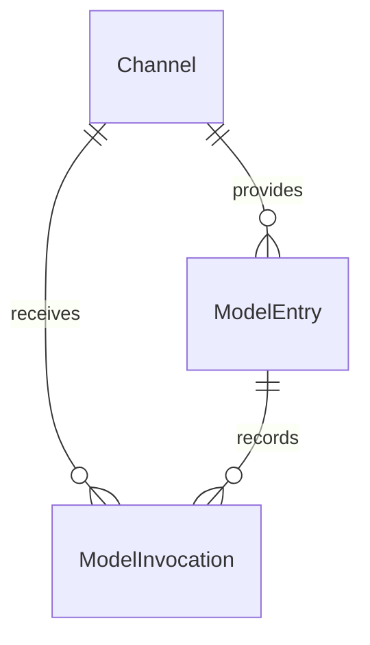

# 模型接入

本模块保存渠道、模型配置、调用/用量和供应商费用；billing 与 inference Adapter 处理协议，Service 负责授权、事务和事实，后台 Task 负责核对编排。[Flow](flow.md) 通过公开 Service 固定角色选择与累计预算，不共享领域 ORM。

## 1. 范围与边界

为后续业务提供统一的模型调用入口，记录每次调用的用量、上游报告的费用，并展示渠道账户的余额。采用“成熟调用 SDK＋少量渠道适配代码”，不要求独立网关。

当前实际发送开放 OpenRouter、Openlux 和 Yunwu，复用 OpenAI SDK 的文本对话及流式协议。OpenRouter 可保存响应费用并按请求 ID 补查，Openlux/Yunwu 使用原 Token 分页核对日志。DeepSeek、阿里云百炼保留适配声明，尚未开放发送。阿里云暂按百炼/DashScope 按量付费服务设计，不把订阅额度混为账户余额。图片与异步任务能力见[模型操作与产物](#6-模型操作与产物)。

只保留渠道、模型配置、调用记录三个对象。不做用户钱包、充值、配额分配、计费倍率、价格表、自动渠道切换或智能路由。这里记录的是供应商侧成本，不是向 Keystone 用户收费。

## 2. 领域模型

| 对象 | 职责 |
|---|---|
| Channel（渠道） | 配置如何连接某个上游账户，保存最近查询到的余额 |
| ModelEntry（模型配置） | 给业务一个稳定的模型 key，映射到某个渠道的上游模型 |
| ModelInvocation（调用记录） | 记录一次本地调用尝试的归属、结果、用量和可获得的费用；不证明上游已收到请求 |



调用、渠道和模型配置使用三张主表，另有真实凭据范围的 ModelDispatchScope 发送协调表。余额快照和用量是结构化字段，不单独建表；渠道适配器是代码实现，不是领域实体。

### 2.1 渠道 Channel

| 字段 | 含义 |
|---|---|
| `id`、`name` | 稳定 ID、展示名 |
| `provider` | `deepseek`、`openrouter`、`aliyun_bailian`、`openlux`、`yunwu`，决定适配实现 |
| `api_base` | 经管理员配置的服务地址，包含相应地域/站点差异 |
| `api_key_encrypted` | 推理 API Key 密文，接口不返回 |
| `billing_api_key_encrypted` | 可空，账务 API Key 密文，接口不返回 |
| `upstream_account_ref` | 上游账户的非秘密标识，用于说明余额归属；无法获得时可空 |
| `is_active` | 是否允许新的模型调用 |
| `balance_snapshot` | 可空，最近成功查询的余额结构 |
| `balance_checked_at` | 最近成功采集余额的时间 |
| `balance_last_attempt_at`、`balance_check_status` | 最近查询时间及结果：`never`、`ok`、`error`、`unavailable` |
| `created_at` | 创建时间，服务端生成，UTC，必填 |
| `created_by` | 创建操作的用户 ID，系统操作可为空 |
| `updated_at` | 渠道配置最近修改时间，UTC，创建时与 created_at 相同 |
| `updated_by` | 渠道配置最近修改操作的用户 ID，系统操作可为空，创建时与 created_by 相同 |

`balance_snapshot` 包含 `scope`、`items`；每项包含 `kind`、十进制 `amount`、`unit`。`scope` 说明是供应商账户或阿里云账户；`kind` 区分总余额、现金、赠送等，`unit` 明确为 CNY、USD 或供应商 credits 等单位。来源由渠道适配实现确定。

各渠道字段映射见本页[渠道能力](#33-渠道能力)。不同币种和余额分项不直接相加。成功刷新原子替换快照与采集时间；失败只更新本次查询结果，不清空旧余额。未查询/不可用不能显示成零。

保留旧余额仅适用于同一查询配置下的失败。影响余额查询来源的配置（地址、账务凭据，或余额适配实际使用的推理凭据等）变更时，同事务清空余额快照与成功/尝试时间，将 balance_check_status 重置为 never；只改名称或启停不清空。provider 和账户归属创建后固定，不能通过更改 upstream_account_ref 将原渠道改作其他账户；该标识未知时可补录同一账户标识。替换秘密也必须保持同一账户，无法确认时新建渠道。

updated_at、updated_by 只追踪渠道配置变更；余额刷新使用 balance_checked_at、balance_last_attempt_at 表达，不覆盖最后的配置修改人。

余额刷新保留同渠道会话锁。快照、查询结果与审计写回使用持锁连接上的短事务，外部 HTTP 不保持业务事务；连接丢失后禁止换连接提交，即使已收到余额响应也必须回滚，保留原快照。不能以一次写前检查代替持锁连接内的原子提交；查费的真实 Token 范围锁另按第 3.6 节处理。

同一供应商可以配置多个渠道。首版不建立独立供应商账户或余额流水表，也不计算跨渠道余额总和。允许同账户内轮换密钥；换供应商、换账户应新建渠道，避免历史调用与余额归属混淆。余额查询配置不完整时仍可保留模型调用能力。

自动查费遵守适配器声明的查询范围：账户相同不代表不同 Token 能互查日志。Yunwu/Openlux 的配置接口禁止更换 Token 或站点，返回 channel_query_scope_fixed；相同 Key 重存、名称和启停修改不受影响。换 Token 必须新建 Channel，旧渠道保留核对凭据。OpenRouter 凭据变更会产生新范围，无法验证的历史待办阻塞，不能自动转交新 Key。

### 2.2 模型配置 ModelEntry

| 字段 | 含义 |
|---|---|
| `id` | 稳定 ID |
| `key` | 业务使用的唯一 key，创建后固定，例如 `general-chat` |
| `channel_id` | 所属渠道 |
| `provider_model` | 上游接受的模型标识 |
| `operations` | 管理员声明的明确操作集合，默认 text.generate；可发送能力还须与已实现协议匹配 |
| `is_active` | 是否允许新调用 |
| `created_at` | 创建时间，服务端生成，UTC，必填 |
| `created_by` | 创建操作的用户 ID，系统操作可为空 |
| `updated_at` | 最近修改时间，UTC，创建时与 created_at 相同 |
| `updated_by` | 最近修改操作的用户 ID，系统操作可为空，创建时与 created_by 相同 |

一条配置只映射一个渠道和一个上游模型。界面直接展示 key，不单独保存模型配置的展示名。业务不接触渠道密钥；映射修改不需要业务改 key，但模型能力和行为变化仍需业务验证。历史调用保存当时的渠道和模型，不能通过当前配置反推。

普通直接调用在本次尝试开始时解析 key；Flow 在受理时固定模型选择，映射修改只影响之后受理的运行，规则见[固定模型选择](#34-flow-的固定模型选择)。

首版不引入模型家族、模型版本、路由池、价格方案或通用能力注册表。模型与渠道都启用才允许发起新调用；停用不修改已有调用记录。

Channel、ModelEntry 首版都只停用、不删除，统一使用已有 is_active，不增加 deleted 状态、deleted_at 或回收站。停用 Channel 阻止该渠道的新调用，但不批量修改其 ModelEntry；重新启用渠道后，仅模型配置自身也启用时才能调用。单独停用 ModelEntry 只阻断该配置的新调用。

停用配置仍可由有权限的管理者查询、修改或重新启用；ModelEntry.key 继续被原配置占用，不回收给另一条配置。允许误建配置以停用记录留存，省去物理删除与引用清理分支。旧 Run 仍关联原配置，但原模型或渠道停用时明确拒绝新调用；已发送请求继续保存结果、用量和费用，历史数据不改写。

停用是 Keystone 的调用控制，不等于撤销供应商密钥，也不自动清除已保存的渠道凭据。管理员可在控制台替换 API Key、清除可选账务 Key；供应商侧的撤销由操作者处理，配置与历史记录继续保留。

### 2.3 调用记录 ModelInvocation

| 字段 | 含义 |
|---|---|
| `id` | 本地调用尝试 ID；Flow 内每次持久模型请求使用可在恢复时复现的稳定 ID |
| `user_id` | 发起用户；系统调用可空，由可信服务端确定 |
| `flow_context` | 可空的小型 JSON：flow_run_id、model_role、node_key、agent_key、agent_call_id、可空 workflow_id/step_id，按实际调用场景填写；普通调用为空 |
| `model_entry_id`、`channel_id` | 本次使用的模型配置与实际渠道 |
| `provider_model` | 本次上游模型标识快照 |
| `upstream_request_id` | 上游返回的请求/generation ID；未收到时可空 |
| `operation` | 本次固定的语义操作，历史缺失按 text.generate 解释 |
| `result_context` | 私有 TaskReceipt/ImageManifest 恢复证据，公共调用视图不返回 |
| `status` | `running`、`succeeded`、`failed`、`unknown` |
| `finished_at` | 可空，本地调用处理结束时间，开始时间使用 `created_at` |
| `usage` | 可空的结构化用量，保存上游提供的输入、输出、缓存等计量信息 |
| `cost_amount`、`cost_unit` | 可空，上游报告的本次账户费用及对应单位 |
| `cost_source` | `response`、`query` 或 `unknown` |
| `cost_note`、`error_code` | 可空，费用缺失/补查失败的简短原因及脱敏错误分类 |
| `created_at` | 本地调用尝试登记时间，服务端生成，UTC，必填；不是精确网络发送时间 |
| `updated_at` | 状态、用量或费用最近补全时间，UTC，创建时与 created_at 相同 |

`running` 表示本地尝试尚未结束，不证明请求已经发送或被上游接受；`succeeded` 表示收到正常完成结果，`failed` 表示已知失败，`unknown` 表示无法确认是否已发送或上游是否完成。状态都不代表是否收费。进程中断遗留的 running 只在确认执行已结束后标记未知，不能仅因经过一段时间就把仍在执行的请求改成 unknown；未知结果不自动重发。

`usage` 缺失的分项保持缺失；缓存、推理 token 可能是其他分项的子集，不重复求和。费用已知时必须同时有金额、单位和来源；未知时金额和单位为空、来源为 `unknown`，原因可写“上游未提供”或“等待查询”。

费用补查只补全同一记录，不新增调用、不累加原金额；失败保留已知费用。费用来源表示上游报告口径，不保证与最终发票、税费、退款或外部 BYOK 账单完全一致。首版不建立账单对账或结算状态机。

原记录内保存费用核对状态、调度信息、原查询范围及必要证据，仍是调用事实记录。调用结果与费用核对状态彼此独立，字段、迁移边界和保存规则见[自动费用核对](#36-自动费用核对)。

一条记录对应一次本地调用尝试，不等于一次聊天会话或一个业务任务，也不证明上游实际收到请求。对同一尝试的结果补全以本地 ID 更新；历史渠道/模型归属不因配置变更而改变。调用用户归属由 user_id 表达，Flow 关联由 flow_context 表达，状态和费用由服务端补全，不增加 created_by、updated_by。updated_at 用于判断记录最近是否得到补全，不表示一次人工编辑。

Agent 一次运行可能发起多次模型请求，每次实际请求都独立记录，不能只在 agent.run() 外面记一条总调用。flow_context 由可信执行上下文生成，只用于追踪，不是权限凭据，也不保存消息或 SDK 对象；相同 Agent 调用中的多轮请求共用 agent_call_id，但各有自己的调用记录 ID。普通业务按需在自身数据中保存调用 ID，模型接入模块不反向保存通用业务关联号。

## 3. 主要流程

### 3.1 SDK 与适配器

业务通过稳定的模型配置 key 发起调用，模块解析渠道和上游模型，再交给 SDK。

渠道适配代码仅处理必要差异：

- 从响应中提取请求 ID、用量和上游报告的费用。
- 支持时，按上游请求 ID 查询费用，补全已有记录。
- 使用渠道对应接口查询账户余额。

不支持的能力直接返回“不可用/不支持”，不为了统一接口编造金额。沿用普通适配类和显式 provider 注册，cost_query_mode 区分请求直查、日志分页和不支持；不增加插件系统或独立账务服务。OpenAI 兼容只说明推理格式相似，不能据此推断查费路径、凭据范围或金额单位相同。

调用协议位于 adapters/inference/、费用和余额协议位于 adapters/billing/，Service 保留业务用例、权限与事实保存。多个中转站复用调用协议、分别选择账务适配；adapters/billing/ 不再复制一套 Controller/Service/Model，也不直接持久化费用。详细边界见第 8 节。

### 3.2 调用与余额刷新

1. 校验输入、当前身份、调用权限及模型/渠道启用状态，在即将发送前创建并提交调用记录；记录失败则不发起上游请求。Flow 还需遵守下文的原子登记与防重发规则。
2. 发起请求，保存上游请求 ID、用量、结果状态和可获得的费用。流式请求在流结束后更新，缺失末尾用量时不补造数据。
3. 可信响应费用直接确认；缺少费用且具有原查询范围及合法请求 ID 时，同事务保存 pending，Worker 后续自动核对。授权管理者也可显式补查，复用同一服务。没有请求 ID 或不支持查询时保留未知原因。
4. 有管理权限的用户可手动刷新渠道余额；API 直接调用本模块，在有界超时内查询并保存结果，不返回需要 Worker 接续的后台任务。不在每次模型调用前后查询余额，首版不安排定时同步。

每次实际发往上游的尝试必须对应一条记录，但记录可能在发送前的中断窗口内已创建，不能反过来把每条记录都算成上游已接受请求。首版关闭 SDK 的自动重试；收到响应后记录更新失败也不能触发模型重试。以后若允许新的重试尝试，必须逐次使用不同 ID 记录，不能覆盖原尝试；Flow 的同一请求恢复不属于新的获准尝试。Flow 调用通过已有 flow_context 关联，普通业务自行保存相关调用 ID，不新增通用业务关联号字段。

超时、断流或进程中断可能无法确认上游结果，记为 `unknown`，不能推断没有收费。硬退出或结果写回失败可暂时遗留 running，只有确认原执行已结束后才能收尾；普通 API 调用使用下述离线命令，Flow 调用由持有排他锁的 Worker 启动恢复。调用结果和费用是否已知相互独立；补查失败不改变已经成功的调用结果。调用记录不是持久化任务或业务会话。

请求发出后用户停用、权限收回或原令牌失效，不阻断该次调用的响应处理和记录补全。已有尝试的状态、用量和费用继续由可信执行上下文或受限系统维护补齐，user_id 仍保留原始归属；费用补查只核实原请求，不重新推理。撤权后的新请求仍拒绝，用户查询记录也必须通过当前权限检查。

余额刷新失败时保留上次成功快照，显示采集时间和本次失败状态。余额只是有时间戳的上游观察值，不用于保证下一次调用一定成功，也不用余额前后差计算单次费用。多个渠道共享同一上游账户时不能重复汇总，首版仅逐渠道展示。

余额查询分为读取当前配置、事务外请求、短事务写回三段；同渠道刷新串行协调，并与影响查询的配置变更协调。写回前确认仍对应原查询配置，过期结果丢弃，不能覆盖新配置的快照；不为此增加刷新请求表、任务状态或版本字段。API 中断时不承诺请求已完成，保持最后已确认信息，可再次手动查询。渠道停用只禁止新推理，不禁止授权管理者查询历史、补查费用或刷新余额。渠道余额刷新是本模块的简化规则，不声称复用现成实现。

### 3.3 渠道能力

OpenRouter 等官方能力依据下列文档；Yunwu/Openlux 另有实测依据。Keystone 回归使用隔离数据库和本地协议桩，没有发送付费模型请求。

| 渠道 | 单次调用费用 | 账户余额 | 首版处理 |
|---|---|---|---|
| DeepSeek | 已核对的对话响应提供用量，未提供单次金额 | `/user/balance` 提供分币种的总余额、赠送余额和充值余额 | 保存用量；费用未知；首版不开放余额刷新（仅保留解析声明） |
| OpenRouter | 响应 `usage.cost`；也可按 generation ID 查询 | `/api/v1/credits` 返回累计 credits 和使用量，需要 management key | 保存上游报告费用；必要时查询补全；支持余额刷新 |
| 阿里云百炼 | 尚未确认可按推理请求 ID 查询单次实际金额的接口 | `QueryAccountBalance` 查询阿里云账户，区分可用额度和现金余额 | 保存用量；费用未知；首版不开放账户余额查询（仅保留解析声明） |
| Yunwu/Openlux | 原 Token 分页拉取日志，本地精确匹配 `other.request_id` 与 `x-api-request-id`，按站点口径解析 quota | 不提供余额查询，Token 用量不视为账户余额 | 已接入自动核对和手动补查；详见第 3.6 节 |

DeepSeek 的余额解析保留接口返回的币种，总余额已经包含赠送和充值部分，不重复相加；首版未开放查询，因此余额状态为 unavailable。费用未知仅表示当前接入能力不足，不断言供应商永远没有相应能力。依据：[余额接口](https://api-docs.deepseek.com/api/get-user-balance/)、[对话响应](https://api-docs.deepseek.com/api/create-chat-completion/)。

OpenRouter 的 `usage.cost` 表示该账户被收取的 credits；流式用量在最后的 SSE 消息中。不要用 `upstream_inference_cost` 替换账户费用，尤其 BYOK 还涉及外部供应商收费。余额由 `total_credits - total_usage` 得到，保留 credits 口径，不能当作某个 API Key 的独享额度。依据：[用量与费用](https://openrouter.ai/docs/cookbook/administration/usage-accounting)、[余额与凭据要求](https://openrouter.ai/docs/api/api-reference/credits/get-remaining-credits)。

阿里云余额接口的 `AvailableAmount` 是可用额度，`AvailableCashAmount` 是现金余额，展示时分别标明；首版仅有解析声明，不发起查询。它们属于阿里云账户，可能同时供其他云产品消费，并非百炼专属余额。查询需要阿里云 OpenAPI 账务授权，不能直接使用 DashScope API Key。依据：[账户余额接口](https://help.aliyun.com/zh/user-center/developer-reference/api-bssopenapi-2017-12-14-queryaccountbalance)。

百炼账单存在出账延迟和聚合口径，出账也不等于即时扣款。首版不抓取控制台、不把聚合账单摊分成单次“实扣”；后续确认能够精确关联请求的官方数据后再补全。依据：[账单与费用管理](https://help.aliyun.com/zh/model-studio/bill-query-and-cost-management)。

### 3.4 Flow 的固定模型选择

**当前实现。** 用户在 model_bindings 中按角色提交 ModelEntry key，受理时解析全部角色，固定 model_entry_id、channel_id、provider_model、provider 和 api_base，写入 format=2 快照。业务 input 不混入 Selection；客户端不能伪造解析结果。角色、文件引用、Run 和审计同事务提交，见[Flow 角色绑定](flow.md#3-受理与幂等)。

同一 Run 始终使用保存的选择，不在每次执行或恢复时重新解析当前 key 映射。每次真正发送前仍检查当前用户、原个人令牌、原 ModelEntry 与原 Channel 是否有效；原配置停用或不存在则明确拒绝。对 format=2 Run，Entry 的 channel_id/provider_model 或 Channel 的 provider/api_base 与固定值不一致即拒绝。旧 Selection-in-input 数据保持原样，旧在途执行仍由原制品收尾。

允许原渠道在同一账户内轮换凭据，发送时读取当前秘密。原渠道 api_base 与保存值不一致时拒绝发送，不能静默改用新地址；更换供应商或账户必须新建 Channel。ModelInvocation 记录这次实际采用的渠道和模型。

Token 级查费适配固定原查询范围，换 Token 按第 2.1 节新建 Channel。已有 Run 的固定选择不改到新渠道，不能为完成旧查费而放宽 Flow 的新请求授权或目标校验。

Flow 的 request_digest 依据用户原始提交计算，不包含服务端解析结果。重复发起先按原请求检查幂等并返回原 Run，不因当前映射变化而重新解析或改写其 input/绑定快照。

### 3.5 Flow 模型请求的恢复与防重发

复用 ModelInvocation.id 作为每次持久模型请求的稳定标识，由执行上下文确定，恢复同一请求时必须得到同一 ID。不能只使用 agent_call_id：一次 Agent 调用中的多轮模型请求各有自己的 ID。

1. DBOS 已有可恢复的模型结果检查点时，直接复用结果，不新增调用记录、不再次发送。
2. 需要执行请求时，在发送边界原子创建 ModelInvocation，利用 ID 唯一约束取得首次发送资格。只有首次成功登记的执行者可以发送；冲突或不确定是否登记成功都不能取得发送资格。
3. 已有调用记录但没有可恢复的结果时，停止该次执行并报告明确错误，例如 `model_result_unavailable`；即使调用状态为 succeeded 也不能重发，因为费用记录不能替代丢失的模型响应。Flow 的恢复失败不覆盖已经确认的调用成功状态。

该规则宁可在“已登记、尚未发出”时中断，也不在恢复时猜测可以重发。可靠的上游查询可以核实原请求结果或费用，但不能借查询重新发起推理。首版不增加发送意图表、额外状态或保存模型响应的字段，也不使用 File 保存防重发标记。

这是复用现有调用表的设计选择，不等于供应商侧 exactly-once 保证。实现时必须验证稳定请求身份、原子登记以及 DBOS/Agent 内部恢复边界；仍用于恢复防重发的调用记录不能提前清理。

### 3.6 自动费用核对

本节对应当前实现。复用 ModelInvocation、Channel、现有 Worker 和 DBOS，不新增业务 Flow、通用 JobRun、账本或独立查费进程。费用是上游报告的账户消耗；不根据 token 数、公开价格或账户余额差估计单次实扣。

#### 3.6.1 通用适配与结果分类

| 适配能力 | 渠道适配器负责 | 公共核对服务负责 |
|---|---|---|
| 响应直接提供费用 | 提取明确的账户扣费、单位及可信编号，声明其费用口径 | 保存可信费用并确认，通常无需补查 |
| 请求 ID 直查 | 查询路径、参数、鉴权、返回编号校验、金额解析，例如 OpenRouter | 按原调用查询和幂等补全 |
| 日志列表查询 | 时间筛选、分页、凭据可见范围及日志解析，例如 Yunwu/Openlux | 按原查询范围合并拉取，逐条精确匹配 |
| 不支持查询 | 明确能力边界 | 保留未知原因并停止自动查询，不编造金额 |

适配器返回已找到、尚未生成、暂时失败、需要修复配置或不支持等明确结果；保留安全原因码和有效 Retry-After。HTTP 200 还须校验业务 success、响应结构和记录内容；404 只有在已确认的查询契约明确表示“该请求尚无记录”时才归为等待，错误路径不能伪装成未出账。端点、方法、鉴权位置和编号来源由代码显式声明，不接受客户端任意导入路径、URL 或解析脚本。

#### 3.6.2 Yunwu/Openlux 的已验证契约

依据为 2026-10-21 的实际图片调用及只读查费探针；2026-10-22 复核了站点公开金额配置。Keystone 使用该协议实现并通过本地回归；上游真实出账时效和大流量容量仍需部署后观测。

该渠道实际使用 `https://api.openlux.ai`。已验证查询如下，路径从受控账务 origin 构造，不能直接拼在推理 `/v1` 后面：

```http
GET https://api.openlux.ai/api/log/token?key=<原调用API_KEY>&start_timestamp=<开始秒>&end_timestamp=<结束秒>&p=1&page_size=20
```

| 项目 | 已验证行为及约束 |
|---|---|
| 鉴权与范围 | key 查询参数可查日志，仅用 Bearer Header 的探针未成功；按原 Token 查询，不假定同账户另一枚 Key 可见旧日志 |
| 返回与分页 | 读取 data.items 和分页信息；p 从 1 开始，page_size、时间范围可用，other 可能为 JSON 字符串 |
| 请求编号 | 日志 other.request_id 精确匹配响应头 x-api-request-id；同次响应的 x-oneapi-request-id 是另一编号，不能直接替代 |
| request_id 参数 | 传入不存在的 request_id 仍返回普通日志列表，不能依赖该参数完成服务端精确筛选 |
| 日志 id | 同条日志随分页/页大小出现不同 id，不用作稳定账单编号、递增水位或幂等键 |
| 扣费依据 | 读取明确的消费记录及其 quota、单位口径；不从日志 content 中的模型倍率重新估价 |

适配器使用 site、原查询范围和查费 request ID 确定匹配对象；时间、模型和组等元数据只用于缩小范围或校验，不能通过相近 token 数、时间或“只有一条记录”代替请求 ID。重复页只幂等补全同一调用；多条记录互相矛盾，或同一外部请求已绑定另一条调用时，转为阻塞，不擅自求和或重复计费。

样本为 `quota=1328`、`quota_per_unit=500000`、`currency_type=USD`，得到 `0.002656 USD`。金额按 Decimal 精确计算；样本中的人民币换算只是展示参考，不是实际充值成本。复核时 [Openlux 公开配置](https://api.openlux.ai/api/status)为 USD，而[旧 Yunwu 公开配置](https://yunwu.ai/api/status)为自定义额度，不能统一视为美元。原站点和换算口径须随调用保存；历史口径不明时保留额度证据和未知原因，不套用当前配置重解释旧费用。旧 Yunwu 和 Openlux 不通过修改原 Channel 地址混用历史。

实现只允许 Openlux `https://api.openlux.ai/v1`、Yunwu `https://yunwu.ai/v1`。调用保存适配器口径；每轮日志查询先读取公开 `/api/status` 校验 quota_per_unit=500000、对应币种。Openlux 为 USD，Yunwu 要求 CUSTOM 且 custom_currency_exchange_rate=1，落库单位为 yunwu_credits。变化时 blocked/cost_policy_changed，不用新口径解释旧调用。只解析 type=2、非负整数 quota，并校验匹配日志的模型名。

#### 3.6.3 回执、查询范围与凭据

回执观测由适配器明确选出可查费编号，尽早保存到调用记录；可保留少量其他响应编号供诊断，不能被响应体模型 id 无条件覆盖。Yunwu/Openlux 优先使用已验证的 x-api-request-id，OpenRouter 保留其 generation ID 规则。没有合法编号时费用保持未知，不生成猜测编号；硬中断发生在编号持久化之前时不能承诺自动找回费用。

查询范围由实际账务站点和原凭据可见范围确定。原 Token 与其他 Token 不能只因账户相同就混查；首版换 Token 新建 Channel，旧渠道保留必要密文凭据。范围未变的轮换仍须可验证，无法确认则阻塞，不静默替换历史范围。相同真实 Token 重复配置为多个 Channel 时也属于同一协调范围，不能靠不同 channel_id 绕过防重或限流。

任务参数只包含调用、渠道、范围标识和受控分页位置，不包含秘密或完整日志。凭据在受控服务内执行时解密，查询前后复核原范围和配置；变化后的旧结果丢弃。key 位于 URL 查询串时，日志、HTTP 异常、追踪和 DBOS 保存的错误均须脱敏，不保存完整 URL 或上游原始错误；只保存费用所需的规范化证据，不保存日志里的账号、IP 或完整 content。只访问显式允许的 HTTPS origin、路径和方法，不自动跳转。

#### 3.6.4 调度与分页推进

调用结束的短事务同时保存回执和费用待办，API 不负责即时投递。只有已结束且费用核对 pending、next_check_at 到期的记录可被扫描；运行中的调用沿用原收尾机制，不能为了查费按时间改判 unknown。调用 succeeded、failed、unknown 均可能产生费用。

model_access/tasks/workflows.py 由 composition 显式装配：启动投递一次，此后 DBOS 每 5 秒扫描。稳定计划名为 keystone.model_access.reconcile_costs。扫描使用 keystone-model-maintenance 串行队列，每轮最多投递 20 个到期范围；外部查询使用 keystone-system，默认全部 Worker 与 API 手动入口共享查费并发 2，同一查询范围串行，并与推理容量隔离。Worker 仅提供 DBOS 执行包装，费用扫描和核对规则由本模块 Service 提供，计划与容量语义保持不变。

请求直查按调用处理；日志查询按原 Token 范围和相近时间窗口合并，单页可确认多次调用。每次执行限制页数和总耗时，单次 HTTP 使用明确超时；未完成则保存固定起止窗口、下一页和本轮匹配范围，后续继续。该小型 checkpoint 归原 Channel，费用和进度协调写入，不新增分页任务表。下一页只在本页匹配结果提交后推进，崩溃后可安全重读同一页。

当前每批最多 20 条调用、每页 20 条日志、每次最多 2 页/25 秒，单次 HTTP 最长 10 秒。窗口从本批最早登记时间前 120 秒到本轮开始时间；后续分页不修改边界。未扫完约 5 秒后继续，完整覆盖后才确认费用。相同站点/Token 通过服务端 HMAC 生成不含秘密的 scope，选最早创建的 Channel 保存共享 checkpoint、阻塞和冷却；API 与 Worker 共用 PostgreSQL session advisory lock，查询期间不持有业务事务。

每进程最多 2 个查费流程，取得数据库协调连接之前即受限，避免大量手动补查占满连接池。日志响应上限 256 KiB、公开口径响应上限 1 MiB；只保存有界请求 ID、模型名、额度及单位等规范化证据，拒绝过深 JSON 或异常结构。

分页未完成只表示本轮未覆盖完，不判定未找到，不消耗一次完整“未找到”核对轮次。完成一轮仍未匹配时，才安排下一轮退避。后续轮次从窗口起点重新扫描，允许重叠以捕获延迟写入或分页移动的记录；不能仅凭最后一个日志 id 或最高时间永久跳过旧窗口。新待办不能不断改写正在扫描的窗口，扫描顺序须避免少数渠道或历史大窗口饿死后续待办。

同一执行重复投递沿用稳定 ID，运行中的同范围任务按范围及 execution_version 合并；下一轮使用新执行 ID，避免复用过期查询检查点。API 退出、Worker 重启或技术任务丢失后仍可从领域待办继续发现；DBOS 恢复可能重复只读 HTTP，因此费用写入和进度推进都须幂等。扫描器不占住受限队列等待自身派生查询完成。

#### 3.6.5 等待与重试

以下为当前默认值，不是供应商的账单时效承诺。自动窗口从调用结束起计 24 小时；停机不重新起算。首次约在结束后 10 秒到期，完整扫描仍未找到时依次约在结束后 30 秒、2 分钟、10 分钟、1 小时、6 小时和 24 小时核对，调度粒度允许数秒延迟。

| 结果 | 处理 |
|---|---|
| 找到唯一可信扣费 | 保存 confirmed，清除 next_check_at，停止自动轮询 |
| 本轮完整扫描无匹配 | 保持 pending，按上述时间安排下一轮；空列表不代表零费用 |
| 超时、连接失败、5xx | 保存暂时失败原因并有界退避，可从 30 秒逐步增至最长 1 小时并加少量抖动；等待不持有 workflow/数据库锁 |
| 429 | 优先遵守有效 Retry-After，持久化整个查询范围的下次允许时间，不逐条待办继续冲击同一 Token |
| 401/403、缺少凭据、范围不匹配 | blocked，暂停该范围，修复并确认仍属原范围后才重新触发 |
| 响应结构、金额或匹配冲突 | blocked，保留原已知费用和安全原因，等待人工核实或修复适配器 |
| 无可用编号或无查询能力 | unavailable，保留未知原因；不能无限自动重试 |
| 到达自动窗口或有界错误重试预算 | exhausted，保留未知及证据，停止自动查询，不标记免费 |

传输失败与未出账等待分开计数，暂时性错误最多自动重试 12 次，不含首次请求，并与 24 小时窗口共同约束；查询成功不重置累计错误预算。退避从 30 秒倍增至约 1 小时，附加 ±20% 抖动；有效 Retry-After 优先，支持秒数与 HTTP 日期。分页继续不重置截止时间，也不作为完整未找到轮次计数。24 小时是截止上限，不保证调度延迟后补跑最后一轮；迟于截止时间时直接 exhausted，晚于截止时间的 Retry-After 不引起越窗查询。SDK 不做隐藏重试；下一次业务查询由持久 cost_next_check_at 驱动，不为每笔费用建立长期 sleep 循环。所有重试仅查询账务，禁止重新推理。

手动补查保留现有 model:manage 和记录读取权限，与自动核对共用范围互斥、适配器和保存规则，不另建一条可绕过凭据范围的路径。日志查询超出同步预算时保存待办并返回尚未确认的状态，不在 API 请求中扫描无限页。对 blocked/exhausted 的重新触发由授权管理者显式执行，不因普通页面轮询无限重置预算。

#### 3.6.6 费用状态与落库

费用字段、到期索引及发送归属直接包含在 model_access 基线迁移中，不再单独追加。内部 JSON 和范围不通过接口自动暴露。

| 归属 | 需要持久化的事实 |
|---|---|
| ModelInvocation | cost_check_status：pending、confirmed、blocked、unavailable、exhausted；cost_check_reason、cost_check_rounds、cost_check_errors、cost_checked_at、cost_next_check_at、cost_deadline_at，显式返回调用详情与列表 |
| ModelInvocation | cost_context 保存原站点/凭据范围和口径，receipt_ids 保存必要响应编号，cost_evidence 保存规范化额度、单位、口径和证据时间；三者为内部字段 |
| Channel | cost_scope、cost_context、cost_block_reason、cost_next_allowed_at、cost_checkpoint 为内部字段；凭据仍使用原受控密文，不进入 checkpoint |

cost_check_status 与调用 status 分开，查到账务不改变 succeeded/failed/unknown，也不把已结束 Flow 重新置为运行中。已知费用仍使用 cost_amount、cost_unit、cost_source；查询写入 source=query，明确可信的响应费用使用 response。未确认金额和单位保留 null，只有上游明确报告零消耗才记录 0。查费错误另存，不覆盖模型调用 error_code。

重复结果只补全同一调用，不创建新 ModelInvocation、不累加金额或用量。保留 Numeric(38,18) 和 Decimal，不能经过二进制浮点估价；按渠道及单位汇总，不跨旧 Yunwu 自定义额度、Openlux USD、OpenRouter credits 或人民币参考值相加。查询失败不清空已知金额；新的可信实际查询替换原响应费用时保留前后证据，矛盾记录不能静默覆盖。

外部 HTTP 在短业务事务之外；写回前检查原查询范围、配置、调用状态及本轮 checkpoint。费用、证据、进度和需要的审计同事务保存，旧查询或失去协调所有权的执行不得推进新轮次。常规自动确认保存在调用记录及必要证据中，不为每页或每次未找到复制管理审计；显式重查仍写 `model.cost.recheck`，保留实际操作者与原核对状态。

确认后停止自动轮询，本阶段不自动推断退款、负数费用、冲正或长期账单修订。不明历史口径、矛盾记录和窗口耗尽均保留未决；不能把已知费用汇总称为全部调用的最终实扣。

#### 3.6.7 多 Worker 的协调与恢复

查费允许重复只读查询，费用确认保持幂等。所有 Worker 和 API 手动补查通过 PostgreSQL 共享查询容量、真实 scope 会话锁、Channel 分页 checkpoint 和持久冷却。准备与写回在持锁连接的短事务内校验所有权，连接失效后禁止换连接提交。写回比较原配置、轮次和 checkpoint revision，每次推进递增 revision，防止旧页结果覆盖新进度；不同 Channel 指向同一真实 Token 时也不能并行推进同一范围。

DBOS 投递去重不代替上述保护，进程内 Semaphore 只控制本地资源。查询总容量默认 2，可通过 model_cost_concurrency 调整；拿不到容量时自动待办保留、手动入口返回忙碌，不消耗错误预算。Retry-After 在实例间共享，不能将预算乘 Worker 数。固定身份、按旧实例收尾及原身份重启恢复见[整体架构第 3.5 节](../architecture.md#35-多-worker恢复与发布)，不自动接管故障槽位。

## 4. 权限与审计

管理操作日志采用 [AuditLog](audit.md)，ModelInvocation 继续负责每次调用的用量与费用记录。

沿用现有用户、个人令牌和 Casbin。模型调用、渠道管理与调用记录读取分别授权；模型调用权限不自动授予历史记录读取权。普通用户只能查看可调用模型的非敏感信息；首版不增加逐模型授权表，需要按业务对象限制时由业务模块检查。

首版将调用及普通可用模型目录明确为 model:invoke；配置管理、管理配置查询与账户余额查看/刷新统一使用 model:manage，不再细分余额权限。invoke 不授予 manage 或历史记录权限；manage 也不隐含 invoke。普通目录仅返回启用且所属渠道启用的模型 key 和必要能力说明，不返回内部地址、密钥配置状态或余额。配置管理接口仅返回非秘密值，普通调用者不能指定渠道密钥。功能权限由代码声明，不增加逐模型授权关系。

配置接口允许 model:manage 管理者录入或更新 API Key，不提供读取已保存密钥内容的接口；api_base 不允许内嵌凭据，Flow 选择快照只保存非秘密地址。调用记录视图也不通过关联 Channel 泄露凭据状态或账务配置。凭据配置失败以脱敏错误返回，不把 SDK 原始异常作为错误详情。

| 调用记录权限 | 范围 |
|---|---|
| model_invocation:read | 读取本人调用记录与本人费用汇总，按 user_id=当前用户过滤 |
| model_invocation:read_all | 在已有 read 权限的基础上，扩大至其他用户与 user_id 为空的系统记录 |

read 与 read_all 都属于代码权限目录，不增加授权表。会话与 PAT 都检查权限，PAT 使用“用户当前权限 ∩ 令牌权限范围”。获得 read 的 PAT 可读取所属用户的历史记录，包括其他凭据发起的调用；仅获得模型调用权限的 PAT 可以发起请求，但不能读取历史记录或费用汇总。归属统一按 user_id 判断，不新增凭据归属字段或逐令牌记录隔离。

查看他人或系统调用记录及费用汇总同时需要 model_invocation:read 与 model_invocation:read_all，flow:manage 不替代这些权限。Flow 页面展示 Run 下的调用明细或费用时，入口同时检查 Run 可见性与模型模块的记录查看规则；从模型记录页面查询仍使用同一套模型授权判断，不要求模型模块反向调用 Flow。权限过滤在分页与汇总前完成，无权限不能返回其他用户数据或把费用展示成零，也不能用 Flow 接口绕过限制。

模型记录可见不自动授予对应 Run 或文件的访问权。查看 Run 仍按 Flow 权限与归属判断，下载关联文件仍按文件功能权限、FileGrant 和状态判断。不新增跨模块授权表或另一套 Flow 专属调用记录。

渠道凭据由管理者在控制台录入，只允许服务端发送时解密使用；数据库保存密文，接口只返回 has_api_key、has_billing_api_key 两个状态。推理凭据与账务凭据分别配置，账务凭据使用相应接口所需的最小权限；没有账务凭据不影响已有推理能力。API 返回、异常和日志都不得泄露凭据。

金额用十进制定点值或十进制字符串，带币种/计量单位和来源。只有上游明确报告零费用才记录 `0`；缺失使用 `null`。按用户统计时分别展示已知费用和费用未知的尝试数，同币种、同口径才可汇总，不能把不完整统计叫总实扣。调用次数按状态区分，本地尝试总数不等于上游接受次数；未知不折算为零费用。

默认不保存提示词、模型输出或完整 HTTP 报文。保留必要用量和关联信息；配置、启停、凭据变更等管理操作记录审计日志。

时间由服务端生成，统一使用 UTC；操作人或调用归属来自可信身份，不能接受客户端任意指定。Channel、ModelEntry 创建时 updated_at 与 created_at 相同，updated_by 与 created_by 相同；系统配置操作允许操作者为空，来源写入审计日志。行上字段不能代替完整管理操作历史。

Channel、ModelEntry 是管理配置，保留四个审计字段。ModelInvocation 是调用事实记录，保留 user_id、created_at、finished_at、updated_at 和费用来源即可，不增加 created_by、updated_by。正常的调用完成、用量与费用补全记录在调用记录内，不为每次自动补全再复制一条通用管理审计。

Channel、ModelEntry 不论是否已被引用，首版均不提供物理删除或软删除；管理变更、启停和凭据变更记录审计。配置只停用的规则不改变调用记录的保留策略：ModelInvocation 不提供普通用户修改/删除接口，仍承担 Flow 恢复防重发作用的记录必须保留，确认对应运行不再有恢复或协调义务后才能按保留期清理，不在这里扩展成归档领域。

不为这三个对象增加 deleted_at、deleted_by。首版不提供调用记录的删除或归档入口，也不逐条增加删除字段；未来清理须记录任务范围、数量和结果，并保留仍有恢复义务的记录；已有审计独立保留。首版不采用保留连接行、设置 deleted 并清除秘密和授权的删除模型，也不引入相关协调机制。

管理操作的审计日志与调用记录用途不同：前者追踪谁改了配置，后者记录调用发生及费用信息。两者都不保存秘密明文，调用记录默认不保存提示词和输出正文。

## 5. 接口与调用

本节记录当前实现约定，代码职责见第 8 节；自动核对的完整状态、分页 checkpoint、重试和迁移规则见第 3.6 节。手动与自动核对共用 CostService，不分别维护账务写入逻辑。

代码位于 backend/src/keystone/platform/model_access/，model_access 领域初始迁移建立 model_channels、model_entries、model_invocations，渠道直接使用凭据密文字段。受控发送、运行时凭据注入、响应观测和安全错误分类按发送前登记规则实现；没有复制路由池、配额、聊天会话或其他领域实体。

### 5.1 配置

模型始终使用真实服务，不提供 disabled/mock/live 模式和发送开关。渠道创建时填写 api_key，可选 billing_api_key；编辑时省略或传 null 保留原密钥，clear_billing_api_key=true 清除账务密钥。输入采用 SecretStr，响应、审计和日志都不返回明文或密文。API 与 Worker 读取同一数据库，变更立即生效，无需重启。配置步骤见[模型接入](../../README.md#模型配置手动)。

加密使用 Fernet，绑定渠道 ID 与推理/账务用途，防止凭据密文跨渠道或用途替换。首次保存时在现有 FILE_COORDINATION_ROOT 自动原子生成 `.model-credentials.key`（Linux/macOS 文件权限为 0600），不增加配置项或初始化命令。API 与 Worker 共用该协调目录；已有密文而密钥丢失时拒绝密钥写入和调用，不静默重新生成。备份应保留完整协调目录。实现依据 [Fernet 文档](https://cryptography.io/en/latest/fernet/)。

当前支持 OpenRouter、Openlux、Yunwu 的固定地址，普通目录只返回启用且支持发送的渠道模型；DeepSeek/阿里云既有配置仍可管理，但不能发送，也不开放余额查询。缺少或撤销凭据时在发送前拒绝。启动或保存配置不会自动发起模型调用。

确定性响应只通过测试目录中的 HTTP 传输替身注入，不随应用包或部署镜像发布。旧开发模拟数据不得用作真实调用的费用或恢复依据，应使用独立数据库和文件卷。

### 5.2 接口与权限

以下路径统一带 /api/v1。配置 PATCH 接收完整非秘密可编辑字段；凭据字段可省略以保留原值。Channel.provider 和 ModelEntry.key 创建后不可编辑；已填写账户标识不可更换，原为空时可补录。没有删除接口。

| 接口 | 要求与用途 |
|---|---|
| GET /model-access/options | model:manage；返回支持的服务商列表 |
| GET/POST /model-channels；PATCH /model-channels/{id} | model:manage；查询、创建、编辑和启停渠道 |
| POST /model-channels/{id}/balance | model:manage；同步刷新，失败保留旧快照，返回查询状态 |
| GET/POST /model-entries；PATCH /model-entries/{id} | model:manage；查询、创建、编辑和启停模型选择 |
| GET /models | model:invoke；只返回可用 key 和调用能力，不暴露渠道凭据配置 |
| POST /models/invoke | model:invoke；消息文本调用，stream=true 返回 start/delta/done/error SSE 事件 |
| GET /model-invocations；GET /model-invocations/{id}；GET /model-invocations/summary | read 限本人，read + read_all 扩大范围；明细、分页与汇总使用相同归属过滤 |
| POST /model-invocations/{id}/cost | 同时要求 model:manage 与该记录读取权限；仅补查已结束记录，更新费用，不改变调用状态 |

渠道和模型列表默认 50 条、最多 100 条；调用历史默认最近 30 天、范围最多 366 天，支持时间、渠道、FlowRun 过滤，列表另可按状态过滤。汇总在一个 SQL 快照内按状态计数，已知费用按渠道/单位分别求和，未知费用单独计数。数值以十进制解析，费用用 Numeric(38,18)，API 返回十进制字符串；只保留上游明确报告的用量字段，不补算缺失 token 或价格。

管理页提供配置、启停、余额、普通/流式调用、记录和费用汇总；所有权和 PAT 范围仍由服务端当前授权决定。只有历史权限时不会取得配置；只有调用权限时不会取得历史。当前分页选择、筛选及详情交互见 7.7。

### 5.3 发送与故障规则

- 每次进入 SDK 的实际 POST 发送边界，重新校验身份、model:invoke、原模型/渠道启用状态、固定地址与当前秘密。短事务原子插入 ModelInvocation 并提交后才允许发送；登记失败不发送。
- SDK max_retries=0，禁止自动跳转和环境代理；相同可信 invocation_id 的并发或重放拒绝再次发送，包括原调用已成功但没有可恢复响应的情况。公开 HTTP 只接收 key/messages/max_tokens/stream，不能提交 user_id、Flow 上下文、固定目标或内部调用 ID。
- 已明确拒绝的 4xx 记录 failed；402 映射为 model_insufficient_credits。超时、5xx、断流、中断或无法解析的结果记 unknown。HTTP 200 中的 error 或 finish_reason=error 同样按未知结果处理，返回安全错误码，保留已经收到的编号、用量和费用，不暴露上游原始错误。SSE 必须同时收到完成原因与结束标记；完整响应但没有 usage/cost 仍可成功，费用保持未知。失败与费用是否已知分别判断。
- 已发送请求即使身份撤销或配置停用，也补全原记录；不因此再发请求。补全写入失败返回 model_result_unavailable，可能遗留 running，不自动重发或按时间猜测失败。稳定 ID 的防重发记录仍保留。
- 文本消息最多 32 条，内容总计不超过 64 KiB；max_tokens 默认 1024、上限 4096。单进程模型调用/查询并发 4，调用执行最长 60 秒，SDK I/O 超时 30 秒；响应观测最多 4 MiB，单条流事件缓冲 64 KiB。取消后的事实收尾最多等待 5 秒，不留下后台发送重试任务。
- 默认不保存消息或输出正文。记录必要用量、上游请求 ID、费用来源及稳定错误代码；OpenAI/httpx2/httpcore2 日志不随应用 DEBUG 输出请求体和认证信息。

余额查询外部 I/O 最长 10 秒；每进程最多 2 个余额刷新，同渠道通过 PostgreSQL 会话锁协调，协调连接退出时释放，业务事务不跨外部 I/O。写回前核对配置，旧查询结果丢弃；失败保留上次成功快照，配置修改使余额来源变化时清空。余额采集不改 Channel.updated_at/updated_by；查询发生及结果进入 AuditLog。费用补查失败保留已知费用，重复查询只替换同一次费用，不累加。

### 5.4 Flow/Agent 接入

FlowModel 通过 ModelRuntime.invoke_sdk 内部入口，直接传入固定 Selection、稳定 invocation_id、InvocationContext 和 sdk_request 回调，把 Pydantic AI 的协议适配置于受控客户端内；不构造公开 Invoke 的占位消息，普通模型调用与 Agent 每轮请求仍共享发送登记和响应后记录。公开模型 API 不因此增加工具、身份、稳定调用 ID 或固定选择参数。实际请求体超过 256 KiB 在发送前拒绝。

真实 DBOS Worker 使用 workflow/step 身份派生稳定 UUID。Agent 的每轮模型请求保存独立 ModelInvocation，同属一次 Agent 调用的记录共享 agent_call_id。已登记未发送、已收到响应但缺少 DBOS 检查点这两个崩溃窗口均阻止重发；已确认成功和费用保留，未知仍为 unknown。取消发生在发送后也会保存已返回的用量/费用，新请求被阻断。没有新增费用快照、账本、定价或消息表。

### 5.5 普通 API 调用离线收尾

API 硬退出或结果写回失败后，操作者先停止连接同一数据库的全部 API 进程，并在命令执行期间保持停止，再运行：

```shell
keystone recover-model-calls --confirm-api-stopped
```

该标志是操作者对停止状态的明确确认，命令不会探测本机或远端 API 进程，也不会自动停止它们；不能在仍有普通调用执行时使用。缺少确认直接拒绝，数据库迁移不匹配时也拒绝。确认完成后才能重新启动 API。若有自定义普通调用进程，也须一并停止。

入口调用 model_access/services/maintenance.py，仅处理 status=running 且 flow_context 中没有 flow_run_id 的普通调用。每批最多 100 条，在锁定后将状态置为 unknown、error_code 置为 model_interrupted，填充 finished_at/updated_at；保留原 ID、请求编号、用量、费用及归属。每条 model.invocation.recover 系统审计与该批更新同事务；批次失败回滚，之前已提交批次保留，重跑不重复修改或审计。成功结束记录总处理数。

命令不发起任何上游请求、不重发推理、不删除记录；已经结束的调用及 Flow 调用均不处理。Worker 可以继续处理 Flow。收尾后，具备原费用补查权限的用户可通过已有 cost 接口查询；能否确认费用仍取决于上游编号和供应商能力。保持原有三张表，不增加心跳、租约或恢复任务表。

### 5.6 控制台

/console/models 按管理、调用和历史读取权限分别加载配置、调用和记录区域。渠道与模型配置使用独立编辑弹窗和 50 条分页；渠道选择器、可用模型选择器也支持分页，不只查询前 100 条。当前所选渠道不在这一页时保留 ID，提交后由 API 校验。服务商、模型 key 及已确定的账户标识不可修改，配置只停用不删除；推理与账务 Key 通过密码输入框提交，保存后仅显示已设置状态，不回显内容。

余额同时显示最近查询状态、最近尝试和成功采集时间；本次查询失败时保留的旧快照明确标为历史成功结果。未知余额、未知调用费用都不视为零，不跨渠道或单位合并。调用详情显示当前结果、错误码、上游请求编号、费用来源/说明、用量和 Flow 关联，不包含消息正文。费用补查仍只调用现有账务查询接口，不重发模型请求。

历史列表与费用汇总共享渠道 ID、Flow Run ID、开始/结束时间筛选，默认最近 30 天、最多 366 天；应用筛选时固定同一组时刻。首版不新增用户筛选或状态汇总接口；本人/全部可见范围由当前权限决定。分页只影响列表，汇总覆盖筛选范围；两者分别显示加载失败，避免误把汇总失败当作没有调用。

首次加载也固定相同的起止时间，翻页沿用该范围。刷新或真实调用完成后，默认结束时间同步推进，列表回到第一页；显式填写的结束时间保持不变。刷新使用已提交的筛选条件，不应用仍在编辑的输入。

普通和流式响应的按钮统一为“发送真实请求”，提示可能计费，打开页面或保存配置不会自动调用。Flow 发起表单同样提示真实调用。停止接收只中断浏览器接收，不表示上游撤销或没有费用，不自动重发；离开页面中断接收并清空输入输出。HTTP 错误和流内 error 事件共用会话失效处理。配置变化后可手动刷新模型目录，实际发送仍复查当前配置和权限。

操作隔离和失效结果处理沿用本后台的 Element Plus 弹窗/详情抽屉、分页及请求代次控制；不引入通用连接授权或多模态探测功能。

### 5.7 OpenRouter 接入

沿用现有 OpenAI SDK、受控 transport 和 OpenRouter 费用适配，不增加网关、SDK 依赖或领域表。实际发送使用 httpx2.AsyncHTTPTransport(retries=0, trust_env=False)，SDK 同样禁止重试；忽略 Retry-After，不自动重发计费请求。只允许 `https://openrouter.ai/api/v1`，发送前逐次核对完整地址、POST /chat/completions 和固定模型；账务查询只允许 GET /generation、GET /credits，拒绝跳转和自定义代理地址。

| 能力 | 凭据与口径 |
|---|---|
| 普通/流式推理、Agent 工具调用 | api_key 使用普通推理 API Key；工具调用仅由可信 Flow 适配器使用，公开 API 不增加工具参数 |
| 响应费用 | 使用 usage.cost，单位 credits；不把 cost_details.upstream_inference_cost 当作账户扣费，不根据 token 估价 |
| 费用补查 | 使用原渠道推理 Key 请求 /generation?id=上游编号，验证响应 ID 后读取 total_cost；失败保留原费用，不重发推理 |
| 账户余额 | billing_api_key 使用同一账户的 Management Key；/credits 的 total_credits − total_usage，作为账户剩余额度快照，不是单 Key 限额 |

账务凭据可不配置，此时余额 unavailable，不影响推理；凭据不足或查询失败不能清零旧快照。账户归属由部署者核对，当前没有自动认证两个 Key 属于同一账户的能力。控制台直接录入密钥，保存后仅返回已配置状态，不回显内容。

依据 OpenRouter 官方[用量与费用](https://openrouter.ai/docs/cookbook/administration/usage-accounting)、[账户 credits](https://openrouter.ai/docs/api/api-reference/credits/get-remaining-credits)、[Generation 查询](https://openrouter.ai/docs/api/api-reference/generations/get-request-&-usage-metadata-for-a-generation)及[错误处理](https://openrouter.ai/docs/api_reference/errors-and-debugging)实现协议适配。配置步骤见[OpenRouter 接入](../../README.md#模型配置手动)。


## 6. 模型操作与产物

### 6.1 操作与固定选择

ModelRole.operation 描述需要执行的操作。ModelEntry.operations 描述管理员为该配置确认的能力；协议适配器描述宿主实际实现的能力，三者必须匹配。能力不从任意模型名猜测，也不因渠道支持图片而认定全部模型都支持图片。

| operation | 请求 | 结果 | 当前状态 |
|---|---|---|---|
| text.generate | TextRequest | TextResult | 已实现 |
| text.structured | StructuredRequest | StructuredResult | 已接通 OpenRouter；本地严格校验结果 |
| image.understand | VisionRequest（受控 File ID） | TextResult | 已接通 OpenRouter；仅运行内受权 PNG/JPEG/WebP |
| image.generate | ImageGenerateRequest（sync）/ ImageTaskRequest（async） | ImageResult（File ID）/ ImageTask | OpenRouter 同步、OpenLux Kling 异步已实现 |
| image.edit | ImageEditRequest（受控 File ID） | ImageResult（File ID） | OpenRouter 同步已实现 |

Selection 保存 operation 和 delivery（sync / async），历史缺失分别按 text.generate / sync 读取。受理保存所需 operation；发送前核对角色操作、Entry.operations、协议能力及固定渠道/provider/model/base。修改其他能力不改写历史选择；移除本次所需能力阻止新发送。原凭据、权限、配置锁、取消、调用登记及费用规则继续生效。

ModelEntry.operations 非空、无重复、最多五项，未知枚举拒绝。目录 GET /models 可按 operation 和 delivery 筛选，分页在过滤之后；返回 capabilities/operations 与实际可发送交集。旧条目通过增量迁移默认 text.generate。OpenLux 图片任务另限制为已核验的 kling-v1、kling-v1-5、kling-v2、kling-v2-1；目录分页前过滤，受理与发送均复查，不能用任意模型名声明该原生协议。

### 6.2 请求与结果边界

结构化请求含 TextRequest 的消息/输出 token 以及明确 JsonOutput：名称和对象 Schema。Schema 本身有界，只解析本地引用、禁止远程读取；本地响应验证失败报告安全错误，不隐式修正重发。

图片请求使用有界 File ID 列表，发送前检查 Run 使用范围、当前内容权、MIME/实际文件格式、单图和累计字节。客户端不能提交远程 URL、data URI、本地路径或媒体字节；发送时编码为协议支持的图片输入。现有文本大小限制保持原值。

生成/编辑返回小型 ImageResult，包含 invocation_id 与文件 ID，不含 base64 或签名 URL。产物保存使用稳定逻辑键与原运行引用，失败不能遗留虚假的输出引用。当前 FlowContext 提供 invoke_structured(role, StructuredRequest, node_key=...) 与 invoke_vision(role, VisionRequest, node_key=...)，均在持久 Step 内使用；分别只允许匹配角色操作。图片最多四份，单图最多 4 MiB、合计最多 8 MiB、最多 16M 像素，只接受单帧 PNG/JPEG/WebP；实际解码验证与 MIME 一致，取消等待原生校验完成。媒体请求单独限制为 12 MiB，文本请求保持原 256 KiB 传输上限。

### 6.3 外部事实与恢复

发送意图登记、供应商任务 ID、可恢复结果、文件保存、运行完成分别确认。已有稳定调用 ID 无证据时拒绝重复发送；有任务 ID 时仅查询原任务；有原结果时仅取回原结果；文件已确认时仅继续原引用和结果落库。

可恢复证据由 Model Access 保管，文件和引用由 Files 保管，DBOS 保存步骤检查点，FlowRun 保存受理和业务结果。恢复阶段不保留长期数据库事务，不新增第二套流程引擎。查询/下载有独立有界重试与取消语义，不能把暂时失败当作未提交。

### 6.4 协议依据

实施采用官方文档并以本地确定性协议服务验证，不访问付费模型。能力按完成的 Adapter 逐项开放：

- [OpenRouter 结构化输出](https://openrouter.ai/docs/guides/features/structured-outputs)：请求携带 response_format，支持能力按端点而异，宿主仍校验最终结果。
- [OpenRouter 图片理解](https://openrouter.ai/docs/guides/overview/multimodal/image-understanding)：使用图片内容输入；Keystone 将受权 File 转换为受控协议值。
- [OpenRouter 图片生成](https://openrouter.ai/docs/guides/overview/multimodal/image-generation)：专用图片接口及 base64 结果；产物落为 File，不暴露大正文。
- [OpenLux 官方 Kling 规范](https://doc.openlux.ai/api/docs/public/specs/platform/kling)：原生图片提交、查询、任务状态与结果来源已逐项核验，未实现的音视频与编辑任务不开放。

### 6.5 图片产物

新增增量迁移 0009_model_access_image_results，为 ModelInvocation 增加 operation（旧行 text.generate）和可空 result_context。后者是受限证据，公共调用投影不返回它；不复用 cost_context，不保存提示词、base64、签名 URL 或供应商正文。

同步图片接口的 result_context 使用明确 ImageManifest：format_version=1、request_digest、operation 和 outputs；每个 output 只保存稳定 artifact_key、checksum_sha256、size_bytes、content_type。artifact_key 由 invocation_id 与序号派生，不接受客户端任意 owner/slot。最多两份输出、每份 8 MiB、总计 16 MiB；媒体 HTTP 响应单独有界，文本响应上限不变。

FlowContext 增加 invoke_image(role, ImageGenerateRequest, node_key=...) 与 edit_image(role, ImageEditRequest, node_key=...)，均在持久 Step 内使用。请求含有界 prompt、数量、分辨率/格式等明确参数；编辑引用仍只接受 File ID。返回 ImageResult(invocation_id, files)，每个 file 项只有 file_id。普通业务输出声明 files.*.file_id 即可复用原引用校验。

恢复顺序：

1. 以当前 DBOS Step 得到原 invocation_id，校验原身份、角色、operation、固定目标和请求摘要。
2. 已有 ImageManifest 时按原稳定键查询并验证全部文件及摘要；全部存在则复用文件 ID，不再次生成。缺少任何不可取回结果时安全结束，保留原调用及已保存产物。
3. 无调用记录时才允许原发送登记；已有调用却无可恢复证据，禁止重发。
4. 图片响应解析并验证完整批次后，原子保存生成成功与 ImageManifest；再逐份上传 Files，最后返回小型文件引用。
5. 文件已保存、Step 检查点尚未保存时重启，以原 Manifest 和文件恢复；响应或部分文件未持久化的同步接口没有虚构的“重新获取”能力。

异步接口的证据另用 TaskReceipt（原协议、task_id、请求摘要）；只查询同一任务，获取最终结果后再形成 ImageManifest。查询、下载与发布保持原身份和固定来源，轮询用原生 Workflow/Step/DBOS sleep 表达，不在 Context 创建隐式执行引擎。OpenLux 原生图片协议已接通；不能用同步接口补发替代异步恢复。

### 6.6 异步交付

官方 OpenLux Kling 文档确认 POST /kling/v1/images/generations 提交，以及 GET /kling/v1/images/generations/{id} 查询；任务标识在 data.task_id，状态为 submitted/processing/succeed/failed，结果在 task_result.images。渠道仍保存既有 https://api.openlux.ai/v1 配置；原生路径由适配器固定映射，不允许客户端改 origin。

角色增加 delivery=sync|async（默认 sync），Selection 与角色快照同样保存该值；历史缺失按 sync 读取。模型目录同时按 operation/delivery 过滤，受理与发送复查两者，避免把只能异步交付的模型绑定给只使用同步返回的流程。Entry.operations 仍描述语义操作，交付方式由已实现协议决定，不另建路由池。

异步使用 submit_image(role, ImageTaskRequest, node_key=...)，返回只有 invocation_id 的 ImageTask；image_result(role, invocation_id, node_key=...) 返回 ImagePending（含有界等待秒数）或 ImageResult。流程显式使用原生 Step 调用，pending 时使用 DBOS sleep，Context 不偷偷建立 Workflow。TaskRequest 仅含该协议已确认的 prompt、n、resolution，不把不支持的格式等参数静默丢弃。

TaskReceipt 持久化 protocol、task_id、request_digest、数量、原截止时间、查询次数与最早查询时间。提交 Step 恢复先复用原回执；查询不创建第二次 ModelInvocation，不换任务 ID。Worker 中断后的 unknown 调用可以凭原任务的明确结果转为已知成功/失败；原发送归属及费用保留。

ImageManifest 可保留原 TaskReceipt，保证“查询结果已取得、文件尚未完整保存”时仍能取回原任务结果。已确认输出的摘要不能被后续下载偷偷替换。临时获取错误返回 pending，由显式有界循环继续；原提交起 300 秒、最多 60 次查询、最早查询时刻均持久保存，跨重启不重置。退避只用于查询/取回原结果，不会重新发送生成。已确认生成成功后，下载失败不倒改生成事实；Run 可以失败而调用仍成功，费用另行核对。

下载仅接受适配器声明的 HTTPS CDN 来源，拒绝凭据、非 443 端口、跳转和非公网目标；DNS 验证后固定本次连接 IP 并保留原 TLS SNI/Host，防止二次 DNS 解析改变目标。下载不携带渠道 Authorization，字节与实际图片格式仍有界校验，URL 不进入日志、公开响应或持久回执。取消、原凭据或权限撤销、配置变化阻止新查询/下载/文件发布；本地中断保存原调用证据，不取消或重建供应商任务。

## 7. 发送节奏与 Flow 关联

ModelDispatchScope 以真实站点/Token 的 HMAC 为主键，保存 next_send_at、blocked_until、updated_at，不保存 Token 或正文。相同凭据的重复 Channel、API 和 Worker 共用节奏，不同 Token 独立。model_send_interval_ms 默认 0（0～60000）；冷却默认 5 秒（1～300），最高默认 300（1～3600，且不小于默认）。公共配置摘要包含这些参数。

claim_in_transaction 使用数据库时钟锁定范围，仅到期时推进资格，并与 Flow 预算预留和 ModelInvocation 登记同事务提交；失败整体回滚，不持事务 sleep，不预领一串未来时间槽。取得资格后仍复查原身份/目标，原调用 ID 已存在则拒绝重发。HTTP 429 的 Retry-After 在 Adapter 规范化、有界后持久保存 shared cooldown，即使没有回执也生效；本次不自动重发。原任务 GET 同样受节奏约束，tokenless CDN 下载使用自身取回限制。

Flow 的批量绑定在调用方当前身份事务内解析，全部 Entry→全部 Channel 固定锁序、按 ID 去重。固定 provider、地址、上游模型及 operation/delivery；发送前再次核验，Key 新映射不改变原 Run。原用户/PAT 与每个外部操作继续实时授权。

InvocationContext 的 workflow_id（1～512 字符）/step_id（严格整数 0～2³¹−1）保存原模型 Step，历史为空不补写；异步查询比较原身份/角色/节点，观测位置不参与授权、不覆盖原提交位置。image_sources_in_transaction 每批最多 100 项，在当前模型记录范围和同 Run 内校验私有 Manifest 与 File 登记摘要、大小、MIME，只返回确认的 File/调用/产物键关联。

Run 关联调用按显式 Run 查询，不套默认 30 天窗口；SQL 权限在分页前生效。只投影受控身份、操作、状态、角色/Agent/Step 和错误分类，费用仍独立。Run 预算与诊断接口统一见 [Flow](flow.md#8-api授权与诊断)。
