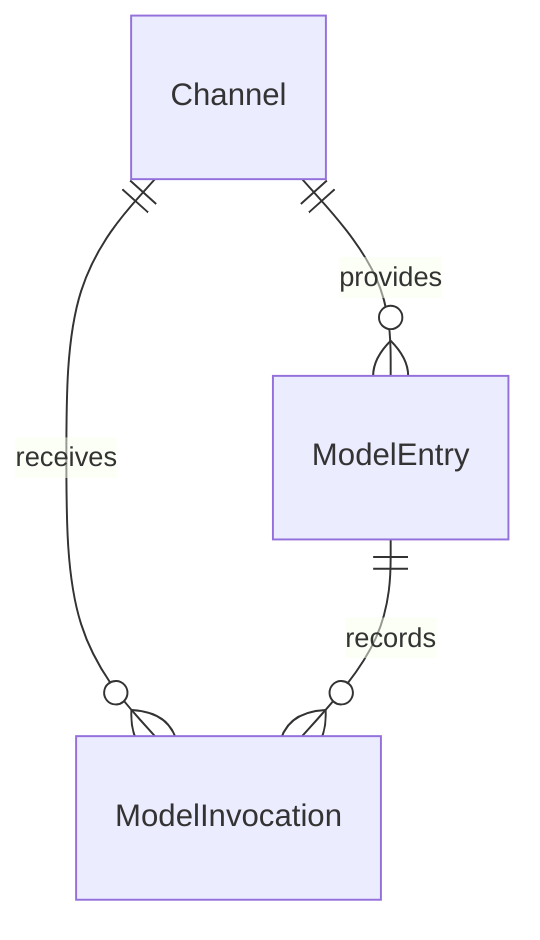

# Keystone 模型接入领域

[范围与边界](#1-范围与边界) · [领域模型](#2-领域模型) · [主要流程](#3-主要流程) · [权限与审计](#4-权限与审计) · [设计取舍](#5-设计取舍) · [待确定事项](#6-待确定事项) · [当前实现](#7-当前实现约定)

## 1. 范围与边界

为后续业务提供统一的模型调用入口，记录每次调用的用量、上游报告的费用，并展示渠道账户的余额。采用“成熟调用 SDK＋少量渠道适配代码”，不要求独立网关。

首批渠道为 DeepSeek、OpenRouter、阿里云百炼。阿里云暂按百炼/DashScope 按量付费服务设计，具体站点、地域和账户在接入时确定；不把 Coding Plan 等订阅额度混为账户余额。首版先覆盖文本对话及流式响应，其他能力按业务需要增加。

只保留渠道、模型配置、调用记录三个对象。不做用户钱包、充值、配额分配、计费倍率、价格表、自动渠道切换或智能路由。这里记录的是供应商侧成本，不是向 Keystone 用户收费。

## 2. 领域模型

| 对象 | 职责 |
|---|---|
| Channel（渠道） | 配置如何连接某个上游账户，保存最近查询到的余额 |
| ModelEntry（模型配置） | 给业务一个稳定的模型 key，映射到某个渠道的上游模型 |
| ModelInvocation（调用记录） | 记录一次本地调用尝试的归属、结果、用量和可获得的费用；不证明上游已收到请求 |



采用三张表。余额快照和用量是结构化字段，不单独建表；渠道适配器是代码实现，不是领域实体。

### 2.1 渠道 Channel

| 字段 | 含义 |
|---|---|
| `id`、`name` | 稳定 ID、展示名 |
| `provider` | `deepseek`、`openrouter`、`aliyun_bailian`，决定适配实现 |
| `api_base` | 经管理员配置的服务地址，包含相应地域/站点差异 |
| `api_key_encrypted` | 推理 API Key 密文，接口不返回 |
| `billing_api_key_encrypted` | 可空，账务 API Key 密文，接口不返回 |
| `upstream_account_ref` | 上游账户的非秘密标识，用于说明余额归属；无法获得时可空 |
| `is_active` | 是否允许新的模型调用 |
| `balance_snapshot` | 可空，最近成功查询的余额结构 |
| `balance_checked_at` | 最近成功采集余额的时间 |
| `balance_last_attempt_at`、`balance_check_status` | 最近查询时间及结果：`never`、`ok`、`error`、`unavailable` |
| `created_at` | 创建时间，服务端生成，UTC，必填 |
| `created_by` | 创建操作的用户 ID，系统操作可为空 |
| `updated_at` | 渠道配置最近修改时间，UTC，创建时与 created_at 相同 |
| `updated_by` | 渠道配置最近修改操作的用户 ID，系统操作可为空，创建时与 created_by 相同 |

`balance_snapshot` 包含 `scope`、`items`；每项包含 `kind`、十进制 `amount`、`unit`。`scope` 说明是供应商账户或阿里云账户；`kind` 区分总余额、现金、赠送等，`unit` 明确为 CNY、USD 或供应商 credits 等单位。来源由渠道适配实现确定。

各渠道字段映射见本页[渠道能力](#33-渠道能力)。不同币种和余额分项不直接相加。成功刷新原子替换快照与采集时间；失败只更新本次查询结果，不清空旧余额。未查询/不可用不能显示成零。

保留旧余额仅适用于同一查询配置下的失败。影响余额查询来源的配置（地址、账务凭据，或余额适配实际使用的推理凭据等）变更时，同事务清空余额快照与成功/尝试时间，将 balance_check_status 重置为 never；只改名称或启停不清空。provider 和账户归属创建后固定，不能通过更改 upstream_account_ref 将原渠道改作其他账户；该标识未知时可补录同一账户标识。替换秘密也必须保持同一账户，无法确认时新建渠道。

updated_at、updated_by 只追踪渠道配置变更；余额刷新使用 balance_checked_at、balance_last_attempt_at 表达，不覆盖最后的配置修改人。

同一供应商可以配置多个渠道。首版不建立独立供应商账户或余额流水表，也不计算跨渠道余额总和。允许同账户内轮换密钥；换供应商、换账户应新建渠道，避免历史调用与余额归属混淆。余额查询配置不完整时仍可保留模型调用能力。

### 2.2 模型配置 ModelEntry

| 字段 | 含义 |
|---|---|
| `id` | 稳定 ID |
| `key` | 业务使用的唯一 key，创建后固定，例如 `general-chat` |
| `channel_id` | 所属渠道 |
| `provider_model` | 上游接受的模型标识 |
| `is_active` | 是否允许新调用 |
| `created_at` | 创建时间，服务端生成，UTC，必填 |
| `created_by` | 创建操作的用户 ID，系统操作可为空 |
| `updated_at` | 最近修改时间，UTC，创建时与 created_at 相同 |
| `updated_by` | 最近修改操作的用户 ID，系统操作可为空，创建时与 created_by 相同 |

一条配置只映射一个渠道和一个上游模型。界面直接展示 key，不单独保存模型配置的展示名。业务不接触渠道密钥；映射修改不需要业务改 key，但模型能力和行为变化仍需业务验证。历史调用保存当时的渠道和模型，不能通过当前配置反推。

普通直接调用在本次尝试开始时解析 key；Flow 在受理时固定模型选择，映射修改只影响之后受理的运行，规则见[固定模型选择](#34-flow-的固定模型选择)。

首版不引入模型家族、模型版本、路由池、价格方案或通用能力注册表。模型与渠道都启用才允许发起新调用；停用不修改已有调用记录。

Channel、ModelEntry 首版都只停用、不删除，统一使用已有 is_active，不增加 deleted 状态、deleted_at 或回收站。停用 Channel 阻止该渠道的新调用，但不批量修改其 ModelEntry；重新启用渠道后，仅模型配置自身也启用时才能调用。单独停用 ModelEntry 只阻断该配置的新调用。

停用配置仍可由有权限的管理者查询、修改或重新启用；ModelEntry.key 继续被原配置占用，不回收给另一条配置。允许误建配置以停用记录留存，省去物理删除与引用清理分支。旧 Run 仍关联原配置，但原模型或渠道停用时明确拒绝新调用；已发送请求继续保存结果、用量和费用，历史数据不改写。

停用是 Keystone 的调用控制，不等于撤销供应商密钥，也不自动清除已保存的渠道凭据。管理员可在控制台替换 API Key、清除可选账务 Key；供应商侧的撤销由操作者处理，配置与历史记录继续保留。

### 2.3 调用记录 ModelInvocation

| 字段 | 含义 |
|---|---|
| `id` | 本地调用尝试 ID；Flow 内每次持久模型请求使用可在恢复时复现的稳定 ID |
| `user_id` | 发起用户；系统调用可空，由可信服务端确定 |
| `flow_context` | 可空的小型 JSON：flow_run_id、node_key、agent_key、agent_call_id，按实际调用场景填写；普通调用为空 |
| `model_entry_id`、`channel_id` | 本次使用的模型配置与实际渠道 |
| `provider_model` | 本次上游模型标识快照 |
| `upstream_request_id` | 上游返回的请求/generation ID；未收到时可空 |
| `status` | `running`、`succeeded`、`failed`、`unknown` |
| `finished_at` | 可空，本地调用处理结束时间，开始时间使用 `created_at` |
| `usage` | 可空的结构化用量，保存上游提供的输入、输出、缓存等计量信息 |
| `cost_amount`、`cost_unit` | 可空，上游报告的本次账户费用及对应单位 |
| `cost_source` | `response`、`query` 或 `unknown` |
| `cost_note`、`error_code` | 可空，费用缺失/补查失败的简短原因及脱敏错误分类 |
| `created_at` | 本地调用尝试登记时间，服务端生成，UTC，必填；不是精确网络发送时间 |
| `updated_at` | 状态、用量或费用最近补全时间，UTC，创建时与 created_at 相同 |

`running` 表示本地尝试尚未结束，不证明请求已经发送或被上游接受；`succeeded` 表示收到正常完成结果，`failed` 表示已知失败，`unknown` 表示无法确认是否已发送或上游是否完成。状态都不代表是否收费。进程中断遗留的 running 只在确认执行已结束后标记未知，不能仅因经过一段时间就把仍在执行的请求改成 unknown；未知结果不自动重发。

`usage` 缺失的分项保持缺失；缓存、推理 token 可能是其他分项的子集，不重复求和。费用已知时必须同时有金额、单位和来源；未知时金额和单位为空、来源为 `unknown`，原因可写“上游未提供”或“等待查询”。

费用补查只补全同一记录，不新增调用、不累加原金额；失败保留已知费用。费用来源表示上游报告口径，不保证与最终发票、税费、退款或外部 BYOK 账单完全一致。首版不建立账单对账或结算状态机。

一条记录对应一次本地调用尝试，不等于一次聊天会话或一个业务任务，也不证明上游实际收到请求。对同一尝试的结果补全以本地 ID 更新；历史渠道/模型归属不因配置变更而改变。调用用户归属由 user_id 表达，Flow 关联由 flow_context 表达，状态和费用由服务端补全，不增加 created_by、updated_by。updated_at 用于判断记录最近是否得到补全，不表示一次人工编辑。

Agent 一次运行可能发起多次模型请求，每次实际请求都独立记录，不能只在 agent.run() 外面记一条总调用。flow_context 由可信执行上下文生成，只用于追踪，不是权限凭据，也不保存消息或 SDK 对象；相同 Agent 调用中的多轮请求共用 agent_call_id，但各有自己的调用记录 ID。普通业务按需在自身数据中保存调用 ID，模型接入模块不反向保存通用业务关联号。

## 3. 主要流程

### 3.1 SDK 与适配器

业务通过稳定的模型配置 key 发起调用，模块解析渠道和上游模型，再交给 SDK。

渠道适配代码仅处理必要差异：

- 从响应中提取请求 ID、用量和上游报告的费用。
- 支持时，按上游请求 ID 查询费用，补全已有记录。
- 使用渠道对应接口查询账户余额。

不支持的能力直接返回“不可用/不支持”，不为了统一接口编造金额。实现上用普通接口和三个适配实现即可，不增加插件系统或独立账务服务。

### 3.2 调用与余额刷新

1. 校验输入、当前身份、调用权限及模型/渠道启用状态，在即将发送前创建并提交调用记录；记录失败则不发起上游请求。Flow 还需遵守下文的原子登记与防重发规则。
2. 发起请求，保存上游请求 ID、用量、结果状态和可获得的费用。流式请求在流结束后更新，缺失末尾用量时不补造数据。
3. 对支持费用查询的渠道，可按已有请求 ID 补查并更新同一记录；补查不是重新调用模型。没有请求 ID 或不支持查询时保留未知原因。
4. 有管理权限的用户可手动刷新渠道余额；API 直接调用本模块，在有界超时内查询并保存结果，不返回需要 Worker 接续的后台任务。不在每次模型调用前后查询余额，首版不安排定时同步。

每次实际发往上游的尝试必须对应一条记录，但记录可能在发送前的中断窗口内已创建，不能反过来把每条记录都算成上游已接受请求。首版关闭 SDK 的自动重试；收到响应后记录更新失败也不能触发模型重试。以后若允许新的重试尝试，必须逐次使用不同 ID 记录，不能覆盖原尝试；Flow 的同一请求恢复不属于新的获准尝试。Flow 调用通过已有 flow_context 关联，普通业务自行保存相关调用 ID，不新增通用业务关联号字段。

超时、断流或进程中断可能无法确认上游结果，记为 `unknown`，不能推断没有收费。硬退出或结果写回失败可暂时遗留 running，只有确认原执行已结束后才能收尾；普通 API 调用使用下述离线命令，Flow 调用由持有排他锁的 Worker 启动恢复。调用结果和费用是否已知相互独立；补查失败不改变已经成功的调用结果。调用记录不是持久化任务或业务会话。

请求发出后用户停用、权限收回或原令牌失效，不阻断该次调用的响应处理和记录补全。已有尝试的状态、用量和费用继续由可信执行上下文或受限系统维护补齐，user_id 仍保留原始归属；费用补查只核实原请求，不重新推理。撤权后的新请求仍拒绝，用户查询记录也必须通过当前权限检查。

余额刷新失败时保留上次成功快照，显示采集时间和本次失败状态。余额只是有时间戳的上游观察值，不用于保证下一次调用一定成功，也不用余额前后差计算单次费用。多个渠道共享同一上游账户时不能重复汇总，首版仅逐渠道展示。

余额查询分为读取当前配置、事务外请求、短事务写回三段；同渠道刷新串行协调，并与影响查询的配置变更协调。写回前确认仍对应原查询配置，过期结果丢弃，不能覆盖新配置的快照；不为此增加刷新请求表、任务状态或版本字段。API 中断时不承诺请求已完成，保持最后已确认信息，可再次手动查询。渠道停用只禁止新推理，不禁止授权管理者查询历史、补查费用或刷新余额。已检查的 Ether 模型连接模块没有对应的渠道余额刷新实现，这部分是 Keystone 的简化规则，不声称直接迁移现成代码。

### 3.3 渠道能力

以下基于官方文档核对，尚未用真实账户联调。

| 渠道 | 单次调用费用 | 账户余额 | 首版处理 |
|---|---|---|---|
| DeepSeek | 已核对的对话响应提供用量，未提供单次金额 | `/user/balance` 提供分币种的总余额、赠送余额和充值余额 | 保存用量；费用未知；支持余额刷新 |
| OpenRouter | 响应 `usage.cost`；也可按 generation ID 查询 | `/api/v1/credits` 返回累计 credits 和使用量，需要 management key | 保存上游报告费用；必要时查询补全；支持余额刷新 |
| 阿里云百炼 | 尚未确认可按推理请求 ID 查询单次实际金额的接口 | `QueryAccountBalance` 查询阿里云账户，区分可用额度和现金余额 | 保存用量；费用未知；有账务凭据时支持账户余额刷新 |

DeepSeek 保留接口返回的币种，总余额已经包含赠送和充值部分，不重复相加。费用未知仅表示当前接入能力不足，不断言供应商永远没有相应能力。依据：[余额接口](https://api-docs.deepseek.com/api/get-user-balance/)、[对话响应](https://api-docs.deepseek.com/api/create-chat-completion/)。

OpenRouter 的 `usage.cost` 表示该账户被收取的 credits；流式用量在最后的 SSE 消息中。不要用 `upstream_inference_cost` 替换账户费用，尤其 BYOK 还涉及外部供应商收费。余额由 `total_credits - total_usage` 得到，保留 credits 口径，不能当作某个 API Key 的独享额度。依据：[用量与费用](https://openrouter.ai/docs/cookbook/administration/usage-accounting)、[余额与凭据要求](https://openrouter.ai/docs/api/api-reference/credits/get-remaining-credits)。

阿里云的 `AvailableAmount` 是可用额度，`AvailableCashAmount` 是现金余额，展示时分别标明。它们属于阿里云账户，可能同时供其他云产品消费，并非百炼专属余额。查询需要阿里云 OpenAPI 账务授权，不能直接使用 DashScope API Key。依据：[账户余额接口](https://help.aliyun.com/zh/user-center/developer-reference/api-bssopenapi-2017-12-14-queryaccountbalance)。

百炼账单存在出账延迟和聚合口径，出账也不等于即时扣款。首版不抓取控制台、不把聚合账单摊分成单次“实扣”；后续确认能够精确关联请求的官方数据后再补全。依据：[账单与费用管理](https://help.aliyun.com/zh/model-studio/bill-query-and-cost-management)。

### 3.4 Flow 的固定模型选择

用户提交 model_key，Flow 受理时由服务端解析为 `model_entry_id`、`channel_id`、`provider_model`、`api_base`，作为明确的模型选择值存入已有 FlowRun.input。这是小型的非秘密选择快照，不新增 FlowRun 字段或模型版本表；流程输入契约及受理代码必须明确其位置与转换规则，不扫描任意 JSON 猜测模型字段，也不接受客户端伪造解析结果。

同一 Run 始终使用保存的选择，不在每次执行或恢复时重新解析当前 key 映射。每次真正发送前仍检查当前用户、原个人令牌、原 ModelEntry 与原 Channel 是否有效；原配置停用或不存在则明确拒绝。ModelEntry 后续映射变化不替换旧 Run 的目标，旧目标仍有效时可继续。

允许原渠道在同一账户内轮换凭据，发送时读取当前秘密。原渠道 api_base 与保存值不一致时拒绝发送，不能静默改用新地址；更换供应商或账户必须新建 Channel。ModelInvocation 记录这次实际采用的渠道和模型。

Flow 的 request_digest 依据用户原始提交计算，不包含服务端解析结果。重复发起先按原请求检查幂等并返回原 Run，不因当前映射变化而重新解析或改写其 input。

### 3.5 Flow 模型请求的恢复与防重发

复用 ModelInvocation.id 作为每次持久模型请求的稳定标识，由执行上下文确定，恢复同一请求时必须得到同一 ID。不能只使用 agent_call_id：一次 Agent 调用中的多轮模型请求各有自己的 ID。

1. DBOS 已有可恢复的模型结果检查点时，直接复用结果，不新增调用记录、不再次发送。
2. 需要执行请求时，在发送边界原子创建 ModelInvocation，利用 ID 唯一约束取得首次发送资格。只有首次成功登记的执行者可以发送；冲突或不确定是否登记成功都不能取得发送资格。
3. 已有调用记录但没有可恢复的结果时，停止该次执行并报告明确错误，例如 `model_result_unavailable`；即使调用状态为 succeeded 也不能重发，因为费用记录不能替代丢失的模型响应。Flow 的恢复失败不覆盖已经确认的调用成功状态。

该规则宁可在“已登记、尚未发出”时中断，也不在恢复时猜测可以重发。可靠的上游查询可以核实原请求结果或费用，但不能借查询重新发起推理。首版不增加发送意图表、额外状态或保存模型响应的字段，也不使用 File 保存防重发标记。

这是 Keystone 复用现有调用表的设计选择，并非声称 Ether 已有同样实现，也不等于供应商侧 exactly-once 保证。实现时必须验证稳定请求身份、原子登记以及 DBOS/Agent 内部恢复边界；仍用于恢复防重发的调用记录不能提前清理。

## 4. 权限与审计

管理操作日志采用 [AuditLog](audit.md)，ModelInvocation 继续负责每次调用的用量与费用记录。

沿用现有用户、个人令牌和 Casbin。模型调用、渠道管理与调用记录读取分别授权；模型调用权限不自动授予历史记录读取权。普通用户只能查看可调用模型的非敏感信息；首版不增加逐模型授权表，需要按业务对象限制时由业务模块检查。

首版将调用及普通可用模型目录明确为 model:invoke；配置管理、管理配置查询与账户余额查看/刷新统一使用 model:manage，不再细分余额权限。invoke 不授予 manage 或历史记录权限；manage 也不隐含 invoke。普通目录仅返回启用且所属渠道启用的模型 key 和必要能力说明，不返回内部地址、密钥配置状态或余额。配置管理接口仅返回非秘密值，普通调用者不能指定渠道密钥。功能权限由代码声明，不增加逐模型授权关系。

配置接口允许 model:manage 管理者录入或更新 API Key，不提供读取已保存密钥内容的接口；api_base 不允许内嵌凭据，Flow 选择快照只保存非秘密地址。调用记录视图也不通过关联 Channel 泄露凭据状态或账务配置。凭据配置失败以脱敏错误返回，不把 SDK 原始异常作为错误详情。

| 调用记录权限 | 范围 |
|---|---|
| model_invocation:read | 读取本人调用记录与本人费用汇总，按 user_id=当前用户过滤 |
| model_invocation:read_all | 在已有 read 权限的基础上，扩大至其他用户与 user_id 为空的系统记录 |

read 与 read_all 都属于代码权限目录，不增加授权表。会话与 PAT 都检查权限，PAT 使用“用户当前权限 ∩ 令牌权限范围”。获得 read 的 PAT 可读取所属用户的历史记录，包括其他凭据发起的调用；仅获得模型调用权限的 PAT 可以发起请求，但不能读取历史记录或费用汇总。归属统一按 user_id 判断，不新增凭据归属字段或逐令牌记录隔离。

查看他人或系统调用记录及费用汇总同时需要 model_invocation:read 与 model_invocation:read_all，flow:manage 不替代这些权限。Flow 页面展示 Run 下的调用明细或费用时，入口同时检查 Run 可见性与模型模块的记录查看规则；从模型记录页面查询仍使用同一套模型授权判断，不要求模型模块反向调用 Flow。权限过滤在分页与汇总前完成，无权限不能返回其他用户数据或把费用展示成零，也不能用 Flow 接口绕过限制。

模型记录可见不自动授予对应 Run 或文件的访问权。查看 Run 仍按 Flow 权限与归属判断，下载关联文件仍按文件功能权限、FileGrant 和状态判断。不新增跨模块授权表或另一套 Flow 专属调用记录。

渠道凭据由管理者在控制台录入，只允许服务端发送时解密使用；数据库保存密文，接口只返回 has_api_key、has_billing_api_key 两个状态。推理凭据与账务凭据分别配置，账务凭据使用相应接口所需的最小权限；没有账务凭据不影响已有推理能力。API 返回、异常和日志都不得泄露凭据。

金额用十进制定点值或十进制字符串，带币种/计量单位和来源。只有上游明确报告零费用才记录 `0`；缺失使用 `null`。按用户统计时分别展示已知费用和费用未知的尝试数，同币种、同口径才可汇总，不能把不完整统计叫总实扣。调用次数按状态区分，本地尝试总数不等于上游接受次数；未知不折算为零费用。

默认不保存提示词、模型输出或完整 HTTP 报文。保留必要用量和关联信息；配置、启停、凭据变更等管理操作记录审计日志。

时间由服务端生成，统一使用 UTC；操作人或调用归属来自可信身份，不能接受客户端任意指定。Channel、ModelEntry 创建时 updated_at 与 created_at 相同，updated_by 与 created_by 相同；系统配置操作允许操作者为空，来源写入审计日志。行上字段不能代替完整管理操作历史。

Channel、ModelEntry 是管理配置，保留四个审计字段。ModelInvocation 是调用事实记录，保留 user_id、created_at、finished_at、updated_at 和费用来源即可，不增加 created_by、updated_by。正常的调用完成、用量与费用补全记录在调用记录内，不为每次自动补全再复制一条通用管理审计。

Channel、ModelEntry 不论是否已被引用，首版均不提供物理删除或软删除；管理变更、启停和凭据变更记录审计。配置只停用的规则不改变调用记录的保留策略：ModelInvocation 不提供普通用户修改/删除接口，仍承担 Flow 恢复防重发作用的记录必须保留，确认对应运行不再有恢复或协调义务后才能按保留期清理，不在这里扩展成归档领域。

不为这三个对象增加 deleted_at、deleted_by。调用记录的保留期清理由任务日志记录范围、数量和结果，不模拟用户逐条删除，也不逐条增加删除字段；已有审计独立保留。Ether 的 模型连接删除 会保留连接行、设置 deleted 并清除秘密和授权；Keystone 首版不搬入该删除状态或相关协调机制。

管理操作的审计日志与调用记录用途不同：前者追踪谁改了配置，后者记录调用发生及费用信息。两者都不保存秘密明文，调用记录默认不保存提示词和输出正文。

## 5. 设计取舍

- 一个模型 key 只映射一个渠道及上游模型；首版不做路由池或自动切换。
- Channel、ModelEntry 只停用、不删除；不增加配置删除状态、引用清理或恢复机制，接受误建配置留存。
- 余额和用量使用结构化字段，不单独建表；余额逐渠道展示，不做跨账户汇总。
- 费用采用上游报告值，未知保留为空；不维护价格表，也不把聚合账单摊成单次实扣。
- 复用身份与权限，不新增租户、模型授权表、钱包、预算、账单或余额流水对象。
- 调用记录记录本地尝试，发送前登记；复用 ID 防止 Flow 恢复重发，不扩展成持久化任务、聊天会话或业务流程。

## 6. 待确定事项

当前只支持 OpenRouter，DeepSeek 与阿里云尚未开放发送；扩展接入时再明确官方地址、账务权限及 SDK。依赖版本以锁文件为准。

费用采用上游报告值，无法确认的发送结果、余额或费用保留未知；不通过估价或新增本地账本掩盖。调用记录与恢复规则见下节。

## 7. 当前实现约定

代码位于 backend/src/keystone/platform/model_access/，迁移 0005_model_access 建立 model_channels、model_entries、model_invocations；0007_channel_credentials 将旧部署引用改为渠道凭据密文，已有渠道升级后需在控制台手动重新填写 Key。复用 Ether ai/runtime.py、dispatch.py、invocations.py 的受控发送、运行时凭据注入、响应观测和安全错误分类思路，按 Keystone 的发送前登记规则改写；没有复制路由池、配额、聊天会话或其他领域实体。

### 7.1 配置

模型始终使用真实服务，不提供 disabled/mock/live 模式和发送开关。渠道创建时填写 api_key，可选 billing_api_key；编辑时省略或传 null 保留原密钥，clear_billing_api_key=true 清除账务密钥。输入采用 SecretStr，响应、审计和日志都不返回明文或密文。API 与 Worker 读取同一数据库，变更立即生效，无需重启。配置步骤见[模型接入](../../README.md#模型配置手动)。

加密使用 Fernet，绑定渠道 ID 与推理/账务用途，防止凭据密文跨渠道或用途替换。首次保存时在现有 FILE_COORDINATION_ROOT 自动原子生成 `.model-credentials.key`（Linux/macOS 文件权限为 0600），不增加配置项或初始化命令。API 与 Worker 共用该协调目录；已有密文而密钥丢失时拒绝密钥写入和调用，不静默重新生成。备份应保留完整协调目录。实现依据 [Fernet 文档](https://cryptography.io/en/latest/fernet/)。

当前支持 OpenRouter 官方地址，普通目录只返回启用且支持发送的渠道模型；DeepSeek/阿里云既有配置仍可管理，但不能发送。缺少或撤销凭据时在发送前拒绝。启动或保存配置不会自动发起模型调用。

确定性响应只通过测试目录中的 HTTP 传输替身注入，不随应用包或部署镜像发布。旧开发模拟数据不得用作真实调用的费用或恢复依据，应使用独立数据库和文件卷。

### 7.2 接口与权限

以下路径统一带 /api/v1。配置 PATCH 接收完整非秘密可编辑字段；凭据字段可省略以保留原值。Channel.provider 和 ModelEntry.key 创建后不可编辑；已填写账户标识不可更换，原为空时可补录。没有删除接口。

| 接口 | 要求与用途 |
|---|---|
| GET /model-access/options | model:manage；返回支持的服务商列表 |
| GET/POST /model-channels；PATCH /model-channels/{id} | model:manage；查询、创建、编辑和启停渠道 |
| POST /model-channels/{id}/balance | model:manage；同步刷新，失败保留旧快照，返回查询状态 |
| GET/POST /model-entries；PATCH /model-entries/{id} | model:manage；查询、创建、编辑和启停模型选择 |
| GET /models | model:invoke；只返回可用 key 和调用能力，不暴露渠道凭据配置 |
| POST /models/invoke | model:invoke；消息文本调用，stream=true 返回 start/delta/done/error SSE 事件 |
| GET /model-invocations；GET /model-invocations/{id}；GET /model-invocations/summary | read 限本人，read + read_all 扩大范围；明细、分页与汇总使用相同归属过滤 |
| POST /model-invocations/{id}/cost | 同时要求 model:manage 与该记录读取权限；仅补查已结束记录，更新费用，不改变调用状态 |

渠道和模型列表默认 50 条、最多 100 条；调用历史默认最近 30 天、范围最多 366 天，支持时间、渠道、FlowRun 过滤，列表另可按状态过滤。汇总在一个 SQL 快照内按状态计数，已知费用按渠道/单位分别求和，未知费用单独计数。数值以十进制解析，费用用 Numeric(38,18)，API 返回十进制字符串；只保留上游明确报告的用量字段，不补算缺失 token 或价格。

管理页提供配置、启停、余额、普通/流式调用、记录和费用汇总；所有权和 PAT 范围仍由服务端当前授权决定。只有历史权限时不会取得配置；只有调用权限时不会取得历史。当前分页选择、筛选及详情交互见 7.7。

### 7.3 发送与故障规则

- 每次进入 SDK 的实际 POST 发送边界，重新校验身份、model:invoke、原模型/渠道启用状态、固定地址与当前秘密。短事务原子插入 ModelInvocation 并提交后才允许发送；登记失败不发送。
- SDK max_retries=0，禁止自动跳转和环境代理；相同可信 invocation_id 的并发或重放拒绝再次发送，包括原调用已成功但没有可恢复响应的情况。公开 HTTP 只接收 key/messages/max_tokens/stream，不能提交 user_id、Flow 上下文、固定目标或内部调用 ID。
- 已明确拒绝的 4xx 记录 failed；402 映射为 model_insufficient_credits。超时、5xx、断流、中断或无法解析的结果记 unknown。HTTP 200 中的 error 或 finish_reason=error 同样按未知结果处理，返回安全错误码，保留已经收到的编号、用量和费用，不暴露上游原始错误。SSE 必须同时收到完成原因与结束标记；完整响应但没有 usage/cost 仍可成功，费用保持未知。失败与费用是否已知分别判断。
- 已发送请求即使身份撤销或配置停用，也补全原记录；不因此再发请求。补全写入失败返回 model_result_unavailable，可能遗留 running，不自动重发或按时间猜测失败。稳定 ID 的防重发记录仍保留。
- 文本消息最多 32 条，内容总计不超过 64 KiB；max_tokens 默认 1024、上限 4096。单进程模型调用/查询并发 4，调用执行最长 60 秒，SDK I/O 超时 30 秒；响应观测最多 4 MiB，单条流事件缓冲 64 KiB。取消后的事实收尾最多等待 5 秒，不留下后台发送重试任务。
- 默认不保存消息或输出正文。记录必要用量、上游请求 ID、费用来源及稳定错误代码；OpenAI/httpx2/httpcore2 日志不随应用 DEBUG 输出请求体和认证信息。

余额查询外部 I/O 最长 10 秒；每进程最多 2 个余额刷新，同渠道通过 PostgreSQL 会话锁协调，协调连接退出时释放，业务事务不跨外部 I/O。写回前核对配置，旧查询结果丢弃；失败保留上次成功快照，配置修改使余额来源变化时清空。余额采集不改 Channel.updated_at/updated_by；查询发生及结果进入 AuditLog。费用补查失败保留已知费用，重复查询只替换同一次费用，不累加。

### 7.4 Flow/Agent 接入

FlowModel 通过 ModelRuntime.invoke_sdk 内部入口，直接传入固定 Selection、稳定 invocation_id、FlowContext 和 sdk_request 回调，把 Pydantic AI 的协议适配置于受控客户端内；不构造公开 Invoke 的占位消息，普通模型调用与 Agent 每轮请求仍共享发送登记和响应后记录。公开模型 API 不因此增加工具、身份、稳定调用 ID 或固定选择参数。实际请求体超过 256 KiB 在发送前拒绝。

真实 DBOS Worker 使用 workflow/step 身份派生稳定 UUID。Agent 的每轮模型请求保存独立 ModelInvocation，同属一次 Agent 调用的记录共享 agent_call_id。已登记未发送、已收到响应但缺少 DBOS 检查点这两个崩溃窗口均阻止重发；已确认成功和费用保留，未知仍为 unknown。取消发生在发送后也会保存已返回的用量/费用，新请求被阻断。没有新增费用快照、账本、定价或消息表。

### 7.5 普通 API 调用离线收尾

API 硬退出或结果写回失败后，操作者先停止连接同一数据库的全部 API 进程，并在命令执行期间保持停止，再运行：

```shell
keystone recover-model-calls --confirm-api-stopped
```

该标志是操作者对停止状态的明确确认，命令不会探测本机或远端 API 进程，也不会自动停止它们；不能在仍有普通调用执行时使用。缺少确认直接拒绝，数据库迁移不匹配时也拒绝。确认完成后才能重新启动 API。若有自定义普通调用进程，也须一并停止。

入口调用 model_access/services/maintenance.py，仅处理 status=running 且 flow_context 中没有 flow_run_id 的普通调用。每批最多 100 条，在锁定后将状态置为 unknown、error_code 置为 model_interrupted，填充 finished_at/updated_at；保留原 ID、请求编号、用量、费用及归属。每条 model.invocation.recover 系统审计与该批更新同事务；批次失败回滚，之前已提交批次保留，重跑不重复修改或审计。成功结束记录总处理数。

命令不发起任何上游请求、不重发推理、不删除记录；已经结束的调用及 Flow 调用均不处理。Worker 可以继续处理 Flow。收尾后，具备原费用补查权限的用户可通过已有 cost 接口查询；能否确认费用仍取决于上游编号和供应商能力。保持原有三张表，不增加心跳、租约或恢复任务表。

### 7.6 控制台

/console/models 按管理、调用和历史读取权限分别加载配置、调用和记录区域。渠道与模型配置使用独立编辑弹窗和 50 条分页；渠道选择器、可用模型选择器也支持分页，不只查询前 100 条。当前所选渠道不在这一页时保留 ID，提交后由 API 校验。服务商、模型 key 及已确定的账户标识不可修改，配置只停用不删除；推理与账务 Key 通过密码输入框提交，保存后仅显示已设置状态，不回显内容。

余额同时显示最近查询状态、最近尝试和成功采集时间；本次查询失败时保留的旧快照明确标为历史成功结果。未知余额、未知调用费用都不视为零，不跨渠道或单位合并。调用详情显示当前结果、错误码、上游请求编号、费用来源/说明、用量和 Flow 关联，不包含消息正文。费用补查仍只调用现有账务查询接口，不重发模型请求。

历史列表与费用汇总共享渠道 ID、Flow Run ID、开始/结束时间筛选，默认最近 30 天、最多 366 天；应用筛选时固定同一组时刻。首版不新增用户筛选或状态汇总接口；本人/全部可见范围由当前权限决定。分页只影响列表，汇总覆盖筛选范围；两者分别显示加载失败，避免误把汇总失败当作没有调用。

普通和流式响应的按钮统一为“发送真实请求”，提示可能计费，打开页面或保存配置不会自动调用。Flow 发起表单同样提示真实调用。停止接收只中断浏览器接收，不表示上游撤销或没有费用，不自动重发；离开页面中断接收并清空输入输出。HTTP 错误和流内 error 事件共用会话失效处理。配置变化后可手动刷新模型目录，实际发送仍复查当前配置和权限。

参考 Ether ModelProbe 的操作隔离和失效结果处理，复用本后台 Element Plus 弹窗/详情抽屉、分页及请求代次控制；不搬入 Ether 的通用连接授权或多模态探测功能。

### 7.7 OpenRouter 接入

沿用现有 OpenAI SDK、受控 transport 和 OpenRouter 费用适配，不增加网关、SDK 依赖或领域表。实际发送使用 httpx2.AsyncHTTPTransport(retries=0, trust_env=False)，SDK 同样禁止重试；忽略 Retry-After，不自动重发计费请求。只允许 `https://openrouter.ai/api/v1`，发送前逐次核对完整地址、POST /chat/completions 和固定模型；账务查询只允许 GET /generation、GET /credits，拒绝跳转和自定义代理地址。

| 能力 | 凭据与口径 |
|---|---|
| 普通/流式推理、Agent 工具调用 | api_key 使用普通推理 API Key；工具调用仅由可信 Flow 适配器使用，公开 API 不增加工具参数 |
| 响应费用 | 使用 usage.cost，单位 credits；不把 cost_details.upstream_inference_cost 当作账户扣费，不根据 token 估价 |
| 费用补查 | 使用原渠道推理 Key 请求 /generation?id=上游编号，验证响应 ID 后读取 total_cost；失败保留原费用，不重发推理 |
| 账户余额 | billing_api_key 使用同一账户的 Management Key；/credits 的 total_credits − total_usage，作为账户剩余额度快照，不是单 Key 限额 |

账务凭据可不配置，此时余额 unavailable，不影响推理；凭据不足或查询失败不能清零旧快照。账户归属由部署者核对，当前没有自动认证两个 Key 属于同一账户的能力。控制台直接录入密钥，保存后仅返回已配置状态，不回显内容。

依据 OpenRouter 官方[用量与费用](https://openrouter.ai/docs/cookbook/administration/usage-accounting)、[账户 credits](https://openrouter.ai/docs/api/api-reference/credits/get-remaining-credits)、[Generation 查询](https://openrouter.ai/docs/api/api-reference/generations/get-request-&-usage-metadata-for-a-generation)及[错误处理](https://openrouter.ai/docs/api_reference/errors-and-debugging)实现协议适配。配置步骤见[OpenRouter 接入](../../README.md#模型配置手动)。

### 代码组织

三个实体分别位于 models/channel.py、model_entry.py、model_invocation.py。渠道、模型配置、调用记录分别由 services/channels.py、entries.py、invocations.py 处理；services/runtime.py 维持受控发送。Flow 调用 select_model(session, key, lock=True) 获取固定选择，保留共享行锁和原事务；services/recovery.py 提供共用的分批收尾，Worker 入口仍要求持有独占锁；maintenance.py 保留普通调用离线恢复的显式确认。响应在 schemas/ 中明确列出字段，不随表新增列自动扩展。 统一规范见[整体架构](../architecture.md#54-模块分层与代码规范)。

调用历史与汇总和审计共用 core/time_range.py：since/until 为闭区间，未传 until 时取数据库当前时间，未传 since 时取 until 前 30 天，最多 366 天，端点必须带时区；仅传历史 until 同样有效。ModelInvocation.created_at 使用数据库时间，默认查询也使用数据库时钟，避免刚写入的记录被应用时钟偏差排除。显式边界原样执行，错误保持 invalid_time_range。

接入能力只在 gateway.SUPPORTED_TARGETS 声明渠道、官方地址和路径对应的 HTTP 方法。模型目录按可推理渠道过滤，实际发送与账务查询仍再次校验；当前仍只开放 OpenRouter，不增加动态插件注册。

两种恢复入口共用每批 100 条的锁定、unknown/model_interrupted 更新及逐条系统审计；保留费用、编号和归属，不重发模型请求。普通入口只处理没有 flow_run_id 的 running 记录，要求操作者确认全部 API 已停；Worker 入口只处理有 flow_run_id 的 running 记录，要求先持有 Worker 独占锁。审计统一 model.invocation.recover，以 source=offline_api_recovery / flow_worker_recovery 区分；更新与日志同事务，失败回滚该批，重复执行不重复审计。

错误分类统一由 services/runtime.py 的 classify_error 沿异常因果链处理；显式 ServiceError 优先，SDK APIStatusError 和 Pydantic AI ModelHTTPError 使用同一 HTTP 错误码映射。HTTP 402/429 在普通调用与 Agent 中均为 failed，并分别保留 model_insufficient_credits / model_rate_limited；上游 5xx、超时、取消及无法确认结果仍为 unknown。分类同时提供安全响应和调用状态，不从原始异常文本推断、不透传上游内容；费用未知仍为未知，失败不代表免费。参考 Ether ai/runtime.py 的安全包装，保留 Keystone 的发送前登记和拒绝重发规则。

OpenRouter 的 cost_query / queried_cost 声明费用补查路径、参数、请求编号匹配和金额解析；InvocationService 只判断是否支持、调用 Gateway、复查渠道配置并保存事实。DeepSeek/阿里云仍不补算调用价格，不扩大真实接入范围。UTC 应用时间统一使用 core/time.py，数据库生成的 created_at 和历史窗口规则不变。
