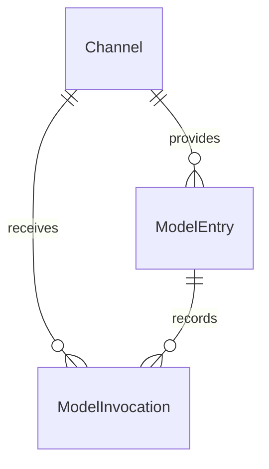
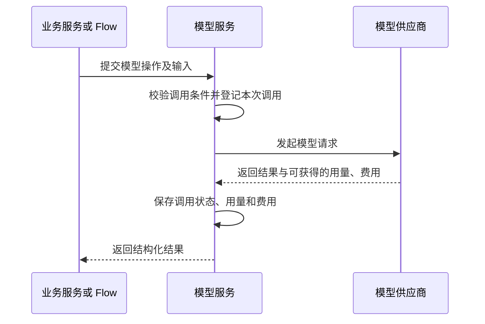
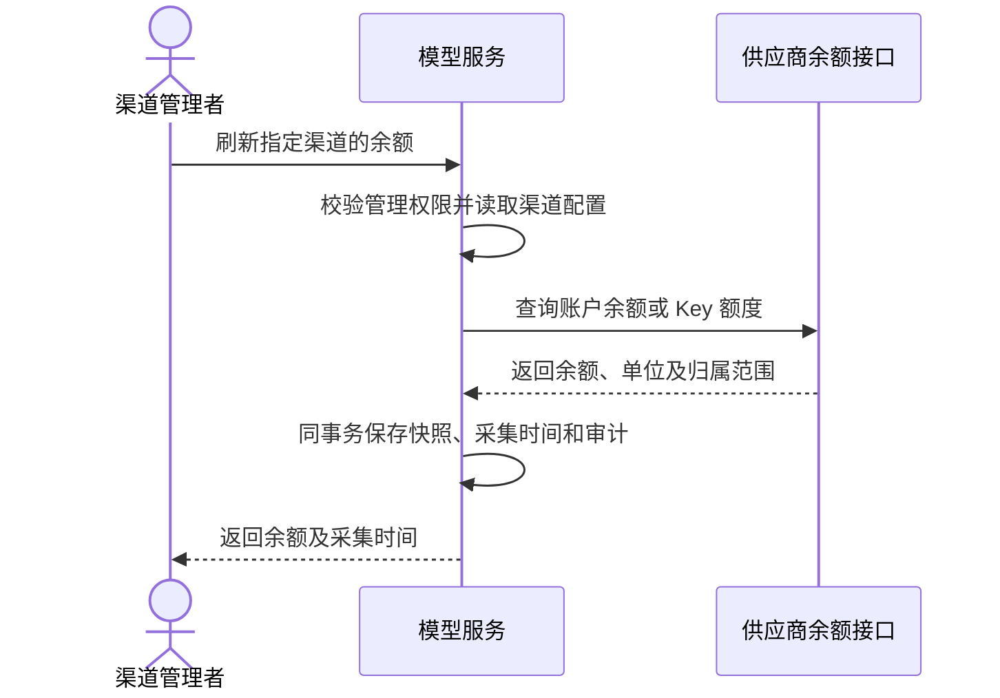
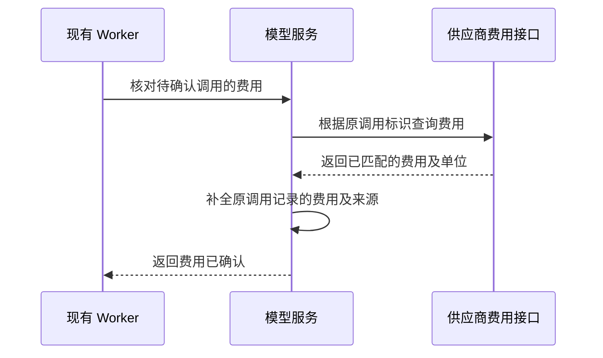
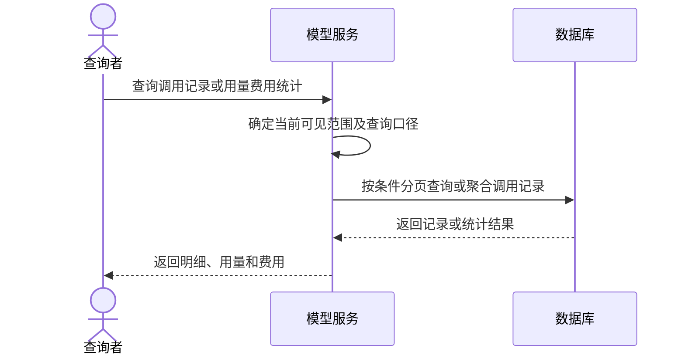
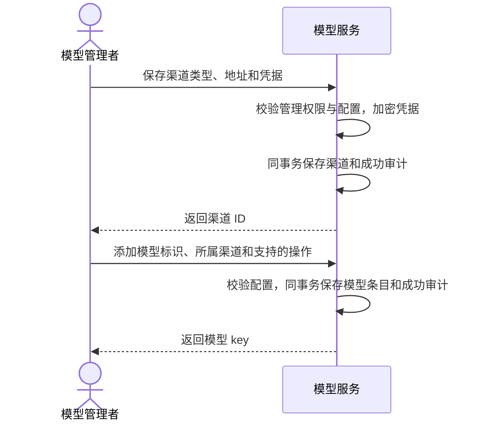
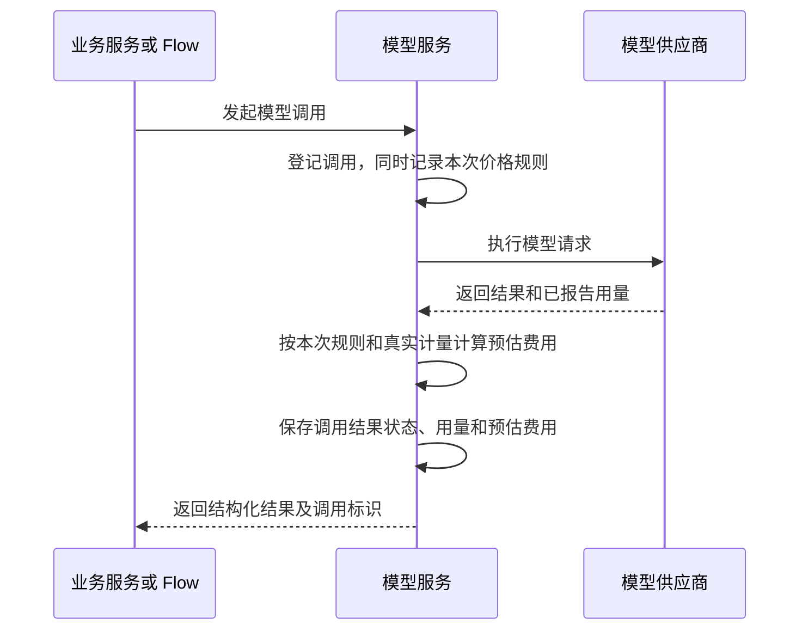

# 模型接入

模型接入管理渠道、模型映射、受控调用、用量、费用和恢复证据。业务 Service 授权业务对象，再组合模型与文件能力；模型返回结果，业务或 Flow 保存所需文件并登记业务结果，见[组合流程](files.md#18-业务服务组合模型与文件)。

主要设计见本页；供应商、接口和底层恢复见[实现参考](../reference/model-access.md)，价格规则见[费用预估](../reference/model-pricing.md)。调用由业务或 Flow 使用内部 Service 发起。

## 1. 范围与边界

| 能力 | 负责 |
|---|---|
| 配置 | 渠道连接与密钥、模型 key/上游映射、操作声明、启停 |
| 调用 | 校验条件、发送前登记、执行协议、返回结构化结果 |
| 调用历史 | 状态、真实用量、预估费用、供应商实扣及覆盖情况 |
| 账户观察 | 手动余额刷新和云账户账单查询 |

使用现有 SDK 和明确的渠道适配，不建设独立网关、用户钱包、充值扣款、智能路由或自动渠道切换。并发和单次操作边界由现有运行时控制，预估和供应商实扣分别表达，不建设累计调用配额。

## 2. 领域模型

### 2.1 渠道 Channel

| 字段组 | 含义 |
|---|---|
| id、name、provider、api_base | 稳定渠道与类型、展示名、连接地址 |
| api_key_encrypted、billing_api_key_encrypted | 推理/账务凭据密文，均不回显 |
| upstream_account_ref、is_active | 同一上游账户说明、新调用开关 |
| balance_snapshot、balance_checked_at | 最近成功余额，包含 scope、分项金额及单位 |
| balance_last_attempt_at、balance_check_status | 最近尝试及 never/ok/error/unavailable |
| cost_* | 原查询范围、分页进度、阻塞和冷却等内部核对事实 |
| created_at/by、updated_at/by | 配置创建/修改，不被余额采集覆盖 |

渠道固定 provider 和账户归属；换供应商或账户须新建。普通同账户凭据轮换不改历史，Token 级查费渠道须保留原范围：Yunwu/Openlux 换 Token/站点新建渠道，OpenRouter 无法验证的旧查询阻塞。

余额查询失败保留同配置下的旧快照；影响余额来源的配置变更清空快照/时间并重置 never。只改名称或启停不清空。不跨币种相加，也不把同账户多个渠道余额重复累计。

### 2.2 模型配置 ModelEntry

id、固定唯一 key、可改 name、channel_id、provider_model、operations、is_active、pricing/pricing_revision，以及四个配置审计字段。业务按稳定 key 使用模型，一条配置映射一个渠道及上游模型。

模型和渠道都启用才接受新调用；停用不改历史或批量改子配置。未被引用的模型/渠道可删除，渠道还须无模型条目；任何调用或保留 Run 引用均阻止删除。配置删除释放 key，不设回收站。

### 2.3 调用记录 ModelInvocation

| 字段组 | 含义 |
|---|---|
| id、user_id、flow_context | 本地尝试 ID、可信归属、可选 Run/角色/节点/Agent/Step 关联 |
| model_entry_id、channel_id、provider_model、operation | 实际目标及语义操作快照 |
| upstream_request_id、result_context | 上游回执及私有任务/产物恢复证据 |
| status、created_at、finished_at、updated_at、error_code | running/succeeded/failed/unknown、登记及收尾时间、安全错误分类 |
| usage | 上游真实报告的计量，缺失保持缺失 |
| cost_amount/unit/source、cost_check_* | 供应商实扣及独立核对状态 |
| estimate_* | 登记时价格快照、计量事实和独立预估结果 |

一条记录对应一次本地尝试，不等于聊天、业务任务或上游已经接收。Agent 每轮真实请求分别记录，同次 Agent 调用共享 agent_call_id。默认不存提示词、输出正文、SDK 对象或原始报文。

另有 ModelDispatchScope 技术协调表，按真实站点/Token 控制发送节奏，不保存秘密或正文。

## 3. 主要流程

### 3.1 SDK 与适配器

协议代码处理报文、鉴权、回执、用量、费用与余额解析；Service 负责身份、事务、调用事实和恢复。能力不足时返回不支持或未知，不推断金额。

### 3.2 调用与余额刷新

调用条件包括当前身份/PAT 的 model:invoke、模型和渠道启用、操作声明与已安装协议匹配；全部为本地检查，不另做上游探测。业务对象授权由调用方负责。

登记失败不发送。SDK 关闭自动重试，结果保存失败也不重发。生成内容交给调用方保存，已发送请求的用量、费用和回执可受限收尾，撤权或取消阻止新操作。

#### 渠道余额查看与刷新

查看只读本地快照，点击刷新才查询供应商；同步、有界完成，不进入后台等待。

| 当前状态 | 事件 | 后续状态 |
|---|---|---|
| never/ok/error/unavailable | 成功刷新 | ok，替换快照及采集时间 |
| 任一状态 | 刷新失败或不支持 | error/unavailable，同配置旧快照保留 |
| 任一状态 | 余额来源配置变更 | never，清空原快照及查询时间 |

金额、单位、归属及时间共同表达一次观察；不能推导单次费用或保证下一请求成功。失败保留旧快照并展示本次状态，未知不显示为零。不逐调用或定时自动刷新余额。

### 3.3 渠道能力

| 渠道 | 调用与账务范围 |
|---|---|
| OpenRouter | 文本、向量、结构化、识图、同步图片；响应/请求 ID 实扣查询，Management Key 余额 |
| NewAPI | 兼容文本、向量、结构化、识图；Bearer 日志查费、账户/Token 额度；图片限已验证站点 |
| Yunwu/Openlux | 兼容文本、结构化、识图、同步图片；Openlux 另有 Kling 异步图片；原 Token 日志查费，未接账户余额 |
| 阿里云百炼 | 北京 DashScope 文本、结构化、识图、向量；独立云账务余额/月账单，单次实扣 unavailable |
| 火山方舟 | 北京文本、结构化、识图及模型列表；独立云账务余额/月账单，单次实扣 unavailable |
| DeepSeek | 保留适配声明，尚未开放发送或余额刷新 |

能力由实际协议和模型声明共同决定，兼容聊天不代表支持图片、视频或查费。地址、模型列表、凭据及协议依据见[渠道实现](../reference/model-access.md#渠道与模型列表)。视频尚未接入。

### 3.4 Flow 的固定模型选择

Run 受理时固定 Entry、Channel、provider_model、provider、api_base、operation、delivery，不包含密钥。重复请求返回原 Run，不按当前 key 重选；每次发送仍核对原身份/PAT、配置启用及固定目标。映射或地址变化时拒绝，不静默换渠道。

### 3.5 Flow 模型请求的恢复与防重发

| 现有事实 | 恢复行为 |
|---|---|
| DBOS 已有结果检查点 | 复用原结果 |
| 尚无调用记录 | 原身份和目标检查后，唯一登记成功者可发送 |
| 已有记录，无可恢复结果 | model_result_unavailable，保留原成功/未知及费用，不重发 |
| 已保存原任务/取回证据 | 只查原任务、取回原结果或验证原文件 |

调用 ID 由持久执行身份稳定派生，不能仅用 agent_call_id。登记提交不确定也不能发送；保留仍承担防重发义务的记录。该机制接受“已登记但未发送”的失败窗口，不承诺供应商 exactly-once。

### 3.6 自动费用核对

可信响应费用随调用保存；支持查询且有合法原请求编号时记 pending，由现有 Worker 后续确认，业务不等待。

只更新原调用，不再推理、不重复累加，不改变真实调用状态或预估费用。查询范围须属于原站点和凭据，日志必须精确匹配请求 ID；空结果不是零。分页、重试及共享范围协调见[费用核对实现](../reference/model-access.md#费用核对)。

### 3.7 调用记录与费用查询

读取本地事实，不触发调用、补查或余额刷新。先限定可见范围再分页/聚合；预估与实扣明确选择、不同币种分别累计，展示已知和未知覆盖。查询无需状态机。

Token 汇总沿用输入、输出两项，输出直接使用包含推理分项的上游输出总量，不再次加上推理 token。现有调用详情保留上游已报告的推理分项；缺失用量保持未知。费用使用对应模型的价格规则，计量分区见[费用预估](../reference/model-pricing.md#计量与分区)。

## 4. 权限与审计

| 权限 | 范围 |
|---|---|
| model:invoke | 可用模型非敏感目录和调用，不含历史读取 |
| model:manage | 配置、价格、余额和账务管理，不隐含 invoke 或历史读取 |
| model_invocation:read | 本人调用、用量及费用，归属按 user_id |
| read＋model_invocation:read_all | 扩大至他人和系统调用 |

PAT 仍为当前权限与原范围的交集，有 read 可查本人其他凭据的调用。Flow 展示还须 Run 可见，flow:manage 不扩大模型记录范围；记录可见不授予 Run 或文件访问权。

管理变更与成功审计同事务，密钥只记设置/变更状态。调用完成及自动费用补全留在 ModelInvocation；显式费用重查、范围绑定和中断维护按相应动作审计。字段白名单及 Actor 见[审计](audit.md)。

## 5. 接口与调用

### 5.1 配置

渠道与模型保存是独立管理操作，各自与审计同事务。保存配置不发起推理。密钥使用 Fernet，绑定渠道 ID 和用途，密钥文件位于共享协调卷 .model-credentials.key；已有密文但密钥丢失时拒绝操作，不重新生成替代。

### 5.2 接口与权限

当前 HTTP、控制台、查询限额和离线收尾命令集中在[实现参考](../reference/model-access.md#接口与控制台)。详细 Schema 见本地 /docs。

### 5.3 发送与故障规则

| 当前状态 | 事件 | 下一状态 |
|---|---|---|
| 无记录 | 准入及唯一登记提交 | running |
| running | 正常完成并保存结果事实 | succeeded |
| running | 明确已知拒绝/失败 | failed |
| running | 超时、断流或无法确认上游结果 | unknown |
| running/unknown，有原任务证据 | 查询确认原任务终态 | succeeded/failed |

running 不证明已经发送，unknown 不证明未收费；进程遗留 running 只有在确认原执行结束后才能收尾。不同供应商的费用和恢复能力分别核验。

### 5.4 Flow/Agent 接入

FlowModel 经 ModelRuntime.invoke_sdk 接入受控客户端，每个真实请求共用发送登记、协议边界和回执规则。Flow/Agent 不拼渠道报文，也不通过公开 API 注入身份、稳定调用 ID 或内部目标。

### 5.5 普通 API 调用离线收尾

停止全部普通调用进程后运行 recover-model-calls，转遗留普通 running 为 unknown；命令及范围见[离线收尾](../reference/model-access.md#离线收尾)。Flow 调用由持有原身份锁的 Worker 恢复。

## 6. 模型操作与产物

### 6.1 操作与固定选择

| 操作 | 结果 |
|---|---|
| text.generate | 文本 |
| text.structured | 本地严格校验的 JSON 对象 |
| text.embed | 已验证维度的向量 |
| image.understand | 文本，输入为已授权 File ID |
| image.generate / image.edit | 受控图片内容与调用 ID；调用方决定保存 |

有效能力取模型声明、已安装协议和 Flow 角色要求的交集。operations 非空、无重复、已知枚举，不按种数另设上限；数据库不重复枚举操作名。delivery 为 sync/async，旧选择缺失按 text.generate/sync 解释。

### 6.2 请求与结果边界

只接受明确 DTO，不开放任意图片 URL、data URI 或本地路径。发送前验证执行范围、实际格式及大小；输入文件由调用业务授权，Flow 限定到固定输入与本 Run 产物；结构化 Schema 有界、只解析本地引用。协议限制、图片取回及原任务恢复见[媒体实现](../reference/model-access.md#媒体与恢复)。

### 6.3 外部事实与恢复

模型生成成功、文件保存、Step 检查点及 Run 完成分别确认。模型接入保存原任务/取回证据，Files 保存内容和引用，DBOS 保存检查点。生成成功而下载失败不能倒改生成事实或重新生成；无可靠结果证据时明确不可恢复。

### 6.4 请求级思考控制

业务在每次请求中通过可选 reasoning 表达思考设置，平台适配器按实际模型和操作校验、转换供应商参数。

| 请求设置 | 行为 |
|---|---|
| 未指定 reasoning | 沿用现有默认行为 |
| mode=off | 明确关闭思考，不能同时指定 effort |
| mode=on | 明确开启思考 |
| mode=on，附带 effort | 使用目标模型与操作支持的指定强度 |

开启与强度分别表达，on 不自动等同于 high。当前 effort 接受 high；模型支持范围由 DashScope 适配代码按具体型号和操作校验。Agent 在 model_settings 中使用 keystone_reasoning 传入同一对象，桥接在调用 SDK 前消费该字段。业务决定阶段策略，例如动作发现时开启、质量判断时关闭。文本、视觉、结构化输出和 Agent 使用同一套请求表达及适配校验；结构化输出按实际兼容性接入，Agent 沿用现有 FlowModel 桥接。

显式不支持的模式或强度在物理发送前报错，不静默降级。请求设置贯通至最终报文校验，SDK 参数转换不能覆盖已校验的意图。调用继续使用现有固定模型目标、唯一登记和稳定调用 ID。思考强度与输出长度分别表达，适配器按协议保持现有单次输出限制的语义。

## 7. 发送节奏与 Flow 关联

真实站点/Token 的 HMAC 范围跨 Channel、API、Worker 共用节奏；领取发送资格与调用登记同事务，外部等待不持业务事务。429 持久保存共享冷却，本次不自动重发；配置见[发送协调](../reference/model-access.md#发送与协调)。

Run 关联只保存受控标识和原 Step 位置，不是权限凭据。诊断按[Flow 规则](flow.md#8-api授权与诊断)过滤，不套默认 30 天窗口，也不公开恢复证据。

## 8. 多渠道模型接入设计

CHANNELS 在代码中显式组合调用和账务协议，随 Keystone 同制品发布。数据库保存连接配置、模型映射和已发生事实，不保存请求模板、协议组合或可执行脚本。新协议通过代码接入，不增加在线插件或媒体引擎。

协议不依赖 ORM、权限、Service、DBOS 或 FlowContext；宿主注入受控传输、登记和回执钩子，转换 AdapterError/QueryLater，并保留身份、事务、共享资源和取消收尾。具体接口见[分层实现](../reference/model-access.md#代码与接口边界)。

## 9. 单次费用预估计算器（设计契约）

价格配置与估价已接入现有 ModelEntry/ModelInvocation，使用纯函数，不增加费用流水或准入服务。

| 估价状态 | 含义 |
|---|---|
| pending | 已保存规则，等待原调用计量 |
| estimated | 所需真实计量齐全，保存总额及币种 |
| partial | 仅部分可算，分项不作为总额累计 |
| unavailable | 缺规则、主动关闭或历史无快照 |
| invalid | 计量冲突、溢出或快照损坏 |

同次调用使用登记时完整价格快照，后续调价不改历史；缺计量不补零，价格不授予模型能力。预估不扣款、不覆盖实扣，也不充当执行配额。配置、计量分区和计算格式见[估价契约](../reference/model-pricing.md)。

## 10. 不变量与当前范围

1. 每次发送前唯一登记，恢复不换 ID 重发未知调用。
2. 历史目标、凭据查询范围和价格快照不被当前映射重解释。
3. 真实用量、预估、实扣及余额分别保存；未知不是零，币种不混加。
4. 撤权、取消和停用阻止新操作，已发生事实受限保存。
5. 秘密、原始报文和大产物不进入公开视图或通用检查点。

模型模块返回受控内容和调用事实；业务或 Flow 组合生成与文件保存。控制台提供模型配置与用量查询，不提供通用调用测试。视频生成尚未实现，通用文件存储不代表已接入视频模型。

### 发送前容量等待与超时

模型共享容量暂满时，只在调用登记之前按有限策略重新授权并重试准入；默认退避为 3 秒、6 秒，总共至多三次尝试。取得准入后沿用原子登记与唯一物理发送，SDK `max_retries=0` 保持不变；上游 429/5xx 或结果未知不因此自动重发。SDK 与宿主操作使用同一协议超时，开启思考至少 120 秒；准入等待也计入宿主操作期限。
