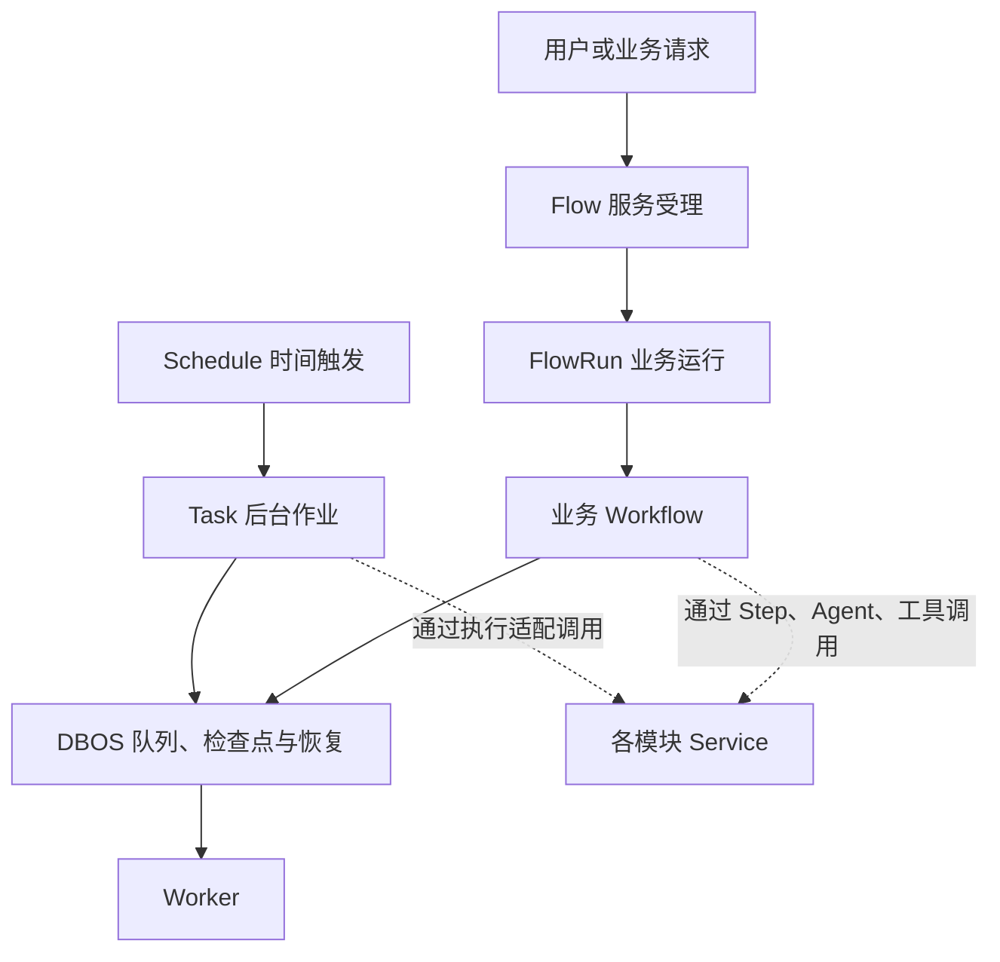
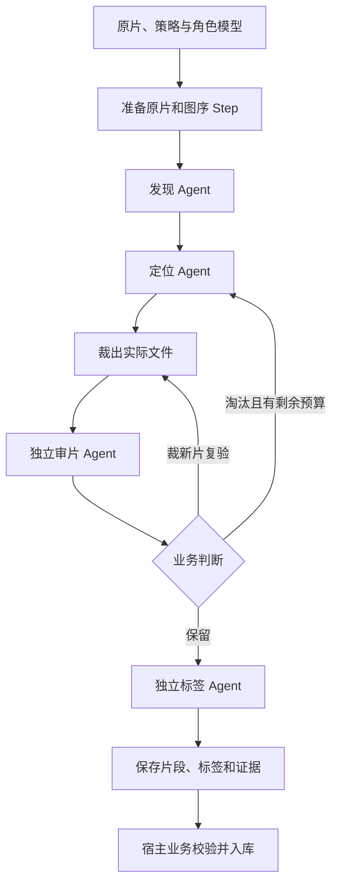

# 任务执行与模块规范设计

**状态：任务设施、三类维护迁移及 MVC + Service 目录归位已实现；Flow 扩展及素材粗选仍为目标设计。** 当前提供 core/execution/、模块 tasks/、TaskDefinition/TaskBinding、统一计划和投递。费用扫描/范围查询、文件清理及 Flow 同步使用统一任务入口和检查点。第 6 节 FlowPackage、多角色模型、数组文件路径及素材包适配尚未实现；相关代码块仍是设计示例。本文素材侧依据 `ether-flows-media-selection==0.17.0` 的粗选 v17、单段验收 v10 声明。当前源码入口见[整体架构第 3.7 节](architecture.md#37-现有实现与调整点)；现有业务接入见[新增业务](extending.md)。

本文统一任务声明、模块目录及执行边界。人工操作归具体业务模块，前后自动阶段拆成独立 Flow；资源状态、结果版本、决定及幂等衔接统一见 [Flow 领域第 8.3 节](domains/flow.md#83-业务人工操作与独立-flow-衔接目标设计)。本次不建设通用人工节点，不让 Run 跨人工操作悬挂。现有事务内受理能力可复用，具体业务审核仍需单独实现。

## 1. 概念、范围与当前差距

| 概念 | 定义 | 示例 |
|---|---|---|
| Module | 拥有业务事实、规则及公开操作 | model_access、files、素材库 |
| Task | 可独立投递的后台作业 | 费用扫描、范围核对、文件清理、Flow 协调 |
| Flow | 平台独立受理、授权和管理的业务流程 | 素材粗选、生成图片 |
| Workflow | DBOS 执行编排函数 | 步骤顺序、分支、循环、子任务投递 |
| Step | 记录结果的持久检查点边界 | 查库、文件操作、外部请求 |
| Schedule | 时间触发规则 | 每 5 秒触发扫描 |
| Worker | 承载执行器的进程 | 队列消费、恢复、身份与健康 |
| 人工操作 | 业务资源上的受权操作，决定是否发起后续自动阶段 | 审核一个结果版本，通过后受理新的 Flow |

Task 与 Flow 使用同一 DBOS 执行设施，保留各自的接入契约。Task 可以投递其他 Task；Flow 可以只有一步。耗时、步骤数量和是否包含 AI 都不是二者的分类依据。后台维护任务不创建 FlowRun，Flow 内每个工具或 Agent 也不自动注册为 Task。



| 能力 | 当前实现 | 目标设计 |
|---|---|---|
| 公共 DBOS 接入 | core/execution/ 技术包 | 已落地 |
| 系统任务入口 | files/model_access/flow 的 tasks/，共享声明、投递与计划 | 三类维护已迁移 |
| 普通 Service | 不直接依赖 DBOS | 保持此边界 |
| Flow 目录 | Definition、FLOW_DEFINITIONS、register_workflows | FlowDefinition、FlowPackage，轻量声明与执行导入分离 |
| 模型绑定 | 单个 model_field，选择写入 input | 多角色绑定，公开输入与执行选择分离 |
| 文件字段路径 | 对象点路径，末端 ID 或 ID 列表 | 增加受限数组路径，如 clips.*.file_id |
| 人工操作衔接 | 有事务内 Flow 受理、产物校验等服务；没有具体审核业务 | 业务保存决定、资源版本及关联，前后独立 Flow；不增加平台人工节点 |

普通查询、配置写入、手动同步查费继续直接调用 Service。Worker 心跳、连接维护等继续使用进程内异步循环。core/execution/ 只收拢 DBOS 技术接入，不增加执行领域、多引擎框架、通用 TaskRun/JobRun 表或自建检查点。

## 2. 当前目录与依赖规则

```text
keystone/
├── core/execution/
│   ├── contracts.py          # Task、Binding、Queue、Schedule 契约
│   ├── dispatch.py           # 投递、执行键、活动去重
│   ├── planning.py           # 显式声明、绑定与队列预算交叉校验
│   ├── schedules.py          # 计划安装、暂停与触发适配
│   ├── steps.py              # Step 异常脱敏等薄包装
│   ├── runtime.py            # DBOS 生命周期和技术观测
│   └── version.py            # 执行制品版本
├── platform/<module>/
│   ├── __init__.py
│   ├── catalog.py            # 按需：权限与审计静态声明
│   ├── controllers/
│   ├── schemas/
│   ├── models/
│   ├── services/
│   ├── adapters/             # 按需：网络、SDK、存储、技术协调
│   ├── tasks/
│   │   ├── definitions.py    # 轻量任务、计划声明
│   │   └── workflows.py      # 原生 DBOS 执行适配与依赖绑定
│   └── workflows/            # 按需：本模块的业务流程
├── businesses/<module>/     # 使用相同职责规则
├── worker/                  # 进程启动、身份、排空与健康
├── composition.py           # 显式装配
└── model_registry.py        # ORM 元数据显式注册
```

这些是当前职责目录，按需创建。模块根目录只允许包说明和 catalog.py；纯判断就近放 services/，复杂后再分 services/policies/。Model Access 的 inference/billing 及凭据、HTTP、协调能力已归 adapters/。Flow 定义改放 schemas/definitions.py；原宿主拆为 workflows/context.py 的活动执行作用域和 services/resources.py 的受权操作，执行身份归 services/identity.py，引擎客户端归 adapters/dbos.py，Agent/启动接入归 workflows/。本次不保留旧导入别名，也不新增 runtime/ 根分层。

| 位置 | 负责 | 边界 |
|---|---|---|
| controllers | HTTP 参数、身份提取、响应映射 | 不访问 ORM，不编排跨模块事务 |
| schemas | 输入输出与显式响应投影 | 不开事务、不调用服务 |
| models | 实体、字段、约束、索引 | 不执行用例或调度 |
| services | 用例、权限、事务、审计及领域查询 | 不导入 DBOS、Controller 或 Worker |
| adapters | 协议、SDK、存储等技术实现 | 不拥有业务授权、领域事务或任务策略 |
| tasks | Task 的 workflow/step、拆分与投递 | 允许 DBOS；领域读写通过 Service |
| workflows | 业务编排、步骤、Agent、工具与资源 | 允许 DBOS；通过公开服务或 FlowContext 使用能力 |
| catalog.py | 模块权限与审计动作字段白名单 | 只依赖 core.catalog，不导入运行实现 |

Controller/执行适配 → Service → 本模块 Model/技术适配器。跨模块调用公开 Service、Schema 或任务声明，不绕过权限直接查询其他模块的表。普通 Service 可被 HTTP 与 Step 共用。不增加 Module 基类、BaseService、通用 Repository、纯转发 public.py 或目录自动发现。

## 3. 任务、计划与投递接口

以下类型已在 core/execution/contracts.py 实现。input_model 使用禁止额外字段的 Pydantic 对象模型，维护入口统一接收一个不超过 64 KiB 的 JSON 对象；无参数使用 NoInput（拒绝额外字段）。旧入口不绑定到新协议，切换约束见第 9 节。

```python
@dataclass(frozen=True)
class TaskDefinition:
    key: str
    entrypoint: str
    input_model: type[BaseModel]
    queue: str
    timeout_seconds: int | None = None


@dataclass(frozen=True)
class TaskBinding:
    definition: TaskDefinition
    workflow: Callable[..., Awaitable[None]]
    enabled: bool = True
    monitor_key: str | None = None


@dataclass(frozen=True)
class QueueDefinition:
    name: str
    worker_concurrency: int
    global_concurrency: int


@dataclass(frozen=True)
class ScheduleDefinition:
    name: str
    tick_entrypoint: str
    task_key: str
    cron: str
    payload: dict
    timezone: str = "UTC"
    max_lateness_seconds: int | None = 10
    run_on_startup: bool = True
    backfill: bool = False
    overlap: Literal["allow", "coalesce"] = "coalesce"


async def enqueue_task(
    task: TaskBinding,
    payload: BaseModel | dict,
    *,
    execution_key: str,
    coalesce_key: str | None = None,
) -> ExecutionRef:
    ...
```

TaskDefinition.key 是稳定的平台标识；entrypoint 是实际 DBOS 名称，执行协议变化时可另起版本。声明在 API 中可轻量读取；TaskBinding 在 Worker 内通过工厂创建，注入窄依赖。服务对象、数据库会话、SDK、凭据、临时路径和完整应用 Runtime 不进入持久参数。

enqueue_task 接收运行时 TaskBinding，检查启用状态、输入、执行键和版本，内部使用 DBOS 原生投递；composition 显式汇总，由 planning.queue_budgets 校验任务键、队列/计划名称、任务与 tick/业务入口唯一性、目标任务与计划输入、绑定的 DBOS 函数名称及全部声明的队列预算。仅监听启用任务的队列。声明同时检查正整数限额、时区、迟到范围和重叠策略；cron 表达式由 DBOS 安装计划时检查。在 workflow 内保持可重放顺序，不允许从 Step 内拆分投递。ExecutionRef 指向实际执行，合并时返回已有执行引用。Task 不强制引入新的 TaskContext，执行标识可使用 DBOS 原生上下文；这些标识本身不授予业务权限。

| 标识 | 作用 | 生命周期 |
|---|---|---|
| execution_key | 同一次执行的稳定身份；调用方保证同键对应同一逻辑输入 | 完成后仍指向原执行 |
| coalesce_key | 合并排队/运行中的同类工作 | 结束后允许新执行占用 |
| Flow 的 flow:<run_id> | 恢复与补投同一次业务运行 | 不因恢复或协调轮次改变 |
| ModelInvocation.id | 模型发送登记与防重发 | 不能因模型结果未知换 ID 重发 |

只传 execution_key 即可独立投递，重复键按 DBOS workflow_id_reuse_policy 返回同一执行。只有提供 coalesce_key 时才设置队列的 deduplication_id/duplication_policy；overlap=allow 使用前一种形式。两种幂等语义不混用。公共设施给活动键附加执行版本。队列合并不能替代领域锁；不同订单或不同生成请求不能按任务类型合并。扫描类触发上一轮未结束时复用活动执行，结束后下一轮重新读取当前待办。

计划启用状态取自目标 TaskBinding，禁用后暂停持久计划、不消费仅属于该能力的队列，并保留执行入口的禁用检查，防止残留 tick 执行。共享队列只有在仍有启用消费者时才监听。当前三项维护计划保留每 5 秒、UTC、启动触发、不补历史、超过 10 秒旧触发略过、活动合并。迟到限制只约束首次触发受理，不是执行超时。

必须逐次处理的计划使用 overlap=allow 和独立执行键，不丢弃必要时间窗口。时间触发业务 Flow 时，仍通过受权业务服务创建 FlowRun，不能跳过受理和幂等。

## 4. 检查点、失败与观测

原生 workflow 负责分支、循环和子执行投递。扫描、外部请求、文件访问等非确定性操作放在 Step，普通 Service 仍无 DBOS 依赖。Flow 引擎幂等投递/取消之前的实时观察与授权有意在每次重放重新执行，防止用已缓存计划授权副作用；这些操作不增加或重排检查点，也不改变固定业务执行 ID。safe_step 是单层 DBOS.step 薄包装，负责在检查点写入前转换安全错误；不会为整个 handler 或整个 Agent 建一个自动重试的大 Step。

```python
def safe_step(*, name: str, retries_allowed: bool = False, max_attempts: int = 3):
    ...
```

异常保护必须覆盖每个 Step 的返回值/异常持久化边界。Step 只返回经领域控制的最小结果，safe_step 不自动清洗返回对象；禁止返回凭据、完整供应商响应或运行时句柄。只在外层 workflow 捕获异常不足以阻止内部 Step 保存原始异常。当前维护 Step 将异常统一转换为代码声明的稳定内部码，不直接持久化 ServiceError 的消息；Flow 结果仍按原白名单投影；原始供应商正文、凭据和异常消息不进入公开视图或引擎错误记录。

进程中断由 DBOS 恢复原执行；未处理异常结束本次执行，不等于无限重试。明确允许的只读操作可设置有界 Step 重试；费用等待策略、分页、截止和后续轮次由所属模块持久状态驱动。没有待办是正常结束；本轮执行正常不表示所有费用已确认、所有文件已清完或所有 Flow 已结束。

模型结果未知时仍使用原发送登记及防重发规则。DBOS 检查点不能单独保证第三方 API 只计费一次。自定义 Agent I/O 工具显式建立 Step 边界，保留 DBOSDurability 的模型请求检查点，不重写 Agent 循环。

Worker 进程健康与共享任务进度分别观测。没有轮到某 Worker 执行不判其进程不健康；同时观察依赖、最近维护尝试、失败和积压，不能用空扫描成功掩盖长期未决。现有安全审计与原身份规则保留。

官方语义依据：[Workflow 确定性](https://docs.dbos.dev/python/tutorials/workflow-tutorial#determinism)、[Step 与投递边界](https://docs.dbos.dev/python/tutorials/step-tutorial)、[执行保证](https://docs.dbos.dev/python/tutorials/workflow-tutorial#workflow-guarantees)。接口落地仍以锁定 SDK 为准。

## 5. 三类维护场景

### 5.1 费用扫描与范围核对

当前入口位于 [model_access/tasks/workflows.py](../backend/src/keystone/platform/model_access/tasks/workflows.py)。CostService.scopes/reconcile、费用页进度、截止、范围锁、共享容量和账务规则继续归 Model Access。

```python
COST_SCAN = TaskDefinition(
    key="model_access.cost_scan",
    entrypoint="keystone.model_access.cost_scan",
    input_model=NoInput,
    queue="keystone-model-maintenance",
)
COST_SCOPE = TaskDefinition(
    key="model_access.cost_scope",
    entrypoint="keystone.model_access.cost_scope",
    input_model=CostScopeInput,
    queue="keystone-system",
)

# costs 由 Worker 注册工厂绑定，不作为持久参数。
@safe_step(name="model_access.find_due_scopes")
async def find_due_scopes():
    return await costs.scopes()

@safe_step(name="model_access.reconcile_scope")
async def reconcile_scope(scope):
    try:
        await costs.reconcile(scope)
    except ServiceError as error:
        if error.code in {"model_refresh_busy", "model_capacity_busy"}:
            return  # 本轮暂缓；原待办不丢失，也不消耗供应商错误预算
        raise

@DBOS.workflow(name=COST_SCAN.entrypoint)
async def scan(payload):
    NoInput.model_validate(payload)
    for scope in await find_due_scopes():
        await enqueue_task(
            scope_task,
            CostScopeInput(scope=scope),
            execution_key=f"cost-query:{DBOS.workflow_id}:{scope}",
            coalesce_key=f"cost:{scope}",
        )

@DBOS.workflow(name=COST_SCOPE.entrypoint)
async def check_scope(payload):
    data = CostScopeInput.model_validate(payload)
    await reconcile_scope(data.scope)

scope_task = TaskBinding(COST_SCOPE, check_scope)
```

扫描与慢账务 HTTP 隔离；扫描 Task 不等待范围 Task 完成。手动查费直接调用同一 Service，继续争用同一范围锁和覆盖 API/Worker 的共享容量。本轮完成但尚未出账时，持久化下次检查时间后返回，后续新扫描再发现。

### 5.2 文件清理

当前入口位于 [files/tasks/workflows.py](../backend/src/keystone/platform/files/tasks/workflows.py)，规则继续位于 [services/cleanup.py](../backend/src/keystone/platform/files/services/cleanup.py)。保留现有数据库/存储预检、每轮 20 个候选、文件互斥、引用检查、状态复核与失败轮换，仍使用有界批次。

```python
@safe_step(name="files.cleanup_batch")
async def cleanup_batch():
    # 保留依赖预检及其观测；领域函数内部继续负责幂等。
    await cleanup(database, storage, limit=20)

@DBOS.workflow(name=FILE_CLEANUP.entrypoint)
async def cleanup_workflow(payload):
    NoInput.model_validate(payload)
    await cleanup_batch()
```

这个有界批次允许中断后重入；已删除内容但未落库时，仍须安全处理同一个登记对象键。不会仅因进入过 Step 就认定删除完成。

### 5.3 Flow 补投、取消与状态同步

原混合协调已拆为 [services/reconciliation.py](../backend/src/keystone/platform/flow/services/reconciliation.py) 的领域事务和 tasks/workflows.py 的执行适配，不能整体包成 Step。以下示意服务边界，实际函数接收显式 runtime/identifier/state：

```python
# services/reconciliation.py（领域函数，无 DBOS 依赖）
async def claim_batch(runtime): ...            # 最多 25 个 Run ID
async def prepare(runtime, identifier, state): ...  # submit/cancel/project/skip
async def submission(runtime, identifier): ...  # 实时原身份复查
async def project(runtime, identifier, state, *, submission_error=None): ...

# tasks/workflows.py（示意，实际含错误保护与当前状态复核）
@DBOS.workflow(name=RECONCILE.entrypoint)
async def reconcile_pass(payload):
    NoInput.model_validate(payload)
    for identifier in await claim_batch_step():
        await sync_run(identifier)  # 内部子 workflow 固定单条超时/失败

@DBOS.workflow(name="keystone.flow.sync_run")
async def sync_run(identifier):
    action = await prepare_step(identifier)
    if action == "submit":
        await enqueue_if_still_authorized(identifier)  # 稳定 ID；独立取消域
    elif action == "cancel":
        await cancel_if_still_requested(identifier)
    await observe_and_project_step(identifier)

```

claim/prepare/project 是 Step 适配；每条 Run 使用内联 DBOS 子 workflow 固定 15 秒超时/失败结果，避免超时分支改变外层批次的重放步骤顺序。通过公开服务查询引擎与 Run、检查版本和必要授权、锁定并保存业务事实。投递位于 workflow 层；submit/cancel 是引擎安全操作，不能隐藏在普通 Service 或整个 reconcile 大 Step 中。维护 Task 不等待业务 Flow，也不递归取消其投递的业务执行；业务 Run 及其执行后代构成自己的取消域。

prepare 的结果在恢复时可能变旧，不能代替实际业务执行前的原身份复查。project 重新观察并校验执行标识、版本、入口及观察新旧，不覆盖已有终态。保留公平扫描的 reconcile_attempted_at、每轮 25 条与单条 15 秒边界。已完成执行的结果按系统协调规则落库，不因发起人后来撤权而丢失事实。投递授权失败后仍先重新观察引擎；只有未发现引擎执行且没有取消意图时，才将 Run 记为 execution_not_authorized。不能在投影前抢先写失败终态，覆盖其他协调执行刚完成的结果。

## 6. 业务 FlowPackage 与素材粗选

### 6.1 包与宿主边界

独立 Flow 包拥有业务算法和编排；宿主拥有账户、ModelEntry、文件授权、FlowRun 与业务入库。目标稳定公开边界先放在轻量 Flow 契约和宿主接口模块，声明模块不导入 ORM、API、Agent 或重型媒体依赖，不预建独立 SDK 工程。

```text
media_selection/
├── definitions.py             # FlowPackage 与轻量流程定义
├── domain/
├── adapters/
└── workflows/
    ├── select_material_v17/
    │   ├── contracts.py
    │   ├── workflow.py
    │   ├── steps/
    │   ├── agents/
    │   ├── tools/
    │   ├── prompts/
    │   └── skills/
    └── review_segment_v10/
```

目标声明示例，字段、路径与模型名称均由可信代码固定：

```python
selection = FlowDefinition(
    key="media_selection.select_material",
    revision="17",
    name="素材粗选与标签",
    description="发现、定位并验收实际片段，返回标签与证据。",
    entrypoint="media_selection.select_material.v17",
    input_model=SelectionInput,
    output_model=SelectionResult,
    required_permissions=(
        "file:content_read", "file:create", "file:inspect", "file:manage", "model:invoke",
    ),
    file_fields=("source_file_id", "review_calibration.*.file_id"),
    model_fields={
        "discover": "models.discover",
        "locate": "models.locate",
        "review": "models.review",
    },
    output_file_fields=(
        "clips.*.file_id", "evidence_file_id", "artifact_manifest_file_id",
    ),
    timeout_seconds=3600,
)

PACKAGE = FlowPackage(
    key="media-selection",
    host_api_version=1,
    definitions=(selection, segment_review),
    execution_modules=(
        "media_selection.workflows.select_material_v17.workflow",
        "media_selection.workflows.review_segment_v10.workflow",
    ),
    execution_packages=("media_selection",),
    required_resources=(...),
)
```

API 只读取轻量流程定义与输入输出契约；Worker 显式导入执行模块。资源清单、代码和锁定依赖进入制品版本。revision 标识业务契约，execution_version 标识完整制品，二者都不表示可以跨制品重放旧检查点。

### 6.2 输入、执行绑定与受控能力

新 Run 的 input 保留已验证业务输入；角色模型选择、契约 revision 与限制进入有版本标识的 definition_snapshot。先按原始提交与凭据范围处理幂等，命中旧请求返回原 Run；只有新请求才解析默认 revision 和模型。模型角色字段使用已登记 ModelEntry 的 Key，受理事务固定全部选择，执行前复查当前授权/配置但不静默换模型。历史 Run 保持原 input/快照格式及读取规则，不批量改写。

FlowContext 只提供当前 Run 的业务输入、受控文件与产物、按固定角色调用模型、执行身份/取消检查和有界工具运行。它不暴露整个 Runtime、会话或凭据。上传授权目标由宿主限定，产物键稳定且原子保留引用。每个自动阶段结束时释放临时文件、子进程、模型客户端和容量许可，后续 Flow 从持久业务版本和文件引用重建输入，不复用前一个 Run 的临时上下文。

文件路径只扩展明确的对象字段与数组 *，按 Schema 校验位置、可空性和数量；不是任意 JSONPath。输出先通过原契约及业务验收，再登记文件引用。大内容留在受控 File，不进入输入、结果或检查点。

### 6.3 素材粗选的执行与真实差距



流程继续以原生 workflow/step 和 DBOSDurability 表达，保留有界候选循环及补查。独立单段验收可以单独提供 Flow 入口，粗选内部复用验收能力不要求逐段创建 FlowRun。技术失败、成功零结果与业务淘汰分别处理。素材流程仍按既定规则直接入库；若具体业务要求人工审核，由业务资源上的普通操作承接，通过后另行受理后续 Flow，不在粗选内部插入人工节点。

| 能力 | 当前差距/归属 |
|---|---|
| 多角色模型 | Keystone 只有单个 model_field；需扩展显式绑定 |
| 模型选择 | Ether v17 可在连接引用上补模型名；接入时改为受理时固定 ModelEntry 角色 |
| 集合文件引用 | 当前 Keystone 不支持 clips.*.file_id 等路径 |
| 多模态与预算 | 当前请求体大小、输出 token 等限制需按受控媒体能力核验，不能直接放开 |
| 宿主 API | ether-flow 与 Keystone 文件、模型、授权接口不同；需适配并验证 |
| 模型/文件恢复 | 保留原发送登记、稳定产物键、权限与取消检查，需受控场景验收 |
| 生图/生视频 | 供应商协议与异步任务结果查询仍需 Model Access 实现，不随目录迁移自动获得 |

## 7. 队列、装配与事实归属

现有五个队列及预算保留。新增 Worker 不自动提高共享容量；队列限额不替代覆盖 API/Worker 的领域共享许可。

| 队列 | 内容 | 每 Worker / 全局默认 |
|---|---|---|
| keystone-model-maintenance | 费用扫描 | 1 / 1 |
| keystone-system | 范围查费 | 2 / 2 |
| keystone-files-maintenance | 文件清理 | 1 / 1 |
| keystone-flow-maintenance | Flow 协调 | 1 / 1 |
| keystone-flows | 业务 Flow、Agent | 2 / 4 |

```python
# 当前 composition 显式调用各模块工厂；不增加 WorkerPlan 或通用 handler 运行器。
bindings, install = model_tasks.register(runtime, health)
# 汇总各工厂绑定，检查任务键/入口唯一性与启用任务的队列预算。
# Worker 在 DBOS 启动之后 await install()，稳定计划安装/暂停后再就绪。
# FlowPackage 的装配留待后续，当前继续使用 FLOW_DEFINITIONS/register_workflows。
```

composition 创建依赖并汇总声明；core/execution/ 不反向导入 composition 或领域模块。启动顺序为身份与共享配置准入 → 声明校验/入口注册 → 原有恢复准备 → 队列预算持久化并复核身份锁 → DBOS 启动 → 计划安装/暂停 → 就绪。API 不启动执行器。关闭 Flow 不关闭费用核对及已启用文件维护。

| 事实 | 归属 |
|---|---|
| 费用待核对、页进度、下次检查 | ModelInvocation / Channel |
| 文件删除、引用与清理事实 | File / FileReference / 审计 |
| Flow 受理、取消意图、业务结果 | FlowRun |
| 素材、采用与编辑事实 | 宿主业务资源及自身文件引用 |
| 审核状态、决定、资源版本及阶段 Run 关联 | 所属业务资源、必要的决定历史与文件引用；不增加平台人工待办 |
| 执行、检查点、队列、计划和消息 | DBOS |

业务事务先提交可扫描的持久待办，Worker 再发现。当前三类维护工作不增加通用 outbox；业务批准、后续 pending FlowRun、关联及审计在同一事务保存，Worker 通过既有 Flow 扫描补投，不依赖提交后发通知或临时后台协程。未来不可从领域事实重建的事件需单独设计事务投递，不能承诺业务提交与任意引擎调用天然原子。

## 8. 人工操作与独立 Flow 衔接

采用“Flow A 生成/分析 → 保存可审核的业务结果版本 → 人工业务操作 → Flow B 发布/后处理”。A、B 各有独立 FlowRun、输入、身份、执行版本和预算。A 处理完即正常结束，人工未操作期间没有悬挂的 workflow，也不占用执行队列。完整业务过程由业务资源的状态与关联串联。

生成结果、审核决定与后续执行是三个独立事实：A 成功不表示已批准；驳回不把 A 改成失败，也不创建 B；批准后 B 仍可失败或取消，不能倒改批准。结果先经业务采用并保存版本、来源 Run 和文件引用，再允许审核；人工编辑生成新业务版本，不改 A 的 input/result。后续只处理明确批准的版本。

批准即继续的业务在同一事务校验当前操作者及后续执行权限、锁定资源版本、保存决定、调用现有 start_in_transaction() 创建 B 的 pending Run，再保存关联及审计；失败全部回滚。逻辑动作由业务唯一约束保障，重复提交先读取原关联，不反复调用 Flow 受理。Flow 自身按 actor_id/request_key 去重不能替代跨操作者的业务幂等。B 的重试必须显式建立新业务尝试，核实原执行与副作用后再受理。

完整状态矩阵、代码示例与竞争规则见 [Flow 第 8.3 节](domains/flow.md#83-业务人工操作与独立-flow-衔接目标设计)。当前只有平台基础服务，没有具体审核业务或端到端衔接实现。本次不增加通用人工待办、人工等待队列或消息唤醒 API。

## 9. 迁移与验收

| 阶段 | 工作 | 验收重点 |
|---|---|---|
| 1（已实现） | MVC + Service 目录归位、轻量声明、公共执行接入 | 显式装配、依赖方向、共享配置一致性 |
| 2（已实现） | 三类维护入口与 Step 边界 | 恢复、活动合并、队列隔离、查费共享锁、协调安全 |
| 3 | FlowPackage、角色模型、数组文件路径及宿主契约 | 幂等受理、固定快照、授权、产物、版本与取消 |
| 4 | 素材包适配 | 媒体与模型受控场景、预算、未知结果不重发、结果入库 |
| 可选业务扩展 | 按业务需要实现人工操作及独立后续 Flow | 资源版本、结果采用、决定与 Run 的事务关联、跨操作者幂等、显式重试 |

三类维护、tick 和内部步骤只保留最新实现，执行入口不附加版本后缀，不保留旧签名的兼容分支；计划名、队列名和 execution_key 前缀保留。执行版本继续由制品指纹判断，不依赖入口名后缀；目录移动也改变当前制品哈希；切换前处理旧在途执行，或用原制品和原身份恢复收尾。计划名、队列名和逻辑任务键尽量稳定，旧参数格式与检查点不能被新代码冒充兼容。保留旧导入/函数名不足以跨版本恢复，更不能通过新 Run/调用 ID 重发未知模型请求。不直接删除 DBOS 执行来释放容量。

架构检查递归覆盖 platform/ 和 businesses/：普通 Service 等分层不能直接或经 core/execution 的实现包依赖 DBOS/Worker，嵌套任务适配也不能直接访问 ORM，轻量任务声明不依赖服务或执行实现，core/execution/ 不反向导入 composition 或领域。同一检查还覆盖根目录纯声明、允许的一级目录、MVC 依赖方向、协议适配器隔离及脚手架输出；Flow 宿主与协议目录已完成归位。

验收至少覆盖多 Worker 共用计划/预算、活动去重与执行 ID 分离、扫描中断恢复、慢清理不阻塞协调、旧观察不覆盖终态、禁用残留触发、原身份撤权、未知模型结果、输入输出/文件数量上限。采用人工衔接的业务另验收资源变更、跨操作者重复批准、相反决定竞争、批准与 B 受理同事务回滚、提交响应丢失及 B 失败后的显式重试。结构检查、受控执行和真实业务质量分别记录，不能相互替代。
