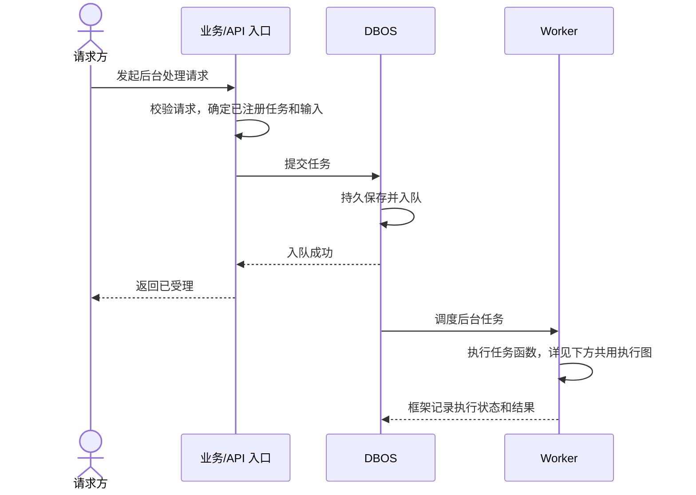
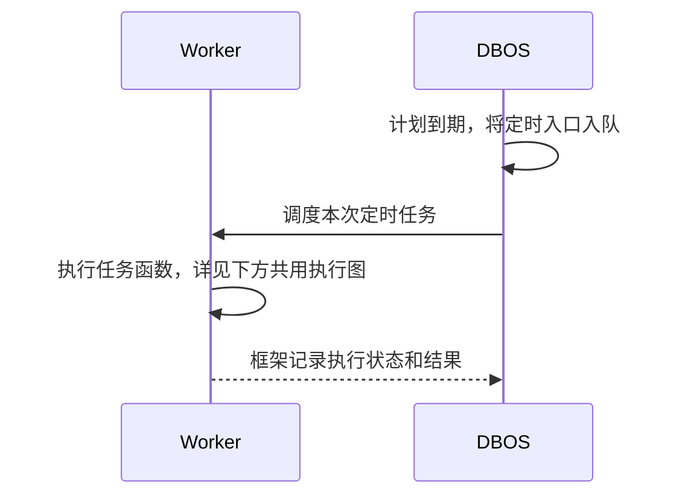
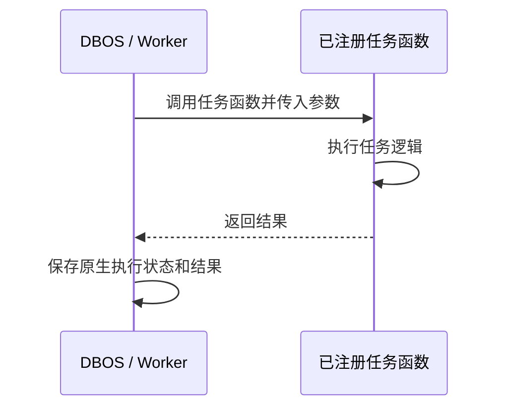

# 任务执行

Task 是可独立投递的后台作业，DBOS 保存输入、队列、状态和结果；普通 Task 不要求领域实体、独立 Service 或 FlowRun。core/execution 管公共设施，任务函数组合普通函数，涉及领域授权和数据变更时调用所属 Service。

## 核心主流程总览

主动提交，入队持久化后即可返回：



任务可在响应前开始，提交响应不等待执行完成。enqueue_task 返回 ExecutionRef/任务 ID，它是入队回执，是否对外展示由业务决定。

定时执行，前提是计划已登记：



共用执行过程：



| 阶段 | 持久事实 |
|---|---|
| 已入队 | DBOS 保存输入和排队记录 |
| 执行中 | 原生状态及 Step 检查点 |
| 完成 | 原生成功/失败和受控结果；领域变更另由所属 Service 保存 |

不变量：提交成功以持久入队为准；只执行注册入口；不重复建设任务状态表；领域操作遵守原授权、事务和幂等。

API/CLI 使用 Runtime 装配的 TaskClient 直接持久投递，不启动 DBOS 执行器；Worker 内使用 enqueue_task。现有维护计划使用薄 tick 处理参数、合并和迟到，忽略执行引用。

## 1. 选择执行入口

| 需求 | 入口 |
|---|---|
| 查询、配置、普通写入、有界手动操作 | 同步 Service |
| 独立后台或定时执行 | Task |
| 独立受理、查询、取消且有输入/结果契约 | FlowRun＋原生 Workflow/Step |
| 心跳、连接、进程监控 | 生命周期管理 |
| 人工决定 | 业务 Service，后续自动化另行受理 Flow |

耗时、步骤数和是否 AI 不决定分类，Flow 的工具/Step 不自动注册为 Task。

## 2. 声明与装配

轻量契约位于 core/execution/contracts.py，导入不注册执行器。

| 类型 | 字段 |
|---|---|
| TaskDefinition | key、entrypoint、input_model、queue、timeout_seconds=None |
| TaskBinding | definition、workflow、enabled=True、monitor_key=None |
| QueueDefinition | name、worker_concurrency、global_concurrency |
| ScheduleDefinition | name、tick_entrypoint、task_key、cron、payload、timezone、max_lateness_seconds、run_on_startup、backfill、overlap |
| ExecutionRef | workflow_id |

input_model 禁止额外字段，序列化为最高 64 KiB JSON 对象，无参数用 NoInput。声明检查非空名称、无首尾空白、正限额及选项，cron 安装时由 DBOS 验证。

tasks/workflows.py 工厂返回 TaskBinding，按需注入 Service；composition 显式汇总，queue_budgets 检查任务/入口/计划/队列名称、绑定、输入与预算，只监听启用队列。持久参数不含 Session、Runtime、SDK、凭据、临时路径或句柄，代码接入见[规范](development/business.md#模块目录与后台任务)。

## 3. 投递与合并

```python
async def enqueue_task(
    task: TaskBinding,
    payload: BaseModel | dict,
    *,
    execution_key: str,
    coalesce_key: str | None = None,
) -> ExecutionRef:
    ...
```

API/CLI 在完成业务授权后调用 `await runtime.tasks.enqueue(definition, payload, execution_key=key)`，只传可信代码中的 TaskDefinition，不导入任务执行模块。TaskClient 校验输入、执行键和当前制品版本，原生持久入队后返回 ExecutionRef；连接、取连接及单条 SQL 等待上限为 3 秒，由 Runtime.close 释放客户端连接。任务及队列仍须在 composition 显式注册。

Worker 的 enqueue_task 还检查绑定是否启用。Workflow 层保持确定顺序，不在 Step 中拆分投递；合并返回已有执行引用。API/CLI 的功能启用和操作授权由业务入口检查，不提供接收任意任务名、执行版本或导入路径的公共投递接口。

| 标识 | 含义 |
|---|---|
| execution_key | 同次逻辑执行，完成后仍指原执行；调用方保证输入一致 |
| coalesce_key | 只合并活动工作，完成后可新一轮，自动带 execution_version |
| flow:<run_id> | 同一 Run 的补投与恢复 |
| ModelInvocation.id | 同一模型尝试，唯一发送登记 |

仅提供 coalesce_key 才设置 DBOS deduplication，逐次事件不能按类型合并。队列去重不替代领域唯一约束或外部副作用防重。

领域变更需与后续投递衔接时，使用该领域持久事实及受理规则，不依赖提交后临时协程。Flow、文件和费用的领域扫描是具体维护需求，不是所有 Task 的前提。

## 4. 持久计划

代码声明、DBOS 数据库保存。Worker 初始化加载入口并启动 DBOS 后 apply_schedules，按稳定名称创建/更新；多 Worker 共用同一计划，不按进程复制。初始化登记与每次到期执行分开。

默认 cron=*/5 * * * * *、UTC、max_lateness=10 秒、run_on_startup=True、backfill=False、overlap=coalesce。迟到约束首次受理，不是执行超时。禁用目标时暂停计划并保留残留 tick 的禁用检查，共享队列仍可供其他任务使用。

维护 tick 适配 scheduled_at/context 后只投递，不等待子任务；统一保留 UTC、启动立即扫描当前待办、coalesce 合并活动执行和 no backfill（停机不补全部时间片）。具体周期与首次受理迟到窗口如下；窗口按周期分别设置，避免低频维护仍因默认 10 秒窗口过度跳过，但不保证拥堵时每次触发均执行。

| 计划 | cron（秒在首位） | 周期 | 最大迟到 |
|---|---|---|---|
| keystone.flow.reconcile | `*/5 * * * * *` | 5 秒 | 10 秒 |
| keystone.files.cleanup | `0 */5 * * * *` | 5 分钟 | 60 秒 |
| keystone.model_access.reconcile_costs | `0 * * * * *` | 1 分钟 | 45 秒 |
| keystone.history.retention（启用时） | `0 0 * * * *` | 1 小时 | 300 秒 |

队列预算见[第 7.2 节](#72-队列预算)。

## 5. Step、失败与恢复

原生 Workflow 管分支、循环、子执行和等待；外部 I/O 等非确定性操作放 Step。safe_step 是单层 DBOS.step 和安全错误包装，不自动清洗返回值；返回须由领域投影为小型安全数据。

Agent 使用 DBOSDurability 原生模型检查点，I/O 工具显式建 Step，不对整个 Agent 自动重试。Flow 投递/取消前的授权观察在重放时重新执行，不复用旧授权或改动稳定业务 Step。

原版本恢复原执行，只读操作可明确有界重试，模型发送不隐藏重试。检查点不保证第三方 exactly-once；未知结果和费用待办按领域规则处理。

安全步骤的幂等声明、3 秒起步退避、分类与取消见 [Flow 重试契约](domains/flow.md#73-平台步骤重试)。物理盘不足按 [文件容量契约](domains/files.md#51-文件容量与临时目录)立即失败；文件操作无数量槽位，也无临时总额等待队列。

## 6. 当前任务与事实

| Task | 所属 Service | 执行适配 |
|---|---|---|
| 费用扫描/范围核对 | 范围、凭据、冷却、分页、证据、金额 | 扫描、合并、Step、进度 |
| 文件清理 | 引用、删除、存储锁、失败待办 | 有界轮次及观测 |
| Flow 协调 | 原授权/契约、取消、结果/引用、终态 | 观察、幂等投递/取消、同步 |

没有待办是正常结束，不证明所有业务均已完成；领域终态也不证明 DBOS 检查点已结束。

## 7. Worker 与资源

### 7.1 启动与身份

Worker 顺序：取得宿主/固定身份锁 → 校验登记、制品和配置 → 收尾本身份旧调用 → 写入队列预算 → 启动 DBOS → 登记计划 → 就绪。预算先于引擎恢复，未准入进程不能修改。

公共 DBOS 生命周期在 core/execution，模块 tasks/ 管执行适配，业务 workflows/ 管编排；运行契约见 [Flow](domains/flow.md)。

### 7.2 队列预算

| 队列 | 每 Worker 默认 | 全局默认 |
|---|---:|---:|
| keystone-flows | 2 | 4 |
| keystone-files-maintenance | 1 | 1 |
| keystone-flow-maintenance | 1 | 1 |
| keystone-model-maintenance | 1 | 1 |
| keystone-system | 2 | 2 |
| keystone-history-maintenance | 1 | 1 |

DBOS 执行线程池通过锁定版本 3.2.0 支持的 `DBOS(config={"max_executor_threads": 32, ...})` 固定为每 Worker 最多 32 个执行线程；它不是异步 Workflow 并发上限，也不限制全部 SDK 后台线程。

**内部队列限制尚未实现**：3.2.0 的 `_dbos_internal_queue` 是 SDK 私有内存队列，公共 `register_queue` 拒绝内部保留名称，Queue 动态配置仅支持数据库队列，`DBOSConfig` 没有内部队列并发配置。因此当前不能通过受支持 API 保证内部队列每 Worker 并发 ≤ 2；不修改 SDK 私有属性、不 monkeypatch，也不以线程池大小代替队列保证。上表维护业务队列仍为原有 1/1；监听业务队列列表不排除 SDK 内部队列。

新增 Worker 不增加全局预算。DBOS 两级并发与 API/Worker 的模型、账务 HTTP 共享容量分别生效，见[配置](operations/configuration.md)。

实际 HTTP 跨 API/Worker 共用容量和真实 Token 范围锁，不能用本地 Semaphore 替代全局约束。

### 7.3 多 Worker、恢复与发布

支持同宿主、同版本的固定 Worker 身份，成员增加不要求其他进程重启。身份登记保存 executor_id、宿主/协调卷、制品/公共配置摘要及实例/退役事实，同时持 OS 和 PostgreSQL 会话锁；失锁停止，禁止换连接提交。

失联但未退役的身份仍参与兼容检查，心跳超时不能证明安全退役。启动仅收尾本身份旧实例的 running 调用；共享排队任务可由匹配版本 Worker 领取。

缩容先排空，再持原身份锁核实 DBOS 在途/待恢复执行及 running 调用已清空，最后退役；查询失败或截断不算清空，未分配共享任务不随退役取消。

不混跑新旧制品，代码/目录/声明/资源变化均影响执行版本，保留原制品和身份完成在途。命令见[部署](operations/deployment.md)与[备份恢复](operations/backup-restore.md)。

### 7.4 健康状态

API readiness 检查数据库、迁移和存储，不自动建表。Worker 分别报告进程/依赖与共享任务进度；未领任务不等于故障，空扫描不能掩盖积压。公开状态不含秘密或私有运行句柄。

模型协议只返回结果/回执，不调度 DBOS 或保存领域状态，原任务等待和费用核对由宿主执行设施组织，见[模型分层](reference/model-access.md#代码与接口边界)。

SDK 语义参考：[确定性](https://docs.dbos.dev/python/tutorials/workflow-tutorial#determinism)、[Step](https://docs.dbos.dev/python/tutorials/step-tutorial)、[队列](https://docs.dbos.dev/python/tutorials/queue-tutorial)、[计划](https://docs.dbos.dev/python/tutorials/scheduled-workflows)；行为以项目锁定版本及原生集成验证为准。
